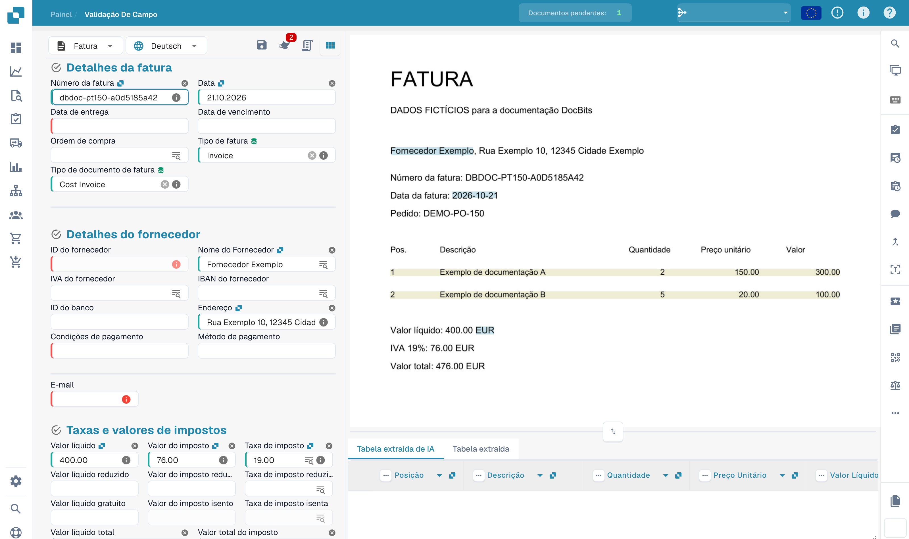
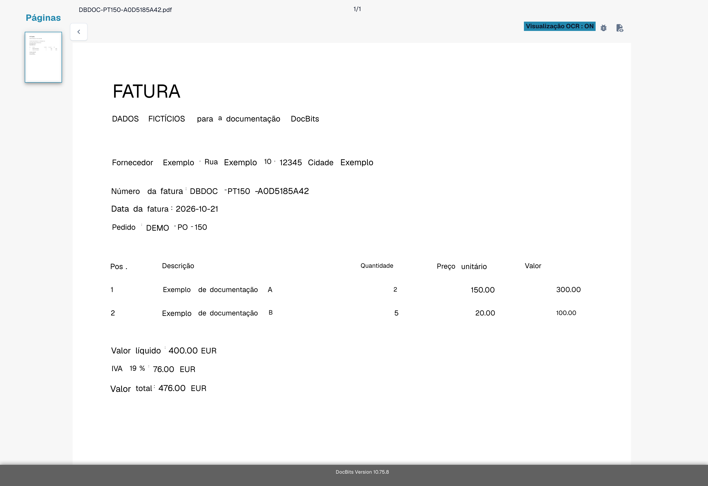
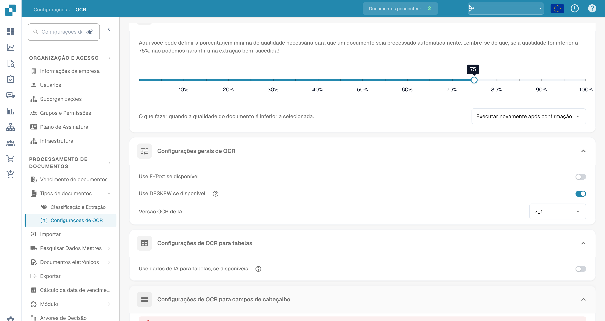
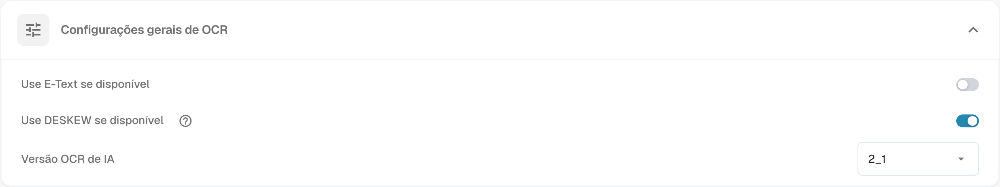

# Texto Ausente na Extração de OCR


DocBits OCR & E-Text Explained: OCR View, Debug Mode, Quality Settings, Deskew & Header Extraction


## **Problema**

Em alguns casos, o texto pode parecer estar ausente na **Visualização OCR**, o que impede que seja extraído usando o recurso de extração.

<figure><figcaption>
Verificação dos campos de uma fatura fictícia.
</figcaption></figure>

Para verificar isso, clique no botão **Visualização OCR** na barra de ferramentas à direita. Se o texto não aparecer lá, isso significa que não está disponível para extração.

<figure><figcaption>
Vista OCR do texto reconhecido na fatura fictícia.
</figcaption></figure>

## **Causa**

A causa mais provável é que o texto que você está tentando extrair faz parte de uma imagem (por exemplo, um logotipo ou seção escaneada) dentro do documento.\
Quando o recurso E-Text está habilitado, o texto que aparece em imagens ou logotipos não é incluído na camada de texto extraído. Como resultado, esse texto não pode ser acessado ou extraído através da lógica de extração padrão.

## **Solução**

Para resolver esse problema, desative o recurso E-Text—seja para o [fornecedor específico](missing-text-in-ocr-extraction.md#desativar-e-text-para-um-fornecedor-especifico) ou para a [organização inteira](missing-text-in-ocr-extraction.md#desativar-e-text-para-a-organizacao-inteira). Uma vez que o E-Text esteja desativado, o DocBits dependerá exclusivamente do OCR, que é capaz de extrair texto de imagens e logotipos dentro do documento.

### **Desativar E-Text para um Fornecedor Específico**

1. Abra um documento do fornecedor específico na **Validação de Campo**.
2.  Clique no menu de três pontos na barra de ferramentas à direita.

<figure><figcaption>
Menu de opções adicionais da validação de campos.
</figcaption></figure>

3.  Desmarque **Use E-Text se disponível**.

<figure><figcaption>
Opção de texto eletrónico no menu do documento.
</figcaption></figure>

4.  Clique em **Confirmar** para reiniciar o processamento do documento.

<figure><figcaption>
Confirmação antes de alterar a utilização do texto eletrónico.
</figcaption></figure>

### Desativar E-Text para a Organização Inteira

1.  Vá para **Configurações → Processamento de documentos → Configurações de OCR**.

<figure><figcaption>
Definições de OCR na interface em português.
</figcaption></figure>

2.  Na seção **Configurações gerais de OCR**, desmarque a opção **Use E-Text se disponível**.

<figure><figcaption>
Definições gerais de OCR com opção de texto eletrónico.
</figcaption></figure>

As imagens utilizam uma fatura fictícia com texto OCR disponível. Mostram controlos da interface, não um incidente reproduzido de texto em falta.
