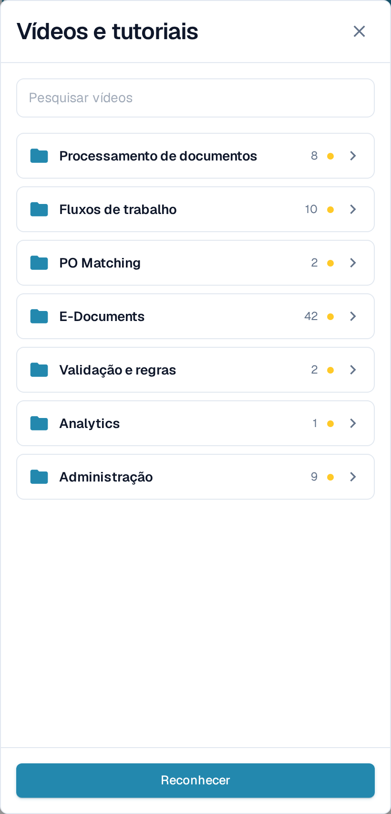
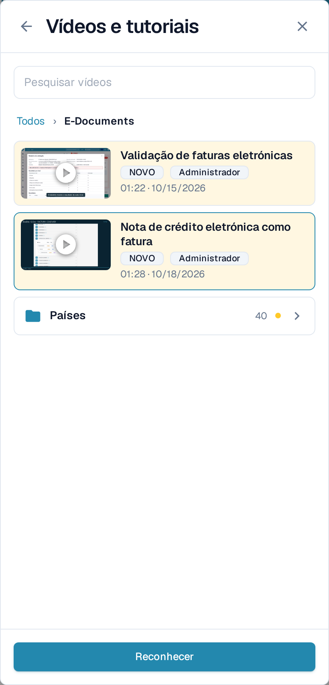
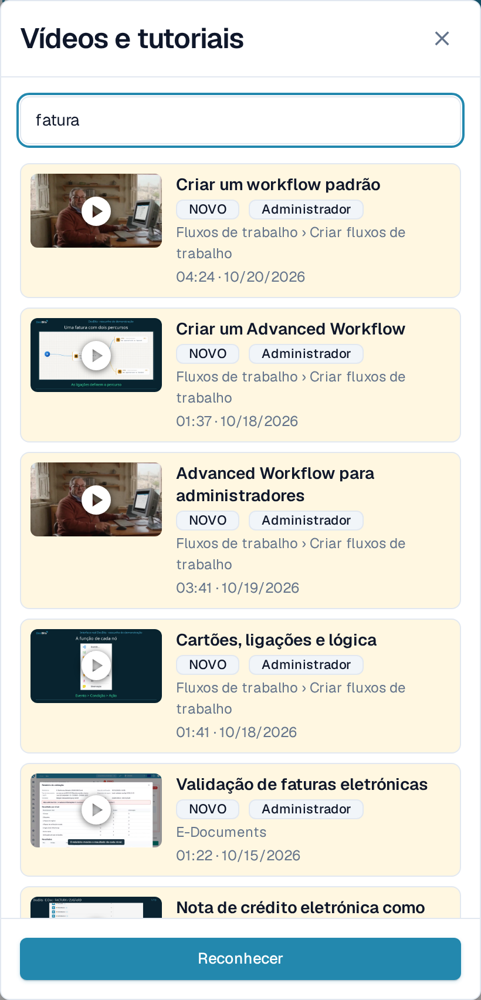
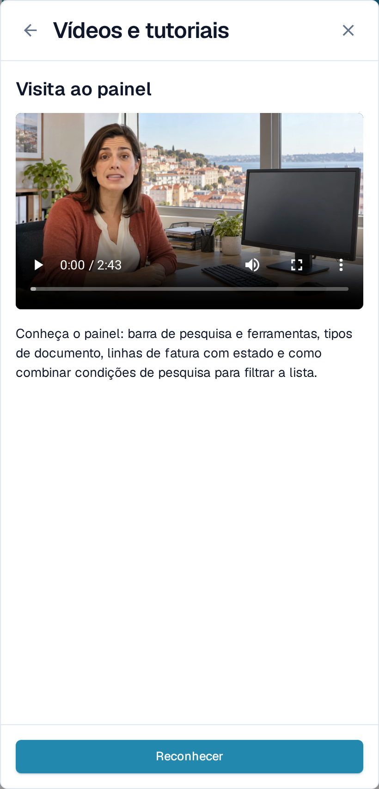

# Vídeos e tutoriais

**Vídeos e tutoriais** reproduz vídeos curtos do DocBits sem que tenha de sair da página onde está a trabalhar. Os vídeos estão agrupados por tema, para que encontre rapidamente o que corresponde à sua tarefa.

## Abrir o painel

O ícone de vídeo encontra-se na extremidade direita da barra superior, a seguir ao ícone de ajuda.

<figure><figcaption>
O ícone de vídeo é o último ícone da barra superior.
</figcaption></figure>

* O ícone está **amarelo com um pequeno ponto** enquanto houver pelo menos um vídeo por reconhecer.
* Assume a cor dos restantes ícones da barra assim que tiver reconhecido todos os vídeos.

Selecione o ícone para abrir **Vídeos e tutoriais** como painel do lado direito.

<figure><figcaption>
O painel abre na lista de temas. Cada tema é uma pasta com o respetivo número de vídeos.
</figcaption></figure>

## Percorrer um tema

O painel abre nas **pastas de temas**, por exemplo **Processamento de documentos**, **Fluxos de trabalho**, **E-Documents** ou **Administração**. Uma pasta indica quantos vídeos contém e apresenta a marca **NOVO** enquanto tiver um vídeo que ainda não reconheceu.

Selecione uma pasta para a abrir. Lá dentro encontra os vídeos desse tema e, quando o tema é extenso, outras pastas que os agrupam, como **Países** dentro de **E-Documents**. O percurso no topo e a seta de retrocesso levam-no um nível acima. Um vídeo aberto a partir de uma pasta regressa a essa pasta quando o fecha.

<figure><figcaption>
Abra um tema para ver os seus vídeos e as suas subpastas.
</figcaption></figure>

## Procurar um vídeo

Escreva em **Pesquisar vídeos** para consultar todos os temas de uma só vez. Cada resultado indica a pasta a que pertence, por exemplo **Fluxos de trabalho › Criar fluxos de trabalho**, para que saiba onde está o vídeo. A pesquisa também encontra nomes de temas e de pastas e ignora maiúsculas e acentos.

<figure><figcaption>
A pesquisa abrange todos os temas e mostra a pasta de cada resultado.
</figcaption></figure>

Limpe o campo de pesquisa para voltar às pastas de temas.

## Ver um vídeo e reconhecê-lo

Selecione um vídeo para o reproduzir no painel. O título e uma breve descrição indicam o que o vídeo aborda.

<figure><figcaption>
Reproduza o vídeo no painel e reconheça-o a seguir.
</figcaption></figure>

Selecione **Reconhecer** depois de ver o vídeo. Passa a estar marcado como visto apenas para o seu utilizador: a marca **NOVO** desaparece para si no vídeo e na respetiva pasta, e o ícone da barra superior fica cinzento assim que não restar nada por reconhecer. Os restantes utilizadores continuam a ver os seus próprios vídeos por reconhecer.

## Vídeos para administradores e para utilizadores

* Os vídeos com a marca **Administrador** destinam-se a administradores. Os administradores veem no painel tanto os vídeos de administração como os de utilizador final; os utilizadores finais veem apenas estes últimos.
* Se um vídeo não estiver disponível no idioma da sua interface, é apresentada a versão inglesa com um código de idioma como **EN**.


As capturas de ecrã mostram a organização de teste do DocBits com a aplicação configurada em português.

