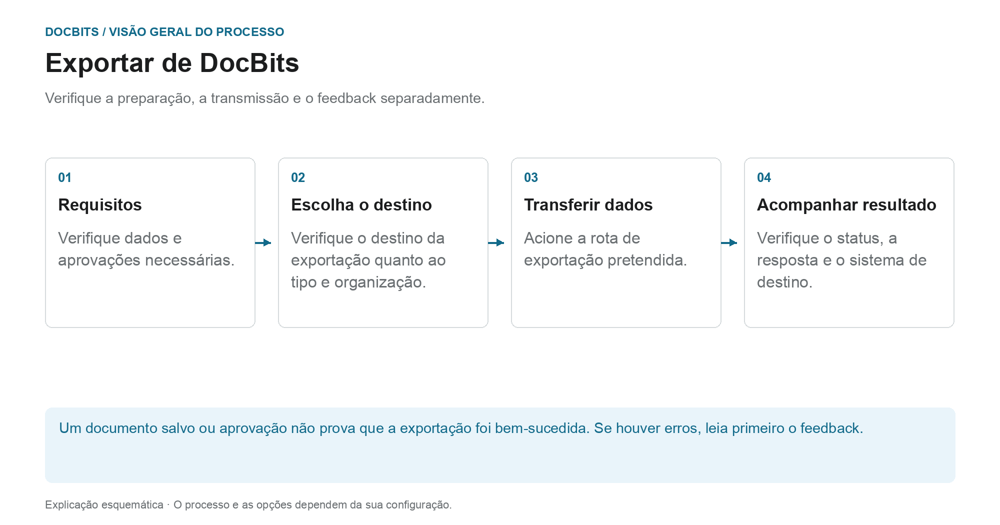

# Exportar no DocBits

## Do documento verificado para o sistema de destino

<figure><figcaption>
Verifique a preparação, a transmissão e o feedback separadamente. O diagrama é esquemático; as configurações ativas da sua organização determinam o comportamento real.
</figcaption></figure>

Ao exportar, o DocBits transfere documentos e dados para uma conexão estabelecida. Se uma exportação será oferecida ou acionada automaticamente depende do tipo de documento, do status, do fluxo de trabalho e da configuração da exportação.

1. **Verifique os pré-requisitos:** Revise os dados dos documentos, abra tarefas e aprovações exigidas pelo seu processo. A correspondência PO bem-sucedida não substitui essas etapas.
2. **Esclareça o destino da exportação:** verifique qual configuração se aplica ao tipo de documento e à organização ou suborganização. O gerenciamento de exportação suporta Infor, Infor & IDM, Webhook e SFTP, entre outros. O conteúdo real da entrega depende da configuração da conexão.
3. **Transferência de gatilho:** Use a ação de documento pretendida ou o fluxo de trabalho configurado. Uma exportação alternativa é configurada separadamente; seu status de disponibilidade não é o status a ser definido após a exportação.
4. **Verificar feedback:** Verifique o status do documento e as respostas disponíveis dos destinatários. Para uma verificação ponta a ponta, você também verifica o processo associado no sistema de destino. Para Infor, etapas de processamento adicionais podem seguir em ION e ERP.

### Se a exportação falhar

Abra os detalhes do erro antes de exportar novamente. O envio repetido não resolverá um mapeamento incorreto ou uma rejeição por parte do destinatário. Use a resposta para verificar os valores do documento, o mapeamento e a configuração do destino, e verifique se uma transação já foi criada no sistema de destino.

### Instruções adicionais

- [Módulo de exportação](export-module.md): Introdução à administração.
- [Exportar configuração](../../administration-and-setup/settings/document-processing/export.md): Conexões e escopos.
- [Exportação alternativa](alternate-export.md): caminho de exportação separado por tipo de documento e status.
- [Exportar para Infor](../exporting-to-infor/README.md): processamento Infor downstream.

A guide to exporting documents in DocBits.
