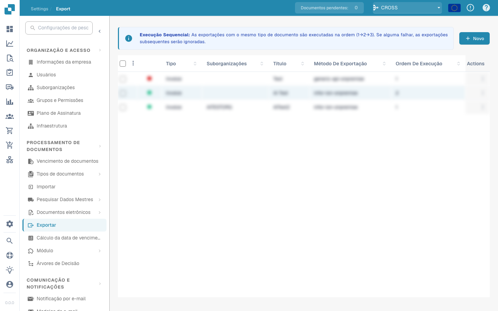

# Mapeamento de Exportação para o M3 (API)

### Seções

O arquivo de mapeamento de exportação do M3 é dividido em 5 seções, e cada seção é subdividida em 2 partes

* Header (cabeçalho)
  * Campos estáticos do cabeçalho
  * Campos de cabeçalho
* Tax Lines (linhas de imposto)
  * Campos estáticos das linhas de imposto
  * Campos das linhas de imposto
* Receipt Lines (linhas de recebimento)
  * Campos estáticos das linhas de recebimento
  * Campos das linhas de recebimento
* Linhas de encargos do pedido (valores adicionais)
  * Campos estáticos dos encargos do pedido
  * Campos dos encargos do pedido
* Cost Lines (linhas de custo)
  * Campos estáticos das linhas de custo
  * Campos das linhas de custo

### Adicionando e Removendo Campos

Adicionando um novo campo:

* Primeiro, é preciso adicionar o **nome do campo da API do M3** à propriedade com a lista de campos da seção correspondente (por exemplo, StaticFields, HeaderFields, InvoiceTaxFields)
* Defina o valor estático ou o nome do campo do documento para o campo da API, com o prefixo apropriado para a seção
  * Exemplo 1: Para definir o valor estático **AAA** para o campo **DIVI** da API do M3, primeiro adicionamos DIVI à propriedade **StaticFields**. Depois, adicionamos a linha **SF\_DIVI = AAA**, pois SF\_ é o prefixo dos campos estáticos
  * Exemplo 2: Para mapear o campo de cabeçalho **IVDT (data da fatura)** para o campo invoice\_date do DocBits, primeiro adicionamos IVDT à propriedade **HeaderFields**. Depois, adicionamos a linha HF\_IVDT = invoice\_date, pois HF\_ é o prefixo dos campos de cabeçalho

Removendo um campo:

* Basta remover o campo da propriedade com a lista de campos da seção e remover a linha que define o valor do campo.

#### **Campos Disponíveis da API do M3:**

* Os campos disponíveis do M3 podem ser consultados abrindo a tela correspondente no M3.

<figure><figcaption></figcaption></figure>

<figure><figcaption></figcaption></figure>

* Da mesma forma, você pode obter os nomes dos campos das linhas

### Cabeçalho:

<figure><figcaption></figcaption></figure>

Propriedade com a lista de campos: StaticFields

Prefixo dos campos da seção: SF\_

Campos disponíveis: você pode mapear qualquer campo da API do M3 para qualquer valor estático

#### **Campos de cabeçalho**

Propriedade com a lista de campos: HeaderFields

Prefixo dos campos da seção: HF\_

Campos disponíveis: você pode mapear qualquer campo do DocBits para qualquer campo da API do M3

### Tax Line:

#### Campos estáticos das linhas de imposto:

Propriedade com a lista de campos: InvoiceTaxStaticFields

Prefixo dos campos da seção: IT\_SF\_

Campos do M3 disponíveis: consulte a API ou a interface do M3

Campos do DocBits disponíveis: você pode informar qualquer valor, pois são campos estáticos

#### Campos das linhas de imposto:

Propriedade com a lista de campos: InvoiceTaxFields

Prefixo dos campos do M3: ITF\_

Prefixo dos campos de tabela do DocBits: TF\_

Campos do M3 disponíveis: consulte a API ou a interface do M3

Campos do DocBits disponíveis: line\_number, tax\_amount, tax\_rate, net\_amount, gross\_amount, tax\_code\_full, tax\_code, tax\_country

### Linha de recebimento:

#### Campos estáticos das linhas de recebimento:

Propriedade com a lista de campos: InvoiceReceiptStaticFields

Prefixo dos campos da seção: IR\_SF\_

Campos do M3 disponíveis: consulte a API ou a interface do M3

Campos do DocBits disponíveis: você pode informar qualquer valor, pois são campos estáticos

#### Campos das linhas de recebimento:

Propriedade com a lista de campos: InvoiceReceiptFields

Prefixo dos campos do M3: IRF\_

Prefixo dos campos de tabela do DocBits: TF\_

Campos do M3 disponíveis: consulte a API ou a interface do M3

Campos do DocBits disponíveis: packing\_slip, purchase\_order, line\_number, line\_sequence, delivery\_number, delivery\_line, amount, quantity, total\_net\_amount

### Linha de encargo do pedido:

#### Campos estáticos dos encargos do pedido:

Propriedade com a lista de campos: OrderChargeStaticFields

Prefixo dos campos da seção: OC\_SF\_

Campos do M3 disponíveis: consulte a API ou a interface do M3

Campos do DocBits disponíveis: você pode informar qualquer valor, pois são campos estáticos

#### Campos dos encargos do pedido:

Propriedade com a lista de campos: OrderChargeFields

Prefixo dos campos do M3: OCF\_

Prefixo dos campos de tabela do DocBits: TF\_

Campos do M3 disponíveis: consulte a API ou a interface do M3

Campos do DocBits disponíveis: ledger\_account, dimension\_2-7, amount, quantity, quantity2, position

### Cost Line:

#### Campos estáticos das linhas de custo:

Propriedade com a lista de campos: InvoiceCostStaticFields

Prefixo dos campos da seção: IC\_SF\_

Campos do M3 disponíveis: consulte a API ou a interface do M3

Campos do DocBits disponíveis: você pode informar qualquer valor, pois são campos estáticos

#### Campos das linhas de custo:

Propriedade com a lista de campos: InvoiceCostFields

Prefixo dos campos do M3: ICF\_

Prefixo dos campos de tabela do DocBits: TF\_

Campos do M3 disponíveis: consulte a API ou a interface do M3

Campos do DocBits disponíveis: ledger\_account, dimension\_1-12, amount, quantity, quantity2, position

Nova atualização


```
###########################
# Header
###########################

## Header Static Fields
StaticFields=DIVI,IBTP,BSCD,IMCD,TEPY,PYME,APCD,CRTP,GEOC,CONO,BKID
SF_DIVI=AAA
SF_IBTP=20
SF_CONO=780
#SF_BSCD=DE
SF_IMCD=0
SF_TEPY=N00
SF_PYME=SCT
SF_APCD=FABCEO
SF_CRTP=1
SF_GEOC=60290522

## Header Fields
HeaderFields=SUNO,IVDT,SINO,SPYN,CUCD,CUAM,VTAM,ACDT,SERS,FTCO,BSCD,PUNO,TXAP,CORI,PAIN,BKID
HF_SUNO=supplier_id
HF_IVDT=invoice_date
HF_SINO=invoice_id
HF_SPYN=supplier_id
HF_CUCD=currency
HF_CUAM=total_net_amount
#HF_VTAM=total_tax_amount
HF_ACDT=invoice_date
#HF_SERS=invoice_sub_type
HF_FTCO=supplier_country_code
HF_PUNO=purchase_order
HF_TXAP=tax_country_1
HF_CORI = correlation_id
HF_PAIN = sqr_field_esr_reference
HF_BKID = custom_field_1


###########################
# Tax Line
###########################

# ## Tax Line Static Fields
# InvoiceTaxStaticFields=RDTP,DIVI,VTCD,CONO
# IT_SF_RDTP=3
# IT_SF_DIVI=AAA
# IT_SF_CONO=780

# ## Tax Line Fields
# InvoiceTaxFields=VTCD,VTA1,VTP1,CLAM
# ITF_VTCD=TF_tax_code
# ITF_VTA1=TF_tax_amount
# ITF_VTP1=TF_tax_rate
# ITF_CLAM=TF_gross_amount

###########################
# Receipt Line
###########################

InvoiceReceipt=invoice_table

## Receipt Line Static Fields
InvoiceReceiptStaticFields=RDTP,DIVI,SERS,RELP,VTCD,CONO
IR_SF_RDTP=1
IR_SF_DIVI=AAA
IR_SF_SERS=0
IR_SF_RELP=1
#IR_SF_VTCD=52
IR_SF_CONO=780

## Receipt Line Fields
InvoiceReceiptFields=IVQA,PUUN,PUNO,PNLI,ITNO,POPN,SUDO,NEPR,GRPR,PPUN,NLAM,GLAM
IRF_IVQA = TF_quantity
IRF_PUUN = TF_unit
IRF_PUNO = TF_purchase_order
IRF_PNLI = TF_line_number
IRF_ITNO = TF_item_number
IRF_POPN = TF_item_number
IRF_SUDO = TF_packing_slip
#IRF_NEPR = TF_net_unit_price
IRF_GRPR = TF_gross_unit_price
IRF_PPUN = TF_unit
#IRF_NLAM = TF_net_amount
IRF_GLAM = TF_total_amount

###########################
# Order Charge Line
###########################

OrderCharge=order_charges

## Order Charge Static Fields
OrderChargeStaticFields=RDTP,DIVI,CONO
OC_SF_RDTP=2
OC_SF_DIVI=AAA
OC_SF_CONO=780

## Order Charge Fields
OrderChargeFields=NLAM,CHGT,CEID
OCF_NLAM=TF_amount
OCF_CHGT=TF_voucher_text
OCF_CEID=TF_ledger_account


###########################
# Cost Line
###########################

InvoiceCost=cost_lines

## Cost Line Static Fields
InvoiceCostStaticFields=RDTP,DIVI,CONO
IC_SF_RDTP=8
IC_SF_DIVI=AAA
IC_SF_CONO=780

## Cost Line Fields
InvoiceCostFields=NLAM,VTXT,AO01,AO02,AO03,AO04,AO05,AO06,AO07,VTCD,AIT1,AIT2,AIT3,AIT4,AIT5,AIT6,AIT7,VTP1,VTP2
ICF_NLAM=TF_amount
ICF_VTXT=TF_voucher_text
ICF_AIT1=TF_ledger_account
ICF_AIT2=TF_dimension_2
ICF_AIT3=TF_dimension_3
ICF_AIT4=TF_dimension_4
ICF_AIT5=TF_dimension_5
ICF_AIT6=TF_dimension_6
ICF_AIT7=TF_dimension_7
ICF_AO01=TF_accounting_object_1
ICF_AO02=TF_accounting_object_2
ICF_AO03=TF_accounting_object_3
ICF_AO04=TF_accounting_object_4
ICF_AO05=TF_accounting_object_5
ICF_AO06=TF_accounting_object_6
ICF_AO07=TF_accounting_object_7
```

### Para clientes dos EUA, atualizamos este mapeamento para a V3

````
```
# Changes from Version 2 to Version 3:# -StaticFields=DIVI,IBTP,BSCD,IMCD,TEPY,PYME,APCD,CRTP,GEOC,BKID
# -SF_DIVI=PJA
# +StaticFields=DIVI,IBTP,BSCD,IMCD,TEPY,PYME,APCD,CRTP,CONO,GEOC
# +SF_DIVI=RFP
# +SF_CONO=001
# -SF_TEPY=J30
# -SF_PYME=PTR
# +#SF_TEPY=N00
# +#SF_PYME=CSH
# +#SF_APCD=MHIDALGO
# -SF_BKID=001
# +SF_GEOC=999999999
# +#SF_BKID=DJ1
# -HeaderFields=SUNO,IVDT,SINO,SPYN,CUCD,CUAM,VTAM,ACDT,SERS,FTCO,BSCD,PUNO,TXAP,CORI,PAIN
# +HeaderFields=SUNO,IVDT,SINO,SPYN,CUCD,CUAM,VTAM,ACDT,SERS,FTCO,BSCD,PUNO,TXAP,CORI,PAIN,TCHG,CDC1,APCD,TEPY,PYME,BKID
# -HF_CUAM=total_net_amount
# +HF_CUAM=total_net_amount_us
# -HF_ACDT=invoice_date
# +#HF_ACDT=invoice_date
# -HF_CORI = correlation_id
# -HF_PAIN = sqr_field_esr_reference
# -
# +HF_CORI=correlation_id
# +HF_PAIN=sqr_field_esr_reference
# +HF_TCHG=additional_amount
# +HF_CDC1=negative_amount
# +HF_APCD=buyer_id
# +HF_TEPY=payment_terms
# +HF_PYME=payment_method
# +HF_BKID=bank_id
# +#HF_GEOC=supplier_geoc
# -## Tax Line Static Fields
# -InvoiceTaxStaticFields=RDTP,DIVI,VTCD
# -IT_SF_RDTP=3
# -IT_SF_DIVI=PJA
# +# ## Tax Line Static Fields
# +# InvoiceTaxStaticFields=RDTP,DIVI,VTCD,CONO
# +# IT_SF_RDTP=3
# +# IT_SF_DIVI=AAA
# +# IT_SF_CONO=780
# -## Tax Line Fields
# -InvoiceTaxFields=VTCD,VTA1,VTP1,CLAM
# -ITF_VTCD=TF_tax_code
# -ITF_VTA1=TF_tax_amount
# -ITF_VTP1=TF_tax_rate
# -ITF_CLAM=TF_gross_amount
# +# ## Tax Line Fields
# +# InvoiceTaxFields=VTCD,VTA1,VTP1,CLAM
# +# ITF_VTCD=TF_tax_code
# +# ITF_VTA1=TF_tax_amount
# +# ITF_VTP1=TF_tax_rate
# +# ITF_CLAM=TF_gross_amount
# -InvoiceReceiptStaticFields=RDTP,DIVI,SERS,RELP,VTCD
# +InvoiceReceiptStaticFields=RDTP,DIVI,SERS,RELP,VTCD,CONO
# -IR_SF_DIVI=PJA
# -IR_SF_SERS=0
# +IR_SF_DIVI=RFP
# -IR_SF_VTCD=52
# +#IR_SF_VTCD=52
# +IR_SF_CONO=001
# -InvoiceReceiptFields=IVQA,PUUN,PUNO,PNLI,ITNO,POPN,SUDO,NEPR,GRPR,PPUN,NLAM,GLAM
# +InvoiceReceiptFields=IVQA,PUUN,PUNO,PNLI,ITNO,POPN,SUDO,NEPR,GRPR,PPUN,NLAM,GLAM,TCHG,CDC1
# -#IRF_PUNO = TF_purchase_order
# -#IRF_PNLI = TF_line_number
# +IRF_PUNO = TF_purchase_order
# +IRF_PNLI = TF_line_number
# -#IRF_NEPR = TF_net_unit_price
# +IRF_NEPR = TF_net_unit_price
# -IRF_PPUN = TF_unit
# -#IRF_NLAM = TF_net_amount
# +IRF_PPUN = TF_unit_code_price
# +IRF_NLAM = TF_net_amount
# +IRF_TCHG = TF_charges
# +IRF_CDC1 = TF_discount
# -OrderChargeStaticFields=RDTP,DIVI
# +OrderChargeStaticFields=RDTP,DIVI,CONO
# -OC_SF_DIVI=PJA
# +OC_SF_DIVI=RFP
# +OC_SF_CONO=001
# -InvoiceCostStaticFields=RDTP,DIVI
# +InvoiceCostStaticFields=RDTP,DIVI,CONO
# -IC_SF_DIVI=PJA
# +IC_SF_DIVI=RFP
# +IC_SF_CONO=001

###########################
# Header
###########################

## Header Static Fields
StaticFields=DIVI,IBTP,BSCD,IMCD,TEPY,PYME,APCD,CRTP,CONO,GEOC
SF_DIVI=RFP
SF_IBTP=20
SF_CONO=001
#SF_BSCD=DE
SF_IMCD=0
#SF_TEPY=N00
#SF_PYME=CSH
#SF_APCD=MHIDALGO
SF_CRTP=1
SF_GEOC=999999999
#SF_BKID=DJ1

## Header Fields
HeaderFields=SUNO,IVDT,SINO,SPYN,CUCD,CUAM,VTAM,ACDT,SERS,FTCO,BSCD,PUNO,TXAP,CORI,PAIN,TCHG,CDC1,APCD,TEPY,PYME,BKID
HF_SUNO=supplier_id
HF_IVDT=invoice_date
HF_SINO=invoice_id
HF_SPYN=supplier_id
HF_CUCD=currency
HF_CUAM=total_net_amount_us
#HF_VTAM=total_tax_amount
#HF_ACDT=invoice_date
#HF_SERS=invoice_sub_type
HF_FTCO=supplier_country_code
HF_PUNO=purchase_order
HF_TXAP=tax_country_1
HF_CORI=correlation_id
HF_PAIN=sqr_field_esr_reference
HF_TCHG=additional_amount
HF_CDC1=negative_amount
HF_APCD=buyer_id
HF_TEPY=payment_terms
HF_PYME=payment_method
HF_BKID=bank_id
#HF_GEOC=supplier_geoc

###########################
# Tax Line
###########################

# ## Tax Line Static Fields
# InvoiceTaxStaticFields=RDTP,DIVI,VTCD,CONO
# IT_SF_RDTP=3
# IT_SF_DIVI=AAA
# IT_SF_CONO=780

# ## Tax Line Fields
# InvoiceTaxFields=VTCD,VTA1,VTP1,CLAM
# ITF_VTCD=TF_tax_code
# ITF_VTA1=TF_tax_amount
# ITF_VTP1=TF_tax_rate
# ITF_CLAM=TF_gross_amount

###########################
# Receipt Line
###########################

InvoiceReceipt=invoice_table

## Receipt Line Static Fields
InvoiceReceiptStaticFields=RDTP,DIVI,SERS,RELP,VTCD,CONO
IR_SF_RDTP=1
IR_SF_DIVI=RFP
IR_SF_RELP=1
#IR_SF_VTCD=52
IR_SF_CONO=001

## Receipt Line Fields
InvoiceReceiptFields=IVQA,PUUN,PUNO,PNLI,ITNO,POPN,SUDO,NEPR,GRPR,PPUN,NLAM,GLAM,TCHG,CDC1
IRF_IVQA = TF_quantity
IRF_PUUN = TF_unit
IRF_PUNO = TF_purchase_order
IRF_PNLI = TF_line_number
IRF_ITNO = TF_item_number
IRF_POPN = TF_item_number
IRF_SUDO = TF_packing_slip
IRF_NEPR = TF_net_unit_price
IRF_GRPR = TF_gross_unit_price
IRF_PPUN = TF_unit_code_price
IRF_NLAM = TF_net_amount
IRF_GLAM = TF_total_amount
IRF_TCHG = TF_charges
IRF_CDC1 = TF_discount

###########################
# Order Charge Line
###########################

OrderCharge=order_charges

## Order Charge Static Fields
OrderChargeStaticFields=RDTP,DIVI,CONO
OC_SF_RDTP=2
OC_SF_DIVI=RFP
OC_SF_CONO=001

## Order Charge Fields
OrderChargeFields=NLAM,CHGT,CEID
OCF_NLAM=TF_amount
OCF_CHGT=TF_voucher_text
OCF_CEID=TF_ledger_account


###########################
# Cost Line
###########################

InvoiceCost=cost_lines

## Cost Line Static Fields
InvoiceCostStaticFields=RDTP,DIVI,CONO
IC_SF_RDTP=8
IC_SF_DIVI=RFP
IC_SF_CONO=001

## Cost Line Fields
InvoiceCostFields=NLAM,VTXT,AO01,AO02,AO03,AO04,AO05,AO06,AO07,VTCD,AIT1,AIT2,AIT3,AIT4,AIT5,AIT6,AIT7,VTP1,VTP2
ICF_NLAM=TF_amount
ICF_VTXT=TF_voucher_text
ICF_AIT1=TF_ledger_account
ICF_AIT2=TF_dimension_2
ICF_AIT3=TF_dimension_3
ICF_AIT4=TF_dimension_4
ICF_AIT5=TF_dimension_5
ICF_AIT6=TF_dimension_6
ICF_AIT7=TF_dimension_7
ICF_AO01=TF_accounting_object_1
ICF_AO02=TF_accounting_object_2
ICF_AO03=TF_accounting_object_3
ICF_AO04=TF_accounting_object_4
ICF_AO05=TF_accounting_object_5
ICF_AO06=TF_accounting_object_6
ICF_AO07=TF_accounting_object_7
```
````
