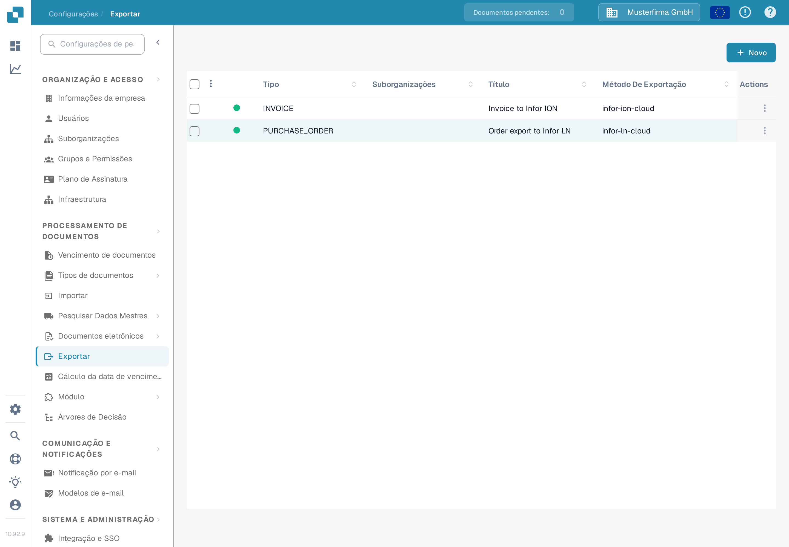
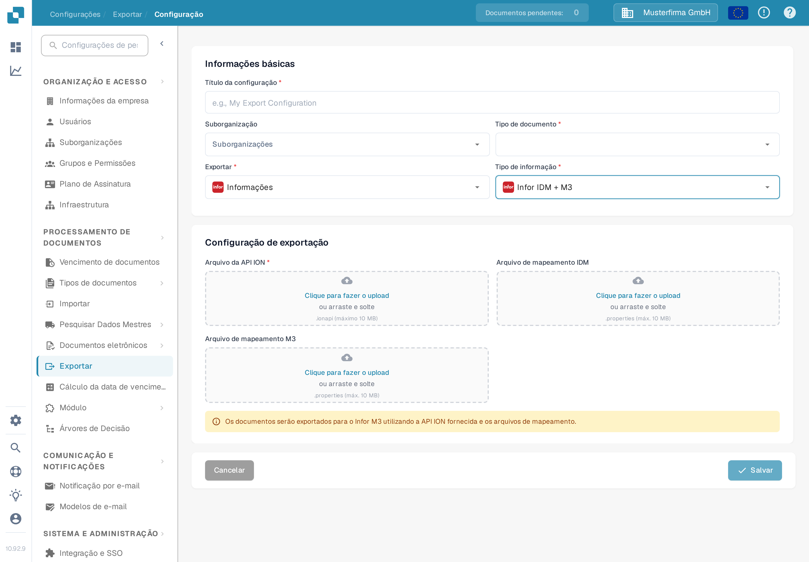

# Configurar uma exportação para o Infor M3

Esta página explica as verificações que ligam uma configuração de exportação do DocBits a um fluxo de documentos Infor ION para o M3. A página anterior continha 38 capturas de ecrã de um tenant (instância) Infor mais antigo, incluindo definições de API e de mapeamento específicas desse ambiente. Elas não permitem estabelecer a configuração no seu tenant, por isso o guia atual remete para as instruções da Infor e mostra o formulário DocBits verificado em português. Nenhuma ligação à Infor nem exportação de fatura foi testada nesta atualização.

## Preparar o tenant Infor

Peça ao administrador Infor o **endpoint da API ION** aprovado, um ficheiro `.ionapi` específico do tenant, os ficheiros `.properties` de **mapeamento IDM** e de **mapeamento M3**, e os nomes dos mapeamentos BOD utilizados no fluxo de faturas desta empresa. O ficheiro `.ionapi` contém credenciais; mantenha-o fora de capturas de ecrã, anexos do Jira e do repositório Git. O seu valor `ci` é o ID do cliente, conforme descrito na [referência de campos de credenciais da Infor](https://docs.infor.com/crm/9.4.x/en-us/webclient/upi1639111995644.html).

No ION Desk, o administrador deve:

1. Importar e aprovar as versões de mapeamento exigidas pelo tenant atual. Verifique os nomes BOD de entrada e saída dos mapeamentos, em vez de reutilizar nomes de uma captura de ecrã antiga.
2. Verificar os pontos de conexão do DocBits e do M3, os seus IDs lógicos específicos do ambiente, as subscrições de documentos e as permissões.
3. Criar o fluxo de documentos com os mapeamentos aprovados e os filtros necessários. A Infor explica [pontos de conexão, mapeamentos e fluxos de documentos](https://docs.infor.com/inforos/2024.x/en-us/useradminlib_cloud/iondeskceug_cloud_osm/lnj1556623308383.html).
4. Guardar, rever e [ativar o fluxo de documentos](https://docs.infor.com/depm/2024.x/en-us/depmolh/configuring_ion/jex1510174562552.html) apenas depois de as rotas terem sido verificadas. A ativação é diferente de uma exportação de documentos bem-sucedida.

Para um exemplo histórico de fluxo ION, veja [Exemplo de Exportação para o M3](README.md). Compare cada ecrã da Infor nessa página com o seu tenant antes de o seguir.

## Configurar a exportação no DocBits

Na organização DocBits pretendida, abra **Configurações → Exportar** e selecione **Novo**. A organização de teste Sandbox em português mostrada aqui não tem nenhuma configuração de exportação guardada.

<figure><figcaption>
A lista Exportar nas Configurações do DocBits em português: nenhuma configuração guardada e o botão «Novo» no canto superior direito.
</figcaption></figure>

Introduza um **Título da configuração**, escolha o **Tipo de documento** (Fatura neste fluxo) e selecione uma **Suborganização** apenas se necessário. Defina **Exportar** como **Infor** e **Tipo de informação** como **Infor IDM + M3**. O formulário atual pede um **Arquivo da API ION** (`.ionapi`, obrigatório), um **Arquivo de mapeamento IDM** (`.properties`) e um **Arquivo de mapeamento M3** (`.properties`). Obtenha apenas ficheiros destinados a este tenant e reveja-os antes de guardar. A captura de ecrã deixa intencionalmente todos os envios de ficheiro vazios.

<figure><figcaption>
Formulário de exportação «Infor IDM + M3» na aplicação Sandbox em português; os campos de envio dos ficheiros ION API, IDM e M3 foram deixados vazios.
</figcaption></figure>

Depois de o fluxo da Infor estar ativo, faça um teste com uma fatura fora do ambiente de produção. Verifique o resultado dela no DocBits, no ION e no M3. Uma configuração guardada ou um fluxo ativado, por si só, não mostram que a fatura chegou.
