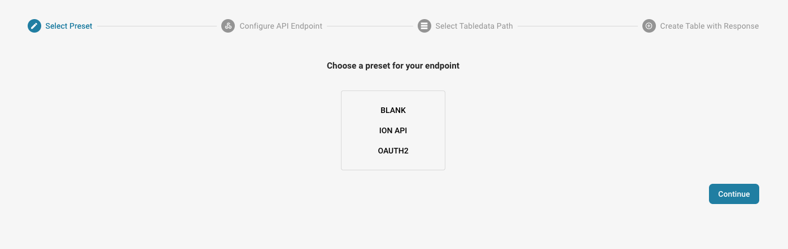

# Dados Mestres Personalizados

#### Ativar os dados mestres personalizados 

No painel, acesse Configurações → Processamento de documentos → Módulo.

.png>)

<figure><figcaption></figcaption></figure>

Em Módulo, ative os dados mestres personalizados (Custom Master Data) clicando no controle deslizante, como mostrado abaixo.

<figure><figcaption></figcaption></figure>

#### Visão geral da funcionalidade 

Para adicionar seus próprios dados mestres ao DocBits, acesse Master Data Lookup em Configurações.

<figure><figcaption></figcaption></figure>

Clique em “Custom Master Data”.

<figure><figcaption></figcaption></figure>

Em seguida, você pode optar por criar um Template (modelo) ou um Endpoint.

<figure><figcaption></figcaption></figure>

#### Criar um template 

A primeira etapa é escolher entre usar o arquivo de API ION da sua organização ou usar OAuth2 e informar os dados necessários.

<figure><figcaption></figcaption></figure>

Em seguida, vamos configurar as predefinições. Aqui você informará o nome da tabela de dados mestres e a URL da chamada de API.

<figure><figcaption></figcaption></figure>

Depois, você precisará informar o caminho JSON usando a notação de pontos. Para mais informações sobre a notação de pontos, clique [aqui](https://docs.hevodata.com/sources/engg-analytics/streaming/rest-api/writing-jsonpath-expressions/).

Por fim, você precisará mapear os dados para as colunas que deseja criar, como no exemplo abaixo.

<figure><figcaption></figcaption></figure>

Depois disso, clique em Concluído (Done) para que os novos dados mestres sejam criados e preenchidos.

#### Criar um endpoint 

A primeira etapa é escolher entre usar o arquivo de API ION da sua organização, usar OAuth2 ou deixar essa opção em branco e informar os dados necessários.

<figure><figcaption></figcaption></figure>

Em seguida, vamos configurar as predefinições. Aqui você informará o nome da tabela de dados mestres e a URL da chamada de API.

<figure><figcaption></figcaption></figure>

Depois, você precisará informar o caminho JSON usando a notação de pontos. Para mais informações sobre a notação de pontos, clique [aqui](https://docs.hevodata.com/sources/engg-analytics/streaming/rest-api/writing-jsonpath-expressions/).

Por fim, você precisará mapear os dados para as colunas que deseja criar, como no exemplo abaixo.

<figure><figcaption></figcaption></figure>

Depois disso, clique em Concluído (Done) para que os novos dados mestres sejam criados e preenchidos.
