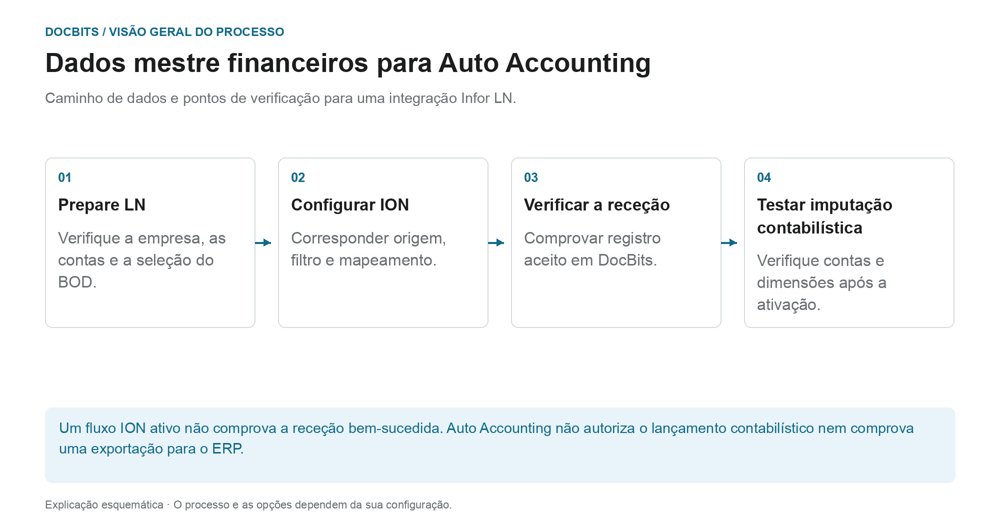
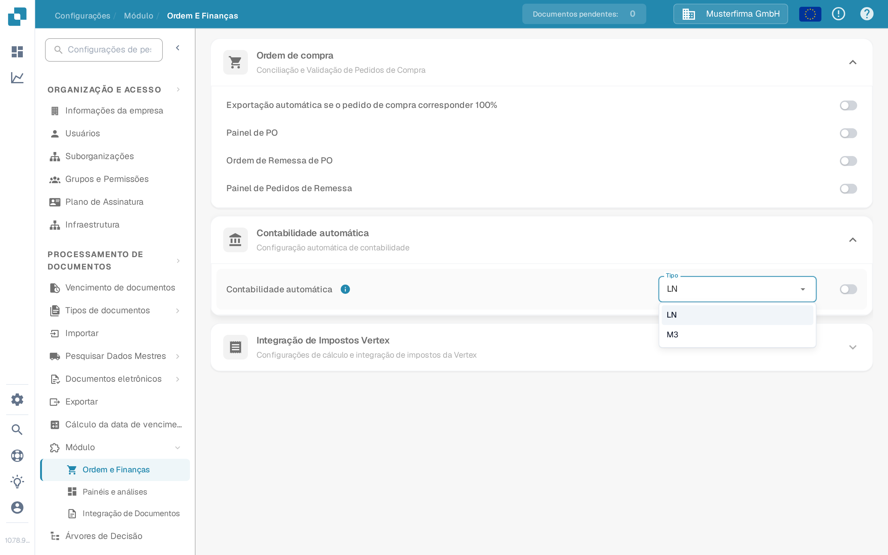

# Contabilidade automática com Infor LN

## Do registro de dados mestre LN à classificação contábil verificada

<figure><figcaption>
Caminho de dados e pontos de verificação para uma integração Infor LN. O diagrama é esquemático; as configurações ativas da sua organização determinam o comportamento real.
</figcaption></figure>

Este guia cobre o fornecimento de dados mestres financeiros para uma integração LN. Selecionar **LN** ou ativar **Auto Accounting** não substitui o fornecimento dos dados ou a verificação do resultado da classificação contábil.

| Transferência | O que você deve provar |
| --- | --- |
| **LN → Publicação BOD** | Corrija os dados da empresa e da conta ou dimensão necessária; Primeiro conte ou simule a seleção. |
| **BOD → ION** | Correspondência de versão, origem, filtros e mapeamento do documento; rastreie o identificador de teste em ION OneView. |
| **ION → DocBits** | Recebendo resposta do endpoint, organização correta e registro aceito. Um fluxo ativado por si só não é suficiente. |
| **DocBits → Resultado da classificação contábil** | Após a ativação aprovada, use documentos de teste representativos para verificar se as contas e as dimensões estão corretas para o processo comercial. |

**Exemplo de rastreabilidade:** use um identificador de teste não confidencial de um conjunto de dados de teste aprovado. Encontre o mesmo identificador na origem BOD, em ION e nos logs de recepção DocBits. Isso ajuda a localizar um mapeamento ausente em uma transferência específica, em vez de alterar repetidamente a chave.

A exportação subsequente e o lançamento ERP devem ser verificados separadamente. As imagens existentes neste guia mostram os controles DocBits; eles não provam que uma transferência LN foi realizada. A seção a seguir descreve a preparação e a verificação completa pelos administradores responsáveis. Para a transferência técnica, consulte [Exportar de DocBits](../../exporting-in-docbits/README.md).

Utilize este guia quando um administrador do Infor LN pretender que o DocBits utilize dados mestres financeiros importados para a contabilidade automática. A página antiga mostrava 48 ecrãs de um determinado ambiente Infor. Os nomes dos pontos de ligação, os mapeamentos, as credenciais e os endereços de endpoint desse ambiente não constituem uma configuração reutilizável.

## Localizar a opção no DocBits

Abra **Configurações → Módulo → Ordem E Finanças → Contabilidade automática** com uma conta de administrador. O menu **Tipo** oferece **LN** e **M3**. Para uma integração LN, verifique se o tipo selecionado é **LN**. Ative o interruptor apenas depois de verificar a empresa LN pretendida, o fluxo BOD e os dados mestres importados. Alterar o tipo ou o interruptor pode afetar o comportamento contabilístico, por isso siga o processo de alteração da sua organização.

As capturas de ecrã seguintes provêm do ambiente Sandbox sintético **DocBits Documentation Test A**. Nesta organização, **LN** estava selecionado e a Contabilidade automática estava **desativada**. O menu foi aberto sem selecionar outro valor; nenhuma configuração foi guardada.

<figure><figcaption>
Localize a Contabilidade automática e verifique o tipo selecionado antes de a ativar.
</figcaption></figure>

<figure><figcaption>
LN e M3 são os tipos disponíveis neste ambiente Sandbox; nenhuma seleção foi alterada.
</figcaption></figure>

## Preparar o LN e o ION

1. Confirme a empresa LN, a entidade contabilística, a organização DocBits e o ambiente de destino. Combine com o administrador do DocBits qual a operação de API atual e o mapeamento de campos que irão receber as contas e as dimensões. Mantenha as credenciais de API no cofre de segredos aprovado, nunca numa captura de ecrã nem num anexo Jira.
2. Configure a publicação de BOD no LN e valide a configuração dos dados de publicação. A Infor documenta **BOD Parameters (tcbod0100m000)** e **Validate Publishing Data Setup (tcbod0300m000)** no seu [guia de publicação de BOD para LN](https://docs.infor.com/ln/10.7.in/en-us/lnolh/help/tc/onlinemanual/000520.html).
3. Verifique quais os nouns que a sua versão de LN e a operação de receção do DocBits exigem. O exemplo anterior utilizava `Sync.ChartOfAccounts` e `Sync.CodeDefinition` para os dados de plano de contas e de dimensão. A Infor lista as opções Chart of Accounts e CodeDefinition em [Publish Financial Master Data (tfbia0200m000)](https://docs.infor.com/ln/2025.x/en-us/lnolh/tfolh/help/tf/bia/tfbia0200m000.html). Alguns separadores CodeDefinition só aparecem depois de o mapeamento de dimensões ter sido especificado e aprovado. Confirme as versões de documento e os campos exatos no seu ambiente antes de os encaminhar.
4. Em **ION Desk → Connect → Connection Points**, ligue a origem LN ao destino API do DocBits aprovado. Em **Data Flows**, encaminhe os documentos selecionados, reveja os filtros e o mapeamento e, em seguida, guarde e ative. A Infor distingue [guardar de ativar um fluxo](https://docs.infor.com/inforos/latest/en-us/useradminlib_cloud/iondeskceug/lsm1436532178755.html).
5. No LN, utilize um identificador de teste não sensível. Em **Publish Financial Master Data**, utilize primeiro **Count** ou **Simulate** para inspecionar a seleção e só depois **Publish**, no âmbito da alteração aprovada pelo administrador. A ação de publicação não é específica de um destino: segundo a Infor, entrega a todos os subscritores. Acompanhe esse identificador e eventuais erros no [ION OneView](https://docs.infor.com/inforos/latest/en-us/useradminlib_cloud/iondeskceug/lsm1436532196155.html).

## Confirmar o resultado no DocBits

Peça ao administrador do DocBits para verificar o registo recebido, a organização e os campos contabilísticos nos registos de importação ou de API atuais. Onde a tabela de consulta relevante estiver exposta, pesquise o mesmo identificador em **Configurações → Processamento de documentos → Pesquisar Dados Mestres**. Um fluxo ION ativado com êxito não prova, por si só, que o DocBits aceitou um registo. Se faltar um valor, compare o BOD de origem, o mapeamento ION, a resposta da API e a organização de destino antes de ativar a contabilidade automática.

Não estava disponível nenhum ambiente LN nem uma transferência financeira BOD em direto para um teste de ponta a ponta. As novas imagens do Sandbox verificam apenas os controlos atuais do DocBits. O administrador do seu ambiente deve validar o mapeamento final e o resultado contabilístico.
