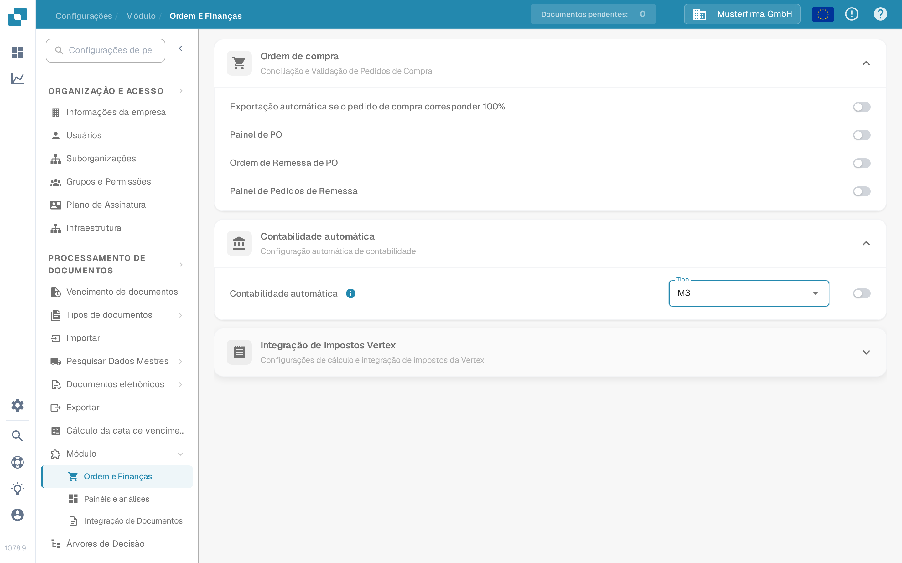

# Contabilização Automática

Use este guia para planear os dados mestres necessários para a contabilidade automática (Auto Accounting) de M3 no DocBits. Uma opção ativada por si só não importa contas nem elementos de custo. O seu administrador de Infor deve confirmar o mapeamento de BOD, a operação de API do DocBits e o resultado na sua própria organização.

## Verificar a opção do DocBits

Um administrador pode abrir **Configurações → Módulo → Ordem e Finanças → Contabilidade automática**. O menu **Tipo** oferece **LN** e **M3**. Escolha **M3** apenas para uma integração com M3 e ative o interruptor depois de verificar o fluxo de dados e os dados mestres necessários. As capturas de ecrã seguintes mostram esta página no ambiente de testes do DocBits em português, com a organização de exemplo **Musterfirma GmbH**. O interruptor estava **desativado**, o Tipo atual era **LN** e abrir o menu não guardou nem alterou nenhuma opção.

<figure><figcaption>
Localize a Contabilidade automática em Ordem e Finanças; neste exemplo do ambiente de testes está desativada.
</figcaption></figure>

<figure><figcaption>
O menu Tipo oferece LN e M3. Não foi selecionada nenhuma opção neste exemplo.
</figcaption></figure>

## Preparar o fluxo de dados de M3

1. Combine qual empresa de M3 e qual organização do DocBits irão trocar dados. Verifique com o seu administrador do DocBits qual operação de API atual aceita os dados mestres de contabilidade. Evite copiar um endpoint ou uma credencial de uma captura de ecrã de um ambiente antigo.
2. No M3, confirme que os BOD necessários estão ativados para a entidade contabilística relevante. O exemplo de um ambiente antigo usava `Sync.ChartOfAccounts` e `Sync.CodeDefinition` para as dimensões contabilísticas. Confirme o noun, a versão e os campos exatos contra a sua configuração de M3 e o contrato da API recetora. A Infor descreve como [ativar a publicação de BOD](https://docs.infor.com/m3core/2025.x/en-us/useradminlib_cloud/m3cecoreag_cloud/wbr1509377469290.html).
3. Em **ION Desk → Connect → Connection Points**, configure a origem de M3 e um destino de API com a operação do DocBits aprovada e uma conta de serviço. Em **Data Flows**, encaminhe apenas os documentos aprovados, verifique os filtros e o mapeamento de campos e, em seguida, guarde e ative o fluxo. Veja a [lista de pontos de ligação da Infor](https://docs.infor.com/inforos/latest/en-us/useradminlib_cloud/iondeskceug/documentflowdesk_connectionpointmasterlist.html) e as [instruções de ativação de fluxos de dados](https://docs.infor.com/inforos/latest/en-us/useradminlib_cloud/iondeskceug/lsm1436532178755.html).
4. Publique um identificador de teste não sensível a partir do M3. Uma carga inicial pode usar o **EVS006** do M3; os nomes da ação e da tabela dependem da versão de M3 instalada. Siga as [instruções de carga inicial da Infor](https://docs.infor.com/m3core/2025.x/en-us/useradminlib_cloud/m3cecoreag_cloud/pbi1544012609638.html). No **ION OneView**, acompanhe o identificador através do fluxo e inspecione o resultado da API com o [Infor OneView](https://docs.infor.com/inforos/latest/en-us/useradminlib_cloud/iondeskceug/lsm1436532196155.html).
5. Verifique o mesmo identificador no DocBits em **Configurações → Processamento de documentos → Pesquisar Dados Mestres**. O [guia de API de M3 para o DocBits](import-from-infor-m3-to-docbits-via-api.md) explica as verificações de importação. Ative a contabilidade automática de M3 apenas quando os registos necessários estiverem presentes e o seu administrador tiver validado o mapeamento.

## Elementos de custo

O exemplo de um ambiente antigo exportava elementos de custo do M3 **PPS280** para Excel, reduzia as colunas e carregava um CSV através de um ecrã antigo de uma API HTTP. Essa sequência de capturas de ecrã não é um procedimento de importação geral seguro: os nomes das colunas, o delimitador, o endpoint e a autenticação precisam de confirmação para o ambiente atual. Use o guia atual da [tabela de elementos de custo](table-extraction-for-costing-element.md) para preparar o ficheiro e inspecionar os controlos de CSV disponíveis no DocBits. Não carregue nenhum ficheiro até que o administrador tenha verificado as suas colunas contra a tabela de destino.

Se um BOD chega ao ION mas não aparece nenhuma linha no DocBits, inspecione a rota de ION, a resposta da API, a organização, o identificador e o mapeamento antes de ativar a função. Não deduza o sucesso de um fluxo ativado nem de dados de demonstração existentes.

Esta página substitui 43 capturas de ecrã de um ambiente antigo de Infor por controlos atuais do DocBits e passos com ligações para as fontes. Não havia nenhum ambiente de Infor nem transferência de BOD em direto disponível para um teste de ponta a ponta; o administrador do seu ambiente deve validar o mapeamento, a importação e o resultado contabilístico finais.
