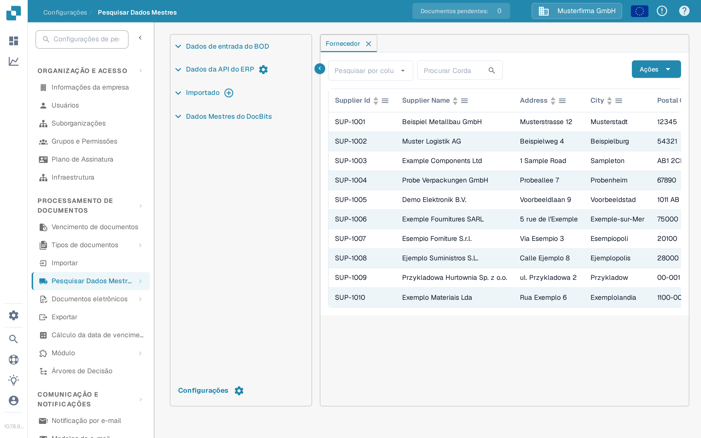
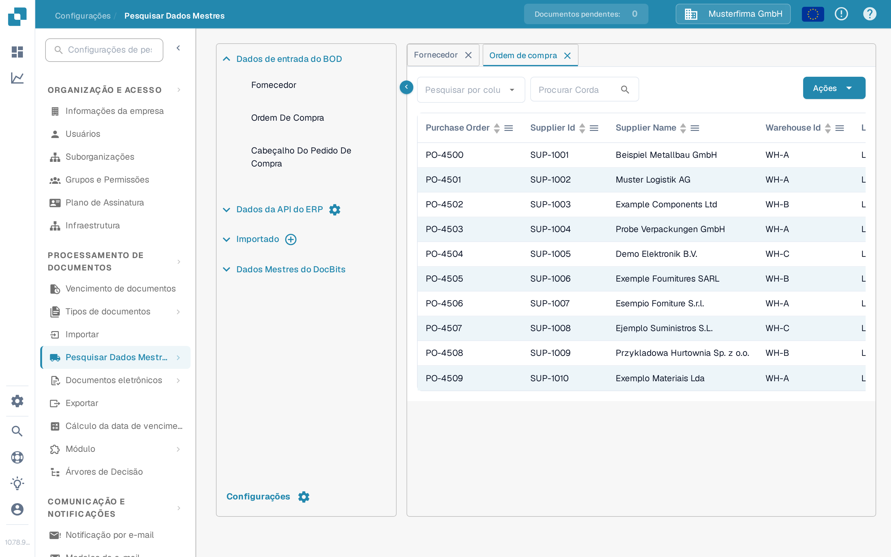

# Importar dados mestres do Infor M3 através do ION API

Use este guia quando um administrador do Infor M3 precisar de entregar BODs selecionados ao DocBits através do Infor ION e do API Gateway. A versão anterior desta página continha 42 capturas de ecrã de um antigo tenant Infor e endereços API fixos de Sandbox. Esses ecrãs e endereços não são um modelo de configuração seguro para outro tenant.

O percurso a verificar é **o M3 publica um BOD → o ION encaminha-o → o API Gateway chama a API do DocBits → o DocBits mostra o registo importado**. Cada etapa tem o seu próprio estado. Ver um registo no DocBits é a verificação final; um data flow do ION ativo, por si só, não prova uma importação.

## Antes de configurar o fluxo

1. Confirme a empresa M3, o tenant ION, a organização DocBits e o ambiente que pretende ligar. Peça a um administrador do DocBits o URL base atual da API e a operação de API exigida pela descrição OpenAPI desse ambiente. Os hosts regionais podem diferir; não copie um host nem um caminho de proxy do API Gateway a partir de uma captura de ecrã antiga.
2. Acorde quais os tipos de documento de que a organização precisa. Os dados mestres de fornecedores e de ordens de compra podem ser verificados no DocBits. Adicione documentos de entrega e de contabilidade apenas quando o caso de uso e a operação de receção estiverem confirmados.
3. Prepare uma conta de serviço Infor com permissão para a operação de API selecionada e uma credencial de API DocBits com o acesso mínimo necessário. Introduza credenciais apenas no ecrã de configuração autorizado. Não cole um ficheiro `.ionapi` completo nem uma chave de API numa página de documentação, num ticket Jira ou numa captura de ecrã.
4. Guarde um identificador de teste não sensível para cada BOD escolhido, para poder seguir o mesmo registo no M3, no ION OneView e no DocBits.

## Escolha o documento e a operação de receção

O exemplo do antigo tenant usava estes BODs. Confirme cada associação com os metadados de API atuais e com o seu projeto de integração antes de criar um connection point:

| BOD no exemplo antigo | Dados previstos no DocBits | Onde verificar o formato de receção |
| --- | --- | --- |
| `Sync.SupplierPartyMaster`, `Sync.RemitToPartyMaster` | Dados mestres de fornecedores | [Importação do BOD de fornecedores](../importing-via-the-api/supplier-bod.md) |
| `Sync.PurchaseOrder` | Ordens de compra | [Importação do BOD de ordens de compra](../importing-via-the-api/purchase-order-bod.md) |
| `Sync.ReceiveDelivery` | Dados de entregas | [Importação do BOD Receive Delivery](../importing-via-the-api/receive-delivery-bod.md) |
| `Sync.AdvanceShipNotice`, `Sync.ChartOfAccounts`, `Sync.CodeDefinition-AccountingDimension` | Dados mestres adicionais para funcionalidades configuradas | [Importação XML de dados mestres](../importing-via-the-api/master-data-xml.md) e os metadados de API do seu tenant |

`Acknowledge.SupplierInvoice` pertence a um fluxo de confirmação de faturas e deve ser configurado separadamente de uma importação de dados mestres do M3 para o DocBits. A página antiga misturava estas direções e incluía um corpo de pedido específico do tenant; não copie esse corpo num novo fluxo sem antes rever o contrato do endpoint e os controlos de acesso.

## Configure o Infor OS e o ION

1. No Infor OS, prepare o target do API Gateway para a operação de API do DocBits **confirmada**. Verifique com o administrador do DocBits o URL de destino, o método do pedido, o formato do pedido e a autenticação. Para os controlos do Gateway, use o atual [guia do Infor API Gateway](https://docs.infor.com/inforos/2025.x/en-us/useradminlib_cloud/apigatewayag_cloud/ionapi_2025.x_apigatewayag_cloud_en-us.pdf).
2. Em **ION → Connect → Connection Points**, crie ou selecione o connection point para a API do DocBits. Adicione apenas os BODs escolhidos em **Documents**, selecione a operação do Gateway correspondente e configure o payload de pedido que a operação espera. As [instruções do elemento API](https://docs.infor.com/inforos/latest/en-us/useradminlib_cloud/iondeskceug/hqg1491985489422.html) da Infor explicam a conta de serviço e as definições do pedido.
3. Em **ION → Connect → Data Flows**, ligue a origem M3 e o destino da API. Verifique a lista de documentos, os filtros e os mapeamentos; depois guarde e ative o fluxo. A Infor distingue entre [guardar e ativar um data flow](https://docs.infor.com/inforos/latest/en-us/useradminlib_cloud/iondeskceug/lsm1436532178755.html).
4. Publique um BOD de teste aprovado a partir do M3. No **ION OneView**, encontre esse identificador e confirme que connection point, mapeamento e chamada de API o processaram. Consulte [Infor OneView](https://docs.infor.com/inforos/latest/en-us/useradminlib_cloud/iondeskceug/lsm1436532196155.html). Se não for mostrado nenhum percurso ou for mostrado um erro, corrija primeiro o fluxo do ION antes de verificar no DocBits.

## Verifique o resultado no DocBits

Abra **Configurações → Processamento de Documentos → Pesquisar Dados Mestres**. Expanda **Dados de entrada do BOD**, escolha o tipo relevante e pesquise o identificador de teste. Os separadores **Fornecedor** e **Ordem De Compra** mostrados abaixo são vistas atuais do DocBits com dados de demonstração sintéticos. As respetivas linhas existentes **não são prova de uma importação do M3**.

<figure><figcaption>
Escolha Fornecedor, selecione uma coluna de pesquisa e introduza o identificador de teste do fornecedor.
</figcaption></figure>

<figure><figcaption>
Escolha Ordem De Compra e pesquise a ordem de teste; as linhas apresentadas são dados de demonstração sintéticos.
</figcaption></figure>

Em qualquer separador, escolha o campo em **Pesquisar por coluna**, introduza o identificador em **Procurar Corda** e execute a pesquisa com o ícone de lupa. Os títulos das colunas ordenam as linhas visíveis; as setas na parte inferior navegam entre páginas. **Ações** abre as operações da tabela e não é necessário para esta verificação de leitura. A **×** num separador fecha-o. O botão **Importado** com o símbolo de adição serve para carregamentos de CSV, não para receber um BOD do ION.

Se o BOD aparecer no OneView mas o registo estiver ausente no DocBits, verifique a operação de API e a resposta, a organização/ambiente, o tipo de documento, o formato do payload e o identificador usado na pesquisa. Peça ao administrador do DocBits o registo de importação correspondente. Não deduza o sucesso a partir de uma chamada HTTP ou de uma captura de ecrã de uma linha de demonstração não relacionada.

Esta página foi atualizada com os controlos atuais do DocBits Sandbox e a documentação da Infor. Não estiveram disponíveis um tenant Infor nem uma transferência real de BOD do M3 para o DocBits para um teste ponta a ponta; um administrador do tenant deve validar o mapeamento final e o resultado.
