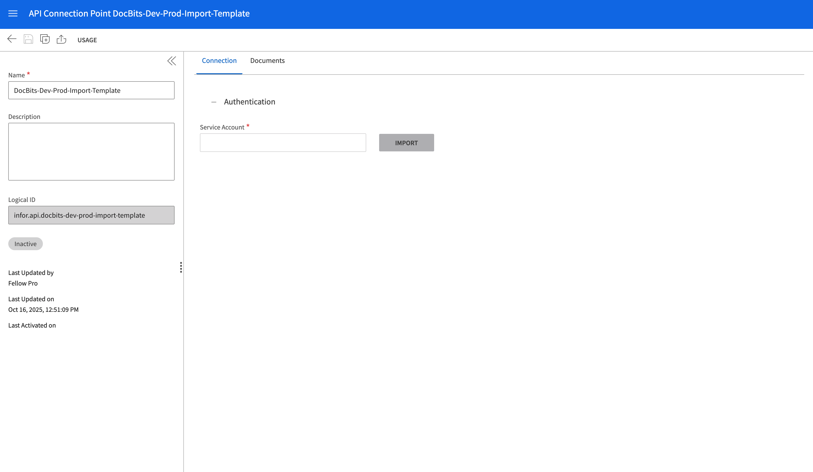

# M3\_OLD

## Importar um template de conexão de API no Infor M3

Este guia explica como importar um template de conexão de API (API Connection Template) para configurar rapidamente os principais ajustes da integração com o Infor M3. O uso de um template permite estabelecer uma configuração de conexão predefinida, simplificando o processo e garantindo consistência.

<mark style="color:red;">**Observação**</mark>: para a configuração detalhada de áreas específicas, como Auto Accounting, integração de fornecedores, pedidos de compra ou Table Extraction para elementos de custo, consulte a documentação correspondente:

* [Auto Accounting](m3/auto-accounting.md)
* [Fornecedores e pedidos de compra](m3/suppliers-and-purchase-orders.md)
* [Como importar todos os fornecedores](m3/how-to-import-all-suppliers.md)
* [Table Extraction para elemento de custo](m3/table-extraction-for-costing-element.md)

### **Baixar o template**

Antes de importar, baixe o template de conexão necessário usando o arquivo abaixo:



### Importar o template

#### Etapas para importar um template de conexão

1. **Acesse o Infor ION Desk:**
   *   Navegue até **InforOS** → **ION Desk** → **Connect** → **Connection Points**.

       
2. **Importe o template:**
   *   Clique no botão **Import**.

       <figure><figcaption></figcaption></figure>
   * Selecione o **arquivo de template** apropriado no seu computador.
   *   Clique em **OK** para iniciar o processo de importação.

       <figure><figcaption></figcaption></figure>
3. **Confirmação:**
   *   Se a importação for bem-sucedida, será exibida uma mensagem de confirmação.

       <figure><figcaption></figcaption></figure>
4. **Configuração pós-importação:**
   * Depois de importar o template, você pode personalizar ajustes específicos da conexão conforme necessário.
   * Não se esqueça de importar ou configurar sua **conta de serviço (Service Account)** para autenticação e controle de acesso.

<figure><figcaption></figcaption></figure>
