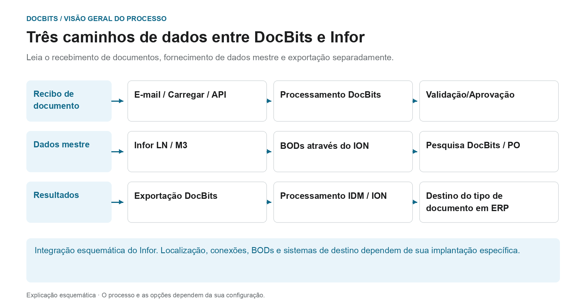

# Arquitetura

## A arquitetura como três caminhos de dados separados

<figure><figcaption>
Leia o recebimento de documentos, fornecimento de dados mestre e exportação separadamente. O diagrama é esquemático; as configurações ativas da sua organização determinam o comportamento real.
</figcaption></figure>

A arquitetura contém diversos fluxos de dados com finalidades diferentes. Os documentos são importados para processamento; os dados mestre vêm da integração do ERP; os resultados reconhecidos e revisados ​​são retornados por meio do caminho de exportação configurado. Esses caminhos são conexões separadas e devem ser rastreados separadamente durante o diagnóstico.

| Caminho de dados | Direção e propósito | Ponto de verificação |
| --- | --- | --- |
| **Recibo de documento** | E-mail, upload ou interface → DocBits. Os documentos são enviados para o processo de processamento pretendido. | O documento certo chegou à organização certa? |
| **Fornecimento de dados mestre** | LN/M3 → Fluxo de dados BODs e ION → DocBits. Fornecedores e pedidos são disponibilizados para identificação e conciliação. | O conjunto de dados necessário foi transferido e aceito pelo DocBits? |
| **Exportação de resultados** | DocBits → conexão Infor configurada → IDM ou ION e ERP. Os dados de documentos e negócios podem seguir diferentes caminhos downstream. | A transferência e o respetivo processamento no destino estão comprovados? |

Na exportação Infor descrita aqui, o PDF e seus atributos são enviados para IDM e `Sync.CaptureDocument` é enviado para ION Desk. ION o transforma no alvo requerido BODs de acordo com o tipo de documento. A aceitação por LN ou M3 deverá ser verificada no respectivo sistema alvo; uma etapa DocBits por si só não prova todas as etapas de processamento downstream.

**Use a visão geral para investigar erros:** Se um documento estiver faltando, comece com a importação. Se faltarem fornecedores ou linhas de ordem de compra, siga o caminho dos dados mestre. Se a transferência de retorno falhar, verifique a configuração da exportação, a resposta do destinatário e o processamento do ION/ERP. Os diagramas de arquitetura abaixo adicionam detalhes de implantação e componentes a esta visão geral do processo.

Além disso: [Importar documentos](../../end-user-and-partner-section/end-user-section/how-to-import-documents/README.md), [Importar dados mestre do cliente](../../infor-integration-and-configuration/importing-customer-master-data/README.md) e [Exportar de DocBits](../../infor-integration-and-configuration/exporting-in-docbits/README.md).

## **Cliente DocBits Cloud**

<figure><figcaption></figcaption></figure>

## DocBits em instalações próprias

<figure><figcaption></figcaption></figure>

Doc**Bits** integra-se perfeitamente com Infor ERP / SAP e M3 por meio da ION API, do ION Desk e dos BODs padrão da Infor. Nossa integração de API nos permite exportar dados para a Infor e realizar a validação de dados mestres no Doc**Bits**.

## **Arquitetura do DocBits Operator**

Todas as conexões entre os componentes são protegidas com protocolos de criptografia padrão do setor. SSH, HTTPS e outros canais seguros garantem a integridade e a confidencialidade dos dados em todo o sistema.

**Em instalações próprias:**&#x20;

<figure><figcaption></figcaption></figure>


[prefect-local-setup-requirements.md](prefect-local-setup-requirements.md)


**Cloud**:

<figure><figcaption></figcaption></figure>

## Exportando dados para a Infor

Usamos a ION API para enviar o PDF com atributos ao IDM e o BOD Sync.CaptureDocument ao ION Desk. No ION Desk, transformamos o [Sync.CaptureDocument](../../infor-integration-and-configuration/exporting-in-docbits/) nos BODs de destino desejados, com base no tipo de documento processado. Esses BODs da Infor transformados são então importados automaticamente para o LN ou o M3.


Exportar para a [Infor](../../infor-integration-and-configuration/exporting-to-infor/)


## Validação de dados mestres no DocBits

Para identificar o fornecedor ou comparar/combinar linhas de pedidos de compra, ativamos um gatilho no LN/M3 que envia os BODs Sync.RemitToPartyMaster, Sync.SupplierPartyMaster e Sync.PurchaseOrder para o Doc**Bits**. Configuramos esse processo no ION Desk definindo o fluxo de dados para um ponto de conexão específico com o Doc**Bits**.

<figure><figcaption></figcaption></figure>


[Validação de dados mestres](../../infor-integration-and-configuration/importing-customer-master-data/)


## Importação de e-mail com OAuth Office365

<figure><figcaption></figcaption></figure>
