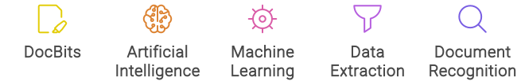

# Principais Recursos do DocBits

O DocBits é uma solução de captura de documentos baseada em nuvem que aproveita o poder da Inteligência Artificial (IA) e do Aprendizado de Máquina (ML) para reconhecer, classificar, analisar e extrair informações de vários tipos de documentos, independentemente do formato. Veja a seguir uma visão mais detalhada de seus principais recursos:

<figure><figcaption>
Principais Recursos do DocBits
</figcaption></figure>

* Reconhecimento de Documentos: o DocBits utiliza algoritmos de IA para identificar e reconhecer documentos com precisão, sejam eles em papel ou arquivos eletrônicos.
* Classificação de Documentos: classifica os documentos em categorias relevantes, facilitando a organização e a recuperação.
* Extração de Dados: extrai dados críticos dos documentos, transformando informações não estruturadas em dados estruturados que podem ser integrados ao seu fluxo de trabalho.
* Aprendizado de Máquina: o sistema aprende continuamente e melhora sua precisão de reconhecimento a cada documento processado, tornando-se mais eficiente com o tempo.
* Inteligência de Enxame: o DocBits utiliza inteligência de enxame para aprimorar sua capacidade de aprendizado, criando um sistema que se aperfeiçoa sozinho.
