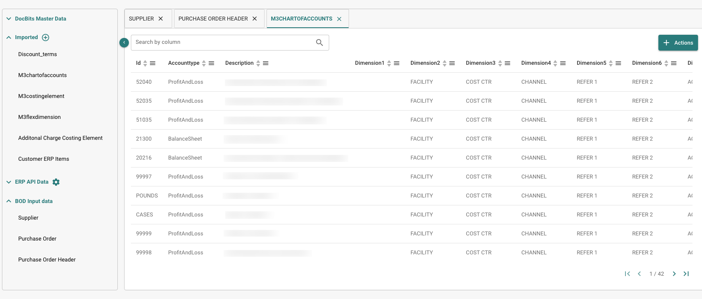

# Notas de Lançamento

**Disponibilidade da NOVA R1.1:** Disponível no ambiente de testes desde **16 de outubro de 2026**. A entrada em produção está prevista para **4 de novembro de 2026**.



**DocBits é o produto. NOVA designa o ciclo de lançamentos.** [Ver o vídeo sobre o novo lançamento do DocBits](https://docbits-videos.fra1.cdn.digitaloceanspaces.com/settings-assistant/nova-release/v2/pt.mp4) · [Legendas](https://docbits-videos.fra1.cdn.digitaloceanspaces.com/settings-assistant/nova-release/v2/pt.vtt).

Escolha um canal de lançamento para ver o que muda para a sua equipa. **O ciclo NOVA introduz a nova versão menor do DocBits com capacidades adicionais para clientes. Os hotfixes da VESTA melhoram a versão de produção atual.** Consulte o [ciclo de vida do lançamento](../docbits-release-lifecycle-strategy.md) para disponibilidade e mudança entre canais.

**As antigas funcionalidades beta da VESTA estão incluídas no ambiente de testes da NOVA.** Todas as funcionalidades anteriormente disponíveis como beta na VESTA fazem parte das funcionalidades regulares da NOVA e podem ser testadas antes da entrada em produção prevista. Passarão também a ser funcionalidades regulares da VESTA com o [próximo hotfix, previsto para **11 de novembro de 2026**](vesta-hotfix-11-november-2026.md).

| Canal de lançamento | Notas de lançamento | Foco |
| --- | --- | --- |
| **NOVA – Versão Menor** | [Novidades para clientes](nova-major-release.md) · **4 de novembro de 2026 (prevista)** | Todas as antigas funcionalidades beta da VESTA, além de novas capacidades e extensões em comparação com a VESTA R1.0.15. |
| **VESTA — Próximo Hotfix (planeado)** | [11 de novembro de 2026](vesta-hotfix-11-november-2026.md) | Introduz todas as antigas funcionalidades beta da VESTA no conjunto de funcionalidades regular da VESTA. |
| **VESTA — Lançamento de Hotfix** | [14 de outubro de 2026 — R1.0.15](incremental-updates-14-october-2026.md) | Melhorias e correções para a versão de produção atual da VESTA. |

## NOVA – Versão Menor 4 de novembro de 2026

### O que a sua equipa ganha com a NOVA

* **Use as antigas funcionalidades beta da VESTA como funcionalidades regulares da NOVA.** Todas as funcionalidades anteriormente oferecidas na beta da VESTA estão incluídas na NOVA, incluindo os controlos de gestão de regras e layouts. As definições da organização, os interruptores de tipo de documento e as permissões ainda se aplicam.
* **Resolva bloqueios de documentos com o Assistente de validação.** Pergunte o que impede um documento, salte para o campo relevante e reveja as correções sugeridas enquanto permanece no documento.
* **Transforme correções repetidas em melhorias de automação revistas.** Os revisores podem submeter pedidos de melhoria; os administradores podem avaliar propostas de regras aprendidas, rever documentos afetados e medir o resultado após a ativação.
* **Compreenda e atue sobre erros de faturas eletrónicas.** Utilize relatórios agrupados por nível de validação, reveja políticas de tipo de documento e o seu histórico, e rejeite uma fatura elegível com um motivo registado.
* **Configure e controle importações FTP/SFTP.** Utilize o assistente de conexão, siga os passos de importação por ficheiro, configure tentativas e notificações de falha, e opcionalmente apague ficheiros de origem após a importação bem-sucedida.
* **Corresponda linhas de entrega com menos ações repetidas.** Selecione primeiro linhas de documento ou de ordem de compra e ligue-as em qualquer direção. As exportações configuradas podem preservar detalhes de sub-linhas e agrupar registos por valores de linha.
* **Mantenha o trabalho exportado separado do trabalho concluído.** Utilize o estado Exported para processamento de acompanhamento e opcionalmente bloqueie documentos Finished contra reabertura ordinária.
* **Aceda diretamente aos controlos de regras e layouts.** Abra os painéis de gestão sem um link beta, pesquise e pré-visualize layouts, e abra o editor de layouts a partir de um documento.
* **Controle a extração e a administração rotineira.** Reinicie um documento com uma contagem de páginas escolhida, escolha se os campos ocultos são extraídos, utilize ações adicionais do Assistente de definições e limite as regras de notificação a uma sub-organização.

### Guias para configurar regras

* [**Regras de transformação**](../../administration-and-setup/settings/global-settings/document-types/transformation-rules.md): limpe e reescreva valores extraídos, crie uma sequência de passos e pré-visualize o resultado. **Ver:** [Ver vídeo](https://docbits-videos.fra1.cdn.digitaloceanspaces.com/settings-assistant/transformation-rules/v1/pt.mp4).
* [**Regras de validação personalizadas**](../../administration-and-setup/settings/global-settings/document-types/custom-validation-rules.md): defina verificações para campos e linhas de tabela, escolha condições e gravidade, e teste as suas regras. **Ver:** [Vídeo em inglês](https://docbits-videos.fra1.cdn.digitaloceanspaces.com/settings-assistant/custom-validation-rules/v1/en.mp4).
* [**Regras de correspondência de encomendas**](../../administration-and-setup/settings/global-settings/document-types/more-settings/purchase-order/purchase-order-matching-rules.md): configure tipos de correspondência, tolerâncias e ordem de execução, e gerir versões de regras. **Vídeo relacionado — Escolher a Automação Certa:** [Ver vídeo](https://docbits-videos.fra1.cdn.digitaloceanspaces.com/settings-assistant/choose-automation/v1/pt.mp4).

[Ver todos os vídeos de funcionalidades](nova-major-release.md#watch-the-feature-videos), incluindo layouts, Touchless Intelligence, Validação de Faturas Eletrónicas e a série de seis partes sobre AI Table.

[Ler a comparação completa de funcionalidades NOVA](nova-major-release.md), incluindo requisitos de ativação, melhorias adicionais e todas as **16 versões de serviço**.

**A base VESTA inclui funcionalidades existentes e funcionalidades beta:** o Assistente de definições original, avisos básicos de saúde da importação, níveis de IA, Verificação de Campos de Cabeçalho, painel Touchless Intelligence, motores de regras, transformações após pesquisa de dados mestres e registos básicos de execução de regras. As notas NOVA distinguem a transição de beta para disponibilidade regular de adições adicionais a estas capacidades.

## VESTA — Versões de Hotfix <a href="#vesta-hotfix-releases" id="vesta-hotfix-releases"></a>

**Próximo hotfix planeado: [11 de novembro de 2026](vesta-hotfix-11-november-2026.md).** Todas as funcionalidades anteriormente disponíveis como beta na VESTA, e agora incluídas na NOVA, tornar-se-ão funcionalidades regulares da VESTA neste hotfix.

**Hotfix mais recente lançado: [14 de outubro de 2026 — R1.0.15](incremental-updates-14-october-2026.md).** Este hotfix da VESTA introduziu o Assistente de definições, níveis de IA atualizados, a Verificação de Campos de Cabeçalho, melhorias no início de sessão e melhorias na correspondência de encargos de ordens de compra.

Notas de hotfix anteriores da VESTA:

* [15 de setembro de 2026 — R1.0.13](incremental-updates-15-september-2026.md)
* [8 de setembro de 2026](incremental-updates-8-september-2026.md)
* [12–25 de agosto de 2026](incremental-updates-12-25-august-2026.md)
* [29 de julho – 12 de agosto de 2026](incremental-updates-29-july-12-august-2026.md)
* [14–29 de julho de 2026](incremental-updates-14-29-july-2026.md)
* [4–14 de julho de 2026](incremental-updates-4-14-july-2026.md)
* [3–4 de julho de 2026](incremental-updates-3-4-july-2026.md)
* [30 de junho – 3 de julho de 2026](incremental-updates-30-june-3-july-2026.md)
* [26–30 de junho de 2026](incremental-updates-26-30-june-2026.md)
* [21–25 de junho de 2026](incremental-updates-21-25-june-2026.md)

Os anúncios de lançamento originais permanecem abaixo para referência.

## **Release R1.0 13/14 de junho de 2026**

> **Disponibilidade no Sandbox:** 28 de abril de 2026

### Novas funcionalidades:

* **Activity Logging / Access Audit:**\
  Registro detalhado de atividades e trilha de auditoria de acessos em todo o aplicativo, para conformidade e monitoramento. Diferentes tipos de logging para todos os microsserviços, com base em intervalo de tempo.
* **Global Quick Search:**\
  Pressione Cmd+K / Ctrl+K em qualquer parte do aplicativo para pesquisar em mais de 200 rotas e mais de 40 funcionalidades dentro das páginas. Mostra os 8 melhores resultados com correspondência aproximada (fuzzy), navegação com as teclas de seta e links para a App Index Page completa.
* **Sitemap (App Index Page):**\
  Página de índice pesquisável que cataloga cada página navegável e cada funcionalidade dentro das páginas (diálogos, barras laterais, painéis) no DocBits. Organizada em 18 categorias, com filtros por tipo, pills de categoria, pesquisa sincronizada com a URL e entradas protegidas por permissão exibidas como bloqueadas para usuários não administradores.
* **Analytics Dashboard:**\
  Análises abrangentes do processamento de documentos com Executive Overview, API Metrics, Quality Metrics, Processing Performance, Document Flow Analytics, Activity Log, Event Log e Audit Trail.
* **Dashboard Export Functionality:**\
  Nova funcionalidade de exportação do dashboard, que permite exportar uma lista nos formatos CSV ou XLSX.
* **Full-Text Search / DocSearch:**\
  Pesquisa vetorial baseada em IA em todos os documentos indexados, com filtro de fornecedores em tempo real, a funcionalidade "Find Similar" e configurações de indexação ajustáveis.
* **Supplier Delivery Statistics:**\
  Novas visões com informações sobre métricas de processamento de documentos relacionadas a fornecedores.
* **Debug Collector:**\
  Pressione Ctrl+Shift+P para capturar um snapshot de depuração completo, incluindo chamadas de API, estado do WebSocket, erros, logs do console, métricas de desempenho e informações do ambiente. Os snapshots podem ser copiados para a área de transferência ou enviados diretamente como ticket de suporte, com um relatório em formato HTML e um arquivo JSON anexado.
* **AI Agents (DocNet):**\
  Agentes autônomos em segundo plano que processam automaticamente os e-mails recebidos — classificando, extraindo e encaminhando documentos sem intervenção manual. Os agentes trabalham de forma independente nas tarefas atribuídas e acionam os usuários por meio de solicitações de aprovação quando é necessário o julgamento humano. Inclui um dashboard dedicado aos agentes para monitorar atividade e desempenho.
* **New E-Documents:**\
  Mais de 80 novos tipos globais de e-invoice e mais de 40 novos formatos, incluindo XRechnung 3.0.2, ZUGFeRD 2.2/2.3.2, variantes do Factur-X e Asia-Pacific PINT Credit Notes. Cobertura de 100% em classificação e extração.
* **AI Script Chat:**\
  Assistente de chat baseado em IA para o desenvolvimento básico de scripts, com respostas em streaming em tempo real.
* **Script Versioning:**\
  Histórico completo de versões dos scripts, com rastreamento de alterações, comparação e restauração. Oferece aos scripts um gerenciamento de versões semelhante ao das versões dos E-Docs.
* **Export History in Dashboard Actions:**\
  Acesso ao histórico de exportação de um documento diretamente pelo menu de ações do dashboard.
* **Generic API Exporter (APS450, GLS840):**\
  Destino de exportação de API genérico e configurável por meio de uma configuração de Mapping-File, para uma integração flexível com sistemas externos. Foram implementados os suportes a APS450 e GLS840.
* **Multiple Export Configurations:**\
  Suporte a várias configurações de exportação ativas por tipo de documento, com ordem de execução e um botão de reexportação para tentar novamente a partir da etapa que falhou.
* **New Watchdog Version:**\
  Reformulação completa da página de configurações do WatchDog. Foram adicionados novos recursos de conveniência, incluindo o status atual do WatchDog, guia e comandos de instalação, configuração de templates XSLT e uma configuração de atualização automática. Também foi implementada a funcionalidade para que o WatchDog gerencie várias configurações ao mesmo tempo.
* **Vertex Integration:**\
  Integração do Consumer Use Tax por meio da Vertex, para cálculo automatizado de impostos e conformidade durante o processamento de documentos.
* **UI Redesign & Settings Rework:**\
  Renovação abrangente da interface em todo o aplicativo. Páginas de login e autenticação redesenhadas. Área de configurações redesenhada, com barra lateral recolhível, subcategorias organizadas, navegação baseada em âncoras, painel de ajuda contextual e badges de acompanhamento de status. Alterações na interface dos scripts de documento. Nova interface do Document Flow. List of Values com interface aprimorada.
* **Idea Board:**\
  Quadro de sugestões em que os usuários podem enviar, discutir e votar em novas funcionalidades, melhorias, correções de bugs necessárias etc., com editor de texto rico e suporte a imagens.
* **API Key Management:**\
  Página de configurações dedicada à criação, visualização e gerenciamento de várias chaves de API.
* **Master Data Lookup Search Functionality:**\
  Capacidade de pesquisa de Master Data aprimorada, com opções de pesquisa adequadas aos campos selecionados.
* **User Activity Chart:**\
  Gráfico visual com os padrões de atividade e as métricas de engajamento dos usuários. Dashboard de atividade de login com gráficos comparativos de tendência, agregação diária/semanal e geolocalização baseada em GeoLite2.
* **User Login History:**\
  Visão de detalhes do usuário com o histórico de logins.
* **Customizable Sidebar:**\
  Reordenação por arrastar e soltar, alternância de mostrar/ocultar e fixação no topo para os itens do menu da barra lateral. As preferências são mantidas por usuário, com a opção "Reset to default". Respeita as feature flags.
* **Video Carousel:**\
  Carrossel de vídeos com reprodução automática na página prepare-dashboard, exibindo vídeos animados curtos com dicas do produto (Global Search, Keyboard Shortcuts, Document Upload, Table Customization). Layout em duas colunas, com os vídeos à esquerda e a preparação do dashboard à direita. O redirecionamento automático fica em pausa enquanto os usuários assistem aos vídeos.
* **Advanced Workflow Designer:**\
  Construtor de automação visual baseado em nós, com canvas de arrastar e soltar para pipelines de processamento de várias etapas. Suporta etapas de espera, caminhos paralelos, templates reutilizáveis, Or condition cards, botão manual de teste/execução, execução parcial "Test from Here" e logs de execução por nó, com destaque visual do fluxo mostrando exatamente quais nós foram executados.
* **Workflow KPI Dashboard:**\
  Dashboard de métricas-chave para monitorar a execução dos workflows.
* **Workflow Partner Card SDK:**\
  SDK para desenvolvedores terceiros criarem cards de workflow personalizados, com revisão baseada em IA, validação em sandbox e documentação de primeiros passos.
* **Workflow Test Manager:**\
  Gerenciador de testes automatizados para workflows, que permite aos administradores criar e executar testes individualmente ou em lote.

### Melhorias:

* **Banco de dados (todos os módulos) — Migração das colunas de ID:**\
  Todas as colunas "ID" do banco de dados do DocBits foram migradas internamente de strings para um tipo de ID dedicado (UUID7). O banco de dados Postgres subjacente foi migrado para a V18 para oferecer suporte a essa melhoria.
* **Processamento de documentos — Outras melhorias:**\
  Alteração da lógica de exportação relacionada ao número máximo de páginas consideradas — agora o documento inteiro será exportado. Durante a validação do documento, o usuário terá a opção de substituir o limite máximo de páginas padrão para esse documento específico. O cálculo do Pending Document Counter foi aprimorado.
* **Versões, status e data de implantação dos serviços:**\
  Status de disponibilidade dos serviços exibido no popup "Service Versions".
* **Language Expansion:**\
  Suporte ampliado para 22 idiomas, com seletor de idioma atualizado.
* **Controle de acesso no nível do campo:**\
  Controle de acesso redesenhado e aprimorado, com estado de ativação mais claro, acesso no nível do campo, tratamento consistente das regras e permissões simplificadas baseadas em grupos. Corrige regras conflitantes entre Access Control e View Permissions, exibe o proprietário da importação na interface e aplica o controle de acesso de forma consistente na validação de campos, nas tabelas extraídas por IA e em todas as visões.
* **Activity Stream em todas as telas:**\
  O Activity Stream agora está disponível em todas as telas de processamento de documentos (Ready for Validation, PO Matching, Accounting, Quote Details, Reject) — não apenas em Pending Approval. Movido para uma posição consistente no painel direito em todas as telas.
* **Document Flow Page:**\
  Página dedicada à visualização e ao acompanhamento do fluxo de processamento de documentos, mostrando as transições de status e o progresso ao longo do pipeline.
* **Dual Monitor Mode (configuração global do usuário):**\
  O modo de monitor duplo passou a ser uma configuração global do usuário, mantida entre as sessões.
* **Melhorias no Layout Builder:**\
  Suporte a campos ocultos e somente leitura com indicadores visuais, divisor de painel redimensionável e configurações de comprimento de campo. Aplique o Default Layout a vários origins sem precisar acessar cada um individualmente.

## **Release HotFix 3 16 de abril de 2026**

### Melhorias do DocBits:

* **Extração de QR Code para faturas polonesas:**\
  O DocBits agora oferece suporte à extração de QR Code especificamente para faturas polonesas, melhorando a captura automatizada de dados de documentos originários da Polônia.

### Correções de bugs:

* Corrigido um problema em que a exportação automática falhava quando o PO Matching já havia ocorrido, mas o pedido de compra não estava associado ao documento.
* Corrigido um problema em que os preços unitários eram arredondados incorretamente em faturas com unidades de embalagem (Verpackungseinheiten / VPE).
* Corrigido um problema em que as mensagens de erro de exportação do ION/MEC (por exemplo, falhas de Acknowledge.PurchaseOrder) não eram exibidas no DocBits, que mostrava o status "Exported" apesar de a exportação ter falhado.
* Corrigido um problema em que o preço unitário na tela de aprovação estava incorreto quando a extração de tabelas por IA era usada.
* Corrigido um problema em que o script Total Matching gerava um erro na tela de validação.
* Corrigido um problema em que o processamento de documentos falhava com um erro ("UserAuthentication object has no setter for 'org\_id'").
* Corrigido um problema em que o treinamento de tabelas não funcionava para determinados fornecedores, com colunas indo parar em colunas ocultas em vez de nos campos mapeados.
* Corrigido um problema em que o PO Matching falhava em faturas grandes (10+ páginas) porque o limite de tamanho da requisição multipart era excedido.
* Corrigido um problema em que os valores de colunas preenchidos por scripts não eram mantidos após a reinicialização de um documento.
* Corrigido um problema em que o toggle "Ignore Table Validation" aparecia como ativo (verde) na interface, mas estava na verdade desativado em segundo plano.
* Corrigido um problema em que a qualidade do documento era significativamente degradada após a importação.
* Corrigido um problema em que as versões dos microsserviços e as datas de implantação exibidas no aplicativo eram inconsistentes entre os ambientes após um push de implantação completo.
* Corrigido um problema em que a extração de código de barras falhava devido a um erro ao construir o objeto de autenticação do usuário a partir dos dados da tarefa.
* Corrigido um problema em que os dados de contato do fornecedor eram apagados ao salvar no portal de fornecedores.
* Corrigido um problema em que os documentos apresentavam um erro NoneType na exportação.
* Corrigido um problema em que o corpo do e-mail não era incluído quando o primeiro arquivo anexado era uma imagem PNG ou JPEG.
* Corrigido um problema em que o corpo do e-mail estava ausente em vários documentos.
* Corrigido um problema em que o DocBits Operator "ai-exporting" não gerava resultados de exportação nos sistemas de destino (LN/D3).

## **Release HotFix 2 31 de março de 2026**

### Melhorias do DocBits:

* **Processamento híbrido de PDF — Extração de XML controlada pelo usuário:**\
  Quando um PDF contém dados XML incorporados, os usuários agora podem escolher se o DocBits deve usar o XML incorporado para a extração ou processar o documento como um PDF padrão. Isso dá às organizações controle total sobre como os documentos híbridos são tratados, garantindo que seja aplicado o método de extração mais adequado ao seu fluxo de trabalho.
* **AP Assignment Code na tela de aprovação:**\
  A página de aprovação do AP Manager agora inclui um campo AP Assignment Code, integrado ao Infor M3 CRS620. Isso permite que os aprovadores revisem e confirmem os códigos de atribuição diretamente durante o processo de aprovação, sem precisar mudar para sistemas externos.
* **PO Total Matching com o total do documento:**\
  O DocBits agora oferece suporte à correspondência do total do pedido de compra com o total do documento, adicionando uma camada extra de validação durante o PO Matching para detectar discrepâncias mais cedo no processo.
* **Atualização do número do item do fornecedor e da VPE:**\
  O DocBits agora oferece suporte à atualização dos campos de número do item do fornecedor e VPE (Verpackungseinheit / unidade de embalagem) durante o processamento de documentos, com os valores sincronizados de volta ao M3 na exportação.
* **Classificação aprimorada do layout do documento:**\
  O ID do layout do documento (tfidf\_id) agora é gerado apenas com base no texto do cabeçalho, excluindo o texto do rodapé. Isso melhora a precisão da classificação, evitando que o conteúdo do rodapé influencie a detecção do tipo de documento.
* **Botão Export & Next:**\
  Foi adicionado um novo botão "Export & Next", que permite exportar o documento atual e seguir imediatamente para o próximo da fila, agilizando o fluxo de revisão e exportação.
* **Processo de aprovação para faturas de custo:**\
  O processo de aprovação de faturas de custo foi aprimorado, com lógica de roteamento e validação melhorada.

### Correções de bugs:

* Corrigido um problema em que a exportação Infor SFTP falhava com um erro devido a um comando de biblioteca incorreto.
* Corrigido um problema em que as caixas de seleção booleanas não podiam ser exibidas na tela de aprovação.
* Corrigido um problema em que mensagens UNMU eram enviadas mesmo quando não havia divergências na unidade de compra.
* Corrigido um problema em que o imposto sobre vendas era classificado incorretamente como encargo na tela de PO Matching, resultando em um valor pendente negativo.
* Corrigido um problema em que a exportação falhava quando a unidade de compra não estava definida na confirmação de pedido, mas estava presente no pedido de compra.
* Corrigido um problema em que o corpo do e-mail estava ausente em vários documentos.
* Corrigido um problema em que o número do item do fornecedor não era visível na tela de aprovação e as atualizações não eram enviadas ao M3.
* Corrigido um problema em que a exportação de fornecedores para o Infor retornava um erro.
* Corrigido um problema em que o PO Matching gerava erros durante o processamento.
* Corrigido um problema em que a função `findAll` não funcionava corretamente nos scripts de documento.
* Corrigido um problema em que a coluna "Updated By" do Watchdog mostrava incorretamente o usuário Fellow Admin em vez do usuário real.
* Corrigido um problema em que o BOD-Mapping não podia ser configurado na interface do Watchdog.
* Corrigido um problema em que os encargos eram exibidos incorretamente como valores pendentes em vez de serem exibidos como encargos.
* Corrigido um problema em que a correspondência automática não funcionava para faturas com várias linhas, apesar de haver uma configuração de correspondência.
* Corrigido um problema em que um hífen ("-") no número do item era considerado no PO Matching para o pedido de compra, mas ignorado na fatura, causando uma divergência falsa.
* Corrigido um problema em que tanto arquivos PDF quanto XML eram enviados para a pasta de exportação mesmo com o toggle "Export PDF" desativado.
* Corrigido um problema em que um status ausente no card de workflow impedia que os documentos avançassem no workflow.
* Corrigido um problema em que a qualidade do documento era significativamente degradada após a importação.
* Corrigido um problema em que a tela de PO Match gerava um erro ("Cannot read properties of null").
* Corrigido um problema em que a lista de valores padrão não podia ser editada.
* Corrigido um problema em que o workflow não conseguia ler corretamente o status do campo, causando um roteamento incorreto.
* Corrigido um problema em que as importações de e-mails recebidos falhavam com um erro.
* Corrigido um problema em que linhas ausentes não chegavam corretamente ao M3 durante a exportação.
* Corrigido um problema em que faturas codificadas e aprovadas ocasionalmente não eram atualizadas para o status "approved" no M3 por meio da API APS110.
* Corrigido um problema em que a configuração Multi Banking não funcionava corretamente.
* Corrigidos vários problemas na exibição e no comportamento de salvamento de dashboards compartilhados.
* Corrigido um problema em que o campo de número do item do fornecedor era limitado a 30 caracteres, impedindo o armazenamento de valores mais longos.
* Corrigido um problema em que os valores de preço unitário e de preço unitário por causavam um erro durante a exportação.
* Corrigido um problema em que linhas de pedido de compra com status excluído (por exemplo, "Closed") ainda podiam ser arrastadas e correspondidas na tela de PO Matching, apesar de estarem excluídas pelas regras de correspondência.

### Alterações de configuração:

* Templates de e-mail atualizados para remover o botão "Go to Task".
* Scripts e configurações de campos obrigatórios ajustados nos elementos de custo.

## **Release HotFix 1 16 de março de 2026**

### Melhorias do DocBits:

* **Histórico do documento na exportação SFTP:**\
  O DocBits agora oferece suporte à inclusão do histórico completo do documento no payload XML exportado ao exportar para SFTP. Esse recurso é configurável nas Export Settings e fornece aos sistemas downstream uma trilha de auditoria completa de cada mudança de status e ação realizada em um documento no DocBits — incluindo quem fez a alteração, quando ocorreu e quais eram os status anterior e atual. Isso é particularmente valioso para conformidade, rastreabilidade e análise operacional.
* **Atualização de encargos na confirmação de pedido para Infor On Premise:**\
  Os clientes Infor On Premise agora podem processar confirmações de pedido que incluem encargos diretamente no DocBits. Os encargos são totalmente atualizados por meio da exportação, tornando o processo de confirmação de pedido de ponta a ponta contínuo e eliminando a necessidade de ajustes manuais downstream.
*   **Aplicar o layout padrão a todos os origins:**\
    Um novo botão **Apply Default Layout to Origins** foi introduzido na tela de configuração de layout. Os administradores agora podem enviar o layout padrão a todos os origins de uma organização em uma única ação, eliminando o trabalhoso processo manual de copiar e colar o JSON do layout em cada origin individualmente. Isso é especialmente útil na integração de novos clientes, quando vários origins precisam ser configurados de forma consistente.

    <figure><figcaption></figcaption></figure>
*   **Seleção do tipo de documento para importação via FTP:**\
    As configurações de importação via FTP agora oferecem suporte à atribuição do tipo de documento por pasta. Ao configurar uma importação via FTP, os usuários podem especificar qual tipo de documento — como Invoice ou Order Confirmation — deve ser aplicado a todos os documentos importados dessa pasta. Os documentos são classificados automaticamente na importação, eliminando a necessidade de atribuir manualmente o tipo de documento após a ingestão. Isso atende organizações que gerenciam vários tipos de documento em diferentes suborganizações e pastas.

    <figure><figcaption></figcaption></figure>
* **Exportação para GLS840 para Infor On Premise**:\
  O DocBits agora oferece suporte à exportação de documentos para o programa GLS840 para clientes Infor On Premise, ampliando a gama de destinos de exportação compatíveis com ambientes on-premise.
*   **Melhorias de interface para Watchdog e configuração de exportação:**\
    As telas de configuração do Watchdog e de configuração de exportação foram renovadas com uma interface aprimorada, oferecendo um layout mais limpo e uma experiência mais intuitiva para os administradores que gerenciam essas configurações.

    <figure><figcaption></figcaption></figure>

    <figure><figcaption></figcaption></figure>

### Correções de bugs:

* Corrigido um problema em que usuários com direitos de visualização válidos não conseguiam ver documentos — a lógica de permissões foi refatorada, com uma verificação de nível de acesso substituindo a abordagem anterior de filtragem baseada em grupos.
* Tratamento de exceções aprimorado em várias áreas do aplicativo, para maior estabilidade.
* Resolvido um problema em que colunas do tipo booleano não eram tratadas corretamente durante a extração de campos.
* Corrigido um problema de autenticação assíncrona no endpoint de upload de arquivos.
* Resolvidos problemas de exibição da tabela de PO na tela de validação.
* Template de script atualizado para incluir comentários de rastreamento de alterações, para melhor auditabilidade.
* Corrigido um problema em que campos dropdown não se comportavam corretamente na tela de validação.
* Corrigido um problema em que o campo de suborganização não era preenchido previamente ao atualizar as atribuições de documentos a partir do dashboard.

## **Release Winter Summit 10 de dezembro de 2025**

### Melhorias do DocBits:

*   **Personalização aprimorada das regras de PO Matching:**\
    O DocBits agora oferece um controle mais granular e personalizável sobre as regras de correspondência de pedidos de compra. Os administradores podem configurar com precisão quais colunas devem ser avaliadas durante o processo de correspondência para cada tipo de documento, garantindo que apenas os campos mais relevantes sejam considerados. Além disso, é possível definir tolerâncias no nível da coluna, o que dá mais flexibilidade para lidar com pequenas divergências. Cada regra também pode ser configurada para valer para a correspondência manual, a correspondência automática ou ambas, permitindo que as equipes adaptem o fluxo de correspondência exatamente às suas necessidades operacionais. Essas melhorias aumentam significativamente a adaptabilidade e a precisão do processo de correspondência de pedidos de compra.

    <figure><figcaption></figcaption></figure>
*   **Suporte a várias contas financeiras de fornecedores:**\
    O DocBits agora oferece suporte ao gerenciamento de várias contas financeiras de fornecedores por meio do RemitToPartyMaster BOD fornecido pela Infor. Essa melhoria permite que as organizações mantenham vários registros de conta de remessa para um único fornecedor, aumentando a flexibilidade e a precisão no processamento de pagamentos. Uma nova configuração foi introduzida para ativar ou desativar essa capacidade, permitindo que os administradores habilitem o recurso conforme suas necessidades operacionais.

    <figure><figcaption></figcaption></figure>
*   **Acesso dos usuários aos resultados da extração por OCR:**\
    O botão **OCR View** na tela de validação de campos agora está disponível para todos os usuários com acesso à validação, e não mais apenas para administradores. Com essa atualização, qualquer usuário autorizado pode revisar diretamente os resultados da extração por OCR, o que facilita a validação da precisão dos dados e o monitoramento do desempenho geral do OCR. Essa melhoria promove maior transparência e aumenta a eficiência do fluxo de validação.

    <figure><figcaption></figcaption></figure>
* **Renderização dinâmica de colunas nas telas de aprovação:**\
  As visões de aprovação foram aprimoradas para exibir dinamicamente apenas as colunas configuradas para comparação nas preferências do banco de dados de cada organização. Antes, algumas colunas específicas da organização apareciam vazias quando não estavam configuradas para comparação, o que causava confusão. Agora, as visões de aprovação mostram apenas os campos que estão sendo comparados ativamente. Isso resulta em telas de aprovação mais claras e específicas para cada organização, sem colunas vazias ou irrelevantes.
* **Campo Order Type adicionado ao Master Data Lookup**:\
  A lista de cabeçalhos de pedidos de compra agora inclui uma coluna "Order Type" no Master Data Lookup, oferecendo recursos adicionais de categorização.
* **Melhorias nos dashboards com filtros personalizados:**\
  A funcionalidade de compartilhamento de dashboards foi aprimorada para dar mais flexibilidade aos usuários com quem o dashboard é compartilhado. Quem recebe dashboards compartilhados agora pode ajustar e editar os filtros do dashboard, adaptando as informações exibidas às suas necessidades específicas. Essa melhoria oferece uma experiência de visualização mais personalizada e interativa, permitindo que os usuários refinem com facilidade os insights de dados mais relevantes para suas tarefas.
* **Prefixos personalizáveis para as colunas da tela de aprovação:**\
  Uma nova opção configurável foi introduzida para exibir prefixos antes das colunas do documento nas telas de aprovação. Esse recurso pode ser gerenciado diretamente no layout builder, dando aos administradores controle total sobre a exibição dos prefixos e sobre os tipos de documento aos quais se aplicam. Ao ativar essa opção, os usuários ganham mais contexto e legibilidade ao revisar documentos durante o processo de aprovação.

### Melhorias gerais

* Registro de erros aprimorado para tabelas mal treinadas na extração de tabelas.
* Adicionado um limite de compartilhamento de dashboards de até 10 usuários ou 5 grupos, com uma mensagem de erro clara quando o limite é atingido.
* Tratamento de erros aprimorado para dashboards personalizados quando um usuário tenta criar um dashboard com um nome que já existe.

### Correções de bugs:

* Corrigido um problema em que e-mails pareciam ser enviados com sucesso na seção Supplier Details, mas não eram entregues aos destinatários.
* Corrigido um problema em que campos Dropdown adicionados às telas de aprovação/rejeição não eram exibidos.
* Corrigido um problema em que todos os documentos exportados eram marcados como atualizados por último pelo usuário errado.
* Corrigido um problema em que documentos exibiam o status "Workflow in Progress", mas nenhum workflow era executado e o log permanecia vazio.
* Corrigido um problema em que usuários não relacionados eram atribuídos a documentos no momento da exportação sem realizar nenhum trabalho neles.
* Corrigido um problema em que usuários com as permissões corretas não conseguiam rejeitar documentos atribuídos e recebiam erros.
* Corrigido um problema em que os ícones do fluxo de documentos não eram exibidos para algumas organizações.
* Corrigido um problema em que um popup aparecia ao enviar documentos para o dashboard com arrastar e soltar.
* Corrigido um problema em que os flags E-TEXT apareciam como ativados na interface, embora a resposta da API mostrasse todos os valores como false.
* Corrigido um problema em que ocorria um erro ao enviar documentos com páginas em branco.
* Resolvido um problema em que os hiperlinks de tarefas nas notificações por e-mail não redirecionavam os usuários para a tela de aprovação correta.
* Resolvido um problema em que, ao selecionar a suborganização cross, o Master Data Lookup não mostrava nenhum fornecedor. Os usuários agora podem ver corretamente os dados de fornecedores entre organizações.

## Release Autumn Summit 22 de outubro de 2025

### Melhorias do DocBits:

*   **Melhorias no design dos templates de e-mail:**

    O editor de templates de e-mail foi redesenhado para oferecer uma estrutura mais clara e uma experiência mais fluida. Selecionar campos do documento agora é mais intuitivo, e os anexos podem ser incluídos diretamente nos templates. Essas melhorias tornam a criação de e-mails profissionais e personalizados mais rápida e fácil.

    <figure><figcaption></figcaption></figure>
*   **Melhorias no dashboard:**

    O dashboard foi ampliado para melhorar a navegação e a personalização. Com as novas abas, os usuários podem alternar mais rapidamente entre diferentes tipos de documento, reduzindo o tempo gasto procurando a visão certa.

    <figure><figcaption></figcaption></figure>
*   **Dashboards com filtros personalizados:**\
    Além disso, os dashboards agora podem ser personalizados e filtrados de acordo com as preferências individuais. Esses dashboards personalizados também podem ser compartilhados com colegas, o que facilita\
    a criação de visões de relatório consistentes para toda a equipe.

    <figure><figcaption></figcaption></figure>
*   **Logs de notificações por e-mail:**

    Um novo recurso de registro está disponível para todas as notificações por e-mail. Os usuários agora podem consultar um histórico das notificações enviadas, o que facilita verificar as entregas e investigar problemas quando os e-mails não são recebidos.
*   **Suporte a e-invoice: e-SLOG 1.6 e 2.0:**

    Foi introduzido o suporte a formatos adicionais de e-invoice. O sistema agora pode processar e gerar as versões 1.6 e 2.0 do e-SLOG, ampliando a compatibilidade com parceiros e requisitos regulatórios.
*   **Melhorias na detecção de duplicatas:**

    A detecção de duplicatas foi aprimorada com duas poderosas opções de configuração. O **Duplicate Detection Interval** permite definir um intervalo de tempo para verificar duplicatas com mais precisão, enquanto a configuração **Disallow Export of Duplicates** impede automaticamente a exportação de documentos detectados como duplicatas. Juntas, essas melhorias oferecem mais controle e garantem maior precisão dos dados.

    <figure><figcaption></figcaption></figure>
*   **Melhorias nas árvores de decisão:**

    As árvores de decisão agora são mais versáteis, com a capacidade de retornar valores de campos do documento. Isso permite uma lógica de automação mais avançada, possibilitando que os workflows tomem decisões com base nos dados reais do documento.
*   **Novos cards de workflow:**

    Dois novos cards de workflow ampliam as capacidades de automação. O primeiro permite verificar se um documento pertence a uma suborganização específica, facilitando o tratamento de configurações com várias entidades. O segundo introduz uma verificação de tolerância da data de entrega, que compara as datas de entrega com a data atual em dias úteis para ajudar a gerenciar e aplicar os requisitos de entrega com mais eficácia.
*   **Melhorias na exportação CSV:**

    O recurso de exportação CSV foi significativamente aprimorado. Em vez de exportar apenas os documentos exibidos na página atual, o sistema agora exporta todos os documentos de um conjunto de dados. Cada exportação cria uma entrada de log, e o CSV resultante é enviado automaticamente por e-mail, oferecendo um processo de exportação mais completo e confiável.
*   **Prazo para exclusão de pedidos de compra:**

    Uma nova opção de configuração permite que os administradores definam um prazo para a exclusão de pedidos de compra. Essa melhoria acrescenta flexibilidade e controle sobre as políticas de retenção de dados, garantindo que os pedidos de compra só sejam removidos quando apropriado.

### Correções de bugs

* Corrigido um problema em que dados antigos eram incluídos ao exportar documentos.
* Corrigido o filtro de Export Errors, que antes exibia também outros status.
* Resolvida uma divergência na validação de tabelas em que "Unit Price" disparava erros, mas "Unit Price Per" não, apesar de os valores estarem corretos.
* Corrigido um problema em que a adição de uma nova coluna ao dashboard falhava.
* Corrigido um problema em que as tarefas não eram visíveis na coluna de tarefas do dashboard.
* Corrigido o comportamento de ordenação aleatória, de modo que as listas agora seguem uma ordem consistente.
* Resolvido um problema em que a alteração do tamanho da coluna não podia ser interrompida.
* Corrigido um bug que impedia a correspondência manual de linhas na tela de PO Matching.
* Corrigido um problema em que a opção de anexo do e-mail era redefinida após salvar.
* Corrigido um problema em que o auto accounting exibia inicialmente IDs do banco de dados na primeira abertura.
* Corrigido o comportamento dos campos fuzzy, de modo que os valores não são mais sobrescritos incorretamente.
* Corrigido um problema em que os campos no auto account desapareciam após a exclusão do conteúdo.
* Corrigido um bug em que o usuário não conseguia renomear "First Name" e "Last Name" no popup de configurações.
* Resolvido um problema em que os documentos podiam ficar presos em "workflow in progress".
* Corrigido um problema de cor dos ícones do menu em que as cores da organização selecionadas não eram aplicadas corretamente.
* Corrigido um problema em que os QR Codes às vezes não eram reconhecidos.
* Corrigido um problema em que as contas não podiam ser removidas com a tecla Backspace para inserir outra.
* Resolvida uma confusão de idiomas após o login, depois do push para produção.

## Release **Summer Bloom** julho de 2025

### Melhorias do DocBits:

* **Opção de filtro para o log de importação de e-mails:**\
  Os usuários agora podem filtrar os logs de importação e ordenar a tabela para ter uma visão mais clara e eficiente. Essa melhoria agiliza a identificação e o gerenciamento das entradas de e-mail, melhorando a solução de problemas e o gerenciamento geral dos logs.
*   **Suporte multilíngue para List of Values:**\
    Ampliamos os recursos multilíngues para a funcionalidade List of Values. Os administradores agora podem definir rótulos em vários idiomas, garantindo que o rótulo correto seja exibido automaticamente de acordo com a configuração de idioma do sistema do usuário. Essa melhoria promove maior acessibilidade e localização, facilitando a interação de usuários do mundo todo com a plataforma em seu idioma nativo.

    <figure><figcaption></figcaption></figure>
* **Melhorias nos detalhes do usuário nas configurações:**\
  A interface de configurações agora exibe informações completas do usuário. Os administradores podem ver com facilidade as filiações a grupos, os detalhes de suborganizações e outros dados importantes, o que permite gerenciar melhor as funções dos usuários e entender com mais clareza a estrutura das equipes. Além disso, os administradores agora podem criar um System Admin para a organização.
* **Informações de auto accounting na tela de aprovação:**\
  A tela de aprovação agora apresenta os detalhes de auto accounting junto com as informações da fatura. Essa melhoria oferece uma visão mais profunda dos dados da transação, facilitando processos de revisão mais fluidos e decisões mais bem fundamentadas sobre as faturas.
* **Contador de tarefas para documentos na visão do dashboard:**\
  Os documentos no dashboard agora podem indicar as tarefas em aberto associadas a eles e exibir o número total de tarefas pendentes. Esse recurso oferece aos usuários uma visão rápida das ações pendentes, melhorando o gerenciamento de tarefas e a eficiência do workflow.
* **Seleção de modelo de IA por fornecedor:**\
  Os usuários agora podem selecionar, para cada fornecedor, o modelo de IA usado na extração de dados. Essa melhoria permite uma otimização refinada, garantindo maior precisão de extração para diferentes fornecedores e melhorando os resultados gerais do processamento de dados. [Saiba mais](https://docs.docbits.com/end-user-and-partner-section/end-user-section/validation-screen#supplier-based-ai-model)
* **Logs de workflow aprimorados para cards de árvore de decisão:**\
  Os logs agora exibem a saída da árvore de decisão, facilitando o acompanhamento e a compreensão de como as decisões foram tomadas nos workflows.
*   **Introdução de uma nova configuração de testes automáticos para melhorar a funcionalidade e a estabilidade do sistema:**

    Temos o prazer de anunciar a implementação de um novo sistema de testes automatizados, criado para melhorar a funcionalidade e a confiabilidade gerais da nossa plataforma. Essa nova configuração executará verificações consistentes e minuciosas no sistema para identificar problemas antes que eles afetem a sua experiência. Ao automatizar esses testes, podemos responder mais rapidamente a possíveis problemas e manter os mais altos padrões de qualidade do nosso sistema.
* **Implementação da arquitetura de microsserviços:**\
  Reestruturamos a plataforma dividindo os componentes principais em microsserviços dedicados. Essa mudança arquitetônica aumenta a escalabilidade, melhora o desempenho do sistema e permite ciclos de desenvolvimento e implantação mais rápidos e modulares.
*   **Walkthrough:**\
    Agora há um walkthrough guiado para ajudar os usuários a navegar e entender mais facilmente as diferentes partes do aplicativo. Isso é especialmente útil para integrar novos usuários ou explorar funcionalidades desconhecidas.

    <figure><figcaption></figcaption></figure>
* **Melhorias na árvore de decisão:**\
  Foram feitas melhorias na interface da árvore de decisão, incluindo um recurso mais intuitivo de adição de linhas — agora no topo da árvore — para simplificar a manutenção e a edição.
* **DocOperator**\
  Novas ferramentas baseadas em IA, como o DocOperator, ajudam a automatizar tarefas repetitivas, aumentando a eficiência e reduzindo o esforço manual nos workflows de documentos.
*   **Opção de pré-visualização de documentos eletrônicos:**\
    Foi adicionado um recurso de pré-visualização para documentos eletrônicos (eDocs), que permite testar e visualizar alterações diretamente nas configurações antes de implantá-las.\\

    <figure><figcaption></figcaption></figure>
* **Novo idioma compatível – chinês:**\
  O DocBits agora oferece suporte ao chinês, ampliando a acessibilidade e as opções de localização para usuários nos mercados globais.
* **Dashboard de tarefas aprimorado:**\
  O dashboard de tarefas foi aprimorado para exibir um número maior de tarefas de uma só vez, oferecendo uma visão mais clara e melhorando o acompanhamento das tarefas.
*   **Melhorias no PO Matching:**

    Adicionados indicadores visuais para os diferentes estados de correspondência

    Nova configuração para ignorar linhas de pedido de compra já correspondidas por tipo de documento

    Verificação automática de atualizações de pedidos de compra aprimorada para garantir consistência
* **Melhorias no Layout Builder:**\
  Agora é possível pesquisar tanto por nomes quanto por títulos de campos, tornando mais rápido e fácil configurar e localizar componentes do layout.
* **Botão Export and Next na tela de aprovação:**\
  Foi adicionado à tela de aprovação um novo botão que permite exportar um documento e seguir automaticamente para o próximo da fila "Ready for Validation".
* **Novos cards de workflow:**\
  Foram introduzidos novos cards de workflow, incluindo cards para executar workflows em novos pedidos de compra e em eventos relacionados a cotações. Eles oferecem mais opções de automação.
*   **Melhorias no Watchdog:**\
    A configuração do Watchdog foi movida para a interface principal do aplicativo, facilitando o gerenciamento. Também foram introduzidas funcionalidades adicionais para melhor monitoramento e controle.\\

    <figure><figcaption></figcaption></figure>
* **Melhorias na rejeição de linhas:**\
  Rejeitar um item de linha agora exige que os usuários informem um motivo, garantindo melhor rastreabilidade e responsabilização nos workflows de revisão.
* **Lista de modelos de IA por fornecedor nas configurações:**\
  Uma nova visão nas configurações exibe os modelos de IA atribuídos a fornecedores específicos, com uma opção para redefini-los. Isso melhora a transparência e a capacidade de gerenciamento das configurações de IA por fornecedor.
*   **Melhorias no log do documento:**\
    Os logs do documento agora incluem informações mais detalhadas para apoiar melhor a auditoria e a solução de problemas.

    <figure><figcaption></figcaption></figure>
* **Suporte a PNG e JPG:**\
  Agora você pode enviar arquivos PNG e JPG, que serão convertidos automaticamente para o formato PDF para processamento.
* **Configuração do formato de documento da exportação IDM:**\
  O formato de exportação de PDFs no IDM agora pode ser configurado, dando aos usuários mais controle sobre como os documentos são gerados.
* **Novo tipo de eDoc – EDIFACT INVOIC02:**\
  Agora oferecemos suporte ao tipo de documento eletrônico EDIFACT INVOIC02, ampliando a compatibilidade com formatos de fatura padronizados.
*   **Opções de notificações e templates de e-mail**

    O DocBits agora oferece mais controle sobre as notificações por e-mail, incluindo:

    * **Timed Resend:** reenvia automaticamente os e-mails de notificação após um período definido se nenhuma ação for tomada, garantindo que as tarefas não passem despercebidas.
    * **Resend on Reassignment:** as notificações também podem ser disparadas quando as tarefas são reatribuídas, mantendo os usuários atualizados sobre mudanças de responsabilidade.
    * **Custom Email Templates:** os administradores agora podem criar e gerenciar templates de e-mail para personalizar assuntos, conteúdo das mensagens e formatação. Isso permite notificações personalizadas e contextuais, alinhadas ao estilo de comunicação da sua organização.

    Essas adições aumentam a eficiência da comunicação e reduzem atrasos nos workflows de tratamento de documentos.
*   **Status do pedido de compra no dashboard**

    O dashboard agora inclui uma opção para exibir o **status dos pedidos de compra (POs) vinculados** diretamente nas visões gerais dos documentos. Essa melhoria oferece aos usuários uma visão imediata do andamento do pedido de compra — como recebido ou faturado — permitindo decisões mais rápidas e melhor alinhamento entre documentos e processos de compras.

### Correções de bugs

* Resolvido um problema em que as tarefas não apareciam na tela de validação/aprovação.
* Corrigida a posição do botão Next/Previous para que permaneça estático.
* Corrigidos problemas de rolagem nas visões de script e de árvore de decisão, garantindo que os botões de ação permaneçam fixos durante a rolagem.
* Removido o campo de país de origem das e-invoices.
* Corrigido um problema em que o contador de tarefas exibia um número impreciso de tarefas.
* Adicionadas traduções ausentes.
* Corrigidos os campos personalizados para exibirem nomes descritivos em vez de IDs.
* Resolvido um problema em que os documentos eram baixados com um nome de arquivo incorreto.
* Corrigidas inconsistências de ordenação na tabela de linhas da fatura no PO Matching.
* Corrigido um problema que afetava a funcionalidade de criação de tarefas.
* Corrigido um problema no PO Matching em que a ordenação da tabela da fatura era redefinida ao corresponder uma linha.
* Resolvidos problemas de auto accounting, garantindo que as referências de lançamento sejam divididas corretamente quando um valor é dividido.
* Atualizadas as informações do host do ClickHouse.
* Resolvido um problema em que documentos duplicados não eram reconhecidos como duplicatas.
* Corrigidos problemas de exportação causados por referências de lançamento longas demais.
* Corrigidas as previsões fornecidas pelo auto accounting.
* Resolvido um problema em que caixas de seleção somente leitura não eram somente leitura.
* Corrigido um problema em que usuários podiam ser adicionados duas vezes a uma suborganização.
* Corrigido um problema em que a alteração da suborganização de um documento redefinia o usuário ou grupo atribuído.
* Resolvidos alguns problemas na tela de auto accounting.
* Corrigido um problema em que os usuários não conseguiam adicionar uma configuração de FTP.
* Corrigido um problema no login por SSO.
* Corrigidos alguns problemas relacionados a e-mails recebidos.
* Corrigido um problema em que os documentos recebiam um nome errado ao serem baixados.
* Corrigido um problema em que a árvore de decisão retornava um resultado incorreto.

## Release Hot Fix Winter Frost 10 de abril de 2025

### Melhorias do DocBits:

* **Função de script `set_column_date_value` aprimorada:**\
  A função `set_column_date_value` agora oferece suporte à opção `skip_weekend`, permitindo que os valores de data pulem automaticamente os fins de semana quando aplicados.
* **Suporte aprimorado ao upload de arquivos:**\
  Arquivos PNG e JPEG agora podem ser enviados diretamente e são convertidos automaticamente para o formato PDF, para um tratamento de documentos mais simples.
* **Melhorias na funcionalidade do Watchdog:**
  * Agora oferece suporte à exportação para o **Enaio**, para melhor integração entre sistemas.
  * Capacidades de parsing aprimoradas para extrair informações de estruturas XML `Sync.ContentDocument`, permitindo um processamento de dados mais eficiente.

### Correções de bugs

* Corrigido um problema em uma função de script.
* Resolvido um problema em que pedidos de compra ficavam com um status errado depois de atualizados.

## Release Hot Fix Winter Frost 17 de março de 2025

### Correções de bugs

* Atalhos aprimorados.

## Release Hot Fix Winter Frost 11 de março de 2025

### Melhorias do DocBits:

* **Extração de dados aprimorada:** adicionada uma opção para extrair o **Purchase Order** ou o **Item Number** de uma linha acima ou abaixo.
* **Acesso ampliado a Cross Sub-Organizations:** usuários não administradores agora também podem acessar o recurso **Cross Sub-Organizations**. [Saiba mais](https://docs.docbits.com/administration-and-setup/settings/global-settings/groups-users-and-permissions/sub-organizations#cross-sub-organisations-access)

### **Correções de bugs:**

* Corrigido um problema em que os usuários não podiam ser adicionados a um grupo.
* Corrigido um problema com falhas na importação de e-mails.
* Resolvido um problema com o treinamento de campos em documentos com mais de uma página.
* Corrigido um problema em que os scripts não funcionavam corretamente.
* Resolvido um problema em que os dados do documento não eram exibidos corretamente.
* Corrigido um problema com a configuração de atualização automática de pedidos de compra.
* Corrigido um problema em que os tokens de assinatura eram exibidos incorretamente.
* Resolvido um problema em que a tela de tarefas exibia uma versão desatualizada do documento.
* Corrigido um problema que fazia com que os documentos não mudassem de status.

## Release Hot Fix Winter Frost 3 de fevereiro de 2025

### **Melhorias do DocBits:**

* **Suporte a ISO-8859-1 para ZUGFeRD:** compatibilidade aprimorada para faturas que usam a codificação de caracteres ISO-8859-1.
* **Sistema de logging otimizado:** rastreamento e diagnóstico aprimorados para identificar e resolver problemas mais rapidamente.

## Release Winter Frost 22 de janeiro de 2025

#### Novas funcionalidades

### Suporte ao ZUGFeRD 2.1 e versões mais recentes

O DocBits agora inclui suporte completo às versões 2.1 e superiores do ZUGFeRD, permitindo o tratamento e o processamento contínuos de e-invoices compatíveis com o ZUGFeRD. A integração garante:

* **Compatibilidade**: o DocBits é capaz de gerenciar faturas ZUGFeRD tanto no formato estruturado (XML) quanto no não estruturado (PDF), mantendo a conformidade com padrões da UE, como a EN 16931 para faturamento eletrônico.
* **Eficiência**: os usuários podem importar, validar e extrair dados de e-invoices ZUGFeRD sem esforço, minimizando a digitação manual e reduzindo o tempo de processamento.
* **Flexibilidade**: seja com perfis basic, comfort ou extended do padrão ZUGFeRD, o DocBits oferece ferramentas para gerenciar cada nível de complexidade das faturas.
* **Preparado para o futuro**: com suporte às versões mais recentes, o DocBits garante que as empresas permaneçam em conformidade com as regulamentações de faturamento eletrônico em constante evolução nos Estados-Membros da UE e além.

Ao incorporar o ZUGFeRD 2.1 e os padrões mais recentes, o DocBits simplifica as transações internacionais e se alinha às necessidades modernas das empresas, tornando-se uma ferramenta essencial para organizações que priorizam a transformação digital e a conformidade regulatória. [Conheça as versões do ZUGFeRD e seus mapeamentos no DocBits](https://docs.docbits.com/administration-and-setup/settings/global-settings/document-types/edi/zugferd)

### Integração com API externa para processamento de documentos aprimorado

O DocBits introduz uma capacidade avançada de usar APIs externas durante o processamento de documentos, aumentando a completude e a precisão dos dados extraídos. Esse recurso reduz significativamente a entrada manual ao preencher campos ausentes com informações precisas e atualizadas, obtidas em tempo real de fontes confiáveis. Ele garante que os documentos sejam processados com mais rapidez e consistência.

### Cross Sub-Organizations Access

Para organizações com várias suborganizações habilitadas, o DocBits agora introduz o recurso Cross Sub-Organizations. Essa melhoria permite que usuários administrativos simplifiquem o gerenciamento de documentos em todas as suborganizações sob um único guarda-chuva. Os administradores agora podem acessar e visualizar todos os documentos de todas as suborganizações sem precisar trocar de suborganização. Essa visibilidade centralizada permite que os administradores vejam todos os documentos de todas as suborganizações, facilitando a localização de arquivos específicos sem perder a visão geral. [Saiba mais](https://docs.docbits.com/administration-and-setup/settings/global-settings/groups-users-and-permissions/sub-organizations#cross-sub-organisations-access)

<figure><figcaption></figcaption></figure>

### Visibilidade de documentos com base em permissões de grupo

O DocBits introduz controles aprimorados de visibilidade de documentos, permitindo um gerenciamento de acesso mais preciso para usuários não administradores por meio de permissões baseadas em grupos. Esse recurso permite que os administradores definam quais documentos ficam visíveis para usuários ou grupos específicos, garantindo fluxos de trabalho mais ágeis e maior segurança dos dados. Os administradores podem atribuir documentos a grupos específicos, concedendo visibilidade apenas aos usuários desses grupos. Assim, os usuários veem somente os documentos relevantes para sua função ou equipe, reduzindo a desordem e melhorando o foco. [Saiba mais](https://docs.docbits.com/administration-and-setup/settings/global-settings/groups-users-and-permissions/groups-and-permissions)

<figure><figcaption></figcaption></figure>

### Workflow sequencial e histórico de aprovação

O DocBits introduz um poderoso recurso de Sequential Workflow e Approval History, criado para aumentar a eficiência e a responsabilização no processamento de documentos. Ao permitir que os documentos sigam uma árvore de decisão predefinida, esse recurso garante uma revisão e uma aprovação ordenadas, mantendo um registro completo das ações realizadas. Gerenciamento de workflow sequencial:

* Os documentos podem ser atribuídos a vários usuários em uma sequência predefinida, garantindo que cada etapa de revisão ou validação ocorra na ordem correta.
* Cada usuário do workflow é notificado quando chega a sua vez de agir sobre o documento, reduzindo confusão e atrasos.
* Os workflows podem ser personalizados para corresponder a processos de negócio específicos

**Histórico de aprovação:**

* Um registro completo de todas as ações realizadas no documento está disponível nas visões de Validation e Approval. Isso inclui:
  * Ações dos usuários (por exemplo, "approved", "rejected")
  * Carimbos de data e hora de cada ação
  * Comentários ou observações adicionados pelos usuários durante a revisão
* O histórico garante transparência e fornece uma trilha de auditoria para conformidade e solução de problemas. [Saiba mais](https://docs.docbits.com/administration-and-setup/settings/global-settings/document-types/more-settings/approval-history)

<figure><figcaption></figcaption></figure>

### Melhoria do arquivamento de documentos SFTP/FTP

A melhoria de arquivamento de documentos SFTP/FTP no DocBits se baseia na funcionalidade de importação existente e introduz um método contínuo para arquivar arquivos depois de processados. Uma nova configuração na importação via FTP permite ativar ou desativar o arquivamento de arquivos. Quando os arquivos são ingeridos e processados com sucesso no DocBits, eles são arquivados automaticamente em uma pasta designada no servidor SFTP/FTP, caso a opção esteja ativada. Isso garante que os arquivos processados sejam preservados para fins de registro sem poluir os diretórios de importação ativos. [Saiba mais](https://docs.docbits.com/end-user-and-partner-section/end-user-section/how-to-import-documents/ftp)

<figure><figcaption></figcaption></figure>

### Várias seções de imposto por tipo de imposto e exportação para o LN

Esse recurso aprimora o tratamento de impostos ao permitir a classificação detalhada e a exportação das informações de impostos para o Infor LN (Full Tax, Reduced Tax, Tax Free). Isso permite um melhor alinhamento com estruturas tributárias complexas e garante uma integração contínua com os sistemas contábeis.

**Várias seções de imposto por tipo**:

* O DocBits agora oferece suporte à adição de várias seções de imposto em cada tipo de imposto, como:
  * Full Tax: alíquotas padrão de IVA ou de imposto sobre vendas.
  * Reduced Tax: alíquotas menores para bens ou serviços específicos (por exemplo, itens essenciais).
  * Tax-Free: isenções para transações elegíveis.
* Essas seções permitem a categorização precisa dos valores de imposto, garantindo a conformidade com as regulamentações fiscais e os padrões contábeis.

**Integração dinâmica com o Auto Accounting**:

* Com base nos dados extraídos durante o processamento do documento, as seções de imposto relevantes são exibidas automaticamente na tela de Auto Accounting.
* Isso garante que os usuários possam validar e ajustar os lançamentos de imposto rapidamente, sem cálculo manual nem nova digitação, agilizando o fluxo de trabalho.

**Exportação para o Infor LN**:

* Os dados de imposto, incluindo todas as seções e classificações relevantes, são exportados sem problemas para o Infor LN, garantindo consistência entre o processamento de documentos no DocBits e o sistema de planejamento de recursos empresariais (ERP).
* Os dados exportados são vinculados às respectivas linhas de custo no Infor LN, mantendo rastreabilidade clara e relatórios financeiros precisos.

<figure><figcaption></figcaption></figure>

<figure><figcaption></figcaption></figure>

### Melhorias no dashboard

O DocBits introduziu atualizações significativas no dashboard, com foco em usabilidade, eficiência e melhor visibilidade dos dados. Essas melhorias incluem um novo filtro "Assigned To Group" e uma interface otimizada para os Document Logs, facilitando a interação dos usuários com seus documentos e o gerenciamento deles.

### Melhorias no PO Matching

O DocBits introduz várias melhorias de usabilidade na tela de PO Matching, criadas para agilizar o processo de correspondência entre linhas de pedidos de compra (PO) e faturas. Essas melhorias oferecem controles mais intuitivos para a seleção de várias linhas e indicadores visuais claros para tratar dados de PO desatualizados.

**Ctrl + clique para seleção individual de linhas**:

* Os usuários agora podem manter a tecla Ctrl pressionada e clicar em linhas específicas para selecionar várias linhas não contíguas na tela de PO Matching.

**Shift + clique para seleção de intervalo**:

* Os usuários podem selecionar um intervalo de linhas mantendo a tecla Shift pressionada, clicando na primeira linha e, em seguida, na última. Todas as linhas entre a primeira e a última seleção serão selecionadas automaticamente.

**Detecção automática de dados desatualizados**:

* Se os dados do PO associados a uma fatura forem antigos (com base nas configurações do sistema), um ícone será exibido para avisar o usuário. Esse indicador visual garante que os usuários saibam que há dados obsoletos, que podem não refletir as atualizações mais recentes do pedido de compra.

### Correções de bugs

* Resolvido um problema para garantir que todos os valores possíveis sejam exibidos corretamente durante os processos de auto accounting
* Melhorada a interface dos Workflow Logs para tornar a navegação e a usabilidade mais intuitivas
* Atualizados os campos do documento para exibir informações adicionais, como os flags de obrigatório e oculto, diretamente na interface do usuário
* Adicionada a visibilidade das descrições de grupos nas configurações de grupos
* Exibidas as restrições de comprimento dos nomes de grupos durante a criação, para evitar erros
* Corrigidos problemas na funcionalidade de teste da árvore de decisão e resolvidas inconsistências de tradução
* Melhorada a funcionalidade de pesquisa nos Workflow Logs para resultados de pesquisa mais precisos e eficazes
* Corrigido um problema para impedir que os usuários excluam rascunhos de e-documents sem querer
* Resolvidos bugs no processo de importação de e-mails para garantir uma integração e um tratamento de dados sem falhas
* Corrigidos problemas ao salvar tags geradas por IA, garantindo a retenção consistente dos dados
* Corrigido um problema de ordenação que ocorria ao aplicar a ordenação em diferentes páginas do dashboard
* Aprimorado o contador de documentos para exibir com precisão o número de documentos processados pelo DocBits
* Melhoradas as traduções em todo o aplicativo para aumentar a usabilidade em diferentes idiomas

## Release Hot Fix Feast 17 de dezembro de 2024

### **Melhorias do DocBits:**

#### Melhorias na importação de e-mails

* Os usuários agora podem importar arquivos XML e EDI sem problemas por meio do recurso de importação de e-mails.

## Release Hot Fix Feast 27 de novembro de 2024

### Melhorias do DocBits:

#### Otimização aprimorada do PO

* **Mecanismo de salvamento otimizado**: o processo de salvamento foi simplificado para ocorrer somente depois que o usuário conclui a correspondência, reduzindo salvamentos redundantes e melhorando a eficiência.
* **Exportação assíncrona aprimorada**: a funcionalidade de exportação agora é executada de forma assíncrona, garantindo operações mais fluidas e uma melhor experiência geral do usuário.

#### Melhorias no workflow

A funcionalidade de workflow foi aprimorada para oferecer uma melhor experiência ao usuário:

* **Logs aprimorados**: os logs de workflow agora têm uma interface mais limpa e intuitiva, facilitando a revisão e a compreensão dos detalhes do processo.
* **Maior capacidade de resposta**: os processos de execução de workflow foram otimizados para um desempenho mais rápido e confiável, permitindo concluir tarefas mais depressa e reduzindo atrasos.

#### Cache de aplicativo aprimorado

Implementamos estratégias avançadas de cache em todo o aplicativo para otimizar a recuperação de dados e reduzir os tempos de carregamento. Essas melhorias aumentam a usabilidade geral ao garantir uma navegação mais fluida e uma experiência mais responsiva, especialmente nos recursos acessados com frequência.

#### Atualizações do dashboard e da interface

* **Melhorias no dashboard**: o dashboard foi reformulado com um layout aprimorado e recursos adicionais para simplificar a navegação e melhorar a visibilidade das métricas principais.
* **Melhorias na interface**: a interface do usuário em todo o aplicativo foi refinada para uma experiência mais moderna, intuitiva e fácil de usar, facilitando a execução das tarefas com o mínimo de esforço.

### Correções de bugs:

1. Aprimorada a lógica fuzzy para garantir um preenchimento de dados mais preciso e confiável após a extração.
2. Corrigidos bugs conhecidos que afetavam grupos e permissões, garantindo o gerenciamento de acesso e o funcionamento das funções sem falhas.
3. Tratadas inconsistências nas traduções em todo o aplicativo, melhorando a clareza e a localização.
4. Resolvidos problemas relacionados ao layout, garantindo uma interface consistente e otimizada em todas as configurações.
5. Corrigidos erros na funcionalidade de Master Data Lookup, garantindo a recuperação de dados precisa e confiável.
6. Resolvidos problemas na funcionalidade de importação de e-mails em todas as opções disponíveis, garantindo operações fluidas e sem erros.

## Release Feast 4 de novembro de 2024

### Novas funcionalidades:

#### Melhorias na importação de e-mails

Configuradas as definições de e-mail IMAP para enviar automaticamente notificações sobre os resultados da importação. As notificações de importação bem-sucedida confirmam os arquivos processados, enquanto os alertas de falha incluem os nomes dos arquivos e detalhes específicos do erro para uma solução de problemas rápida.

<figure><figcaption><p>Configurações de importação de e-mail</p></figcaption></figure>

#### Reformulação do Master Data Lookup

Reformuladas as configurações do Master Data Lookup, com uma categorização refinada que permite a recuperação mais rápida e precisa de diversos tipos de dados mestres. Essa melhoria simplifica o acesso aos dados ao organizar os dados mestres em categorias distintas, aumentando significativamente a eficiência e a precisão das pesquisas. Os usuários agora conseguem localizar os dados relevantes com mais rapidez, o que melhora a produtividade e a tomada de decisões em todo o aplicativo

<figure><figcaption><p>Dados mestres</p></figcaption></figure>

#### Melhorias de desempenho

Implementado um robusto mecanismo de cache para aumentar significativamente o desempenho do aplicativo, especialmente sob cargas elevadas de requisições. Essa melhoria reduz o tempo de processamento do servidor ao armazenar temporariamente os dados acessados com frequência, permitindo tempos de resposta mais rápidos e uma experiência mais fluida para o usuário. O novo sistema de cache gerencia com eficiência o aumento de tráfego, garantindo um desempenho confiável e escalável mesmo nos períodos de pico de uso

#### Melhoria do recurso de bloqueio de documentos

Aprimorada a funcionalidade de bloqueio de documentos para evitar edições simultâneas, garantindo a integridade dos dados e minimizando conflitos. Agora, os documentos são bloqueados automaticamente durante a edição ativa, com indicadores claros para os usuários quando um documento está em uso, impedindo que outras pessoas façam alterações até que a sessão de edição seja concluída. Essa melhoria agiliza os fluxos de trabalho colaborativos e reduz o risco de sobrescrita de dados.

#### Melhorias de navegação e experiência do usuário

* **Navegação breadcrumb**: adicionadas trilhas breadcrumb nas páginas do aplicativo para melhorar a navegação, permitindo que os usuários acompanhem e voltem facilmente a seções anteriores, para uma experiência de navegação mais intuitiva.
* **Interface simplificada**: removida a notificação em popup de "nova versão" para criar um fluxo de trabalho mais fluido e sem interrupções, reduzindo distrações e melhorando a usabilidade geral.

### Correções de bugs:

* Resolvidos problemas específicos de usuários, como falhas de anexos em e-mails criptografados ou assinados.
* Corrigidos problemas de exibição e de fluxo dos cards.
* Corrigidos problemas de roteamento dos botões Next/Previous.
* Tratados bugs relacionados às tabelas da árvore de decisão.
* Atualizada a interface do campo de senha para melhorar a usabilidade.
* Corrigidos problemas em que o contador de tarefas não era exibido corretamente.
* Corrigido um problema na interface da tabela de IA.
* Resolvidos erros na extração de documentos durante o treinamento de tabelas.
* Adicionado um aviso quando um PO é correspondido durante a reformatação, e garantido que as linhas correspondidas sejam removidas.
* Corrigida a formatação de datas, garantindo que os dados sejam carregados corretamente pelos filtros de dia e semana, e que os tipos de documento sejam exibidos corretamente.
* Corrigida a exibição de documentos em monitores duplos.
* Corrigido um problema em que desvincular uma linha de PO removia todas as linhas.
* Resolvidas traduções incorretas em todo o aplicativo.
* Corrigido o problema em que descrições longas no gerenciamento de regras causavam rolagem na lista.
* Feast: restaurada a funcionalidade "Assign-To" ausente para usuários não administradores.

## Release Harvest 9 de setembro de 2024

#### Novas funcionalidades

### Tratamento de faturas duplicadas

Esse recurso permite que os usuários identifiquem se há documentos duplicados no sistema. Ele funciona analisando campos do documento que podem ser configurados pelo usuário. Ao selecionar campos específicos, os usuários podem personalizar os critérios de detecção de acordo com suas necessidades, garantindo que apenas as duplicatas relevantes sejam sinalizadas. Isso ajuda a manter a integridade dos dados e reduz o acúmulo de documentos redundantes, simplificando os processos de gerenciamento de documentos.



### Árvore de decisão

A árvore de decisão é uma ferramenta usada para automatizar a tomada de decisões em um workflow, mapeando as opções e seus resultados. Ao integrar árvores de decisão, você garante decisões consistentes com base em critérios específicos, simplifica processos e reduz erros. Essa abordagem aumenta a eficiência ao automatizar pontos de decisão complexos dentro do workflow.



### Escolha de modelos de IA

O DocBits agora permite que os usuários alternem entre diferentes modelos de IA para atender melhor às suas necessidades. Você pode escolher o modelo de IA que melhor se adapta ao seu caso de uso específico, seja para análise de documentos, extração de dados ou classificação de textos. Essa flexibilidade permite otimizar o desempenho e obter resultados mais precisos, adaptando as capacidades da IA aos requisitos exclusivos da sua organização.



### Escolha da versão do OCR

O DocBits agora oferece a possibilidade de alterar a versão do OCR (Optical Character Recognition) usada na plataforma. Os usuários podem selecionar diferentes versões de OCR de acordo com suas necessidades específicas, garantindo maior precisão e compatibilidade com vários tipos de documentos. Esse recurso permite uma extração de texto mais precisa de imagens e documentos digitalizados, melhorando a qualidade geral dos dados e a eficiência do workflow.



## Release Sunset 12 de agosto de 2024

### Novas funcionalidades:

## Rule Manager

O [rule-manager](../../administration-and-setup/settings/document-processing/rule-manager/ "mention") oferece a flexibilidade de criar e editar regras de resolução de conflitos adaptadas ao sistema de faturamento do DocBits. Essas regras foram projetadas para tratar automaticamente as divergências entre os detalhes da fatura e os dados do pedido de compra (PO), garantindo uma conciliação financeira precisa. O sistema aplica essas regras ao processar linhas de fatura, encargos e impostos e gera ajustes ou observações apropriados quando necessário.

<figure><figcaption><p>Rule Manager</p></figcaption></figure>

### Sincronização de dados com Stream

A sincronização de BODs da Infor usa o AWS Stream para o processamento de dados em tempo real, aumentando a eficiência e reduzindo significativamente o tempo de sincronização de dados.

### XRechnung

O DocBits agora processa XRechnung (faturas eletrônicas) sem problemas, criando primeiro um PDF fácil de usar, o que agiliza e simplifica o fluxo de processamento de faturas.

<figure><figcaption></figcaption></figure>

### Correções de bugs:

1. Visibilidade do botão PO Match\
   Problema: o botão PO Match fica disponível quando não há tabela ou a tabela foi excluída.\
   Status: na validação de campos, o PO Match será ocultado se não houver tabela ou se a tabela tiver sido excluída
2. Ordenação da tabela por arrastar e soltar\
   Problema: arrastar e soltar para ordenar a tabela em todas as Listas/Dashboards\
   Resolução: o usuário agora pode arrastar e soltar para ordenar a tabela
3. Barra de ferramentas da tela de validação\
   Problema: tela de validação: a barra de ferramentas do lado direito não rola\
   Resolução: corrigido
4. Rolagem horizontal\
   Problema: rolagem horizontal na tela de aprovação\
   Resolução: corrigido
5. Limpar a decisão na tela de aprovação\
   Problema: possibilidade de limpar a decisão de aprovar/rejeitar na tela de aprovação\
   Resolução: corrigido
6. Exibição de tarefas na tela de aprovação\
   Problema: tarefa exibida na tela de aprovação\
   Resolução: há uma barra de ferramentas que mostra a contagem de tarefas abertas/em andamento
7. Tamanho da tabela de PO Match\
   Problema: a tabela de PO Match fica menor depois de correspondida uma linha\
   Resolução: corrigido
8. Atribuição de tarefas com base no grupo de compras do item\
   Problema: tradução para a atribuição do grupo de compras\
   Resolução: corrigido
9. Nome e ID do fornecedor na criação de tarefas\
   Problema: adicionar o nome e o ID do fornecedor na criação de tarefas\
   Resolução: o nome e o ID do fornecedor serão obtidos do documento
10. Cópia do subtipo de documento\
    Problema: o clique em Copy Document Subtype nas configurações de subtipo de documento não funcionava\
    Resolução: corrigido
11. Novo campo Label\
    Problema: novo campo Label na lista de valores para adicionar um rótulo junto com o valor e o sinônimo\
    Resolução: corrigido
12. Card Country Origin no workflow\
    Problema: novo card no workflow que verifica o país de origem de um fornecedor e cria uma tarefa ou continua o processamento do documento de acordo\
    Resolução: corrigido
13. Correção do modo escuro na barra de pesquisa das configurações\
    Problema: este problema já havia sido identificado anteriormente\
    Resolução: corrigido
14. Indicador de visibilidade das colunas da tabela extraída\
    Problema: indicador de colunas ocultas na tabela extraída na validação de campos\
    Resolução: corrigido
15. Atribuição no dashboard para administradores\
    Problema: tornar o Assign to no dashboard disponível apenas para administradores\
    Resolução: corrigido
16. Visibilidade da divisão de documentos\
    Problema: mostrar a divisão de documentos somente quando houver mais páginas\
    Resolução: corrigido
17. Colunas do dashboard de faturas\
    Problema: colunas adicionais no dashboard de faturas\
    Resolução: corrigido
18. Desativação de script na validação de campos\
    Problema: validação de campos: a desativação do script não funcionava corretamente\
    Resolução: corrigido
19. Personalização dos botões do layout de aprovação\
    Problema: não é possível alterar o tipo e o estilo dos botões no construtor de layout de aprovação\
    Resolução: corrigido
20. Tabela de sincronização de dados\
    Problema: tabela de sincronização de dados nas configurações\
    Resolução: corrigido
21. Total exibido no Dashboard Analytics\
    Problema: o Dashboard Analytics exibe um número total errado\
    Resolução: corrigido

## Release Firework 8 de julho de 2024

### Novas funcionalidades

**Exportação de encargos de linha para o M3**

• Exporte os encargos de linha para o M3 com os elementos de custo apropriados, conforme as necessidades do seu negócio.

**Tratamento de divergências entre PO e fatura**

• Tratamento inteligente de divergências de quantidade, preços, encargos e impostos.

### Principais resoluções de bugs

#### 1. Funcionalidade de pesquisa de PO

• Problema: a pesquisa de PO não funcionava.

• Status: esse problema foi identificado e não será tratado nesta release.

#### 2. Conexão do PO Matching

• Problema: a conexão do PO Matching não era removida como esperado.

• Resolução: corrigido para garantir operações de PO Matching sem falhas.

#### 3. Alertas em documentos exportados

• Problema: documentos exportados exibiam alertas de elementos de custo mesmo quando o sistema não estava configurado para isso.

• Resolução: corrigido para evitar alertas desnecessários, garantindo exportações de documentos precisas.

#### 4. Visão EDI de Advance Shipment

• Problema: a visão EDI de Advance Shipment exibia IDs no título.

• Resolução: os títulos agora são exibidos corretamente, melhorando a legibilidade dos dados.

#### 5. Erros de cálculo no problema de Split by Total

• Problema: ocorriam erros de cálculo quando as linhas eram divididas novamente.

• Resolução: corrigido para garantir cálculos precisos em todos os cenários.

#### 6. Exibição da tabela na tela de PO

• Problema: nenhuma tabela era exibida na tela de PO.

• Resolução: problema de exibição resolvido para que as tabelas apareçam corretamente.

#### 7. Auto Export na Order Confirmation

• Problema: a exportação automática não funcionava.

• Resolução: funcionalidade restaurada para que as exportações automáticas funcionem sem problemas.

#### 8. Problema de divergência no PO

• Problema: a divergência no PO era exibida mesmo com tudo idêntico na Delivery Note.

• Resolução: resolvido para garantir uma detecção de divergências precisa.

#### 9. Problemas no download de relatórios

• Problema: os relatórios não eram baixados.

• Resolução: corrigido para permitir o download de relatórios sem falhas.

#### 10. Valores total e líquido incorretos

• Problema: os valores total e líquido exibiam números incorretos.

• Resolução: valores corrigidos para garantir a precisão financeira.

#### 11. Formato da data da fatura no dashboard

• Problema: a coluna Invoice Date tinha valores com formato errado.

• Resolução: as datas agora são exibidas no formato correto, melhorando a usabilidade.

#### 12. Atrasos no workflow em "Ready for Validation"

• Problema: ocorriam atrasos no workflow em "Ready for Validation" até o retorno do Doc2flow.

• Resolução: temporização do workflow melhorada para processos de validação mais rápidos.

## Próxima release Firework 8 de julho de 2024

### Problema:

O sistema atual não possui regras automatizadas para corresponder e processar com precisão os encargos das faturas em relação aos pedidos de compra (POs). Esse processo manual pode levar a divergências, como ilustrado nas capturas de tela, em que os encargos da fatura e os POs precisam ser conciliados para um faturamento correto.

<div><figure><figcaption></figcaption></figure> <figure><figcaption><p>Rule Manager DocBits</p></figcaption></figure></div>

### Solução:

Com o novo Rule Manager do DocBits, que será lançado em julho, você pode automatizar esse processo:

#### 1. Criar regras:

Defina critérios (por exemplo, Quantity > PO Quantity) para os itens de linha da fatura.

#### 2. Definir ações:

Mapeie campos e ações para exportar os dados para o Infor sem problemas.

#### 3. Testar regras:

Valide as regras com dados de exemplo para garantir a precisão.

## Notas da versão Junebug - 10 de junho de 2024

Esta atualização traz novas funcionalidades e correções de bugs para o Junebug:

**Novas funcionalidades:**

* **Automated Charge Extraction:** o Junebug agora extrai e mapeia automaticamente os encargos nos seus documentos do Docbit. Isso elimina a digitação manual e agiliza o seu fluxo de trabalho.
* **Portal Export to Infor IDM:** o novo Portal permite exportar documentos de fornecedores diretamente para o Infor IDM sem esforço. Isso simplifica o processamento de remessas e reduz a intervenção manual.
* **Origin Identification (AI):** o Junebug introduz um poderoso recurso de IA que aprende automaticamente a origem dos documentos. Isso poupa tempo e esforço na classificação de documentos.
*

```
<div><figure><figcaption></figcaption></figure> <figure><figcaption></figcaption></figure> <figure><figcaption></figcaption></figure></div>
```

**Correções de bugs:**

* **QR Code Fix:** foi resolvido um problema que antes causava falhas no processamento de QR Codes.
* **Non-EDI Document Handling:** o Junebug agora trata documentos não EDI com mais eficácia.

<figure><figcaption></figcaption></figure>

Hotfix - 5 de junho [**Priority System**](../../end-user-and-partner-section/end-user-section/our-document-priority-system.md)

## Próxima release - Junebug Release 10 de junho de 2024

Sandbox Freeze - 3 de junho de 2024

<figure><figcaption></figcaption></figure>

Na próxima release, será introduzida uma melhoria significativa nas capacidades de classificação e extração, voltada especificamente para as linhas de tabela dos documentos. Esse novo recurso permite que os usuários definam se uma linha de uma tabela representa um encargo. Essa funcionalidade é particularmente útil em documentos financeiros detalhados, como faturas, em que distinguir entre diferentes tipos de transações — como encargos, impostos ou taxas — é essencial para um processamento e um registro precisos.

**Pontos principais para as notas da versão:**

* **Enhanced Table Line Classification**: os usuários agora podem especificar se uma determinada linha da tabela de um documento é um encargo, melhorando a precisão e a granularidade da extração de dados.

## Maypole Release 5.55.8.10 - (17 de maio)

### Notas da versão - Web App

#### Novas funcionalidades:

▪ Workflow Card Translation: melhorias no workflow, incluindo a tradução de cards para melhor suporte à localização.

▪ Email Import Logging: adicionado registro detalhado para as importações de e-mail, para melhorar a solução de problemas e o monitoramento.

▪ Broken Fuzzy Screen Fix: resolvido um problema de exibição quebrada da tela fuzzy em várias interfaces.

▪ Accounting Updates: processo contábil aprimorado, com a remoção de métodos contábeis obsoletos e uma integração mais eficiente dos encargos.

#### Melhorias:

▪ Ruiz Workflow Enhancements: corrigidos bugs relacionados à navegação no workflow, particularmente envolvendo etapas ocultas.

▪ User Interface Adjustments: elementos da interface melhorados, como os termos de desconto à vista em condições de pagamento, para maior clareza e melhor experiência do usuário.

▪ Performance Enhancements: diversas melhorias no backend para aumentar o desempenho e a estabilidade do sistema.

#### Correções de bugs:

▪ Approval Stamp Issue: corrigidos problemas críticos no processo do carimbo de aprovação, para garantir a conformidade e o funcionamento correto.

▪ Key Addition: chaves necessárias foram adicionadas de volta ao sistema para garantir a integridade dos dados e o funcionamento do sistema.

▪ Master Data Field Adjustment: tratado um problema no campo de dados mestres para alinhá-lo aos requisitos dos usuários.

#### Técnico:

▪ Version Updates: atualizações de rotina em diversos componentes do sistema para alinhá-los aos padrões e tecnologias atuais.

▪ Merge Activities: diversos merges para integrar recursos, correções e melhorias de várias branches de desenvolvimento à branch principal.

### What's New - API

▪ Cache Management Enhancements: atualizado o get\_receive\_delivery\_cache para melhorar o desempenho e a confiabilidade.

▪ New Features for Sales Orders: introduzido um recurso de pré-visualização para pedidos de venda, aprimorando a visualização e o gerenciamento dos dados dos pedidos.

▪ Document Handling Improvements: adicionados jobs de teste automatizados para os ambientes de demotesting e sandbox, para garantir robustez.

▪ Enhanced Cache Functionality: adicionado o field\_id para aprimorar ainda mais os mecanismos de cache.

#### Correções e melhorias

▪ Office Email Import Adjustments: feitos os ajustes necessários no recurso Office Email Import para melhorar a funcionalidade.

▪ Development Enhancements: vários merges das branches dev para main, garantindo sincronização e estabilidade entre os ambientes.

#### Diversos

▪ Configuration Updates: diversas atualizações nos arquivos de configuração, melhorando a configuração e os parâmetros do sistema.

### Notas da versão - Workflow

#### Melhorias:

▪ Implementado um novo teste de workflow que agora pode ser ativado durante a importação, permitindo cenários de teste mais flexíveis.

▪ Aprimorada a funcionalidade de logging dos action cards, tornando a depuração e o monitoramento mais eficientes.

▪ Melhorada a compatibilidade dos cards de comparação de campos com os tipos date e enum, garantindo comparações e validações mais fluidas.

▪ Atualizado o tax card e modificados os processos de retorno dos action cards para agilizar as operações.

#### Correções:

▪ Tratados problemas nas atualizações de status dos documentos, garantindo que sejam refletidas com precisão no sistema.

▪ Corrigido o cálculo do card de comparação envolvendo preço unitário e quantidade, para tratar corretamente as divergências.

▪ Resolvidos vários bugs menores e feitas melhorias de estabilidade.

#### Mudanças operacionais:

▪ Mesclados vários estágios de desenvolvimento nas branches sandbox e stage, refletindo uma integração significativa de novos recursos e correções.
