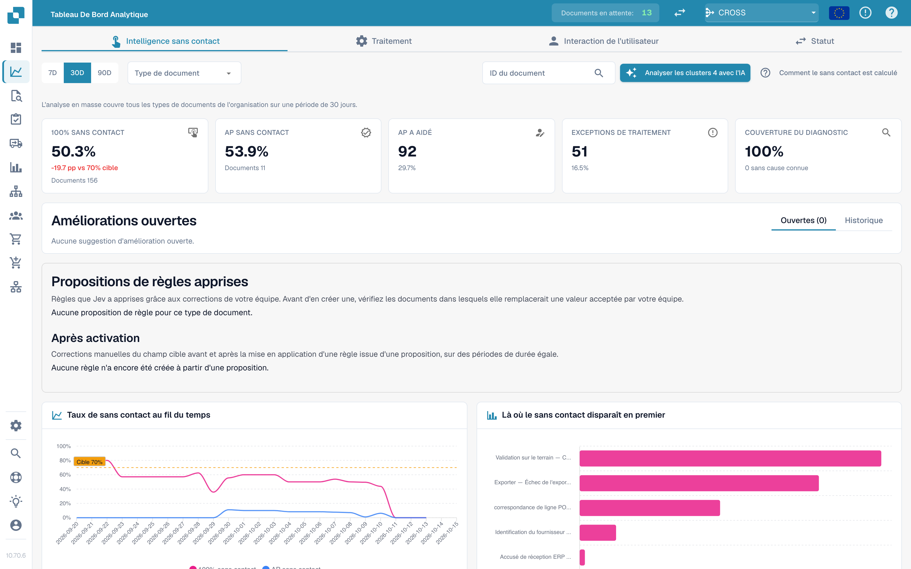

# Touchless Intelligence

Touchless Intelligence répond à deux questions distinctes : **DocBits a-t-il correctement extrait la facture ?** Et : **l'ensemble du processus s'est-il terminé sans intervention de traitement ?** Une extraction correcte peut encore nécessiter une reprise lorsque les données Infor diffèrent. AP désigne l'équipe humaine de comptabilité fournisseurs.

## Vidéo : fonctions du rapport Touchless



Cette version de contrôle de 5:41 montre un rapport renseigné : filtres, indicateurs et calcul, tendances, premiers blocages, preuves enregistrées, historique du document, comparaison des exécutions, règles apprises, améliorations et historique, rapports de conseil et résultats MCP réels.

[Ouvrir la vidéo avec des sous-titres français et 16 liens de chapitres](https://docbits-videos.fra1.cdn.digitaloceanspaces.com/settings-assistant/touchless-intelligence-preview-admin/v2/fr.html). L'écoute humaine de cette nouvelle version reste à faire.

Ces cas de formation expliquent les fonctions du rapport. Une recommandation ou un aperçu ne prouve ni un paramètre appliqué ni une amélioration mesurée. La proposition de modification MCP affichée nécessite encore une configuration cible précise ; l'aperçu et l'application sont indisponibles pour cette proposition. Certains textes natifs du produit peuvent conserver leur langue d'origine.

<figure><figcaption>
Touchless comme chaîne de tri, avec les chiffres illustratifs de l'exemple de calcul : les 14 portes sont les étapes du Chemin du pipeline, les feuilles encore sur le tapis sont en cours et ne sont pas comptées, un document qui s'arrête à une porte est poussé dans le bac de contrôle avec les documents AP assisted (30) et Process exceptions (10), et les documents Pure touchless (120) et avec approbation seule (30) du bac d'export donnent au cadran 150 sur 190, soit 78,9 %, au-delà de la marque cible de 70 %.
</figcaption></figure>

## Trouver le bon guide

| Guide | Contenu |
| --- | --- |
| [Indicateurs et calcul](../../touchless-metrics.md) | Catégories de résultats, numérateur et dénominateur, actions AP et calculs |
| [Utiliser le tableau de bord](touchless-dashboard.md) | Filtres, cartes d'indicateurs, tendances, premiers blocages et commandes |
| [Exemples pratiques : prix et quantité](touchless-examples.md) | Factures fictives et vues Dev réelles de PO avec écarts de prix et de quantité |
| [Diagnostic fournisseur et clusters de problèmes](../../touchless-supplier-diagnosis.md) | Prioriser les fournisseurs et les causes récurrentes |
| [Diagnostic du rapprochement avec le BC](../../touchless-po-matching-diagnosis.md) | Comprendre les règles actives, les tolérances et le déroulement de la décision |
| [Trace du document](touchless-document-trace.md) | Inspecter les valeurs d'origine, les exécutions, les blocages et les interventions |
| [Propositions de modification et rapports](touchless-change-proposals.md) | Distinguer aperçu, application, mesure de l'effet et annulation |
| [Expliquer et améliorer Touchless avec MCP](touchless-mcp.md) | Expliquer, diagnostiquer et apporter des améliorations contrôlées via MCP |

<figure><figcaption>
L'onglet Touchless Intelligence : chiffres clés, améliorations, le taux dans le temps et le graphique de la première perte. Organisation d'exemple avec des données de démonstration ; les noms de fournisseurs sont fictifs.
</figcaption></figure>

## Paramètres du rapport

Le rapport lit quatre paramètres d'organisation qu'un administrateur tient à jour sous **Settings → Module → Dashboards & Analytics**. Ils définissent l'objectif et la vue des coûts ; un champ vide signifie que DocBits utilise la valeur par défaut.

| Paramètre | Valeur par défaut | Ce qu'il contrôle |
| --- | --- | --- |
| Touchless target | 70 % | La part de documents qui devraient passer sans intervention de traitement. Le rapport l'utilise comme marque cible dans le graphique du taux. |
| Minutes per AP intervention | 6 min | Le temps dont un employé AP a besoin pour corriger et libérer un document. |
| Hourly cost | 40 | Le coût d'une heure de travail AP dans la devise ci-dessous. |
| Currency | EUR | La devise de la vue des coûts, sous forme de code ISO 4217 à trois lettres comme `EUR`, `CHF` ou `USD`. DocBits stocke le code en majuscules et rejette une valeur qui n'est pas un code de devise ; une faute de frappe ne peut donc pas atteindre le rapport. |

L'API revérifie les valeurs stockées et utilise la valeur par défaut pour une valeur avec laquelle elle ne peut pas travailler.

## Accès

Cette zone appartient au [Tableau de bord analytique](../). Les administrateurs y ont accès ; les autres utilisateurs ont besoin de l'attribution de rôle correspondante. L'analyse IA, les modifications prises en charge et les rapports de conseil peuvent exiger des droits administrateur.

<!-- Documentation review 2026-11-04: extraction quality vs process outcomes; KPI and terminal-outcome definitions checked against DocBits_API c51f350c728acb8ac964098d15f7b006bce273f4, module/automation_intelligence/kpi.py and bucket.py. Existing native screenshots retained and checked separately from illustrative examples. -->
<!-- Completion review 2026-11-04: owned synthetic PO examples, MCP schema/read evidence, human-action classification, KPI labels and screenshot proof limits. -->
