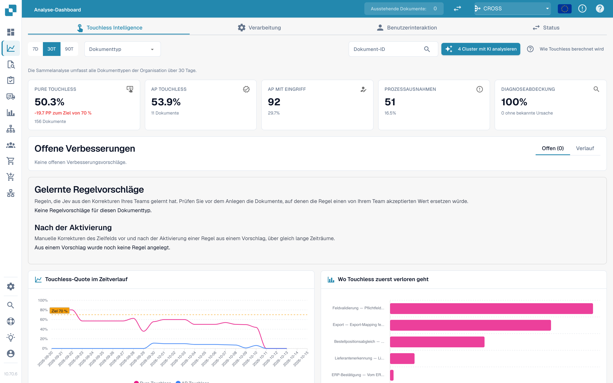

# Touchless Intelligence

Touchless Intelligence erklärt zwei unterschiedliche Fragen: **Hat DocBits die Rechnung richtig ausgelesen?** Und: **Konnte der gesamte Prozess ohne Bearbeitungseingriff abschließen?** Korrekte Auslesung kann bei abweichenden Infor-Daten trotzdem Nacharbeit auslösen. AP bezeichnet die menschliche Kreditorenbuchhaltung.

## Video: Funktionen des Touchless-Berichts



Diese Prüffassung mit 5:42 Minuten zeigt einen gefüllten Bericht: Filter, Kennzahlen und Berechnung, Trends, erste Blocker, aufgezeichnete Nachweise, Dokumentverlauf, Laufvergleich, gelernte Regeln, Verbesserungen und Verlauf, Consulting-Berichte und tatsächliche MCP-Ergebnisse.

[Video mit deutschen Untertiteln und 16 direkt anwählbaren Kapiteln öffnen](https://docbits-videos.fra1.cdn.digitaloceanspaces.com/settings-assistant/touchless-intelligence-preview-admin/v2/de.html). Die Hörprüfung dieser neuen Fassung steht noch aus.

Diese Schulungsfälle erklären die Berichtsfunktionen. Eine Empfehlung oder Vorschau belegt weder eine gespeicherte Einstellung noch eine gemessene Verbesserung. Der gezeigte MCP-Änderungsvorschlag benötigt noch eine konkrete Zielkonfiguration; Vorschau und Anwenden sind für diesen Vorschlag nicht verfügbar. Einzelne native Produkttexte können in ihrer ursprünglichen Sprache bleiben.

<figure><figcaption>
Touchless als Sortierstrecke, mit den Beispielzahlen aus der Beispielrechnung: Die 14 Tore sind die Schritte des Verarbeitungspfads, Blätter, die noch auf dem Band liegen, sind in Bearbeitung und werden nicht gezählt, ein Dokument, das an einem Tor stoppt, landet im Prüffach bei den Dokumenten mit AP Assisted (30) und Prozessausnahme (10), und die Dokumente mit Pure (120) und reiner Freigabe (30) im Exportbehälter ergeben 150 von 190 beziehungsweise 78,9 % auf der Anzeige, über der Zielmarke von 70 %.
</figcaption></figure>

## Die passende Anleitung finden

| Anleitung | Inhalt |
| --- | --- |
| [Kennzahlen und Berechnung](touchless-metrics.md) | Ergebniskategorien, Zähler und Nenner, AP-Aktionen und Berechnungen |
| [Dashboard bedienen](touchless-dashboard.md) | Filter, Kennzahlenkarten, Trends, erste Blocker und Bedienelemente |
| [Praxisbeispiele: Preis und Menge](touchless-examples.md) | Fiktive Rechnungen und echte Dev-Bestellansichten mit Preis- und Mengenunterschieden |
| [Lieferantendiagnose und Fehlermuster](touchless-supplier-diagnosis.md) | Lieferanten und wiederkehrende Ursachen priorisieren |
| [Bestellabgleich-Diagnose](touchless-po-matching-diagnosis.md) | Aktive Regeln, Toleranzen und den Entscheidungsablauf verstehen |
| [Dokumentverlauf](touchless-document-trace.md) | Originalwerte, Verarbeitungsläufe, Blocker und Eingriffe prüfen |
| [Änderungsvorschläge und Berichte](touchless-change-proposals.md) | Vorschau, Anwendung, Wirkungsmessung und Rücknahme unterscheiden |
| [Touchless mit MCP erklären und verbessern](touchless-mcp.md) | Über MCP erklären, diagnostizieren und kontrolliert verbessern |

<figure><figcaption>
Der Tab Touchless Intelligence: Kennzahlen, Verbesserungen, die Quote im Zeitverlauf und das Diagramm der zuerst verlorenen Dokumente. Beispielorganisation mit Demodaten; die Lieferantennamen sind frei erfunden.
</figcaption></figure>

## Berichtseinstellungen

Ein Administrator pflegt die vier Organisationseinstellungen, die der Bericht liest, unter Settings → Module → Dashboards & Analytics. Sie legen Ziel und Kostenansicht fest; ein leeres Feld bedeutet, dass DocBits den Standardwert verwendet.

| Einstellung | Standard | Was sie steuert |
| --- | --- | --- |
| Touchless target | 70 % | Der Anteil der Dokumente, der ohne Bearbeitungseingriff durchlaufen soll. Der Bericht verwendet ihn als Zielmarke im Quotendiagramm. |
| Minutes per AP intervention | 6 min | Die Zeit, die ein AP-Mitarbeiter benötigt, um ein Dokument zu korrigieren und freizugeben. |
| Hourly cost | 40 | Die Kosten einer Stunde AP-Arbeit in der unten genannten Währung. |
| Currency | EUR | Die Währung der Kostenansicht als dreistelliger ISO 4217-Code wie `EUR`, `CHF` oder `USD`. DocBits speichert den Code in Großbuchstaben und weist jeden Wert zurück, der kein Währungscode ist, sodass ein Tippfehler den Bericht nicht erreichen kann. |

Die API prüft die gespeicherten Werte erneut und verwendet für einen Wert, mit dem sie nicht arbeiten kann, den Standardwert.

## Zugriff

Dieser Bereich gehört zum [Analytics Dashboard](../../analytics-dashboard.md). Administratoren haben Zugriff; weitere Benutzer benötigen die entsprechende Rollenzuweisung. KI-Analyse, unterstützte Änderungen und Consulting-Berichte können Administratorrechte erfordern.

<!-- Documentation review 2026-11-04: extraction quality vs process outcomes; KPI and terminal-outcome definitions checked against DocBits_API c51f350c728acb8ac964098d15f7b006bce273f4, module/automation_intelligence/kpi.py and bucket.py. Existing native screenshots retained and checked separately from illustrative examples. -->
<!-- Completion review 2026-11-04: owned synthetic PO examples, MCP schema/read evidence, human-action classification, KPI labels and screenshot proof limits. -->
