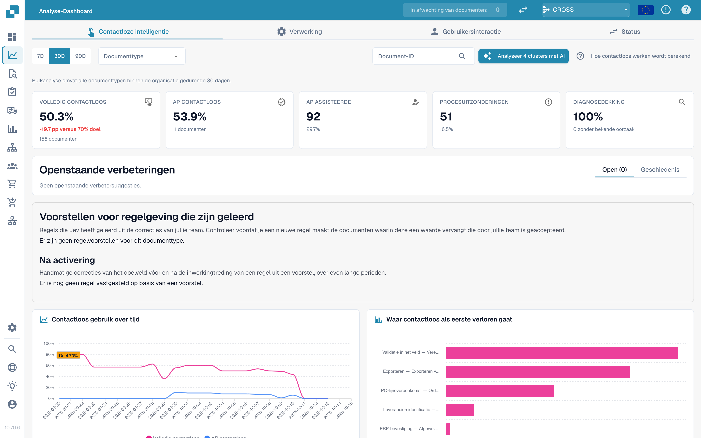

# Touchless Intelligence

Touchless Intelligence beantwoordt twee afzonderlijke vragen: **Heeft DocBits de factuur correct uitgelezen?** En: **Is het hele proces zonder verwerkingsingreep afgerond?** Correct uitlezen kan toch nabewerking vragen wanneer Infor-gegevens afwijken. AP betekent het menselijke team crediteurenadministratie.

## Video: functies van het Touchless-rapport



Deze controleversie van 4:22 toont een gevuld rapport: filters, kerncijfers en berekening, trends, eerste blokkades, vastgelegd bewijs, documentgeschiedenis, vergelijking van uitvoeringen, geleerde regels, verbeteringen en geschiedenis, adviesrapporten en werkelijke MCP-resultaten.

[Open de video met Nederlandse ondertitels en 16 hoofdstukken](https://docbits-videos.fra1.cdn.digitaloceanspaces.com/settings-assistant/touchless-intelligence-preview-admin/v2/nl.html). De luisterbeoordeling van deze nieuwe versie is nog niet afgerond.

Deze leervoorbeelden verklaren functies van het rapport. Een aanbeveling of voorvertoning bewijst geen toegepaste instelling en geen gemeten verbetering. Het getoonde MCP-wijzigingsvoorstel heeft nog een specifieke doelconfiguratie nodig; voorvertoning en toepassing zijn voor dat voorstel niet beschikbaar. Sommige oorspronkelijke productteksten kunnen in hun oorspronkelijke taal blijven staan.

<figure><figcaption>
Touchless als sorteerlijn, met de illustratieve getallen uit het rekenvoorbeeld: de 14 poorten zijn de fasen van het Pipeline Path, vellen die nog op de band liggen zijn in behandeling en tellen niet mee, een document dat bij een poort stopt wordt in de controlebak geduwd bij de documenten met AP assisted (30) en procesuitzondering (10), en de pure (120) en alleen-goedkeuringsdocumenten (30) in de exportbak geven op de wijzerplaat 150 van 190, oftewel 78,9 %, voorbij de doelmarkering van 70 %.
</figcaption></figure>

## Vind de juiste handleiding

| Handleiding | Inhoud |
| --- | --- |
| [Metrieken en berekening](../../touchless-metrics.md) | Uitkomstcategorieën, teller en noemer, AP-acties en berekeningen |
| [Het dashboard gebruiken](touchless-dashboard.md) | Filters, KPI-kaarten, trends, eerste blokkades en bediening |
| [Uitgewerkte voorbeelden: prijs en aantal](touchless-examples.md) | Fictieve facturen en echte Dev-PO-weergaven met prijs- en aantalverschillen |
| [Leveranciersdiagnose en probleemclusters](../../touchless-supplier-diagnosis.md) | Leveranciers en terugkerende oorzaken prioriteren |
| [PO-matchingdiagnose](../../touchless-po-matching-diagnosis.md) | Actieve regels, toleranties en de beslissingsstroom begrijpen |
| [Document Trace](touchless-document-trace.md) | Originele waarden, verwerkingsuitvoeringen, blokkades en ingrepen controleren |
| [Wijzigingsvoorstellen en rapporten](touchless-change-proposals.md) | Voorvertoning, toepassing, effectmeting en terugdraaien onderscheiden |
| [Touchless uitleggen en verbeteren met MCP](touchless-mcp.md) | Uitleggen, diagnosticeren en gecontroleerd verbeteren via MCP |

<figure><figcaption>
Het tabblad Touchless Intelligence: kerncijfers, verbeteringen, het percentage in de tijd en de grafiek waar touchless het eerst verloren gaat. Voorbeeldorganisatie met demogegevens; de namen van leveranciers zijn fictief.
</figcaption></figure>

## Rapportinstellingen

Het rapport leest vier organisatie-instellingen die een beheerder onderhoudt onder **Settings → Module → Dashboards & Analytics**. Ze bepalen het doel en de kostenweergave; een leeg veld betekent dat DocBits de standaardwaarde gebruikt.

| Instelling | Standaard | Waar het invloed op heeft |
| --- | --- | --- |
| Touchless target | 70 % | Het aandeel documenten dat zonder verwerkingsingreep zou moeten passeren. Het rapport gebruikt dit als doelmarkering in de grafiek van het percentage. |
| Minutes per AP intervention | 6 min | De tijd die een AP-medewerker nodig heeft om één document te corrigeren en vrij te geven. |
| Hourly cost | 40 | De kosten van één uur AP-werk in de valuta hieronder. |
| Currency | EUR | De valuta van de kostenweergave, als drieletterige ISO 4217-code zoals `EUR`, `CHF` of `USD`. DocBits bewaart de code in hoofdletters en weigert een waarde die geen valutacode is, zodat een typefout het rapport niet kan bereiken. |

De API controleert de bewaarde waarden opnieuw en gebruikt de standaardwaarde voor een waarde waarmee hij niet kan werken.

## Toegang

Dit onderdeel valt onder het [Analytics Dashboard](../). Beheerders hebben toegang; andere gebruikers hebben de bijbehorende rolmachtiging nodig. AI-analyse, ondersteunde wijzigingen en adviesrapporten kunnen beheerdersrechten vereisen.

<!-- Documentation review 2026-11-04: extraction quality vs process outcomes; KPI and terminal-outcome definitions checked against DocBits_API c51f350c728acb8ac964098d15f7b006bce273f4, module/automation_intelligence/kpi.py and bucket.py. Existing native screenshots retained and checked separately from illustrative examples. -->
<!-- Completion review 2026-11-04: owned synthetic PO examples, MCP schema/read evidence, human-action classification, KPI labels and screenshot proof limits. -->
