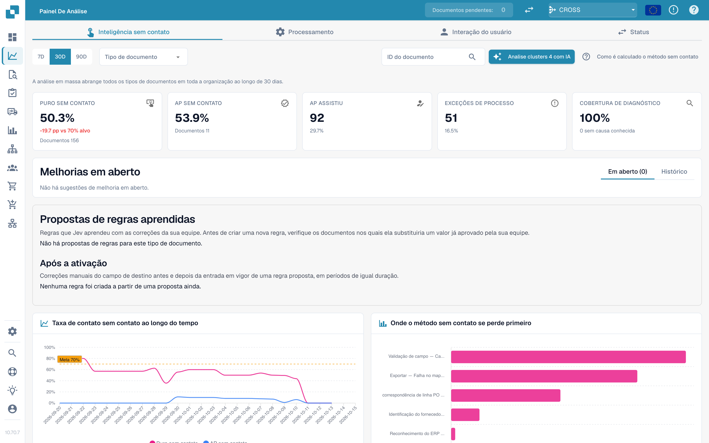

# Touchless Intelligence

Touchless Intelligence responde a duas perguntas separadas: **O DocBits extraiu a fatura corretamente?** E: **o processo inteiro terminou sem uma intervenção de processamento?** Uma extração correta ainda pode exigir retrabalho quando os dados do Infor são diferentes. AP designa a equipe humana de Accounts Payable.

## Vídeo: funções do relatório Touchless



Esta versão de revisão de 5:15 mostra um relatório preenchido: filtros, KPIs e cálculo, tendências, primeiros bloqueios, evidências registradas, histórico do documento, comparação de execuções, regras aprendidas, melhorias e histórico, relatórios de consultoria e resultados MCP reais.

[Abrir o vídeo com legendas em português e 16 links de capítulos](https://docbits-videos.fra1.cdn.digitaloceanspaces.com/settings-assistant/touchless-intelligence-preview-admin/v2/pt.html). A revisão humana de escuta desta nova versão ainda está pendente.

Estes casos de treinamento explicam funções do relatório. Uma recomendação ou pré-visualização não prova uma configuração aplicada nem uma melhoria medida. A proposta de alteração MCP exibida ainda precisa de uma configuração de destino específica; pré-visualização e aplicação não estão disponíveis para essa proposta. Alguns textos nativos do produto podem manter o idioma original.

<figure><figcaption>
O Touchless como uma linha de triagem, com os números ilustrativos do cálculo de exemplo: as 14 comportas são as etapas do Pipeline Path, as folhas que ainda estão na esteira estão em andamento e não são contadas, um documento que para numa comporta é empurrado para a bandeja de revisão junto com os documentos AP assisted (30) e de exceção de processo (10), e os documentos pure touchless (120) e apenas aprovação (30) no compartimento de exportação dão ao mostrador 150 de 190, ou 78,9 %, acima da marca da meta de 70 %.
</figcaption></figure>

## Encontrar o guia certo

| Guia | O que cobre |
| --- | --- |
| [Métricas e cálculo](touchless-metrics.md) | Categorias de resultado, numerador e denominador, ações de AP e cálculos |
| [Usar o painel](touchless-dashboard.md) | Filtros, cartões de KPI, tendências, primeiros bloqueios e controles |
| [Exemplos práticos: preço e quantidade](touchless-examples.md) | Faturas fictícias e visões reais de PO em Dev com diferenças de preço e quantidade |
| [Supplier Diagnosis e clusters de problemas](touchless-supplier-diagnosis.md) | Priorizar fornecedores e causas recorrentes |
| [PO Matching Diagnosis](touchless-po-matching-diagnosis.md) | Entender regras ativas, tolerâncias e o fluxo de decisão |
| [Document Trace](touchless-document-trace.md) | Inspecionar valores originais, execuções de processamento, bloqueios e intervenções |
| [Change Proposals e relatórios](touchless-change-proposals.md) | Distinguir pré-visualização, aplicação, medição de efeito e reversão |
| [Explicar e melhorar o Touchless com MCP](touchless-mcp.md) | Explicar, diagnosticar e fazer melhorias controladas via MCP |

<figure><figcaption>
A aba Touchless Intelligence: indicadores principais, melhorias, a taxa ao longo do tempo e o gráfico de onde o touchless se perde primeiro. Organização de exemplo com dados de demonstração; os nomes dos fornecedores são fictícios.
</figcaption></figure>

## Configurações do relatório

O relatório lê quatro configurações da organização que um administrador mantém em **Settings → Module → Dashboards & Analytics**. Elas definem a meta e a visão de custos; um campo vazio significa que o DocBits usa o padrão.

| Configuração | Padrão | O que controla |
| --- | --- | --- |
| Touchless target | 70 % | A parcela de documentos que deve passar sem uma intervenção de processamento. O relatório a usa como marca da meta no gráfico de taxa. |
| Minutes per AP intervention | 6 min | O tempo que um funcionário de AP precisa para corrigir e liberar um documento. |
| Hourly cost | 40 | O custo de uma hora de trabalho de AP na moeda abaixo. |
| Currency | EUR | A moeda da visão de custos, como um código ISO 4217 de três letras, por exemplo `EUR`, `CHF` ou `USD`. O DocBits armazena o código em maiúsculas e rejeita um valor que não seja um código de moeda, para que um erro de digitação não chegue ao relatório. |

A API verifica os valores armazenados novamente e usa o padrão para um valor com o qual não consegue trabalhar.

## Acesso

Esta área pertence ao [Analytics Dashboard](..). Administradores têm acesso; outros usuários precisam da concessão de função correspondente. Análise com IA, alterações suportadas e relatórios de consultoria podem exigir direitos de administrador.

<!-- Documentation review 2026-11-04: extraction quality vs process outcomes; KPI and terminal-outcome definitions checked against DocBits_API c51f350c728acb8ac964098d15f7b006bce273f4, module/automation_intelligence/kpi.py and bucket.py. Existing native screenshots retained and checked separately from illustrative examples. -->
<!-- Completion review 2026-11-04: owned synthetic PO examples, MCP schema/read evidence, human-action classification, KPI labels and screenshot proof limits. -->
