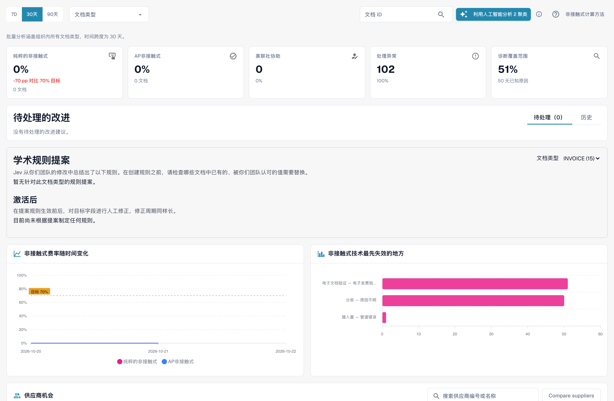

# 无接触智能

本页保留的既有视频使用英语；以下文字、说明卡和界面截图为中文。



Touchless Intelligence 区分两个问题：**DocBits 是否正确提取发票？**以及**整个流程是否无人工处理干预地完成？** 提取正确也可能需要处理不同的 Infor 数据。AP 指人工应付账款团队。

## 选择合适的指南

| 指南 | 内容 |
| --- | --- |
| [指标与计算](touchless-metrics.md) | 类别、分子分母、操作和计算示例 |
| [使用仪表板](touchless-dashboard.md) | 筛选、指标、趋势和首次阻塞 |
| [示例：价格与数量](touchless-examples.md) | 虚构发票及真实 Dev 价格/数量差异画面 |
| [供应商诊断与问题集群](touchless-supplier-diagnosis.md) | 供应商和重复原因的优先级 |
| [采购订单匹配诊断](touchless-po-matching-diagnosis.md) | 有效规则、容差和决策 |
| [文档追踪](touchless-document-trace.md) | 原件、执行、阻塞和人工操作 |
| [变更提案和报告](touchless-change-proposals.md) | 区分预览、应用、测量和撤销 |
| [通过 MCP 解释和改善 Touchless](touchless-mcp.md) | 通过 MCP 解释、诊断和受控改善 |

<figure><figcaption>
当前中文 Touchless Intelligence 总览。指标和图表是测试环境实际数据；“美联社协助”指应付账款辅助处理，“非接触式费率”指免人工处理率，“学术规则提案”指已学习规则提案。Compare suppliers 按钮仍为英文。未运行诊断或应用提案。
</figcaption></figure>

## 访问权限

属于[分析仪表板](../)。管理员可访问，其他用户需要相应角色权限。AI 分析、支持的变更和报告可能需要管理员。

<!-- Alignment 2026-11-04: correct extraction is distinct from process Touchless; KPI numerator and denominator verified. -->
<!-- Completion 2026-11-04: localized MCP examples, AP actions, original-value evidence and owned synthetic PO cards. -->
