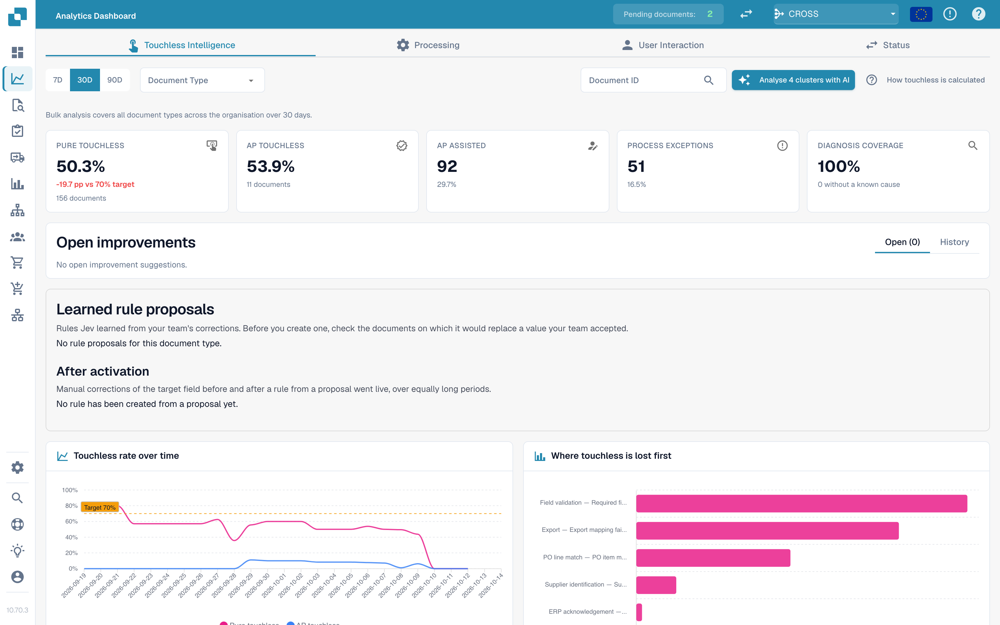
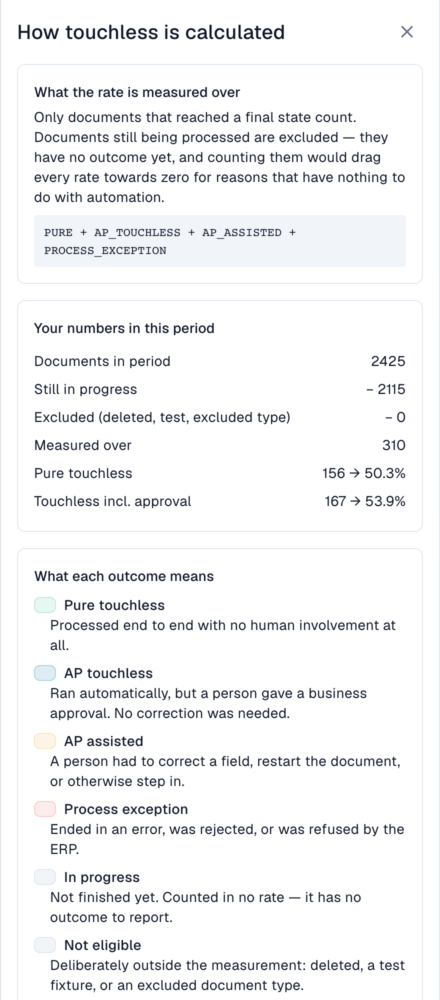
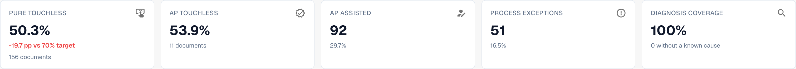
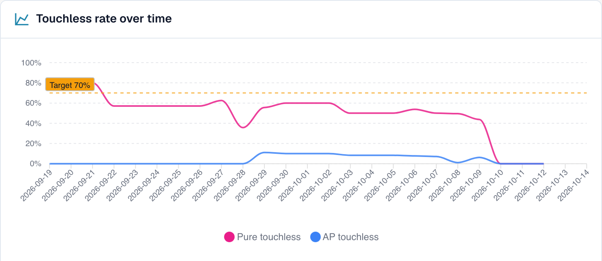
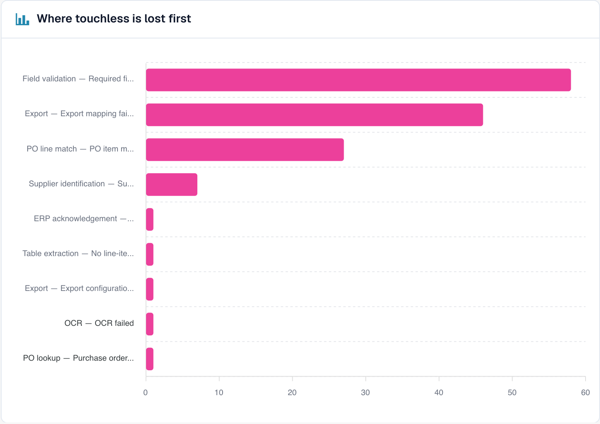
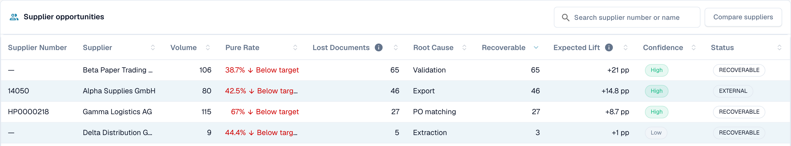
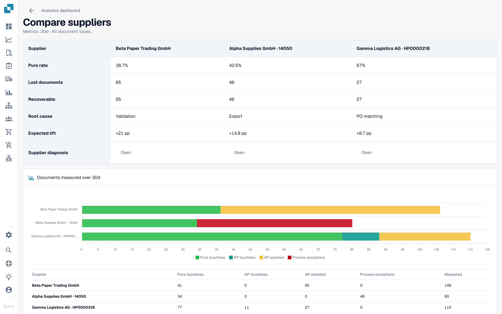

# Touchless Intelligence



## Overview

**Touchless Intelligence** answers two questions about your document processing:

1. **How many documents finish without a manual correction or other processing intervention?** This is your _AP touchless rate_; business approval alone is allowed. _Pure touchless_ also excludes that approval.
2. **Why do the others stop, and what should we change so that fewer stop?** This is the _diagnosis_.

It is a tab of the [Analytics Dashboard](../). It does not add any work for your team: DocBits records what happens to every document in the processing pipeline and evaluates the result every 15 minutes.

<figure><figcaption><p>The Touchless Intelligence tab: key figures, improvements, the rate over time and the lost-first chart. Example organisation with demo data; supplier names are fictional.</p></figcaption></figure>

### Correct extraction and a touchless process are different

**DocBits can read every invoice value correctly and the invoice can still need AP attention because the source-system data differs.** AP means Accounts Payable, the team processing supplier invoices. Check these two questions separately:

| Question | Compare | What the result tells you |
| --- | --- | --- |
| **Did DocBits read the document correctly?** | The original invoice against the extracted header fields and table lines, before any manual correction | Extraction quality: does the extracted value match what is actually on the invoice? |
| **Could the process finish without an intervention?** | The correctly extracted invoice against the purchase order and master data supplied by Infor ERP, together with the recorded processing history | Process automation: could the configured checks, matching and export complete without a correction or restart? |

A different value in Infor does not by itself tell you which side is wrong. Check the invoice, the agreed order and the data actually imported into DocBits. The source may be incorrect, the import may be outdated, or the supplier may have invoiced a different value.


**The touchless rate measures the process, not extraction accuracy.** An AP-assisted document does not prove a DocBits extraction error. Conversely, a passed extraction stage or a high confidence score does not prove every value is correct. Compare the original document with the extracted values to establish that.


### What you can do with it

| You want to…                       | Use                                 | Example                                                               |
| ---------------------------------- | ----------------------------------- | --------------------------------------------------------------------- |
| See how automated you are          | The five **key figures** at the top | "63.2 % of our documents ran without a person last month"             |
| See the trend                      | **Touchless rate over time**        | "The rate rose from 55 % to 68 % since we fixed supplier master data" |
| Find out where documents get stuck | **Where touchless is lost first**   | "Most documents stop at Field Validation"                             |
| Decide which supplier to fix first | **Supplier opportunities**          | "Supplier A would give us +4.0 percentage points"                     |
| Understand one supplier            | **Supplier Diagnosis** page         | "Their invoices have no PO number, so PO matching fails"              |
| Understand one document            | **Document Trace**                  | "This invoice stopped at stage 8, Field Validation"                   |
| Compare suppliers                  | **Compare suppliers**               | "Supplier A and B use the same template, but only B fails"            |
| Change a setting that helps        | **Change proposals**                | "Switch on automatic PO match: preview, apply, measure, undo"         |

## Who can see it

* The tab is part of the Analytics Dashboard. Your administrator enables it for the organisation. If the tab is missing, ask your administrator.
* **Organisation administrators** always see it.
* Other users see it when an administrator granted their role the **Analytics dashboard** tab (**Settings → Roles**). Without a grant, only administrators have access.
* Some actions are for administrators only: **AI analysis**, **applying and undoing a change**, **learned rule proposals** and the **Consulting report**.

If you are not allowed, the page shows _Action not allowed, please contact the administrator_.

## What "touchless" means

Every document ends in exactly **one** outcome:

| Outcome               | Meaning                                                                                             | Counts in the rate                                                                         |
| --------------------- | --------------------------------------------------------------------------------------------------- | ------------------------------------------------------------------------------------------ |
| **Pure touchless**    | Processed from import to export with **no human involvement at all**                                | Yes, as a success                                                                          |
| **AP touchless**      | Ran automatically, and a person only gave the **business approval**. No correction was needed       | Yes, as a success                                                                          |
| **AP assisted**       | Finished successfully, but a person had to **correct a field, restart the document** or otherwise step in; this can be needed even when extraction was correct | Yes, outside the touchless numerator; it does not by itself identify the cause |
| **Process exception** | Ended in an **error**, was **rejected**, was **refused by the ERP**, or **stalled** in the pipeline | Yes, as a miss                                                                             |
| **In progress**       | Not finished yet                                                                                    | **No**. It has no outcome yet                                                              |
| **Not eligible**      | Deleted, archived, a test document, or an excluded document type                                    | **No**                                                                                     |

The **AP touchless rate**, including documents with approval only, is:

```
rate = (Pure touchless + AP touchless)
       ÷ (Pure touchless + AP touchless + AP assisted + Process exception)
```

Here **AP touchless** in the numerator is the document outcome "approval only". The dashboard's **AP touchless percentage** is the combined rate: pure plus approval-only documents. **Do not add the two displayed percentages.** The pure rate uses only pure documents in the numerator, with the same denominator.

Documents that are still **in progress** or **not eligible** are never in the calculation. This protects the rate: a document that arrived five minutes ago cannot pull it down.


**One touch counts for good.** Once a person has touched a document, it stays counted as touched, even if a later automatic run would have needed nobody. **Restarting a document does not make it touchless again.** The rate reflects the work that happened.


### Example calculation (illustrative numbers)

In 30 days, 200 documents arrived:

| Outcome                       | Documents |
| ----------------------------- | --------- |
| Pure touchless                | 120       |
| AP touchless                  | 30        |
| AP assisted                   | 30        |
| Process exception             | 10        |
| In progress                   | 8         |
| Not eligible (test documents) | 2         |

* Denominator: 120 + 30 + 30 + 10 = **190**. The 8 in-progress and 2 not-eligible documents are left out.
* **Pure touchless**: 120 ÷ 190 = **63.2 %**
* Share with **approval only**: 30 ÷ 190 = **15.8 %**. This is the share of that outcome, not the combined AP touchless rate.
* **AP touchless rate**: (120 + 30) ÷ 190 = **78.9 %**

The tab shows a **target** (70 % unless your organisation uses a different one). In this example the combined AP rate is above 70%, while the pure rate of 63.2% is below it. Compare the target with the rate identified by the relevant card or chart.

Click **How touchless is calculated** at the top right to open this explanation inside DocBits, with the numbers of your own period (documents in period, still in progress, excluded, measured).

<figure><figcaption><p>The drawer <strong>How touchless is calculated</strong>: here 2,425 documents, of which 2,115 are in progress and 310 are measured. The 156 pure documents give 50.3%; adding 11 approval-only documents gives 167 and 53.9% AP touchless. These figures describe the process, not extraction accuracy. Example organisation with demo data.</p></figcaption></figure>

### Example: 100% correct extraction, 80% AP touchless

Suppose a review of the original invoices and their extracted values confirms that **all 100 completed, eligible invoices were extracted correctly**. Their processing outcomes are:

| What happened | Documents | Outcome |
| --- | --- | --- |
| Invoice and source data matched; the whole process completed automatically | 70 | Pure touchless |
| Invoice and source data matched; only business approval was needed | 10 | AP touchless (approval-only outcome) |
| Invoice data was extracted correctly, but the imported Infor data differed. AP clarified the discrepancy and manually restarted the documents in DocBits after the source data was corrected; they then completed successfully | 20 | AP assisted |

* **Correctly extracted documents in this reviewed sample:** 100 ÷ 100 = **100%**.
* **Pure touchless rate:** 70 ÷ 100 = **70%**.
* **AP touchless rate:** (70 + 10) ÷ 100 = **80%**.

There is no contradiction: extraction was correct on all invoices, while 20 needed a processing intervention because of source data. The **100% extraction figure is an illustrative result of a separate document review**, not an additional KPI shown by this dashboard. Do not calculate it from the touchless outcomes alone.

### Examples: what did AP actually have to do?

The following cases are illustrative, not the individual documents behind the screenshots. The successful outcomes assume processing has finished, including ERP confirmation where required.

| Case | Original invoice / DocBits extraction / source data | AP action and outcome | Where to investigate |
| --- | --- | --- | --- |
| **Extraction error** | PO number `45001234` / incorrectly extracted as `45001284` / correct order `45001234` exists in Infor | AP corrects the extracted number; the invoice finishes as **AP assisted** | Extraction for this supplier |
| **Source-system discrepancy** | Unit price €10.00 / correctly extracted €10.00 / imported Infor order says €9.00, outside the configured tolerance | AP confirms €10.00 is the agreed price, arranges correction of the order and manually restarts the invoice in DocBits; it finishes as **AP assisted** | Infor order data and its import |
| **Import delay** | PO number is correct on the invoice and in DocBits / the order exists in Infor but has not reached DocBits | If a later import and retry finish automatically without a recorded human intervention or approval, the result can remain **Pure touchless**. A manual restart followed by success gives **AP assisted** | Import timing and the actual run history |
| **ERP rejection** | Extraction is correct, but the ERP refuses the exported document | **Process exception** while classified as a terminal ERP rejection, even if someone previously intervened | ERP rejection and export evidence |

**Even a small recorded correction or manual restart counts as an intervention.** AP assisted means "a person helped process the document"; it is not the name of a separate AI assistant. A source-data problem and an extraction problem can therefore have the same outcome but require different fixes.

The classification uses the events DocBits records. Do not assume that work performed only in Infor, without a corresponding recorded DocBits event, is automatically counted as an AP intervention. Keep that work in the diagnosis as well.

### How current are the numbers

Outcomes are **recalculated every 15 minutes**. A document's outcome can still change after it first appears: the ERP may confirm an export hours later. The line **Data as of …** at the bottom of the tab shows when the numbers were last computed.

## The overview tab

### Filters

| Filter                            | What it does                                                                                                                                                                                                                   |
| --------------------------------- | ------------------------------------------------------------------------------------------------------------------------------------------------------------------------------------------------------------------------------ |
| **7D / 30D / 90D**                | The period for the key figures and the queue. The default is 30 days                                                                                                                                                           |
| **Document Type**                 | Restricts every number to one type, for example INVOICE                                                                                                                                                                        |
| **Segment field / Segment value** | Only if your organisation runs several processes through one document type (for example direct, indirect and EAM orders in the field `order_type`). Pick a field to see the breakdown, pick a value to narrow everything to it |
| **Document ID**                   | Opens the **Document Trace** for one document                                                                                                                                                                                  |

The **sub-organisation** you selected at the top of DocBits narrows the key figures and the supplier queue. Issue clusters and the AI analysis always cover the whole organisation.

### The five key figures

<figure><figcaption><p>The five key figures. Here the pure rate is 50.3 % (156 documents), which is 19.7 points under the 70 % target, and diagnosis coverage is 100 %. Example organisation with demo data; supplier names are fictional.</p></figcaption></figure>

| Card                   | Shows                                             | Example (illustrative)                                                      |
| ---------------------- | ------------------------------------------------- | --------------------------------------------------------------------------- |
| **Pure touchless**     | The percentage and the difference to the target   | **63.2 %** · "120 documents" · "−6.8 pp vs 70 % target" (red, below target) |
| **AP touchless**       | Combined percentage: pure plus approval-only; the document count underneath refers to the approval-only outcome | **78.9 %** · "30 documents" (approval only) |
| **AP assisted**        | The number of documents and their share           | **30** · 15.8 %                                                             |
| **Process exceptions** | The number of documents and their share           | **10** · 5.3 %                                                              |
| **Diagnosis coverage** | How many blocked documents have a **known** cause | **80 %** · "10 without a known cause"                                       |

* In the screenshot, 156 pure documents plus 11 approval-only documents give **167 ÷ 310 = 53.9% AP touchless**. Pure alone is **156 ÷ 310 = 50.3%**. The two percentages overlap.
* A card shows a dash (—) instead of **0 %** when there is nothing to measure. A dash means "no data", not "zero".
* **Diagnosis coverage** = documents with a known blocking reason ÷ all blocked documents. Example: 50 blocked documents, 10 with an unknown cause → 40 ÷ 50 = **80 %**. A low value means "we do not yet understand why documents stop". Improve it before you try to fix individual causes.
* **Click a card** to open the document list behind the number in a new tab ("View the documents behind this number"). Cards with 0 documents are not clickable.

### Touchless rate over time

<figure><figcaption><p>The rate per day with the target line. Here the rate stays between 40 and 60 % and drops sharply from 10 October. Example organisation with demo data; supplier names are fictional.</p></figcaption></figure>

The screenshot shows separate outcome shares: **Pure touchless** and **AP touchless** (approval only), plus the **target line**. In this captured view the blue line is the approval-only share, not the combined AP headline rate. The combined rate adds the pure and approval-only shares over the same population. Keep outcome shares and the combined KPI distinct when reading charts. Short periods show daily points, long periods weekly points.

**Example.** After you switched on automatic PO matching on 1 October, the pure rate climbs from 55 % to 68 % within two weeks. The chart shows the day the curve turns, so you can match it to your change.

### Where touchless is lost first

<figure><figcaption><p>Blocked documents by the stage and reason where they stopped first. Here <strong>Field validation: Required field missing</strong> costs the most documents (58), then <strong>Export mapping failed</strong> (46) and <strong>PO item mismatch</strong> (27). Example organisation with demo data; supplier names are fictional.</p></figcaption></figure>

A bar chart of **Blocked documents** per pipeline stage: the **first** stage that stopped a document.

**Example.** Bars: Supplier Identification 12, Field Validation 41, PO Line Match 7. The biggest bar tells you to look at **Field Validation** first. A missing extracted value is one possible cause; compare the original invoice, field rules and available source data before confirming it.

### Supplier opportunities

<figure><figcaption><p>The supplier queue (shortened to the first four rows). The first supplier has 106 documents, a pure rate of 38.7 % and 65 recoverable documents, so fixing it is worth <strong>+21 pp</strong>. Example organisation with demo data; supplier names are fictional.</p></figcaption></figure>

The queue answers **"Which supplier should we fix first?"** It is sorted by **Recoverable** documents, highest first, 25 rows per page.

| Column                         | Meaning                                                                                                                                                   |
| ------------------------------ | --------------------------------------------------------------------------------------------------------------------------------------------------------- |
| **Supplier Number / Supplier** | The supplier. Documents without a recognised supplier appear as **No supplier identified (n documents)**                                                  |
| **Volume**                     | Eligible documents of the supplier in the period                                                                                                          |
| **Pure Rate**                  | Share of pure touchless documents. Green if at or above the target, red if below                                                                          |
| **Lost Documents**             | Documents that ended as AP assisted or as a process exception. Not always a person: an ERP rejection or a document that stalled for seven days counts too |
| **Root Cause**                 | Who owns the fix: Configuration, ERP integration, Export, Extraction, Master data, Measurement, PO matching, User process, Validation or Unknown          |
| **Recoverable**                | Lost documents whose cause DocBits can fix: configuration, master data or supplier template                                                               |
| **Expected Lift**              | How many **percentage points** your organisation's rate would gain if every recoverable document of this supplier ran touchless (**+x pp**)               |
| **Confidence**                 | **High**, **Medium** or **Low**: how sure the diagnosis is                                                                                                |
| **Status**                     | New, Open, Investigating, In progress, Confirmed, Resolved, Dismissed. A supplier with too few documents shows **NEEDS\_DIAGNOSIS**                       |

**Example.** Your organisation has 1,000 eligible documents in the period. Supplier A has 40 recoverable documents, Supplier B has 90 lost documents but only 10 recoverable (their problem is on their side).

* Supplier A: 40 ÷ 1,000 = **+4.0 pp expected lift**
* Supplier B: 10 ÷ 1,000 = **+1.0 pp**, although B has more lost documents

The queue ranks A above B because **expected lift** is measured against your whole organisation, not against the supplier. A supplier with four bad documents cannot outrank one with four hundred.

Use the search box ("Search supplier number or name") to find a supplier. Click a row to open the **Supplier Diagnosis**.

### Compare suppliers

<figure><figcaption><p>Three suppliers side by side: pure rate, lost and recoverable documents, root cause, expected lift and a bar chart of the outcomes. Each <strong>Open</strong> leads to the Supplier Diagnosis. Example organisation with demo data; supplier names are fictional.</p></figcaption></figure>

Click **Compare suppliers**, tick **two to five** suppliers (each is listed with its number of blocked documents) and click **Compare**.

The comparison shows the suppliers side by side: **Pure rate**, **Lost documents**, **Recoverable**, **Root cause**, **Expected lift**, a bar chart of the outcomes, and a link to each **Supplier Diagnosis**.

**Example.** Supplier A and B send the same invoice layout. B has a pure rate of 80 %, A only 35 %. A's diagnosis suggests "Master data". Compare original invoices, extracted values and imported supplier records before confirming that cause. The rate difference alone does not prove that the layout is correct or that A's master data is incomplete.

### Analyse with AI

The button **Analyse n clusters with AI** analyses the issue clusters with the highest touchless potential (at least a minimum number of documents each). It takes about 13 seconds per cluster and covers the **whole organisation**. Only administrators can start it.

While it runs you see **Queued**, **Running**, **Done**, **Already analysed** or **Error** for each cluster, with a link **Open cluster**. If AI is switched off or not configured in the environment, the button is disabled with the reason, and **everything else on the page keeps working**.

## Go deeper

| Page                                                                     | What it covers                                                                                                                   |
| ------------------------------------------------------------------------ | -------------------------------------------------------------------------------------------------------------------------------- |
| [Supplier Diagnosis and Issue Clusters](touchless-supplier-diagnosis.md) | One supplier in detail: outcome tiles, trend, issue clusters, where a recommendation comes from                                  |
| [PO Matching Diagnosis](touchless-po-matching-diagnosis.md)              | Why documents stop at PO lookup or PO line match, and the decision flow that shows how DocBits matches invoice lines to PO lines |
| [Document Trace](touchless-document-trace.md)                            | What happened to one document, stage by stage                                                                                    |
| [Change Proposals and Reports](touchless-change-proposals.md)            | Preview, apply, measure and undo a change; learned rule proposals; the Consulting report                                         |

## Work with Touchless Intelligence: a routine

1. **Weekly**: open the tab and check the **rate** and the **trend** against the target.
2. Look at **Diagnosis coverage**. Below about 80 %, first find out why documents stop.
3. Read **Where touchless is lost first** and pick the biggest stage.
4. Open **Supplier opportunities**. Sort by **Expected lift** and take the top supplier with the status **RECOVERABLE**.
5. Read the **issue clusters**, check **Missing evidence**, then follow **What to change**.
6. Apply one change at a time with a **preview**, so the **Change history** can measure it.
7. After two weeks check the **before/after** result.

## Ask in plain language: DocBits MCP

All of this is also available to your AI assistant through the [DocBits MCP](../../../advanced-functions-and-tools/docbits-mcp/). Examples you can ask:

* "What is our touchless rate for the last 30 days?"
* "Which three suppliers cost us the most touchless documents?"
* "Why do documents of this supplier stop for a human?"
* "Why did the PO match fail for this document?"

## FAQ

**DocBits extracted everything correctly. Why is the invoice AP assisted?**
Touchless measures the whole process. Incorrect or outdated Infor data can require a recorded correction or manual restart even with correct extraction. Check the original invoice, the values DocBits extracted and the imported source data separately.

**Does AP assisted tell me whether DocBits or Infor caused the work?**
No. It records the intervention, not responsibility. Use the document trace and the underlying document and source data to confirm the cause.

**The rates show a dash (—).** No document has reached a final outcome in the period, or fewer documents than the minimum were measured. Documents that are still in progress are not counted.

**The tab is missing.** Ask your administrator to enable the module and to grant your role the **Analytics dashboard** tab.

**A document is counted as touched, but it ran through without anyone this time.** It was touched in an earlier run (a correction or a restart). The rate counts the work that happened.

**Why does the number change after a few hours?** The ERP may confirm an export hours after it was sent. The outcome is recalculated every 15 minutes.

**Does the AI change anything on its own?** No. AI writes explanations only. A setting changes only after an administrator previews and applies it.

## Related pages

* [Supplier Diagnosis and Issue Clusters](touchless-supplier-diagnosis.md)
* [PO Matching Diagnosis](touchless-po-matching-diagnosis.md)
* [Document Trace](touchless-document-trace.md)
* [Change Proposals and Reports](touchless-change-proposals.md)
* [Analytics Dashboard](../)
* [Settings Assistant](../../settings/global-settings/company-information/settings-assistant/)
* [DocBits MCP](../../../advanced-functions-and-tools/docbits-mcp/)

<!-- Documentation review 2026-11-04: extraction quality vs process outcomes; KPI and terminal-outcome definitions checked against DocBits_API c51f350c728acb8ac964098d15f7b006bce273f4, module/automation_intelligence/kpi.py and bucket.py. Existing native screenshots retained and checked separately from illustrative examples. -->
