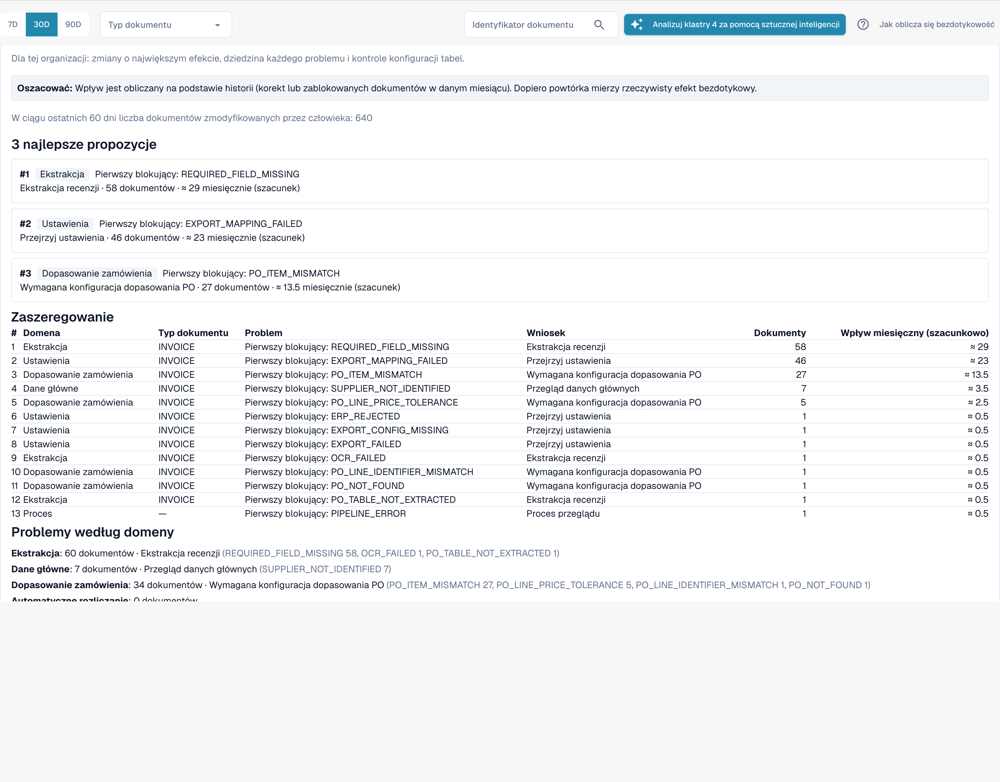

# Propozycje zmian i raporty

<!-- touchless-admin-video-v2-20261104:start -->
**Rozdział filmu (wersja do oceny):** [Propozycje i historia](https://docbits-videos.fra1.cdn.digitaloceanspaces.com/settings-assistant/touchless-intelligence-preview-admin/v2/pl.html#chapter=10).
<!-- touchless-admin-video-v2-20261104:end -->

Rekomendacja może zawierać **change proposal**, czyli pojedynczą zmianę ustawienia, która powinna pomóc. Administratorzy pracują z nią w czterech krokach:

1. **Preview**: pokazuje zmianę (wartość bieżąca i proponowana) oraz to, czego oczekuje DocBits. Nic nie jest zapisywane. **Apply** jest możliwe tylko po obejrzeniu podglądu.
2. **Apply**: zapisuje dokładnie tę zmianę, która była w podglądzie. Zmiana jest rejestrowana.
3. **Measure**: DocBits porównuje wskaźnik touchless dla tego samego typu dokumentu **przed i po**, w równie długich okresach. W każdym okresie potrzeba co najmniej **20 dokumentów**, w przeciwnym razie wynik to _not measurable_.
4. **Undo**: cofa zmianę, jeśli ta propozycja obsługuje wycofanie. Sprawdź dostępność i zweryfikuj przywrócone ustawienie.


Różnica przed/po to **obserwacja**, a nie dowód przyczyny. W tym samym czasie mogą zmienić się inne rzeczy (nowy dostawca, szczyt sezonowy).


**Przykład (ilustracyjny).** Zastosuj _Switch on automatic PO match and export_ dla faktur. Dwa tygodnie później **Change history** pokazuje wskaźnik AP touchless przed 52 % (210 dokumentów), a po 61 % (198 dokumentów). To +9 pp, wystarczająca liczba dokumentów, aby pomiar był możliwy. Mierzony wskaźnik obejmuje dokumenty czyste i wymagające tylko zatwierdzenia; nie mierzy dokładności odczytu. Korektę danych źródłowych w Infor trzeba też sprawdzić względem zaimportowanych danych i późniejszych faktur; nie zakładaj, że to zmiana ustawienia DocBits ani że zostanie automatycznie wymieniona w tej historii.

Administratorzy widzą też dwie sekcje między kluczowymi wskaźnikami a wykresami:

* **Improvement requests**: sugestie, które użytkownicy wysłali z asystenta walidacji, w dwóch zakładkach **Open** i **History**.
* **Learned rule proposals**: reguły, których DocBits nauczył się z poprawek Twojego zespołu, na przykład "dla dostawcy X zastąp wartość w polu Y". Zanim utworzysz taką regułę, sprawdź dokumenty, w których zastąpiłaby wartość zaakceptowaną przez Twój zespół. Sekcja **After activation** pokazuje ręczne poprawki pola docelowego przed uruchomieniem reguły i po nim.

<figure><figcaption>
Consulting report: najlepsze propozycje, ranking wszystkich blokad z dokumentami i szacowanym wpływem miesięcznie oraz problemy według domen. Przykładowa organizacja z danymi demonstracyjnymi; nazwy dostawców są fikcyjne.
</figcaption></figure>

Administratorzy znajdą **Consulting report** na dole karty. Kliknij **Create report**, aby go wczytać. Raport łączy dla Twojej organizacji:

* **zmiany o największym efekcie**, uszeregowane, każda z domeną, problemem, zalecanym działaniem, liczbą dokumentów i **szacowanym** efektem miesięcznie,
* **domenę każdego problemu** (extraction, master data, PO matching, auto accounting, settings, process),
* **kontrole konfiguracji tabel**, na przykład _structured table output not used_ lub _table column type mismatch_ według typu dokumentu i kolumny.

Wartości efektu są **szacunkami**. Jeśli raport zwraca _forbidden_, Twoja rola na to nie pozwala.

Dopasowane wywołania narzędzi i klasyfikację działań człowieka znajdziesz w [Touchless z MCP](touchless-mcp.md).

## Powiązane strony

* [Touchless Intelligence](./)
* [Diagnoza dostawcy i klastry problemów](../../touchless-supplier-diagnosis.md)
* [Diagnoza dopasowania PO](../../touchless-po-matching-diagnosis.md)

<!-- Documentation review 2026-11-04: extraction quality vs process outcomes; KPI and terminal-outcome definitions checked against DocBits_API c51f350c728acb8ac964098d15f7b006bce273f4, module/automation_intelligence/kpi.py and bucket.py. Existing native screenshots retained and checked separately from illustrative examples. -->

<!-- Completion review 2026-11-04: owned synthetic PO examples, MCP schema/read evidence, human-action classification, KPI labels and screenshot proof limits. -->
