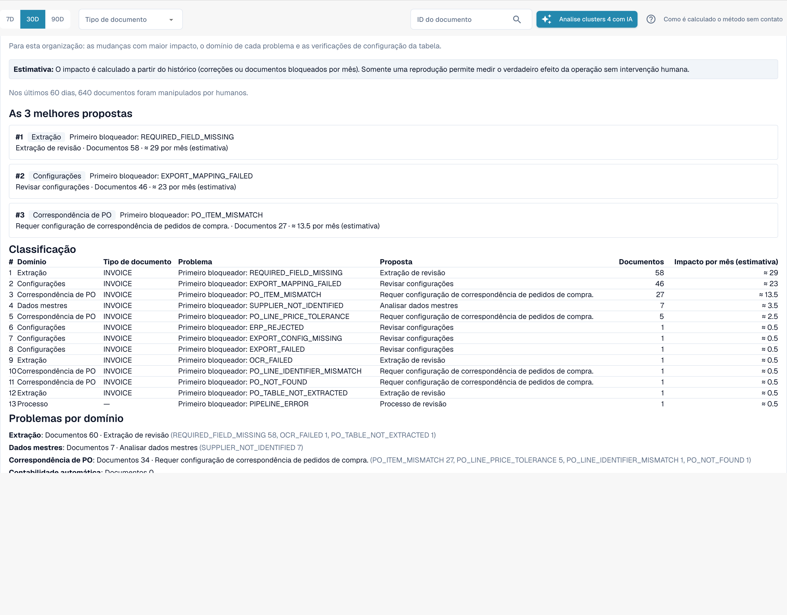

# Change Proposals e relatórios

<!-- touchless-admin-video-v2-20261104:start -->
**Capítulo do vídeo (versão de revisão):** [Propostas e histórico](https://docbits-videos.fra1.cdn.digitaloceanspaces.com/settings-assistant/touchless-intelligence-preview-admin/v2/pt.html#chapter=10).
<!-- touchless-admin-video-v2-20261104:end -->

Uma recomendação pode vir com uma **change proposal**, uma única alteração de configuração que deve ajudar. Os administradores trabalham com ela em quatro etapas:

1. **Preview**: mostra a alteração (valor atual e valor proposto) e o que o DocBits espera. Nada é salvo. **Apply** só é possível depois que você olhou uma pré-visualização.
2. **Apply**: salva exatamente a alteração pré-visualizada. Ela é registrada no log.
3. **Measure**: o DocBits compara a taxa touchless do mesmo tipo de documento **antes e depois**, em períodos de igual duração. São necessários pelo menos **20 documentos** em cada período, caso contrário é indicado _not measurable_.
4. **Undo**: reverte a alteração se esta proposta suportar reversão. Verifique a disponibilidade e confirme a configuração restaurada.


Uma diferença antes/depois é uma **observação**, não prova de causa. Outras coisas podem mudar ao mesmo tempo (um novo fornecedor, um pico sazonal).


**Exemplo (ilustrativo).** Você aplica _Switch on automatic PO match and export_ para faturas. Duas semanas depois, o **Change history** mostra uma taxa AP touchless de 52 % (210 documentos) antes e 61 % (198 documentos) depois. Isso é +9 pp, documentos suficientes para ser mensurável. A taxa medida inclui documentos pure e apenas aprovação; ela não mede a precisão da extração. Uma correção de dados de origem no Infor também deve ser verificada nos dados importados e nas faturas posteriores; não presuma que seja uma alteração de configuração do DocBits nem que apareça automaticamente neste histórico.

Os administradores também veem duas seções entre os indicadores principais e os gráficos:

* **Improvement requests**: sugestões que os usuários enviaram a partir do assistente de validação, em duas abas **Open** e **History**.
* **Learned rule proposals**: regras que o DocBits aprendeu com as correções da sua equipe, por exemplo "para o fornecedor X, substitua o valor no campo Y". Antes de criar uma, verifique os documentos em que ela substituiria um valor que a sua equipe havia aceitado. A seção **After activation** mostra as correções manuais do campo de destino antes e depois de uma regra entrar em vigor.

<figure><figcaption>
O Consulting report: principais propostas, uma classificação de todos os bloqueios com documentos e impacto estimado por mês, e os problemas por domínio. Organização de exemplo com dados de demonstração; os nomes dos fornecedores são fictícios.
</figcaption></figure>

Os administradores encontram o **Consulting report** na parte inferior da aba. Clique em **Create report** para carregá-lo. Ele combina, para a sua organização:

* as **alterações com o maior efeito**, classificadas, cada uma com o domínio, o problema, a ação recomendada, o número de documentos e o efeito **estimado** por mês,
* **o domínio de cada problema** (extraction, master data, PO matching, auto accounting, settings, process),
* **verificações de configuração de tabela**, por exemplo _structured table output not used_ ou _table column type mismatch_ por tipo de documento e coluna.

Os valores de efeito são **estimativas**. Se o relatório responder _forbidden_, a sua função não o permite.

Consulte [Touchless com MCP](touchless-mcp.md) para as chamadas de ferramenta correspondentes e a classificação das ações humanas.

## Páginas relacionadas

* [Touchless Intelligence](./)
* [Supplier Diagnosis e clusters de problemas](../../touchless-supplier-diagnosis.md)
* [PO Matching Diagnosis](../../touchless-po-matching-diagnosis.md)

<!-- Documentation review 2026-11-04: extraction quality vs process outcomes; KPI and terminal-outcome definitions checked against DocBits_API c51f350c728acb8ac964098d15f7b006bce273f4, module/automation_intelligence/kpi.py and bucket.py. Existing native screenshots retained and checked separately from illustrative examples. -->

<!-- Completion review 2026-11-04: owned synthetic PO examples, MCP schema/read evidence, human-action classification, KPI labels and screenshot proof limits. -->
