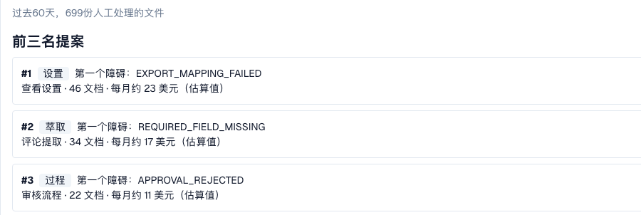

# 变更提案与报告

<!-- touchless-admin-video-v2-20261104:start -->
**视频章节（审核版）：** [提案与历史](https://docbits-videos.fra1.cdn.digitaloceanspaces.com/settings-assistant/touchless-intelligence-preview-admin/v2/zh.html#chapter=10)。
<!-- touchless-admin-video-v2-20261104:end -->

建议可能附带一个**变更提案**，即一项应当有所帮助的单项设置变更。管理员分四步处理：

1. **Preview**：显示该变更（当前 → 提议值）以及 DocBits 的预期。不会保存任何内容。只有在查看过预览之后才能 **Apply**。
2. **Apply**：准确保存预览过的变更。该操作会被记录。
3. **Measure**：DocBits 在等长的期间内比较同一文档类型在**变更前后**的 touchless 比率。每个期间至少需要 **20 份文档**，否则会显示 _not measurable_。
4. **Undo**：在该提案支持回退时撤销变更。请检查可用性并核实恢复后的设置。


前后差异是一种**观察**，而不是因果证明。其他因素可能同时发生变化（例如新增供应商、季节性高峰）。


**示例（说明性）。**您为发票应用了 _Switch on automatic PO match and export_。两周后，**Change history** 显示 AP touchless 比率从 52 %（210 份文档）变为 61 %（198 份文档）。这是 +9 pp，文档量足以计量。测得的比率包含 pure 和仅审批文档；它并不衡量提取准确率。Infor 中的源数据更正还必须对照导入的数据和后续发票检查；不要假定它是 DocBits 设置变更，也不要假定它会自动列在此历史中。

管理员还会在关键指标和图表之间看到两个区域：

* **Improvement requests**：用户从验证助手发送的建议，分为 **Open** 和 **History** 两个选项卡。
* **Learned rule proposals**：DocBits 从团队的更正中学到的规则，例如“对于供应商 X，替换字段 Y 中的值”。创建规则之前，请检查它将要替换的、团队已接受过的值所在的文档。**After activation** 区域显示规则生效前后目标字段的人工更正情况。

<figure><figcaption>
Consulting report：首要提案、所有阻塞点按每月文档数和预计影响的排名，以及按领域划分的问题。示例组织，使用演示数据；供应商名称为虚构。
</figcaption></figure>

管理员可在该选项卡底部找到 **Consulting report**。点击 **Create report** 即可加载。它会针对您的组织汇总：

* **影响最大的变更**，按排名列出，每项包含领域、问题、建议操作、文档数量以及每月的**预计**影响，
* **每个问题所属的领域**（extraction、master data、PO matching、auto accounting、settings、process），
* **表格配置检查**，例如按文档类型和列列出的 _structured table output not used_ 或 _table column type mismatch_。

影响数值均为**估算值**。如果报告返回 _forbidden_，说明您的角色无权查看。

关于对应的工具调用和人工操作的分类，参见 [Touchless with MCP](touchless-mcp.md)。

## 相关页面

* [Touchless Intelligence](./)
* [供应商诊断与问题集群](touchless-supplier-diagnosis.md)
* [PO 匹配诊断](touchless-po-matching-diagnosis.md)

<!-- Documentation review 2026-11-04: extraction quality vs process outcomes; KPI and terminal-outcome definitions checked against DocBits_API c51f350c728acb8ac964098d15f7b006bce273f4, module/automation_intelligence/kpi.py and bucket.py. Existing native screenshots retained and checked separately from illustrative examples. -->

<!-- Completion review 2026-11-04: owned synthetic PO examples, MCP schema/read evidence, human-action classification, KPI labels and screenshot proof limits. -->
