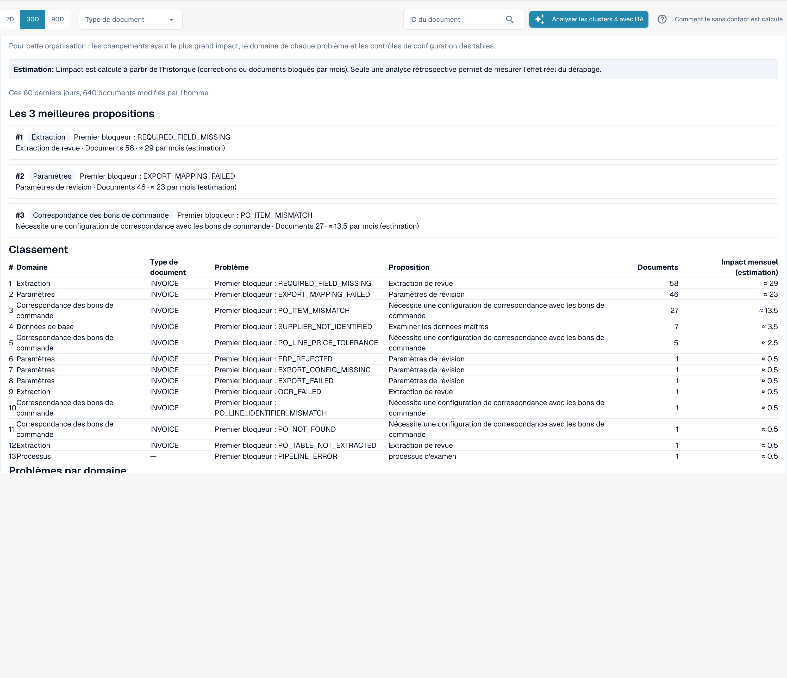

# Propositions de modification et rapports

<!-- touchless-admin-video-v2-20261104:start -->
**Chapitre vidéo (version de contrôle):** [Propositions et historique](https://docbits-videos.fra1.cdn.digitaloceanspaces.com/settings-assistant/touchless-intelligence-preview-admin/v2/fr.html#chapter=10).
<!-- touchless-admin-video-v2-20261104:end -->

Une recommandation peut s'accompagner d'une **change proposal**, une modification unique de paramètre qui devrait aider. Les administrateurs la traitent en quatre étapes :

1. **Preview** : affiche la modification (valeur actuelle → valeur proposée) et ce que DocBits attend. Rien n'est enregistré. **Apply** n'est possible qu'après avoir consulté un aperçu.
2. **Apply** : enregistre exactement la modification prévisualisée. L'opération est journalisée.
3. **Measure** : DocBits compare le taux touchless du même type de document **avant et après**, sur des périodes de même durée. Au moins **20 documents** sont nécessaires dans chaque période, sinon le résultat indique _not measurable_.
4. **Undo** : annule la modification si cette proposition permet l'inversion. Vérifiez la disponibilité et contrôlez le paramètre restauré.


Un écart avant/après est une **observation**, pas une preuve de causalité. D'autres éléments peuvent changer en même temps (un nouveau fournisseur, un pic saisonnier).


**Exemple (illustratif).** Vous appliquez _Switch on automatic PO match and export_ pour les factures. Deux semaines plus tard, le **Change history** affiche un taux AP touchless de 52 % avant (210 documents) et de 61 % après (198 documents). Cela fait +9 pp, avec assez de documents pour être mesurable. Le taux mesuré inclut les documents pure et ceux avec approbation seule ; il ne mesure pas la précision de l'extraction. Une correction de données source dans Infor doit aussi être contrôlée par rapport aux données importées et aux factures suivantes ; ne supposez pas qu'il s'agit d'une modification de paramètre DocBits ni qu'elle figure automatiquement dans cet historique.

Les administrateurs voient aussi deux sections entre les chiffres clés et les graphiques :

* **Improvement requests** : suggestions que les utilisateurs ont envoyées depuis l'assistant de validation, dans deux onglets **Open** et **History**.
* **Learned rule proposals** : règles que DocBits a apprises des corrections de votre équipe, par exemple « pour le fournisseur X, remplacer la valeur du champ Y ». Avant d'en créer une, vérifiez les documents où elle remplacerait une valeur que votre équipe avait acceptée. La section **After activation** montre les corrections manuelles du champ cible avant et après la mise en service d'une règle.

<figure><figcaption>
Le Consulting report : principales propositions, classement de tous les blocages avec le nombre de documents et l'impact estimé par mois, et les problèmes par domaine. Organisation d'exemple avec des données de démonstration ; les noms de fournisseurs sont fictifs.
</figcaption></figure>

Les administrateurs trouvent le **Consulting report** en bas de l'onglet. Cliquez sur **Create report** pour le charger. Il combine, pour votre organisation :

* les **modifications au plus fort effet**, classées, chacune avec le domaine, le problème, l'action recommandée, le nombre de documents et l'effet **estimé** par mois,
* **le domaine de chaque problème** (extraction, données de référence, PO matching, comptabilisation automatique, paramètres, processus),
* des **contrôles de configuration des tableaux**, par exemple _structured table output not used_ ou _table column type mismatch_ par type de document et par colonne.

Les valeurs d'effet sont des **estimations**. Si le rapport répond _forbidden_, votre rôle ne l'autorise pas.

Voir [Touchless avec MCP](touchless-mcp.md) pour les appels d'outils correspondants et la classification des actions humaines.

## Pages associées

* [Touchless Intelligence](./)
* [Diagnostic fournisseur et clusters de problèmes](../../touchless-supplier-diagnosis.md)
* [Diagnostic du rapprochement avec le BC](../../touchless-po-matching-diagnosis.md)

<!-- Documentation review 2026-11-04: extraction quality vs process outcomes; KPI and terminal-outcome definitions checked against DocBits_API c51f350c728acb8ac964098d15f7b006bce273f4, module/automation_intelligence/kpi.py and bucket.py. Existing native screenshots retained and checked separately from illustrative examples. -->

<!-- Completion review 2026-11-04: owned synthetic PO examples, MCP schema/read evidence, human-action classification, KPI labels and screenshot proof limits. -->
