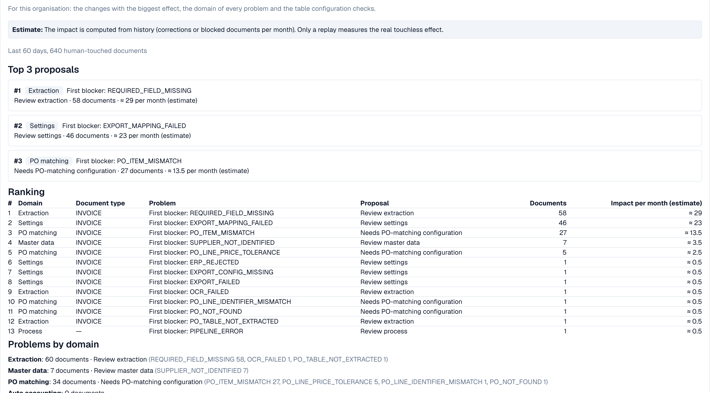

# Change Proposals and Reports

A recommendation can come with a **change proposal**, a single setting change that should help. Administrators work with it in four steps:

1. **Preview**: shows the change (current → proposed value) and what DocBits expects. Nothing is saved. **Apply** is only possible after you looked at a preview.
2. **Apply**: saves exactly the previewed change. It is logged.
3. **Measure**: DocBits compares the touchless rate of the same document type **before and after**, over equally long periods. At least **20 documents** are needed in each period, otherwise it says _not measurable_.
4. **Undo**: takes the change back if this proposal supports reversal. Check availability and verify the restored setting.


A before/after difference is an **observation**, not proof of cause. Other things can change at the same time (a new supplier, a seasonal peak).


**Example (illustrative).** You apply _Switch on automatic PO match and export_ for invoices. Two weeks later the **Change history** shows an AP touchless rate before of 52 % (210 documents), after 61 % (198 documents). That is +9 pp, enough documents to be measurable. The measured rate includes pure and approval-only documents; it does not measure extraction accuracy. A source-data correction in Infor must also be checked against the imported data and later invoices; do not assume it is a DocBits setting change or is automatically listed in this history.

Administrators also see two sections between the key figures and the charts:

* **Improvement requests**: suggestions that users sent from the validation assistant, in two tabs **Open** and **History**.
* **Learned rule proposals**: rules DocBits learned from your team's corrections, for example "for supplier X, replace the value in field Y". Before you create one, check the documents where it would replace a value your team had accepted. The section **After activation** shows the manual corrections of the target field before and after a rule went live.

<figure><figcaption>
The Consulting report: top proposals, a ranking of all blockers with documents and estimated impact per month, and the problems by domain. Example organisation with demo data; supplier names are fictional.
</figcaption></figure>

Administrators find the **Consulting report** at the bottom of the tab. Click **Create report** to load it. It combines, for your organisation:

* the **changes with the biggest effect**, ranked, each with the domain, the problem, the recommended action, the number of documents and the **estimated** effect per month,
* **the domain of every problem** (extraction, master data, PO matching, auto accounting, settings, process),
* **table configuration checks**, for example _structured table output not used_ or _table column type mismatch_ per document type and column.

The effect values are **estimates**. If the report answers _forbidden_, your role does not allow it.

## Preview, apply and measure with MCP

> Explain the confirmed cause and list supported proposals. Preview the selected change, its scope and risks. Apply only that chosen change, then verify the saved setting, change history and measurable effect.

| Step | Tool and actual returned identifiers | What it proves |
| --- | --- | --- |
| List | `touchless_list_change_proposals`, optional `issue_signature`, `window: "30d"`, `lang: "en"` | Available proposals; no setting saved |
| Preview | `touchless_preview_change` with the returned `proposal_id` and matching `issue_signature` | Concrete scope and a bound `preview_token` when permitted |
| Apply selected change | `touchless_apply_change` with the same IDs, `preview_token`, `overrides` and `window` | **Writes** the supported setting; successful response returns a `change_id` |
| Read effect | `touchless_verify_change` with that `change_id` and the same `window` | Before/after measurement; at least 20 eligible completed documents per period still required |

Copy IDs and tokens from genuine responses. A token previewing one value cannot apply a different value. An expired, forbidden or incomplete preview is not evidence of an applied change. Read-only tools and apply must not be described as equivalent. This table explains the tool sequence; it does not claim that the demo executed a proposal or measured a gain.

**Configuration example:** After a confirmed configuration fix, inspect the actual saved value and new invoices. 52% before and 61% after is an observed 9 percentage-point difference, not proof that this change alone caused it. **Source-data example:** A wrong Infor PO needs a business correction and a verified import. `touchless_apply_change` is not a general Infor-write tool. Do not widen tolerances to conceal wrong source data.

The report screenshot shows recommendations and estimated impact, not application or rollback. A successful apply needs a success response and history entry. Undo is available only where the selected proposal supports it; verify the actual restored setting. Reloading history does not apply a setting, and rollback does not delete past document interventions.

## Related pages

* [Touchless Intelligence](./)
* [Supplier Diagnosis and Issue Clusters](touchless-supplier-diagnosis.md)
* [PO Matching Diagnosis](touchless-po-matching-diagnosis.md)

<!-- Documentation review 2026-11-04: extraction quality vs process outcomes; KPI and terminal-outcome definitions checked against DocBits_API c51f350c728acb8ac964098d15f7b006bce273f4, module/automation_intelligence/kpi.py and bucket.py. Existing native screenshots retained and checked separately from illustrative examples. -->

<!-- Completion review 2026-11-04: owned synthetic PO examples, MCP schema/read evidence, human-action classification, KPI labels and screenshot proof limits. -->
