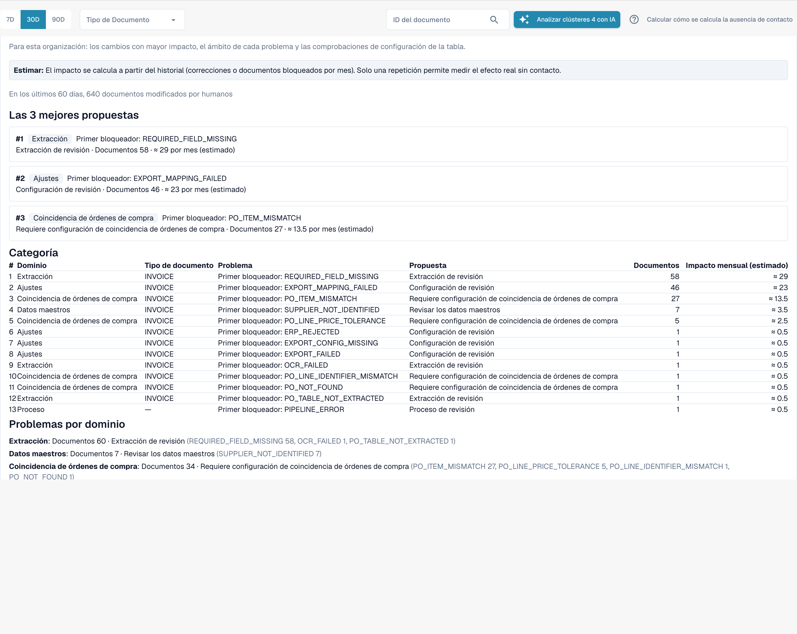

# Touchless Intelligence: Propuestas de cambio e informes

<!-- touchless-admin-video-v2-20261104:start -->
**Capítulo del vídeo (versión de revisión):** [Propuestas e historial](https://docbits-videos.fra1.cdn.digitaloceanspaces.com/settings-assistant/touchless-intelligence-preview-admin/v2/es.html#chapter=10).
<!-- touchless-admin-video-v2-20261104:end -->

Una recomendación puede venir acompañada de una **change proposal**, un único cambio de ajuste que debería ayudar. Los administradores trabajan con ella en cuatro pasos:

1. **Preview**: muestra el cambio (valor actual → valor propuesto) y lo que DocBits espera. No se guarda nada. **Apply** solo es posible después de haber visto una vista previa.
2. **Apply**: guarda exactamente el cambio previsualizado. Queda registrado.
3. **Measure**: DocBits compara la tasa touchless del mismo tipo de documento **antes y después**, en períodos de igual duración. Se necesitan al menos **20 documentos** en cada período; de lo contrario indica _not measurable_.
4. **Undo**: revierte el cambio si esta propuesta admite reversión. Compruebe la disponibilidad y verifique el ajuste restablecido.


Una diferencia entre antes y después es una **observación**, no una prueba de causa. Otras cosas pueden cambiar al mismo tiempo (un proveedor nuevo, un pico estacional).


**Ejemplo (ilustrativo).** Aplica _Switch on automatic PO match and export_ para facturas. Dos semanas después, el **Change history** muestra una tasa AP touchless anterior del 52 % (210 documentos) y posterior del 61 % (198 documentos). Son +9 pp, suficientes documentos para ser medible. La tasa medida incluye documentos pure y de solo aprobación; no mide la precisión de la extracción. Una corrección de datos de origen en Infor también debe comprobarse con los datos importados y las facturas posteriores; no presuponga que es un cambio de ajuste de DocBits ni que aparece automáticamente en este historial.

Los administradores también ven dos secciones entre las cifras clave y los gráficos:

* **Improvement requests**: sugerencias que los usuarios enviaron desde el asistente de validación, en dos pestañas, **Open** y **History**.
* **Learned rule proposals**: reglas que DocBits aprendió de las correcciones de su equipo, por ejemplo "para el proveedor X, sustituir el valor del campo Y". Antes de crear una, revise los documentos en los que sustituiría un valor que su equipo había aceptado. La sección **After activation** muestra las correcciones manuales del campo de destino antes y después de que una regla entrara en vigor.

<figure><figcaption>
El Consulting report: propuestas principales, una clasificación de todos los bloqueos con documentos e impacto estimado por mes, y los problemas por dominio. Organización de ejemplo con datos de demostración; los nombres de proveedores son ficticios.
</figcaption></figure>

Los administradores encuentran el **Consulting report** al final de la pestaña. Haga clic en **Create report** para cargarlo. Combina, para su organización:

* los **cambios con mayor efecto**, ordenados, cada uno con el dominio, el problema, la acción recomendada, el número de documentos y el efecto **estimado** por mes,
* **el dominio de cada problema** (extracción, datos maestros, coincidencia con la OC, contabilización automática, ajustes, proceso),
* **comprobaciones de la configuración de tablas**, por ejemplo _structured table output not used_ o _table column type mismatch_ por tipo de documento y columna.

Los valores de efecto son **estimaciones**. Si el informe responde _forbidden_, su rol no lo permite.

Véase [Touchless con MCP](touchless-mcp.md) para conocer las llamadas de herramienta correspondientes y la clasificación de las acciones humanas.

## Páginas relacionadas

* [Touchless Intelligence](./)
* [Touchless Intelligence: Diagnóstico de proveedores y clústeres de problemas](../../touchless-supplier-diagnosis.md)
* [Touchless Intelligence: Diagnóstico de la coincidencia con la OC](../../touchless-po-matching-diagnosis.md)

<!-- Documentation review 2026-11-04: extraction quality vs process outcomes; KPI and terminal-outcome definitions checked against DocBits_API c51f350c728acb8ac964098d15f7b006bce273f4, module/automation_intelligence/kpi.py and bucket.py. Existing native screenshots retained and checked separately from illustrative examples. -->

<!-- Completion review 2026-11-04: owned synthetic PO examples, MCP schema/read evidence, human-action classification, KPI labels and screenshot proof limits. -->
