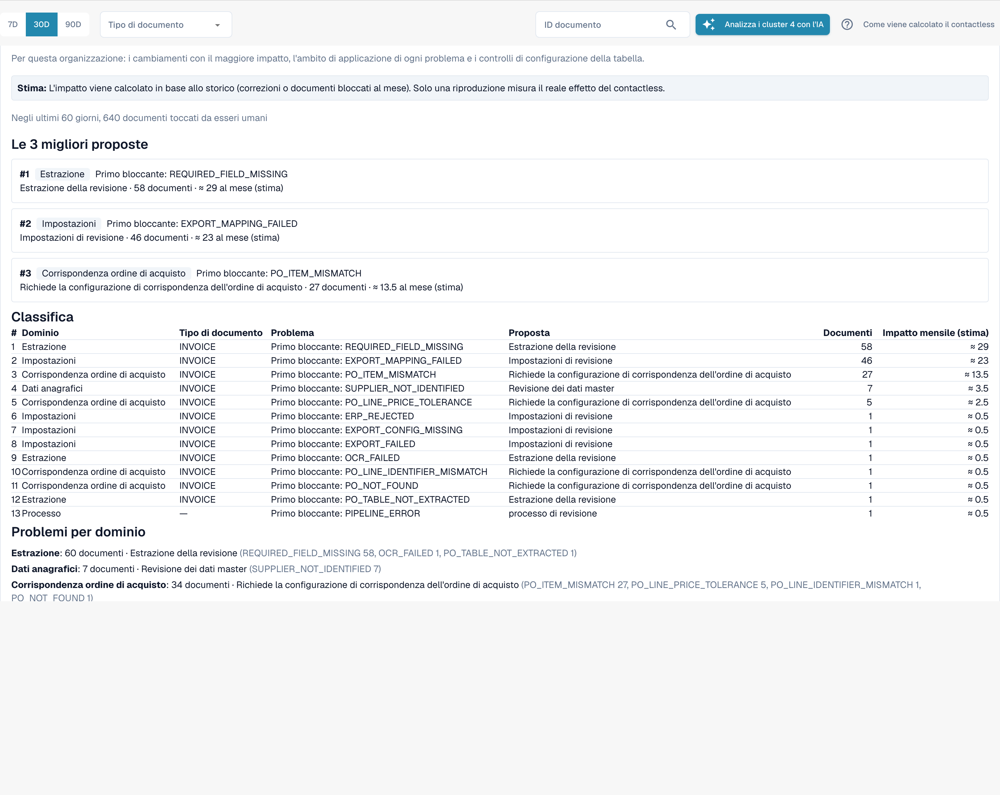

# Proposte di modifica e report

<!-- touchless-admin-video-v2-20261104:start -->
**Capitolo video (versione di verifica):** [Proposte e cronologia](https://docbits-videos.fra1.cdn.digitaloceanspaces.com/settings-assistant/touchless-intelligence-preview-admin/v2/it.html#chapter=10).
<!-- touchless-admin-video-v2-20261104:end -->

A una raccomandazione può essere associata una **proposta di modifica**, cioè una singola modifica di impostazione che dovrebbe aiutare. Gli amministratori la gestiscono in quattro passaggi:

1. **Preview**: mostra la modifica (valore attuale → valore proposto) e che cosa si aspetta DocBits. Non viene salvato nulla. **Apply** è possibile solo dopo aver visto un'anteprima.
2. **Apply**: salva esattamente la modifica mostrata in anteprima. Viene registrata.
3. **Measure**: DocBits confronta il tasso touchless dello stesso tipo di documento **prima e dopo**, su periodi di pari durata. In ogni periodo servono almeno **20 documenti**, altrimenti indica _not measurable_.
4. **Undo**: annulla la modifica se questa proposta supporta l'inversione. Controlla la disponibilità e verifica l'impostazione ripristinata.


Una differenza prima/dopo è un'**osservazione**, non la prova di una causa. Altre cose possono cambiare nello stesso momento (un nuovo fornitore, un picco stagionale).


**Esempio (illustrativo).** Applichi _Switch on automatic PO match and export_ per le fatture. Due settimane dopo la **Change history** mostra un tasso AP touchless di 52 % prima (210 documenti) e di 61 % dopo (198 documenti). Sono +9 pp, documenti sufficienti per essere misurabili. Il tasso misurato comprende documenti pure e con sola approvazione; non misura la precisione dell'estrazione. Anche una correzione dei dati di origine in Infor va verificata rispetto ai dati importati e alle fatture successive; non dare per scontato che sia una modifica di impostazione DocBits né che compaia automaticamente in questa cronologia.

Gli amministratori vedono anche due sezioni tra gli indicatori chiave e i grafici:

* **Improvement requests**: suggerimenti che gli utenti hanno inviato dall'assistente di convalida, in due schede **Open** e **History**.
* **Learned rule proposals**: regole che DocBits ha appreso dalle correzioni del tuo team, ad esempio "per il fornitore X, sostituisci il valore nel campo Y". Prima di crearne una, controlla i documenti in cui sostituirebbe un valore che il tuo team aveva accettato. La sezione **After activation** mostra le correzioni manuali del campo di destinazione prima e dopo l'attivazione di una regola.

<figure><figcaption>
Il Consulting report: prime proposte, una classificazione di tutti i bloccanti con documenti e impatto stimato al mese, e i problemi per dominio. Organizzazione di esempio con dati dimostrativi; i nomi dei fornitori sono fittizi.
</figcaption></figure>

Gli amministratori trovano il **Consulting report** in fondo alla scheda. Fai clic su **Create report** per caricarlo. Per la tua organizzazione combina:

* le **modifiche con l'effetto maggiore**, in ordine di rilevanza, ciascuna con il dominio, il problema, l'azione consigliata, il numero di documenti e l'effetto **stimato** al mese,
* **il dominio di ogni problema** (estrazione, dati anagrafici, abbinamento ordini, contabilità automatica, impostazioni, processo),
* **controlli della configurazione delle tabelle**, ad esempio _structured table output not used_ o _table column type mismatch_ per tipo di documento e colonna.

I valori degli effetti sono **stime**. Se il report risponde _forbidden_, il tuo ruolo non lo consente.

## Lingua delle spiegazioni

DocBits richiede le spiegazioni nella lingua che usi in DocBits. Se il servizio non può rispondere in quella lingua, le spiegazioni vengono scritte in inglese e il pannello mostra questa riga sopra le proposte:

> Proposal explanations are not available in your selected language. English is shown.

La riga riguarda solo la formulazione. Preview, Apply, Measure e Undo funzionano allo stesso modo.

Vedi [Touchless con MCP](touchless-mcp.md) per le chiamate agli strumenti corrispondenti e la classificazione delle azioni umane.

## Pagine correlate

* [Touchless Intelligence](./)
* [Diagnosi del fornitore e cluster di problemi](touchless-supplier-diagnosis.md)
* [Diagnosi dell'abbinamento ordini](touchless-po-matching-diagnosis.md)

<!-- Documentation review 2026-11-04: extraction quality vs process outcomes; KPI and terminal-outcome definitions checked against DocBits_API c51f350c728acb8ac964098d15f7b006bce273f4, module/automation_intelligence/kpi.py and bucket.py. Existing native screenshots retained and checked separately from illustrative examples. -->

<!-- Completion review 2026-11-04: owned synthetic PO examples, MCP schema/read evidence, human-action classification, KPI labels and screenshot proof limits. -->
