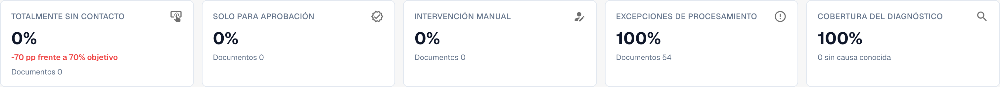
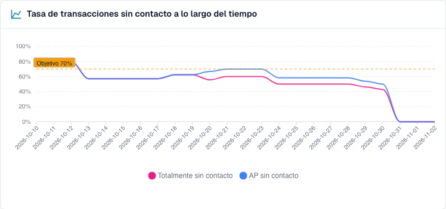
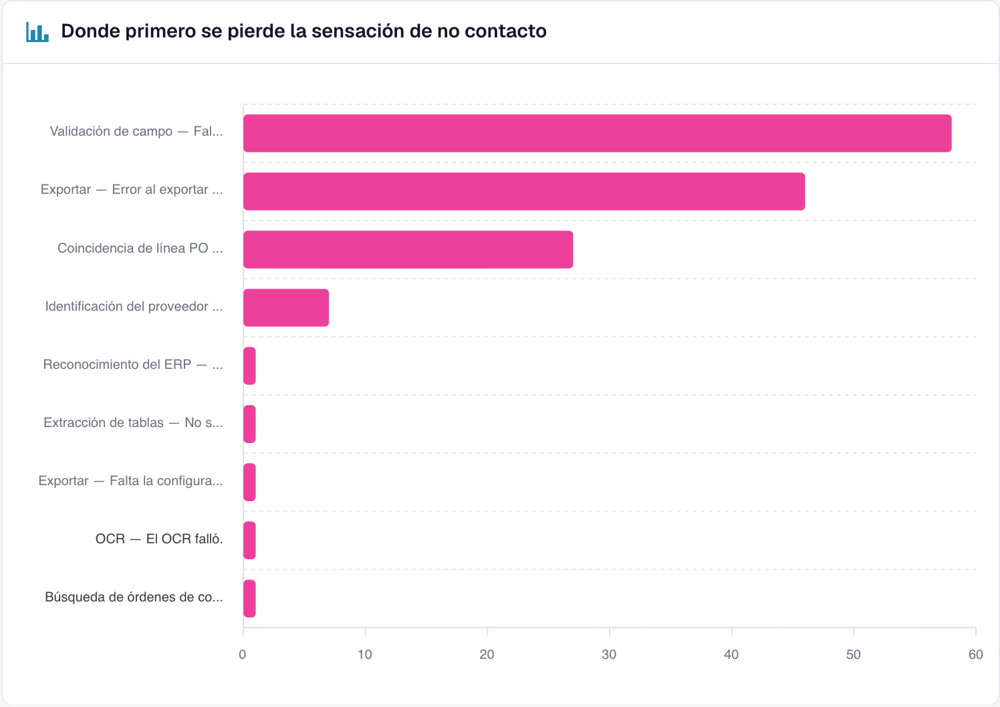
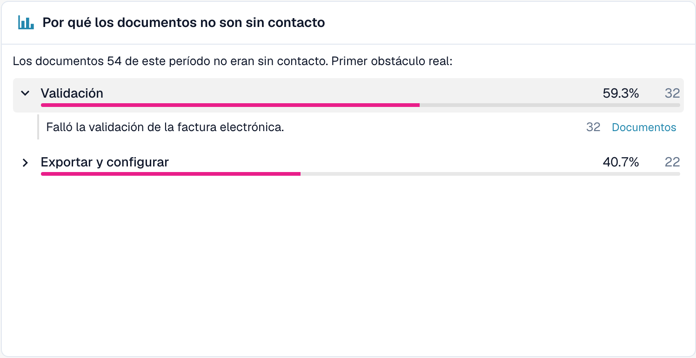
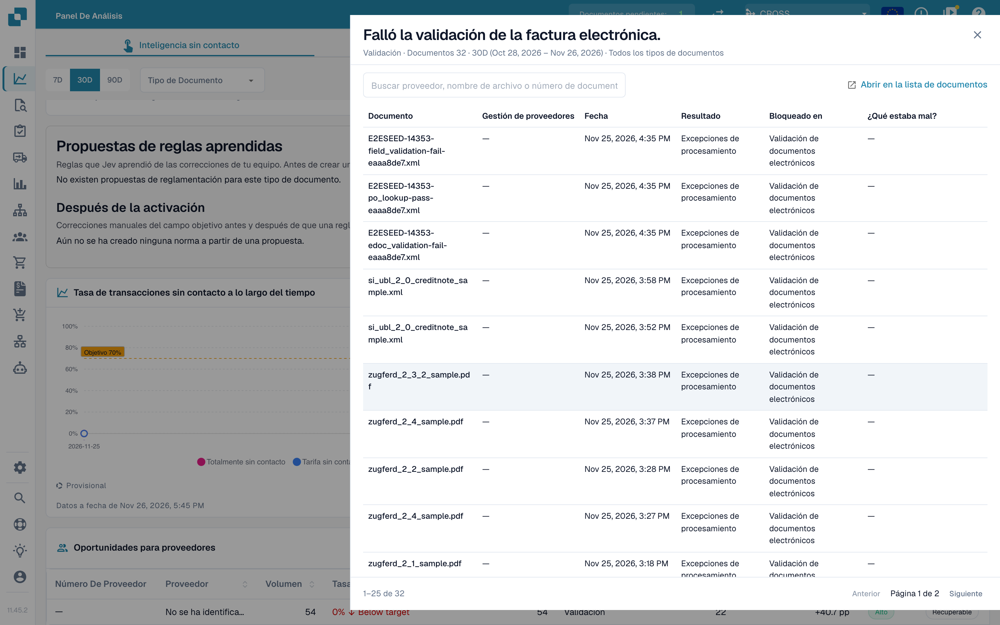
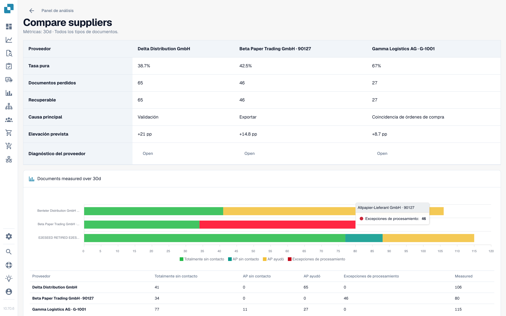

# Usar el panel

<!-- touchless-admin-video-v2-20261104:start -->
**Capítulo del vídeo (versión de revisión):** [Selección y fecha de los datos](https://docbits-videos.fra1.cdn.digitaloceanspaces.com/settings-assistant/touchless-intelligence-preview-admin/v2/es.html#chapter=01).
<!-- touchless-admin-video-v2-20261104:end -->

### Filtros

| Filtro                            | Qué hace                                                                                                                                                                                                                   |
| --------------------------------- | ------------------------------------------------------------------------------------------------------------------------------------------------------------------------------------------------------------------------------ |
| **7D / 30D / 90D**                | El período de las cifras clave y de la cola. El valor predeterminado es 30 días                                                                                                                                                           |
| **Document Type**                 | Filtra las métricas Touchless y el análisis relacionado a un solo tipo, por ejemplo INVOICE. Las propuestas de reglas aprendidas tienen actualmente su propia selección; véase más abajo                                                                                                                                                                        |
| **Segment field / Segment value** | Solo si su organización ejecuta varios procesos con un mismo tipo de documento (por ejemplo, pedidos directos, indirectos y EAM en el campo `order_type`). Elija un campo para ver el desglose y elija un valor para limitarlo todo a él |
| **Document ID**                   | Abre el **Document Trace** de un documento                                                                                                                                                                                  |

La **suborganización** que seleccionó en la parte superior de DocBits limita las cifras clave y la cola de proveedores. Los clústeres de problemas y el análisis con IA siempre abarcan toda la organización.

### Tipo de documento superior frente a propuestas de reglas aprendidas

El selector superior y el tipo de documento de **Learned rule proposals** son independientes en la implementación comprobada actualmente. Ese apartado carga sus propios tipos disponibles y elige inicialmente la primera entrada. Por tanto, seleccionar **ORDER_CONFIRMATION** arriba puede dejar **INVOICE** seleccionado abajo. Esas propuestas se refieren a facturas, no a las confirmaciones de pedido elegidas para las métricas.

Antes de aplicar una regla, compruebe el tipo que se muestra dentro de ese apartado. Si allí no hay disponible un tipo coincidente, no se han establecido propuestas para él. El apartado también usa su propia base de datos, como documentos corregidos de los últimos 60 días, en lugar de adoptar automáticamente el período principal. Esto describe los controles separados actuales; no afirma que la sincronización esté implementada.

### Las cinco cifras clave

<figure><figcaption>
Las cuatro tarjetas de resultados y la Cobertura del diagnóstico. Este informe de prueba de 30 días contiene 54 excepciones de procesamiento y ningún documento en las demás categorías.
</figcaption></figure>

Las primeras cuatro tarjetas son **categorías de resultados independientes**. En cada tarjeta, el valor grande es la proporción de esa categoría entre todos los documentos contados y la línea pequeña es su número de documentos. Las cuatro proporciones suman el 100 %; no añada una tasa combinada independiente.

| Tarjeta | Qué cuenta | Información adicional |
| --- | --- | --- |
| **Totalmente sin contacto** | Documentos completados sin intervención manual ni aprobación independiente | Diferencia en puntos porcentuales respecto al objetivo touchless |
| **Solo para aprobación** | Documentos que requirieron aprobación, pero ninguna otra corrección manual | Solo la proporción y el número de esta categoría |
| **Intervención manual** | Documentos que requirieron una corrección manual u otra interacción del usuario | Su propia proporción y número |
| **Excepciones de procesamiento** | Documentos que no pudieron completarse por una excepción de procesamiento o integración | Su propia proporción y número |
| **Cobertura del diagnóstico** | En cuántos documentos bloqueados se conoce la **primera causa** del bloqueo | Número de documentos sin causa conocida |

El campo independiente **Tasa touchless · Totalmente sin contacto + Solo para aprobación**, situado debajo de las tarjetas, combina las dos primeras categorías. Por ejemplo, 60 documentos totalmente sin contacto más 15 documentos solo para aprobación de un total de 100 producen una **tasa touchless del 75 %**. La tarjeta Solo para aprobación sigue mostrando **15 %**, no 75 %.

* Una tarjeta muestra un guion (—) en lugar de **0 %** cuando no hay nada que medir. Un guion significa «sin datos», no «cero».
* **Cobertura del diagnóstico** = documentos con una causa de bloqueo conocida ÷ todos los documentos bloqueados. Ejemplo: 50 documentos bloqueados, 10 con causa desconocida → 40 ÷ 50 = **80 %**. Un valor bajo significa que todavía no se entiende por qué se detienen los documentos. Mejórelo antes de corregir causas individuales.
* **Haga clic en una tarjeta** para abrir en una pestaña nueva la lista de documentos detrás de la cifra. Las tarjetas con 0 documentos no se pueden pulsar. Cobertura del diagnóstico abre los documentos sin causa conocida.

### Tasa touchless a lo largo del tiempo

<figure><figcaption>
Totalmente sin contacto y la Tasa touchless combinada a lo largo del tiempo. La línea discontinua marca el objetivo.
</figcaption></figure>

El gráfico muestra **Totalmente sin contacto**, la **Tasa touchless** combinada y la **línea de objetivo**. La tasa combinada incluye Totalmente sin contacto y Solo para aprobación, por lo que es igual o superior a la tasa totalmente sin contacto; no sume los dos valores. Cada punto tiene su propio número de documentos completados aptos, de modo que una tasa diaria no es automáticamente la tasa de todo el período. Los períodos cortos muestran puntos diarios y los largos, puntos semanales. Los puntos basados en datos recientes incompletos se marcan como **Provisional**.

**Ejemplo.** Después de activar la correspondencia automática de pedidos el 1 de octubre, la tasa totalmente sin contacto aumenta del 55 % al 68 % en dos semanas. El gráfico muestra el día en que cambia la curva para que pueda investigar el momento. Una asociación antes/después no demuestra por sí sola que este ajuste haya causado la mejora. Compare el tipo de documento, la combinación de proveedores y otros cambios.

### Dónde se pierde primero el touchless

<figure><figcaption>
Documentos bloqueados por la etapa y el motivo en los que se detuvieron primero. Aquí, <strong>Field validation: Required field missing</strong> afecta al mayor número de documentos (58), seguido de <strong>Export mapping failed</strong> (46) y <strong>PO item mismatch</strong> (27). Organización de ejemplo con datos de demostración; los nombres de proveedores son ficticios.
</figcaption></figure>

Un gráfico de barras de **Documentos bloqueados** por etapa del proceso: la **primera** etapa que detuvo un documento.

**Ejemplo.** Barras: Supplier Identification 12, Field Validation 41, PO Line Match 7. La barra más grande indica que debe revisar primero **Field Validation**. Un valor extraído que falta es una causa posible; compare la factura original, las reglas de campos y los datos de origen disponibles antes de confirmarla.

#### Por qué los documentos no son touchless (canal de publicación Nova)

Las organizaciones del canal de publicación **Nova** ven la respuesta a esta misma pregunta en una lista ampliable en lugar del gráfico de barras. El panel se titula **Por qué los documentos no son sin contacto** y está junto a **Tasa touchless a lo largo del tiempo**.

<figure><figcaption>
Amplíe un área para ver sus motivos y abrir los documentos detrás de un motivo. El informe de prueba también contiene un área Exportar y configurar con 22 documentos.
</figcaption></figure>

* El encabezado indica cuántos documentos cubre la lista. Cada fila es un área del primer bloqueo con su porcentaje, número de documentos y barra. Las filas se ordenan de mayor a menor.
* Haga clic en una fila para abrir sus motivos. Solo un área está abierta a la vez; vuelva a hacer clic para cerrarla. Se muestran los **cinco** primeros motivos; seleccione **+N más** para ver el resto. Al cerrar el área, la lista vuelve a cinco.
* **Corregido sin un bloqueo** es un área independiente para documentos que un usuario corrigió aunque el informe no encontró un primer bloqueo técnico. Utilícela para investigar oportunidades de mejora en los procesos de usuario y la formación, no para buscar una etapa fallida del proceso.
* La lista procede de los mismos datos del informe que las cifras clave. El navegador no recalcula los números, por lo que el total del encabezado y las filas coinciden.
* Si su instalación todavía no envía estos datos, el panel lo indica en lugar de mostrar **0**. Una lista vacía con el mensaje de «nada registrado» significa que no se perdieron documentos en el período; son estados diferentes y no debe interpretar el primero como una buena noticia.

##### Documentos detrás de un motivo

Seleccione **Documentos** en un motivo para abrir un panel lateral sin salir del informe. El encabezado mantiene visibles el motivo, el área, el período y el tipo de documento.

<figure><figcaption>
El panel de documentos del motivo muestra 25 documentos por página. En este ejemplo de prueba, Falló la validación de la factura electrónica tiene 32 documentos coincidentes.
</figcaption></figure>

* **Busque** por proveedor, nombre de archivo o número de documento. Borre la búsqueda para volver a todos los documentos del motivo; un mensaje de ninguna coincidencia no significa que el motivo no tenga documentos.
* La tabla muestra el **documento, proveedor, fecha de recepción, resultado, primera etapa bloqueada y un detalle breve**. Seleccione una fila o su nombre de documento para abrir la **Trazabilidad del documento**. **Volver** desde la trazabilidad regresa al mismo motivo, búsqueda y página.
* Use **Anterior** y **Siguiente** para recorrer páginas de **25 documentos**. El pie muestra el intervalo visible, el total y la página actual.
* **Abrir en la lista de documentos** abre la lista completa en una pestaña nueva con los filtros de motivo, período del informe y tipo de documento aplicados. El informe y el panel lateral permanecen abiertos en la pestaña original.
* Si falla la carga, use **Reintentar**. Un resultado vacío y un error de carga son estados diferentes.

El canal de publicación **Vesta** conserva el gráfico de barras descrito anteriormente. Si su página muestra barras, está en Vesta; si muestra la lista ampliable, está en Nova. Ambos responden a la misma pregunta, por lo que el resto de esta página se aplica en ambos casos.

### Oportunidades por proveedor

<figure><figcaption>
La cola de proveedores (reducida a las cuatro primeras filas). El primer proveedor tiene 106 documentos, una tasa pure del 38,7 % y 65 documentos recuperables, así que corregirlo vale <strong>+21 pp</strong>. Organización de ejemplo con datos de demostración; los nombres de proveedores son ficticios.
</figcaption></figure>

La cola responde a **"¿Qué proveedor deberíamos corregir primero?"** Está ordenada por documentos **Recoverable**, de mayor a menor, 25 filas por página.

| Columna                         | Significado                                                                                                                                                   |
| ------------------------------ | --------------------------------------------------------------------------------------------------------------------------------------------------------- |
| **Supplier Number / Supplier** | El proveedor. Los documentos sin un proveedor reconocido aparecen como **No supplier identified (n documents)**                                                  |
| **Volume**                     | Documentos elegibles del proveedor en el período                                                                                                          |
| **Pure Rate**                  | Proporción de documentos pure touchless. Verde si está en el objetivo o por encima, rojo si está por debajo                                                                          |
| **Lost Documents**             | Documentos que terminaron como AP assisted o como process exception. No siempre interviene una persona: un rechazo del ERP o un documento estancado durante siete días también cuentan |
| **Root Cause**                 | Quién es responsable de la corrección: Configuration, ERP integration, Export, Extraction, Master data, Measurement, PO matching, User process, Validation o Unknown          |
| **Recoverable**                | Documentos perdidos cuya causa DocBits puede corregir: configuración, datos maestros o plantilla del proveedor                                                               |
| **Expected Lift**              | Cuántos **puntos porcentuales** ganaría la tasa de su organización si cada documento recuperable de este proveedor se procesara touchless (**+x pp**)               |
| **Confidence**                 | **High**, **Medium** o **Low**: cuán seguro es el diagnóstico                                                                                                |
| **Status**                     | New, Open, Investigating, In progress, Confirmed, Resolved, Dismissed. Un proveedor con muy pocos documentos muestra **NEEDS\_DIAGNOSIS**                       |

**Ejemplo.** Su organización tiene 1.000 documentos elegibles en el período. El proveedor A tiene 40 documentos recuperables; el proveedor B tiene 90 documentos perdidos, pero solo 10 recuperables (su problema está de su lado).

* Proveedor A: 40 ÷ 1.000 = **+4,0 pp de mejora esperada**
* Proveedor B: 10 ÷ 1.000 = **+1,0 pp**, aunque B tiene más documentos perdidos

La cola clasifica a A por encima de B porque la **mejora esperada** se mide con respecto a toda su organización, no con respecto al proveedor. Un proveedor con cuatro documentos malos no puede superar a uno con cuatrocientos.

Utilice el cuadro de búsqueda ("Search supplier number or name") para encontrar un proveedor. Haga clic en una fila para abrir el **Supplier Diagnosis**.

### Vista de proveedor o de grupo

De forma predeterminada, la cola muestra una fila por proveedor. El conmutador **Supplier | Group** situado junto al cuadro de búsqueda cambia eso:

* **Supplier** enumera cada clave de proveedor tal como aparece en sus documentos. Es el valor predeterminado y se comporta como la cola antes de que existiera el grafo.
* **Group** agrupa en una sola fila las claves de proveedor que DocBits ha agrupado. Una fila agrupada muestra los nombres fusionados en la columna **Members** y los muestra todos en una información emergente.

Una fila agrupada no abre un **Supplier Diagnosis**, porque el diagnóstico trabaja con una única clave de proveedor. Vuelva a **Supplier** y haga clic en el proveedor que desee. Mientras DocBits no haya creado un grafo para su organización, la vista de grupo devuelve las mismas filas que la vista de proveedor, sin error.

### Comparar proveedores

<figure><figcaption>
Tres proveedores lado a lado: tasa pure, documentos perdidos y recuperables, causa raíz, mejora esperada y un gráfico de barras de los resultados. Cada <strong>Open</strong> lleva al Supplier Diagnosis. Organización de ejemplo con datos de demostración; los nombres de proveedores son ficticios.
</figcaption></figure>

Haga clic en **Compare suppliers**, marque **de dos a cinco** proveedores (cada uno aparece con su número de documentos bloqueados) y haga clic en **Compare**.

La comparación muestra los proveedores lado a lado: **Pure rate**, **Lost documents**, **Recoverable**, **Root cause**, **Expected lift**, un gráfico de barras de los resultados y un enlace al **Supplier Diagnosis** de cada uno.

**Ejemplo.** Los proveedores A y B envían el mismo diseño de factura. B tiene una tasa pure del 80 % y A solo del 35 %. El diagnóstico de A sugiere "Master data". Compare las facturas originales, los valores extraídos y los registros de proveedor importados antes de confirmar esa causa. La diferencia de tasas por sí sola no demuestra que el diseño sea correcto ni que los datos maestros de A estén incompletos.

### Analizar con IA

El botón **Analyse n clusters with AI** analiza los clústeres de problemas con mayor potencial touchless (como mínimo un número mínimo de documentos cada uno). Tarda unos 13 segundos por clúster y abarca **toda la organización**. Solo los administradores pueden iniciarlo.

Mientras se ejecuta, verá **Queued**, **Running**, **Done**, **Already analysed** o **Error** para cada clúster, con un enlace **Open cluster**. Si la IA está desactivada o no está configurada en el entorno, el botón aparece desactivado con el motivo, y **todo lo demás de la página sigue funcionando**.

## Ontology: cómo DocBits agrupa a sus proveedores

El área tiene dos pestañas: **Report** contiene el panel descrito arriba y **Ontology** muestra el grafo de proveedores que utiliza la vista de grupo de la cola. La pestaña es de solo lectura. No cambia ninguna configuración ni ningún documento.

DocBits deriva el grafo una vez por noche a partir de los documentos que ha procesado su organización. Un nodo de proveedor lleva un nombre tal como aparece impreso en un documento; una arista une los nombres que DocBits interpreta como la misma empresa, por ejemplo porque la ortografía difiere solo ligeramente o porque ambos tienen el mismo número de identificación fiscal. Junto al título ve la versión del grafo y cuándo se calculó. **Reload** vuelve a obtener el grafo actual.

La pestaña tiene tres partes:

| Parte | Contenido |
| --- | --- |
| **Your suppliers, grouped** | Los grupos y cuántas grafías contiene cada uno. También se enumera un grupo con una sola grafía. |
| **How it all connects** | El grafo: proveedores y grupos de proveedores, las áreas temáticas en las que se atascan las facturas, los motivos concretos y los campos que las personas tienen que corregir con más frecuencia. |
| **Explanation** | Los detalles del nodo seleccionado: **What this is based on** enumera las pruebas que lo sustentan, **Also written as** enumera las otras grafías que DocBits ha visto y **fixed by DocBits** (con un icono de candado) marca un nodo que DocBits mantiene por sí mismo y no su organización. |

Los tipos de nodo se explican en lenguaje sencillo dentro de la pestaña: un nombre de proveedor es un nombre exactamente como aparece en sus documentos, un área temática es un punto donde las facturas suelen atascarse y necesitan a una persona, un motivo es una causa concreta de una ejecución automática fallida y un campo es un campo del documento que las personas a menudo tienen que corregir o rellenar.

Un grafo vacío es un estado normal. Muestra **DocBits is still learning** con la nota de que la descripción general se construye cada noche y aparece tras la siguiente ejecución. Una organización joven o una ejecución nocturna omitida se ven así; no es un error.

El grafo también funciona sin ratón: Tab pasa a un grupo o a un nodo, Enter o Space lo selecciona y rellena **Explanation**.

## Trabajar con Touchless Intelligence: una rutina

1. **Cada semana**: abra la pestaña y compare la **tasa** y la **tendencia** con el objetivo.
2. Revise **Diagnosis coverage**. Si está por debajo de aproximadamente el 80 %, averigüe primero por qué se detienen los documentos.
3. Lea **Where touchless is lost first** (Vesta) o **Why documents are not touchless** (Nova) y elija la etapa o el área más grande.
4. Abra **Supplier opportunities**. Ordene por **Expected lift** y tome el primer proveedor con el estado **RECOVERABLE**.
5. Lea los **issue clusters**, revise **Missing evidence** y siga después **What to change**.
6. Corrija una causa confirmada. Para una propuesta compatible de DocBits use la vista previa y el historial de cambios. Para una corrección en Infor, documente la fuente e importe por separado; no crea automáticamente una entrada de cambio de ajuste en DocBits.
7. Transcurridas dos semanas, revise el resultado de **antes/después**.

## Quién puede verla

* La pestaña forma parte del Panel de Análisis. Su administrador la habilita para la organización. Si falta la pestaña, consulte a su administrador.
* Los **administradores de la organización** siempre la ven.
* Los demás usuarios la ven cuando un administrador ha concedido a su rol la pestaña **Analytics dashboard** (**Settings → Roles**). Sin esa concesión, solo los administradores tienen acceso.
* Algunas acciones son solo para administradores: **AI analysis**, **aplicar y deshacer un cambio**, **learned rule proposals** y el **Consulting report**.

Si no tiene permiso, la página muestra _Action not allowed, please contact the administrator_.

## Páginas relacionadas

* [Touchless Intelligence](./)
* [Métricas y cálculo](touchless-metrics.md)
* [Ejemplos: precio y cantidad](touchless-examples.md)
* [Touchless Intelligence: Diagnóstico de proveedores y clústeres de problemas](touchless-supplier-diagnosis.md)
* [Touchless Intelligence: Diagnóstico de la coincidencia con la OC](touchless-po-matching-diagnosis.md)
* [Touchless Intelligence: Seguimiento del documento](touchless-document-trace.md)
* [Touchless Intelligence: Propuestas de cambio e informes](touchless-change-proposals.md)
* [Explicar y mejorar Touchless con MCP](touchless-mcp.md)

<!-- Documentation review 2026-11-04: extraction quality vs process outcomes; KPI and terminal-outcome definitions checked against DocBits_API c51f350c728acb8ac964098d15f7b006bce273f4, module/automation_intelligence/kpi.py and bucket.py. Existing native screenshots retained and checked separately from illustrative examples. -->
<!-- Completion review 2026-11-04: owned synthetic PO examples, MCP schema/read evidence, human-action classification, KPI labels and screenshot proof limits. -->
