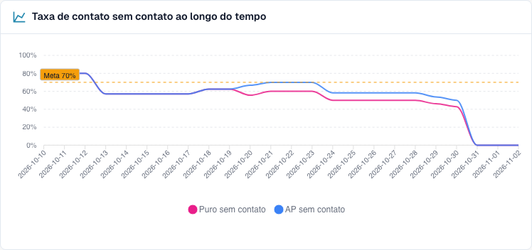
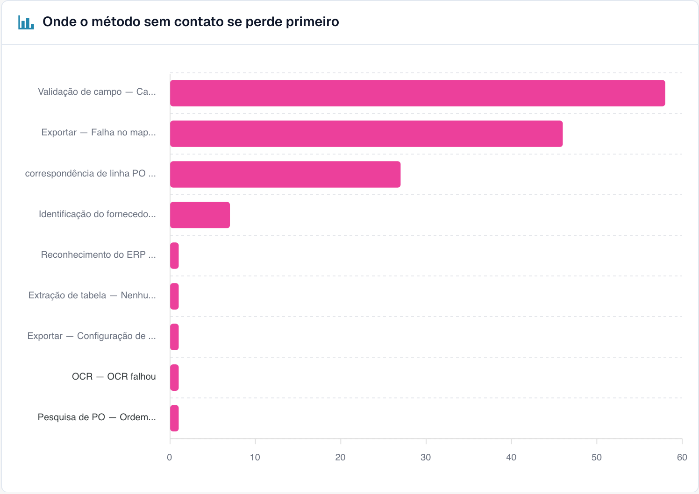
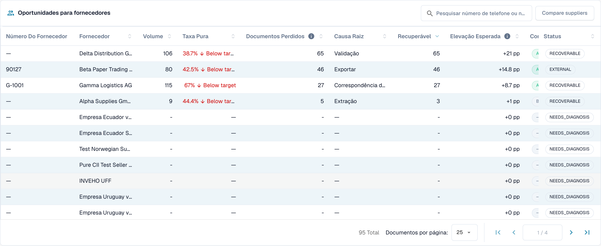
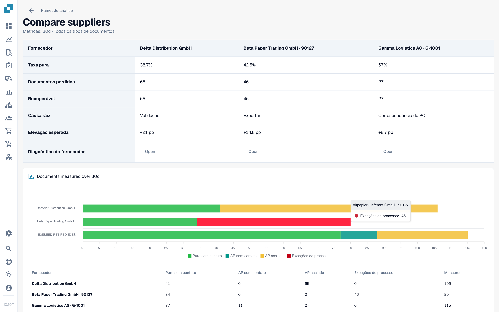

# Usar o painel

<!-- touchless-admin-video-v2-20261104:start -->
**Capítulo do vídeo (versão de revisão):** [Seleção e carimbo de data dos dados](https://docbits-videos.fra1.cdn.digitaloceanspaces.com/settings-assistant/touchless-intelligence-preview-admin/v2/pt.html#chapter=01).
<!-- touchless-admin-video-v2-20261104:end -->

### Filtros

| Filtro                            | O que faz                                                                                                                                                                                                                   |
| --------------------------------- | ------------------------------------------------------------------------------------------------------------------------------------------------------------------------------------------------------------------------------ |
| **7D / 30D / 90D**                | O período dos indicadores principais e da fila. O padrão é 30 dias                                                                                                                                                           |
| **Document Type**                 | Filtra as métricas Touchless e a análise relacionada para um único tipo, por exemplo INVOICE. As propostas de regras aprendidas têm atualmente seleção própria; veja abaixo                                                                                                                                                                        |
| **Segment field / Segment value** | Somente se a sua organização executa vários processos por um único tipo de documento (por exemplo, pedidos diretos, indiretos e EAM no campo `order_type`). Escolha um campo para ver a divisão, escolha um valor para restringir tudo a ele |
| **Document ID**                   | Abre o **Document Trace** de um documento                                                                                                                                                                                  |

A **sub-organização** que você selecionou no topo do DocBits restringe os indicadores principais e a fila de fornecedores. Os clusters de problemas e a análise com IA sempre abrangem a organização inteira.

### Tipo de documento de nível superior versus propostas de regras aprendidas

O seletor superior e o tipo de documento em **Learned rule proposals** são independentes na implementação verificada atualmente. A seção carrega os seus próprios tipos disponíveis e escolhe inicialmente a primeira entrada. Selecionar **ORDER_CONFIRMATION** acima pode, portanto, deixar **INVOICE** selecionado abaixo. Essas propostas dizem respeito a faturas, não às confirmações de pedido escolhidas para as métricas.

Antes de aplicar uma regra, verifique o tipo mostrado dentro dessa seção. Se nenhum tipo correspondente estiver disponível ali, as propostas para ele não foram estabelecidas. A seção também usa uma base de dados própria, como documentos corrigidos dos últimos 60 dias, em vez de adotar automaticamente o período do cabeçalho. Isso descreve os controles separados atuais; não afirma que uma sincronização tenha sido implementada.

### Os cinco indicadores principais

<figure><figcaption>
Relatório atual de faturas de 30 dias: 107 faturas totalmente automáticas mais 11 faturas apenas com aprovação dão 118 de 201, ou 58.7% AP Touchless. Apenas Pure é 53.2%. O cartão AP já mostra a contagem combinada de 118. Histórico de treinamento fictício; nenhuma exportação ERP executada está comprovada.
</figcaption></figure>

| Cartão                   | Mostra                                             | Exemplo (ilustrativo)                                                      |
| ---------------------- | ------------------------------------------------- | --------------------------------------------------------------------------- |
| **Pure touchless**     | A porcentagem e a diferença em relação à meta   | **63.2 %** · "120 documentos" · "−6.8 pp em relação à meta de 70 %" (vermelho, abaixo da meta) |
| **AP touchless** | Porcentagem e contagem combinadas: Pure mais apenas aprovação | **78.9%** · "150 documentos" no exemplo com 120 Pure e 30 apenas aprovação |
| **AP assisted**        | O número de documentos e a sua participação           | **30** · 15.8 %                                                             |
| **Process exceptions** | O número de documentos e a sua participação           | **10** · 5.3 %                                                              |
| **Diagnosis coverage** | Quantos documentos bloqueados têm uma causa **conhecida** | **80 %** · "10 sem causa conhecida"                                       |

* Na captura atual, 107 faturas totalmente automáticas mais 11 apenas com aprovação dão **118 ÷ 201 = 58.7% AP Touchless**. Apenas Pure é **107 ÷ 201 = 53.2%**. As duas porcentagens se sobrepõem e não devem ser somadas.
* Um cartão mostra um traço (—) em vez de **0 %** quando não há nada a medir. Um traço significa "sem dados", não "zero".
* **Diagnosis coverage** = documentos com um motivo de bloqueio conhecido ÷ todos os documentos bloqueados. Exemplo: 50 documentos bloqueados, 10 com causa desconhecida, o que dá 40 ÷ 50 = **80 %**. Um valor baixo significa "ainda não entendemos por que os documentos param". Melhore isso antes de tentar corrigir causas individuais.
* **Clique em um cartão** para abrir, em uma nova aba, a lista de documentos por trás do número ("View the documents behind this number"). Cartões com 0 documentos não são clicáveis.

### Taxa touchless ao longo do tempo

<figure><figcaption>
Tendência atual do relatório: rosa mostra Pure Touchless e azul mostra a taxa combinada, incluindo documentos apenas com aprovação. A linha tracejada marca a meta de 70%. Essas curvas usam casos de treinamento fictícios e não comprovam uma melhoria real do processo.
</figcaption></figure>

O gráfico atual mostra **Pure Touchless**, a **taxa AP Touchless combinada** e a **linha da meta**. O azul inclui Pure e apenas aprovação, por isso fica na linha do rosa ou acima dele; não some os dois valores. Cada ponto tem o seu próprio número de documentos concluídos elegíveis, portanto uma taxa diária não é automaticamente a taxa de todo o período. Períodos curtos mostram pontos diários, períodos longos pontos semanais. A categoria separada de apenas aprovação é diferente desta linha combinada.

**Exemplo.** Depois de você ativar a correspondência automática de PO em 1 de outubro, a taxa pure sobe de 55 % para 68 % em duas semanas. O gráfico mostra o dia em que a curva muda, para que você possa investigar o momento. Uma associação antes/depois não prova por si só que essa configuração causou a melhoria. Compare o tipo de documento, a composição de fornecedores e outras alterações.

### Onde o touchless se perde primeiro

<figure><figcaption>
Documentos bloqueados por etapa e motivo em que pararam primeiro. Aqui <strong>Field validation: Required field missing</strong> custa a maior parte dos documentos (58), depois <strong>Export mapping failed</strong> (46) e <strong>PO item mismatch</strong> (27). Organização de exemplo com dados de demonstração; os nomes dos fornecedores são fictícios.
</figcaption></figure>

Um gráfico de barras de **Blocked documents** por etapa do pipeline: a **primeira** etapa que parou um documento.

**Exemplo.** Barras: Supplier Identification 12, Field Validation 41, PO Line Match 7. A maior barra indica que você deve olhar primeiro para **Field Validation**. Um valor extraído ausente é uma causa possível; compare a fatura original, as regras de campo e os dados de origem disponíveis antes de confirmá-la.

### Oportunidades de fornecedores

<figure><figcaption>
A fila de fornecedores (reduzida às quatro primeiras linhas). O primeiro fornecedor tem 106 documentos, uma pure rate de 38.7 % e 65 documentos recuperáveis, por isso corrigi-lo vale <strong>+21 pp</strong>. Organização de exemplo com dados de demonstração; os nomes dos fornecedores são fictícios.
</figcaption></figure>

A fila responde a **"Qual fornecedor devemos corrigir primeiro?"** Ela é ordenada por documentos **Recoverable**, do maior para o menor, com 25 linhas por página.

| Coluna                         | Significado                                                                                                                                                   |
| ------------------------------ | --------------------------------------------------------------------------------------------------------------------------------------------------------- |
| **Supplier Number / Supplier** | O fornecedor. Documentos sem fornecedor reconhecido aparecem como **No supplier identified (n documents)**                                                  |
| **Volume**                     | Documentos elegíveis do fornecedor no período                                                                                                          |
| **Pure Rate**                  | Participação de documentos pure touchless. Verde se estiver na meta ou acima dela, vermelho se abaixo                                                                          |
| **Lost Documents**             | Documentos que terminaram como AP assisted ou como exceção de processo. Nem sempre é uma pessoa: uma rejeição do ERP ou um documento parado por sete dias também conta |
| **Root Cause**                 | Quem é o responsável pela correção: Configuration, ERP integration, Export, Extraction, Master data, Measurement, PO matching, User process, Validation ou Unknown          |
| **Recoverable**                | Documentos perdidos cuja causa o DocBits pode corrigir: configuração, dados mestres ou modelo do fornecedor                                                               |
| **Expected Lift**              | Quantos **pontos percentuais** a taxa da sua organização ganharia se todos os documentos recuperáveis deste fornecedor passassem touchless (**+x pp**)               |
| **Confidence**                 | **High**, **Medium** ou **Low**: o quão segura é a causa diagnosticada                                                                                                |
| **Status**                     | New, Open, Investigating, In progress, Confirmed, Resolved, Dismissed. Um fornecedor com poucos documentos mostra **NEEDS\_DIAGNOSIS**                       |

**Exemplo.** A sua organização tem 1,000 documentos elegíveis no período. O fornecedor A tem 40 documentos recuperáveis, o fornecedor B tem 90 documentos perdidos, mas apenas 10 recuperáveis (o problema está do lado deles).

* Fornecedor A: 40 ÷ 1,000 = **+4.0 pp de ganho esperado**
* Fornecedor B: 10 ÷ 1,000 = **+1.0 pp**, embora B tenha mais documentos perdidos

A fila classifica A acima de B porque o **ganho esperado** é medido em relação à sua organização inteira, não em relação ao fornecedor. Um fornecedor com quatro documentos ruins não pode superar um com quatrocentos.

Use a caixa de busca ("Search supplier number or name") para encontrar um fornecedor. Clique em uma linha para abrir o **Supplier Diagnosis**.

### Comparar fornecedores

<figure><figcaption>
Três fornecedores lado a lado: pure rate, documentos perdidos e recuperáveis, causa raiz, ganho esperado e um gráfico de barras dos resultados. Cada <strong>Open</strong> leva ao Supplier Diagnosis. Organização de exemplo com dados de demonstração; os nomes dos fornecedores são fictícios.
</figcaption></figure>

Clique em **Compare suppliers**, marque **dois a cinco** fornecedores (cada um aparece com o seu número de documentos bloqueados) e clique em **Compare**.

A comparação mostra os fornecedores lado a lado: **Pure rate**, **Lost documents**, **Recoverable**, **Root cause**, **Expected lift**, um gráfico de barras dos resultados e um link para cada **Supplier Diagnosis**.

**Exemplo.** Os fornecedores A e B enviam o mesmo layout de fatura. B tem uma pure rate de 80 %, A apenas 35 %. O diagnóstico de A sugere "Master data". Compare as faturas originais, os valores extraídos e os registros de fornecedor importados antes de confirmar essa causa. A diferença de taxas por si só não prova que o layout está correto nem que os dados mestres de A estão incompletos.

### Analisar com IA

O botão **Analyse n clusters with AI** analisa os clusters de problemas com o maior potencial touchless (com pelo menos um número mínimo de documentos cada). Leva cerca de 13 segundos por cluster e abrange a **organização inteira**. Somente administradores podem iniciá-lo.

Enquanto ele é executado, você vê **Queued**, **Running**, **Done**, **Already analysed** ou **Error** para cada cluster, com um link **Open cluster**. Se a IA estiver desativada ou não configurada no ambiente, o botão fica desabilitado com o motivo, e **todo o resto da página continua funcionando**.

## Trabalhar com o Touchless Intelligence: uma rotina

1. **Semanalmente**: abra a aba e verifique a **taxa** e a **tendência** em relação à meta.
2. Veja **Diagnosis coverage**. Abaixo de cerca de 80 %, descubra primeiro por que os documentos param.
3. Leia **Where touchless is lost first** e escolha a maior etapa.
4. Abra **Supplier opportunities**. Ordene por **Expected lift** e pegue o fornecedor principal com o status **RECOVERABLE**.
5. Leia os **clusters de problemas**, verifique **Missing evidence** e depois siga **What to change**.
6. Corrija uma causa confirmada. Para uma proposta DocBits suportada, use a pré-visualização e o histórico de alterações. Para uma correção no Infor, documente a origem e a importação separadamente; ela não cria automaticamente uma entrada de histórico de alteração de configuração no DocBits.
7. Depois de duas semanas, verifique o resultado **antes/depois**.

## Quem pode ver

* A aba faz parte do Analytics Dashboard. O seu administrador a habilita para a organização. Se a aba estiver faltando, pergunte ao seu administrador.
* **Administradores da organização** sempre a veem.
* Outros usuários a veem quando um administrador concedeu à função deles a aba **Analytics dashboard** (**Settings > Roles**). Sem essa concessão, somente administradores têm acesso.
* Algumas ações são exclusivas de administradores: **AI analysis**, **aplicar e desfazer uma alteração**, **learned rule proposals** e o **Consulting report**.

Se você não tiver permissão, a página mostra _Action not allowed, please contact the administrator_.

## Páginas relacionadas

* [Touchless Intelligence](./)
* [Métricas e cálculo](../../touchless-metrics.md)
* [Exemplos práticos: preço e quantidade](touchless-examples.md)
* [Supplier Diagnosis e clusters de problemas](../../touchless-supplier-diagnosis.md)
* [PO Matching Diagnosis](../../touchless-po-matching-diagnosis.md)
* [Document Trace](touchless-document-trace.md)
* [Change Proposals e relatórios](touchless-change-proposals.md)
* [Explicar e melhorar o Touchless com MCP](touchless-mcp.md)

<!-- Documentation review 2026-11-04: extraction quality vs process outcomes; KPI and terminal-outcome definitions checked against DocBits_API c51f350c728acb8ac964098d15f7b006bce273f4, module/automation_intelligence/kpi.py and bucket.py. Existing native screenshots retained and checked separately from illustrative examples. -->
<!-- Completion review 2026-11-04: owned synthetic PO examples, MCP schema/read evidence, human-action classification, KPI labels and screenshot proof limits. -->
