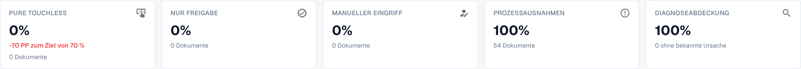
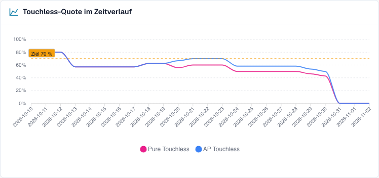
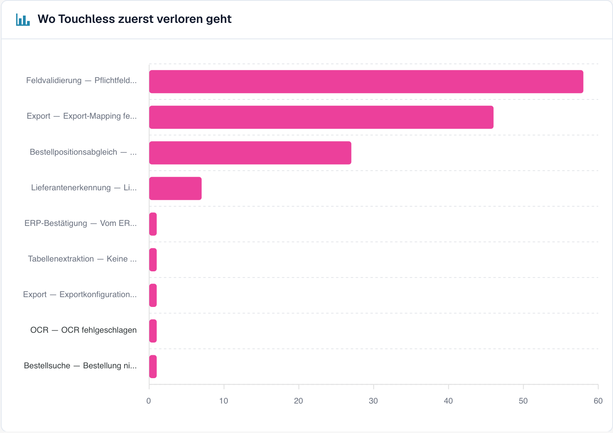
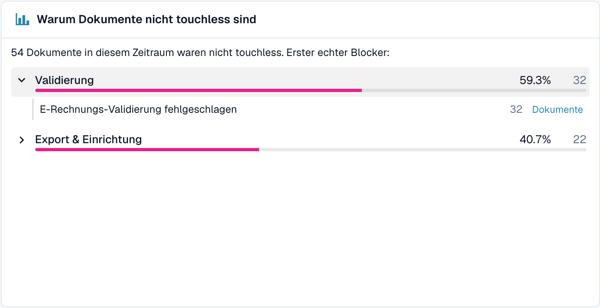
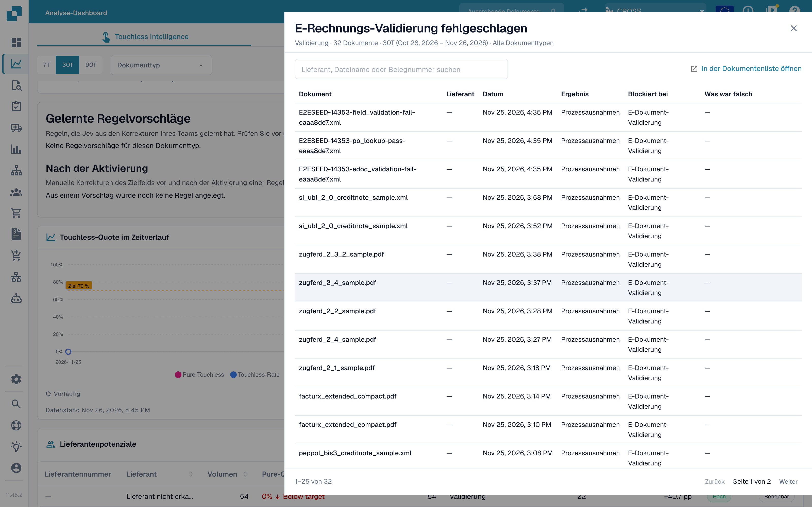
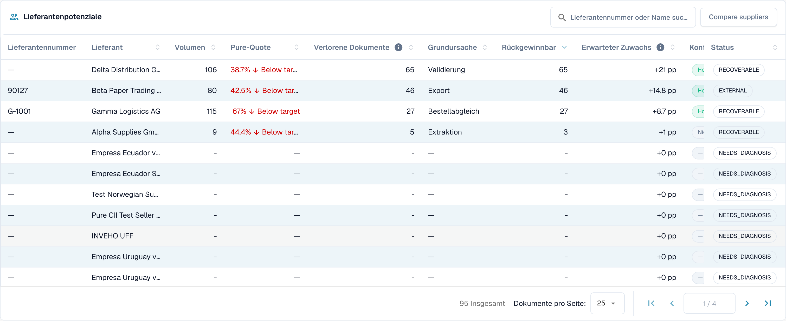

# Dashboard bedienen

<!-- touchless-admin-video-v2-20261104:start -->
**Video-Kapitel (Prüffassung):** [Auswahl und Datenstand](https://docbits-videos.fra1.cdn.digitaloceanspaces.com/settings-assistant/touchless-intelligence-preview-admin/v2/de.html#chapter=01).
<!-- touchless-admin-video-v2-20261104:end -->

### Filter

| Filter                            | Was er bewirkt                                                                                                                                                                                                                   |
| --------------------------------- | ------------------------------------------------------------------------------------------------------------------------------------------------------------------------------------------------------------------------------ |
| **7D / 30D / 90D**                | Der Zeitraum für die Kennzahlen und die Warteschlange. Standard sind 30 Tage                                                                                                                                                           |
| **Document Type**                 | Filtert die Touchless-Kennzahlen und die zugehörige Auswertung auf einen Typ, zum Beispiel INVOICE. Gelernte Regelvorschläge haben derzeit eine eigene Auswahl; siehe unten                                                                                                                                                                        |
| **Segment field / Segment value** | Nur, wenn Ihre Organisation mehrere Prozesse über einen Dokumenttyp abwickelt (zum Beispiel direkte, indirekte und EAM-Bestellungen im Feld `order_type`). Wählen Sie ein Feld, um die Aufschlüsselung zu sehen, und einen Wert, um alles darauf einzugrenzen |
| **Document ID**                   | Öffnet den **Document Trace** für ein Dokument                                                                                                                                                                                  |

Die **Sub-Organisation**, die Sie oben in DocBits gewählt haben, grenzt die Kennzahlen und die Lieferanten-Warteschlange ein. Fehlermuster und die KI-Analyse betreffen immer die gesamte Organisation.

### Dokumenttyp oben und gelernte Regelvorschläge

Die obere Auswahl und der Dokumenttyp in **Learned rule proposals** sind im derzeit geprüften Stand voneinander unabhängig. Der Abschnitt lädt seine eigenen verfügbaren Typen und wählt zunächst den ersten Eintrag. Wählen Sie oben **ORDER_CONFIRMATION**, kann unten deshalb weiterhin **INVOICE** ausgewählt bleiben. Diese Vorschläge betreffen Rechnungen, nicht die für die Kennzahlen gewählten Auftragsbestätigungen.

Prüfen Sie vor einer Regelanwendung den Typ, der in diesem Abschnitt angezeigt wird. Ist dort kein passender Typ verfügbar, sind für ihn keine Vorschläge belegt. Der Abschnitt verwendet außerdem seine eigene Datengrundlage, etwa korrigierte Dokumente der letzten 60 Tage, und übernimmt nicht automatisch den oben gewählten Zeitraum. Diese Beschreibung gibt den aktuellen getrennten Zustand wieder; sie behauptet keine umgesetzte Synchronisierung.

### Die fünf Kennzahlen

<figure><figcaption>
Die vier Ergebniskarten und die Diagnoseabdeckung. Dieser 30-Tage-Testbericht enthält 54 Prozessausnahmen und keine Dokumente in den anderen Ergebniskategorien.
</figcaption></figure>

Die ersten vier Karten sind **getrennte Ergebniskategorien**. Auf jeder Karte zeigt der große Wert den Anteil dieser Kategorie an allen gezählten Dokumenten; die kleinere Zeile zeigt ihre Dokumentanzahl. Die vier Anteile ergeben zusammen 100 %. Addieren Sie keine separate gemeinsame Quote hinzu.

| Karte | Was sie zählt | Zusätzliche Information |
| --- | --- | --- |
| **Pure touchless** | Dokumente, die ohne manuellen Eingriff oder separate Freigabe abgeschlossen wurden | Abweichung in Prozentpunkten vom Touchless-Ziel |
| **Nur Freigabe** | Dokumente, die eine Freigabe, aber keine sonstige manuelle Korrektur benötigten | Nur eigener Anteil und eigene Anzahl dieser Kategorie |
| **Manueller Eingriff** | Dokumente, die eine manuelle Korrektur oder andere Benutzerinteraktion benötigten | Eigener Anteil und eigene Anzahl |
| **Prozessausnahmen** | Dokumente, die wegen einer Verarbeitungs- oder Integrationsausnahme nicht abgeschlossen werden konnten | Eigener Anteil und eigene Anzahl |
| **Diagnoseabdeckung** | Bei wie vielen blockierten Dokumenten die erste blockierende Ursache **bekannt** ist | Anzahl ohne bekannte Ursache |

Das separate Feld **Touchless-Quote · Pure touchless + Nur Freigabe** unter den Karten kombiniert die ersten beiden Kategorien. Beispiel: 60 Pure-Dokumente plus 15 Dokumente mit reiner Freigabe von insgesamt 100 ergeben eine **Touchless-Quote von 75 %**. Die Karte Nur Freigabe zeigt weiterhin **15 %**, nicht 75 %.

* Eine Karte zeigt einen Strich (—) statt **0 %**, wenn es nichts zu messen gibt. Ein Strich bedeutet „keine Daten“, nicht „null“.
* **Diagnoseabdeckung** = Dokumente mit bekanntem Blockadegrund ÷ alle blockierten Dokumente. Beispiel: 50 blockierte Dokumente, 10 mit unbekannter Ursache ergeben 40 ÷ 50 = **80 %**. Ein niedriger Wert bedeutet „wir verstehen noch nicht, warum Dokumente stehen bleiben“. Verbessern Sie ihn, bevor Sie einzelne Ursachen beheben.
* **Klicken Sie auf eine Karte**, um die Dokumentenliste hinter der Zahl in einem neuen Tab zu öffnen. Karten mit 0 Dokumenten sind nicht anklickbar. Die Diagnoseabdeckung öffnet die Dokumente ohne bekannte Ursache.

### Touchless-Quote im Zeitverlauf

<figure><figcaption>
Pure Touchless und die gemeinsame Touchless-Quote im Zeitverlauf. Die gestrichelte Linie markiert das Ziel.
</figcaption></figure>

Das Diagramm zeigt **Pure Touchless**, die gemeinsame **Touchless-Quote** und die **Ziellinie**. Die gemeinsame Quote enthält Pure Touchless und Nur Freigabe und liegt daher auf oder über der Pure-Quote; addieren Sie die beiden Werte nicht. Jeder Punkt hat seine eigene Anzahl geeigneter abgeschlossener Dokumente, ein Tageswert ist deshalb nicht automatisch die Quote des gesamten Zeitraums. Kurze Zeiträume zeigen Tagespunkte, lange Zeiträume Wochenpunkte. Punkte auf Grundlage unvollständiger aktueller Daten sind als **Vorläufig** markiert.

**Beispiel.** Nachdem Sie am 1. Oktober den automatischen Bestellabgleich eingeschaltet haben, steigt die Pure-Quote innerhalb von zwei Wochen von 55 % auf 68 %. Das Diagramm zeigt den Tag, an dem die Kurve dreht, sodass Sie den Zeitpunkt untersuchen können. Ein Vorher/Nachher-Zusammenhang beweist für sich genommen nicht, dass diese Einstellung die Verbesserung verursacht hat. Vergleichen Sie Dokumenttyp, Lieferantenmix und weitere Änderungen.

### Wo Touchless zuerst verloren geht

<figure><figcaption>
Blockierte Dokumente nach Schritt und Grund, an dem sie zuerst stehen geblieben sind. Hier kostet <strong>Field validation: Required field missing</strong> die meisten Dokumente (58), danach <strong>Export mapping failed</strong> (46) und <strong>PO item mismatch</strong> (27). Beispielorganisation mit Demodaten; die Lieferantennamen sind frei erfunden.
</figcaption></figure>

Ein Balkendiagramm der **Blocked documents** je Pipeline-Schritt: der **erste** Schritt, der ein Dokument gestoppt hat.

**Beispiel.** Balken: Supplier Identification 12, Field Validation 41, PO Line Match 7. Der größte Balken sagt Ihnen, dass Sie zuerst **Field Validation** prüfen sollten. Ein nicht ausgelesener Wert ist eine mögliche Ursache; vergleichen Sie Originalrechnung, Feldregeln und verfügbare Quelldaten, bevor Sie sie bestätigen.

#### Warum Dokumente nicht touchless sind (Nova-Release-Kanal)

Organisationen auf dem Release-Kanal **Nova** sehen dieselbe Frage durch eine aufklappbare Liste statt durch das Balkendiagramm beantwortet. Das Panel heißt **Warum Dokumente nicht touchless sind** und steht neben **Touchless-Quote im Zeitverlauf**.

<figure><figcaption>
Klappen Sie einen Bereich auf, um seine Gründe zu sehen und die Dokumente hinter einem Grund zu öffnen. Der Testbericht enthält außerdem den Bereich Export &amp; Einrichtung mit 22 Dokumenten.
</figcaption></figure>

* Die Kopfzeile nennt, wie viele Dokumente die Liste abdeckt. Jede Zeile ist ein Bereich des ersten Blockers mit seinem Anteil in Prozent, der Anzahl der Dokumente und einem Balken. Die Zeilen sind nach Größe sortiert, größte zuerst.
* Klicken Sie auf eine Zeile, um ihre Gründe direkt zu öffnen. Es ist immer nur ein Bereich geöffnet; klicken Sie ihn erneut an, um ihn zu schließen. Zunächst werden die **fünf** größten Gründe angezeigt; wählen Sie **+N weitere**, um die übrigen zu sehen. Beim Schließen wird die Liste wieder auf fünf reduziert.
* **Korrigiert ohne Blocker** ist ein separater Bereich für Dokumente, die ein Benutzer korrigiert hat, obwohl der Bericht keinen technischen ersten Blocker gefunden hat. Untersuchen Sie hier Möglichkeiten zur Verbesserung von Benutzerprozessen und Schulungen, statt nach einem fehlgeschlagenen Pipeline-Schritt zu suchen.
* Die Liste stammt aus denselben Berichtsdaten wie die Kennzahlen. Die Zahlen werden nicht im Browser neu berechnet, daher stimmen die Summe in der Kopfzeile und die Zeilen überein.
* Wenn Ihre Installation diese Daten noch nicht sendet, sagt das Panel das, statt **0** anzuzeigen. Eine leere Liste mit dem Hinweis für „nichts erfasst“ bedeutet, dass in dem Zeitraum keine Dokumente verloren gingen; die beiden Zustände sind unterschiedlich, und Sie sollten den ersten nicht als gute Nachricht lesen.

##### Dokumente hinter einem Grund

Wählen Sie bei einem Grund **Dokumente**, um ein seitliches Panel zu öffnen, ohne den Bericht zu verlassen. Die Kopfzeile zeigt weiterhin Grund, Bereich, Zeitraum und Dokumenttyp.

<figure><figcaption>
Das Dokumentenpanel zeigt 25 Dokumente pro Seite. In diesem Testbeispiel hat E-Rechnungs-Validierung fehlgeschlagen 32 passende Dokumente.
</figcaption></figure>

* **Suchen** Sie nach Lieferant, Dateiname oder Belegnummer. Löschen Sie die Suche, um wieder alle Dokumente des Grunds zu sehen; eine Meldung ohne Treffer bedeutet nicht, dass der Grund keine Dokumente hat.
* Die Tabelle zeigt **Dokument, Lieferant, Eingangsdatum, Ergebnis, ersten blockierten Schritt und eine kurze Detailinformation**. Wählen Sie eine Zeile oder ihren Dokumentnamen, um die **Dokumentenverfolgung** zu öffnen. **Zurück** aus der Verfolgung kehrt zum selben Grund, zur selben Suche und Seite zurück.
* Verwenden Sie **Zurück** und **Weiter**, um durch Seiten mit je **25 Dokumenten** zu navigieren. Die Fußzeile zeigt sichtbaren Bereich, Gesamtzahl und aktuelle Seite.
* **In der Dokumentenliste öffnen** öffnet die vollständige Dokumentenliste in einem neuen Tab mit den Filtern für Grund, Berichtszeitraum und Dokumenttyp. Bericht und Seitenpanel bleiben im ursprünglichen Tab geöffnet.
* Verwenden Sie bei einem Ladefehler **Wiederholen**. Ein leeres Ergebnis und ein Ladefehler sind unterschiedliche Zustände.

Der Release-Kanal **Vesta** behält das oben beschriebene Balkendiagramm. Zeigt Ihre Seite Balken, sind Sie auf Vesta; zeigt sie die aufklappbare Liste, sind Sie auf Nova. Beide beantworten dieselbe Frage, daher gilt der Rest dieser Seite in beiden Fällen.

### Lieferantenpotenziale

<figure><figcaption>
Die Lieferanten-Warteschlange (auf die ersten vier Zeilen gekürzt). Der erste Lieferant hat 106 Dokumente, eine Pure-Quote von 38,7 % und 65 rückgewinnbare Dokumente, seine Behebung ist daher <strong>+21 pp</strong> wert. Beispielorganisation mit Demodaten; die Lieferantennamen sind frei erfunden.
</figcaption></figure>

Die Warteschlange beantwortet die Frage **„Welchen Lieferanten sollten wir zuerst angehen?“** Sie ist nach **Recoverable**-Dokumenten sortiert, die höchsten zuerst, mit 25 Zeilen pro Seite.

| Spalte                         | Bedeutung                                                                                                                                                   |
| ------------------------------ | --------------------------------------------------------------------------------------------------------------------------------------------------------- |
| **Supplier Number / Supplier** | Der Lieferant. Dokumente ohne erkannten Lieferanten erscheinen als **No supplier identified (n documents)**                                                  |
| **Volume**                     | Berücksichtigte Dokumente des Lieferanten im Zeitraum                                                                                                          |
| **Pure Rate**                  | Anteil der Pure-Touchless-Dokumente. Grün, wenn sie dem Ziel entspricht oder darüber liegt, rot, wenn sie darunter liegt                                                                          |
| **Lost Documents**             | Dokumente, die als AP assisted oder als Prozessausnahme endeten. Nicht immer war es eine Person: Auch eine ERP-Ablehnung oder ein Dokument, das sieben Tage lang hing, zählt dazu |
| **Root Cause**                 | Wer die Behebung verantwortet: Configuration, ERP integration, Export, Extraction, Master data, Measurement, PO matching, User process, Validation oder Unknown          |
| **Recoverable**                | Verlorene Dokumente, deren Ursache DocBits beheben kann: Konfiguration, Stammdaten oder Lieferanten-Template                                                               |
| **Expected Lift**              | Um wie viele **Prozentpunkte** die Quote Ihrer Organisation steigen würde, wenn jedes rückgewinnbare Dokument dieses Lieferanten touchless liefe (**+x pp**)               |
| **Confidence**                 | **High**, **Medium** oder **Low**: wie sicher die Diagnose ist                                                                                                |
| **Status**                     | New, Open, Investigating, In progress, Confirmed, Resolved, Dismissed. Ein Lieferant mit zu wenigen Dokumenten zeigt **NEEDS\_DIAGNOSIS**                       |

**Beispiel.** Ihre Organisation hat im Zeitraum 1.000 berücksichtigte Dokumente. Lieferant A hat 40 rückgewinnbare Dokumente, Lieferant B hat 90 verlorene Dokumente, aber nur 10 rückgewinnbare (sein Problem liegt auf seiner Seite).

* Lieferant A: 40 ÷ 1.000 = **+4,0 pp erwarteter Zuwachs**
* Lieferant B: 10 ÷ 1.000 = **+1,0 pp**, obwohl B mehr verlorene Dokumente hat

Die Warteschlange stuft A über B ein, weil der **erwartete Zuwachs** an Ihrer gesamten Organisation gemessen wird, nicht am Lieferanten. Ein Lieferant mit vier schlechten Dokumenten kann keinen mit vierhundert verdrängen.

Mit dem Suchfeld („Search supplier number or name“) finden Sie einen Lieferanten. Ein Klick auf eine Zeile öffnet die **Lieferantendiagnose**.

### Lieferanten- oder Gruppenansicht

Standardmäßig hat die Warteschlange eine Zeile pro Lieferant. Der Umschalter **Supplier | Group** neben dem Suchfeld ändert das:

* **Supplier** listet jeden Lieferantenschlüssel so auf, wie er auf Ihren Dokumenten erscheint. Das ist die Voreinstellung und verhält sich wie die Warteschlange vor dem Graphen.
* **Group** fasst die Lieferantenschlüssel, die DocBits zusammengefasst hat, zu einer Zeile zusammen. Eine gruppierte Zeile führt die zusammengeführten Namen in der Spalte **Members** auf und zeigt sie alle in einem Tooltip.

Eine gruppierte Zeile öffnet keine **Supplier Diagnosis**, weil die Diagnose mit einem einzelnen Lieferantenschlüssel arbeitet. Wechseln Sie zurück zu **Supplier** und klicken Sie den gewünschten Lieferanten an. Solange DocBits noch keinen Graphen für Ihre Organisation aufgebaut hat, liefert die Gruppenansicht dieselben Zeilen wie die Lieferantenansicht, ohne Fehler.

### Lieferanten vergleichen

<figure><figcaption>
Drei Lieferanten nebeneinander: Pure-Quote, verlorene und rückgewinnbare Dokumente, Grundursache, erwarteter Zuwachs und ein Balkendiagramm der Ergebnisse. Jedes <strong>Open</strong> führt zur Lieferantendiagnose. Beispielorganisation mit Demodaten; die Lieferantennamen sind frei erfunden.
</figcaption></figure>

Klicken Sie auf **Compare suppliers**, wählen Sie **two to five** Lieferanten aus (jeder wird mit seiner Anzahl blockierter Dokumente aufgeführt) und klicken Sie auf **Compare**.

Der Vergleich zeigt die Lieferanten nebeneinander: **Pure rate**, **Lost documents**, **Recoverable**, **Root cause**, **Expected lift**, ein Balkendiagramm der Ergebnisse und einen Link zur jeweiligen **Lieferantendiagnose**.

**Beispiel.** Lieferant A und B senden dasselbe Rechnungslayout. B hat eine Pure-Quote von 80 %, A nur 35 %. Die Diagnose für A deutet auf „Master data“. Vergleichen Sie Originalrechnungen, ausgelesene Werte und importierte Lieferantensätze, bevor Sie diese Ursache bestätigen. Der Quotenunterschied allein beweist weder ein korrektes Layout noch unvollständige Stammdaten von A.

### Mit KI analysieren

Die Schaltfläche **Analyse n clusters with AI** analysiert die Fehlermuster mit dem höchsten Touchless-Potenzial (jeweils mindestens eine Mindestanzahl an Dokumenten). Sie benötigt etwa 13 Sekunden pro Cluster und betrifft die **gesamte Organisation**. Nur Administratoren können sie starten.

Während die Analyse läuft, sehen Sie für jedes Fehlermuster **Queued**, **Running**, **Done**, **Already analysed** oder **Error**, mit einem Link **Open cluster**. Ist die KI abgeschaltet oder in der Umgebung nicht konfiguriert, ist die Schaltfläche mit Angabe des Grundes deaktiviert, und **alles andere auf der Seite funktioniert weiter**.

## Ontology: wie DocBits Ihre Lieferanten gruppiert

Der Bereich hat zwei Tabs: **Report** enthält das oben beschriebene Dashboard, **Ontology** zeigt den Lieferantengraphen, den die Gruppenansicht der Warteschlange nutzt. Der Tab ist schreibgeschützt. Er ändert keine Einstellung und kein Dokument.

DocBits leitet den Graphen einmal pro Nacht aus den Dokumenten ab, die Ihre Organisation verarbeitet hat. Ein Lieferantenknoten trägt einen Namen so, wie er auf einem Dokument gedruckt ist; eine Kante verbindet die Namen, die DocBits als dasselbe Unternehmen liest, zum Beispiel weil sich die Schreibweise nur leicht unterscheidet oder weil beide dieselbe Steuer-ID tragen. Neben dem Titel sehen Sie die Version des Graphen und wann er berechnet wurde. **Reload** lädt den aktuellen Graphen erneut.

Der Tab hat drei Teile:

| Teil | Inhalt |
| --- | --- |
| **Your suppliers, grouped** | Die Gruppen und wie viele Schreibweisen jede enthält. Auch eine Gruppe mit nur einer Schreibweise wird aufgeführt. |
| **How it all connects** | Der Graph: Lieferanten und Lieferantengruppen, die Themenbereiche, in denen Rechnungen hängen bleiben, die konkreten Gründe und die Felder, die Menschen am häufigsten korrigieren müssen. |
| **Explanation** | Die Details des ausgewählten Knotens: **What this is based on** führt die Belege dahinter auf, **Also written as** listet die anderen Schreibweisen, die DocBits gesehen hat, und **fixed by DocBits** (mit Schloss-Symbol) kennzeichnet einen Knoten, den DocBits selbst pflegt und nicht Ihre Organisation. |

Die Knotentypen werden im Tab in einfacher Sprache erklärt: Ein Lieferantenname ist ein Name genau so, wie er auf Ihren Dokumenten erscheint, ein Themenbereich ist eine Stelle, an der Rechnungen typischerweise hängen bleiben und einen Menschen brauchen, ein Grund ist eine konkrete Ursache für einen fehlgeschlagenen automatischen Lauf, und ein Feld ist ein Dokumentfeld, das Menschen oft korrigieren oder ausfüllen müssen.

Ein leerer Graph ist ein normaler Zustand. Er zeigt **DocBits is still learning** mit dem Hinweis, dass die Übersicht jede Nacht aufgebaut wird und nach dem nächsten Lauf erscheint. Eine junge Organisation oder ein ausgefallener nächtlicher Lauf sehen so aus; es ist kein Fehler.

Der Graph funktioniert auch ohne Maus: Tab springt zu einer Gruppe oder einem Knoten, Enter oder Space wählt ihn aus und füllt die **Explanation**.

## Mit Touchless Intelligence arbeiten: eine Routine

1. **Wöchentlich**: Öffnen Sie den Tab und prüfen Sie die **Quote** und den **Trend** im Vergleich zum Ziel.
2. Sehen Sie sich **Diagnosis coverage** an. Liegt der Wert unter etwa 80 %, finden Sie zuerst heraus, warum Dokumente stehen bleiben.
3. Lesen Sie **Where touchless is lost first** (Vesta) oder **Why documents are not touchless** (Nova) und wählen Sie die größte Stufe oder den größten Bereich.
4. Öffnen Sie die **Lieferantenpotenziale**. Sortieren Sie nach **Expected lift** und nehmen Sie den obersten Lieferanten mit dem Status **RECOVERABLE**.
5. Lesen Sie die **Fehlermuster**, prüfen Sie **Missing evidence** und folgen Sie dann **What to change**.
6. Beheben Sie eine bestätigte Ursache. Bei einem unterstützten DocBits-Vorschlag nutzen Sie Vorschau und Änderungshistorie. Bei einer Infor-Korrektur dokumentieren Sie Quelle und Import gesondert; sie erzeugt nicht automatisch einen DocBits-Eintrag zu einer Einstellungsänderung.
7. Prüfen Sie nach zwei Wochen das **Vorher/Nachher**-Ergebnis.

## Wer es sehen kann

* Der Tab gehört zum Analytics Dashboard. Ihr Administrator aktiviert ihn für die Organisation. Fehlt der Tab, fragen Sie Ihren Administrator.
* **Organisation administrators** sehen ihn immer.
* Andere Benutzer sehen ihn, wenn ein Administrator ihrer Rolle den Tab **Analytics dashboard** freigegeben hat (Settings → Roles). Ohne diese Freigabe haben nur Administratoren Zugriff.
* Einige Aktionen sind nur für Administratoren: **AI analysis**, **applying and undoing a change**, **learned rule proposals** und der **Consulting report**.

Wenn Sie keine Berechtigung haben, zeigt die Seite _Action not allowed, please contact the administrator_.

## Weiterführende Seiten

* [Touchless Intelligence](./)
* [Kennzahlen und Berechnung](touchless-metrics.md)
* [Praxisbeispiele: Preis und Menge](touchless-examples.md)
* [Lieferantendiagnose und Fehlermuster](touchless-supplier-diagnosis.md)
* [Bestellabgleich-Diagnose](touchless-po-matching-diagnosis.md)
* [Dokumentverlauf](touchless-document-trace.md)
* [Änderungsvorschläge und Berichte](touchless-change-proposals.md)
* [Touchless mit MCP erklären und verbessern](touchless-mcp.md)

<!-- Documentation review 2026-11-04: extraction quality vs process outcomes; KPI and terminal-outcome definitions checked against DocBits_API c51f350c728acb8ac964098d15f7b006bce273f4, module/automation_intelligence/kpi.py and bucket.py. Existing native screenshots retained and checked separately from illustrative examples. -->
<!-- Completion review 2026-11-04: owned synthetic PO examples, MCP schema/read evidence, human-action classification, KPI labels and screenshot proof limits. -->
