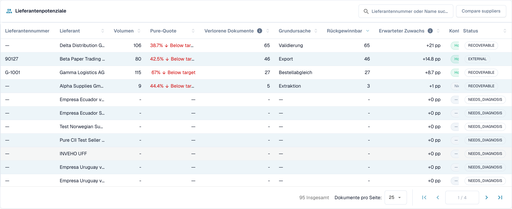

# Dashboard bedienen

<!-- touchless-admin-video-v2-20261104:start -->
**Video-Kapitel (Prüffassung):** [Auswahl und Datenstand](https://docbits-videos.fra1.cdn.digitaloceanspaces.com/settings-assistant/touchless-intelligence-preview-admin/v2/de.html#chapter=01).
<!-- touchless-admin-video-v2-20261104:end -->

### Filter

| Filter                            | Was er bewirkt                                                                                                                                                                                                                   |
| --------------------------------- | ------------------------------------------------------------------------------------------------------------------------------------------------------------------------------------------------------------------------------ |
| **7D / 30D / 90D**                | Der Zeitraum für die Kennzahlen und die Warteschlange. Standard sind 30 Tage                                                                                                                                                           |
| **Document Type**                 | Filtert die Touchless-Kennzahlen und die zugehörige Auswertung auf einen Typ, zum Beispiel INVOICE. Gelernte Regelvorschläge haben derzeit eine eigene Auswahl; siehe unten                                                                                                                                                                        |
| **Segment field / Segment value** | Nur, wenn Ihre Organisation mehrere Prozesse über einen Dokumenttyp abwickelt (zum Beispiel direkte, indirekte und EAM-Bestellungen im Feld `order_type`). Wählen Sie ein Feld, um die Aufschlüsselung zu sehen, und einen Wert, um alles darauf einzugrenzen |
| **Document ID**                   | Öffnet den **Document Trace** für ein Dokument                                                                                                                                                                                  |

Die **Sub-Organisation**, die Sie oben in DocBits gewählt haben, grenzt die Kennzahlen und die Lieferanten-Warteschlange ein. Fehlermuster und die KI-Analyse betreffen immer die gesamte Organisation.

### Dokumenttyp oben und gelernte Regelvorschläge

Die obere Auswahl und der Dokumenttyp in **Learned rule proposals** sind im derzeit geprüften Stand voneinander unabhängig. Der Abschnitt lädt seine eigenen verfügbaren Typen und wählt zunächst den ersten Eintrag. Wählen Sie oben **ORDER_CONFIRMATION**, kann unten deshalb weiterhin **INVOICE** ausgewählt bleiben. Diese Vorschläge betreffen Rechnungen, nicht die für die Kennzahlen gewählten Auftragsbestätigungen.

Prüfen Sie vor einer Regelanwendung den Typ, der in diesem Abschnitt angezeigt wird. Ist dort kein passender Typ verfügbar, sind für ihn keine Vorschläge belegt. Der Abschnitt verwendet außerdem seine eigene Datengrundlage, etwa korrigierte Dokumente der letzten 60 Tage, und übernimmt nicht automatisch den oben gewählten Zeitraum. Diese Beschreibung gibt den aktuellen getrennten Zustand wieder; sie behauptet keine umgesetzte Synchronisierung.

### Die fünf Kennzahlen

<figure><figcaption>
Aktueller 30-Tage-Bericht für Rechnungen: 107 vollständig automatische Rechnungen plus 11 nur freigegebene Rechnungen ergeben 118 von 201, also 58,7 % AP Touchless. Pure allein sind 53,2 %. Die AP-Karte zeigt bereits die gemeinsame Anzahl 118. Fiktiver Schulungsbestand; kein durchgeführter ERP-Export belegt.
</figcaption></figure>

| Karte                   | Zeigt                                             | Beispiel (zur Veranschaulichung)                                                      |
| ---------------------- | ------------------------------------------------- | --------------------------------------------------------------------------- |
| **Pure touchless**     | Den Prozentwert und die Abweichung zum Ziel   | **63,2 %** · „120 Dokumente“ · „−6,8 pp zum Ziel von 70 %“ (rot, unter dem Ziel) |
| **AP touchless** | Gemeinsame Quote und Anzahl: Pure plus reine Freigaben | **78,9 %** · „150 Dokumente“ im Beispiel mit 120 Pure und 30 reinen Freigaben |
| **AP assisted**        | Die Anzahl der Dokumente und ihren Anteil           | **30** · 15,8 %                                                             |
| **Process exceptions** | Die Anzahl der Dokumente und ihren Anteil           | **10** · 5,3 %                                                              |
| **Diagnosis coverage** | Bei wie vielen blockierten Dokumenten die Ursache **bekannt** ist | **80 %** · „10 ohne bekannte Ursache“                                       |

* Im aktuellen Screenshot ergeben 107 vollständig automatische plus 11 nur freigegebene Rechnungen **118 ÷ 201 = 58,7 % AP Touchless**. Pure allein sind **107 ÷ 201 = 53,2 %**. Die beiden Prozentwerte überschneiden sich und dürfen nicht addiert werden.
* Eine Karte zeigt einen Strich (—) statt **0 %**, wenn es nichts zu messen gibt. Ein Strich bedeutet „keine Daten“, nicht „null“.
* **Diagnosis coverage** = Dokumente mit bekanntem Blockadegrund ÷ alle blockierten Dokumente. Beispiel: 50 blockierte Dokumente, 10 mit unbekannter Ursache ergeben 40 ÷ 50 = **80 %**. Ein niedriger Wert bedeutet „wir verstehen noch nicht, warum Dokumente stehen bleiben“. Verbessern Sie ihn, bevor Sie einzelne Ursachen beheben.
* **Klicken Sie auf eine Karte**, um die Dokumentenliste hinter der Zahl in einem neuen Tab zu öffnen („View the documents behind this number“). Karten mit 0 Dokumenten sind nicht anklickbar.

### Touchless-Quote im Zeitverlauf

<figure><figcaption>
Zeitverlauf im aktuellen Bericht: Rosa zeigt Pure Touchless, Blau die gemeinsame Quote einschließlich reiner Freigaben. Die gestrichelte Linie markiert das Ziel von 70 %. Die Kurven stammen aus fiktiven Schulungsfällen und belegen keine tatsächlich erzielte Prozessverbesserung.
</figcaption></figure>

Das aktuelle Diagramm zeigt **Pure Touchless**, die **gemeinsame AP-Touchless-Quote** und die **Ziellinie**. Blau enthält Pure und reine Freigaben und liegt daher auf oder über Rosa; addieren Sie die beiden Werte nicht. Jeder Punkt hat seine eigene Anzahl geeigneter abgeschlossener Dokumente, ein Tageswert ist deshalb nicht automatisch die Quote des gesamten Zeitraums. Kurze Zeiträume zeigen Tagespunkte, lange Zeiträume Wochenpunkte. Die separate Ergebniskategorie der reinen Freigaben ist von dieser gemeinsamen Linie zu unterscheiden.

**Beispiel.** Nachdem Sie am 1. Oktober den automatischen Bestellabgleich eingeschaltet haben, steigt die Pure-Quote innerhalb von zwei Wochen von 55 % auf 68 %. Das Diagramm zeigt den Tag, an dem die Kurve dreht, sodass Sie den Zeitpunkt untersuchen können. Ein Vorher/Nachher-Zusammenhang beweist für sich genommen nicht, dass diese Einstellung die Verbesserung verursacht hat. Vergleichen Sie Dokumenttyp, Lieferantenmix und weitere Änderungen.

### Wo Touchless zuerst verloren geht

<figure><figcaption>
Blockierte Dokumente nach Schritt und Grund, an dem sie zuerst stehen geblieben sind. Hier kostet <strong>Field validation: Required field missing</strong> die meisten Dokumente (58), danach <strong>Export mapping failed</strong> (46) und <strong>PO item mismatch</strong> (27). Beispielorganisation mit Demodaten; die Lieferantennamen sind frei erfunden.
</figcaption></figure>

Ein Balkendiagramm der **Blocked documents** je Pipeline-Schritt: der **erste** Schritt, der ein Dokument gestoppt hat.

**Beispiel.** Balken: Supplier Identification 12, Field Validation 41, PO Line Match 7. Der größte Balken sagt Ihnen, dass Sie zuerst **Field Validation** prüfen sollten. Ein nicht ausgelesener Wert ist eine mögliche Ursache; vergleichen Sie Originalrechnung, Feldregeln und verfügbare Quelldaten, bevor Sie sie bestätigen.

### Lieferantenpotenziale

<figure><figcaption>
Die Lieferanten-Warteschlange (auf die ersten vier Zeilen gekürzt). Der erste Lieferant hat 106 Dokumente, eine Pure-Quote von 38,7 % und 65 rückgewinnbare Dokumente, seine Behebung ist daher <strong>+21 pp</strong> wert. Beispielorganisation mit Demodaten; die Lieferantennamen sind frei erfunden.
</figcaption></figure>

Die Warteschlange beantwortet die Frage **„Welchen Lieferanten sollten wir zuerst angehen?“** Sie ist nach **Recoverable**-Dokumenten sortiert, die höchsten zuerst, mit 25 Zeilen pro Seite.

| Spalte                         | Bedeutung                                                                                                                                                   |
| ------------------------------ | --------------------------------------------------------------------------------------------------------------------------------------------------------- |
| **Supplier Number / Supplier** | Der Lieferant. Dokumente ohne erkannten Lieferanten erscheinen als **No supplier identified (n documents)**                                                  |
| **Volume**                     | Berücksichtigte Dokumente des Lieferanten im Zeitraum                                                                                                          |
| **Pure Rate**                  | Anteil der Pure-Touchless-Dokumente. Grün, wenn sie dem Ziel entspricht oder darüber liegt, rot, wenn sie darunter liegt                                                                          |
| **Lost Documents**             | Dokumente, die als AP assisted oder als Prozessausnahme endeten. Nicht immer war es eine Person: Auch eine ERP-Ablehnung oder ein Dokument, das sieben Tage lang hing, zählt dazu |
| **Root Cause**                 | Wer die Behebung verantwortet: Configuration, ERP integration, Export, Extraction, Master data, Measurement, PO matching, User process, Validation oder Unknown          |
| **Recoverable**                | Verlorene Dokumente, deren Ursache DocBits beheben kann: Konfiguration, Stammdaten oder Lieferanten-Template                                                               |
| **Expected Lift**              | Um wie viele **Prozentpunkte** die Quote Ihrer Organisation steigen würde, wenn jedes rückgewinnbare Dokument dieses Lieferanten touchless liefe (**+x pp**)               |
| **Confidence**                 | **High**, **Medium** oder **Low**: wie sicher die Diagnose ist                                                                                                |
| **Status**                     | New, Open, Investigating, In progress, Confirmed, Resolved, Dismissed. Ein Lieferant mit zu wenigen Dokumenten zeigt **NEEDS\_DIAGNOSIS**                       |

**Beispiel.** Ihre Organisation hat im Zeitraum 1.000 berücksichtigte Dokumente. Lieferant A hat 40 rückgewinnbare Dokumente, Lieferant B hat 90 verlorene Dokumente, aber nur 10 rückgewinnbare (sein Problem liegt auf seiner Seite).

* Lieferant A: 40 ÷ 1.000 = **+4,0 pp erwarteter Zuwachs**
* Lieferant B: 10 ÷ 1.000 = **+1,0 pp**, obwohl B mehr verlorene Dokumente hat

Die Warteschlange stuft A über B ein, weil der **erwartete Zuwachs** an Ihrer gesamten Organisation gemessen wird, nicht am Lieferanten. Ein Lieferant mit vier schlechten Dokumenten kann keinen mit vierhundert verdrängen.

Mit dem Suchfeld („Search supplier number or name“) finden Sie einen Lieferanten. Ein Klick auf eine Zeile öffnet die **Lieferantendiagnose**.

### Lieferanten vergleichen

<figure><figcaption>
Drei Lieferanten nebeneinander: Pure-Quote, verlorene und rückgewinnbare Dokumente, Grundursache, erwarteter Zuwachs und ein Balkendiagramm der Ergebnisse. Jedes <strong>Open</strong> führt zur Lieferantendiagnose. Beispielorganisation mit Demodaten; die Lieferantennamen sind frei erfunden.
</figcaption></figure>

Klicken Sie auf **Compare suppliers**, wählen Sie **two to five** Lieferanten aus (jeder wird mit seiner Anzahl blockierter Dokumente aufgeführt) und klicken Sie auf **Compare**.

Der Vergleich zeigt die Lieferanten nebeneinander: **Pure rate**, **Lost documents**, **Recoverable**, **Root cause**, **Expected lift**, ein Balkendiagramm der Ergebnisse und einen Link zur jeweiligen **Lieferantendiagnose**.

**Beispiel.** Lieferant A und B senden dasselbe Rechnungslayout. B hat eine Pure-Quote von 80 %, A nur 35 %. Die Diagnose für A deutet auf „Master data“. Vergleichen Sie Originalrechnungen, ausgelesene Werte und importierte Lieferantensätze, bevor Sie diese Ursache bestätigen. Der Quotenunterschied allein beweist weder ein korrektes Layout noch unvollständige Stammdaten von A.

### Mit KI analysieren

Die Schaltfläche **Analyse n clusters with AI** analysiert die Fehlermuster mit dem höchsten Touchless-Potenzial (jeweils mindestens eine Mindestanzahl an Dokumenten). Sie benötigt etwa 13 Sekunden pro Cluster und betrifft die **gesamte Organisation**. Nur Administratoren können sie starten.

Während die Analyse läuft, sehen Sie für jedes Fehlermuster **Queued**, **Running**, **Done**, **Already analysed** oder **Error**, mit einem Link **Open cluster**. Ist die KI abgeschaltet oder in der Umgebung nicht konfiguriert, ist die Schaltfläche mit Angabe des Grundes deaktiviert, und **alles andere auf der Seite funktioniert weiter**.

## Mit Touchless Intelligence arbeiten: eine Routine

1. **Wöchentlich**: Öffnen Sie den Tab und prüfen Sie die **Quote** und den **Trend** im Vergleich zum Ziel.
2. Sehen Sie sich **Diagnosis coverage** an. Liegt der Wert unter etwa 80 %, finden Sie zuerst heraus, warum Dokumente stehen bleiben.
3. Lesen Sie **Wo Touchless zuerst verloren geht** und wählen Sie den größten Schritt.
4. Öffnen Sie die **Lieferantenpotenziale**. Sortieren Sie nach **Expected lift** und nehmen Sie den obersten Lieferanten mit dem Status **RECOVERABLE**.
5. Lesen Sie die **Fehlermuster**, prüfen Sie **Missing evidence** und folgen Sie dann **What to change**.
6. Beheben Sie eine bestätigte Ursache. Bei einem unterstützten DocBits-Vorschlag nutzen Sie Vorschau und Änderungshistorie. Bei einer Infor-Korrektur dokumentieren Sie Quelle und Import gesondert; sie erzeugt nicht automatisch einen DocBits-Eintrag zu einer Einstellungsänderung.
7. Prüfen Sie nach zwei Wochen das **Vorher/Nachher**-Ergebnis.

## Wer es sehen kann

* Der Tab gehört zum Analytics Dashboard. Ihr Administrator aktiviert ihn für die Organisation. Fehlt der Tab, fragen Sie Ihren Administrator.
* **Organisation administrators** sehen ihn immer.
* Andere Benutzer sehen ihn, wenn ein Administrator ihrer Rolle den Tab **Analytics dashboard** freigegeben hat (Settings → Roles). Ohne diese Freigabe haben nur Administratoren Zugriff.
* Einige Aktionen sind nur für Administratoren: **AI analysis**, **applying and undoing a change**, **learned rule proposals** und der **Consulting report**.

Wenn Sie keine Berechtigung haben, zeigt die Seite _Action not allowed, please contact the administrator_.

## Weiterführende Seiten

* [Touchless Intelligence](./)
* [Kennzahlen und Berechnung](touchless-metrics.md)
* [Praxisbeispiele: Preis und Menge](touchless-examples.md)
* [Lieferantendiagnose und Fehlermuster](touchless-supplier-diagnosis.md)
* [Bestellabgleich-Diagnose](touchless-po-matching-diagnosis.md)
* [Dokumentverlauf](touchless-document-trace.md)
* [Änderungsvorschläge und Berichte](touchless-change-proposals.md)
* [Touchless mit MCP erklären und verbessern](touchless-mcp.md)

<!-- Documentation review 2026-11-04: extraction quality vs process outcomes; KPI and terminal-outcome definitions checked against DocBits_API c51f350c728acb8ac964098d15f7b006bce273f4, module/automation_intelligence/kpi.py and bucket.py. Existing native screenshots retained and checked separately from illustrative examples. -->
<!-- Completion review 2026-11-04: owned synthetic PO examples, MCP schema/read evidence, human-action classification, KPI labels and screenshot proof limits. -->
