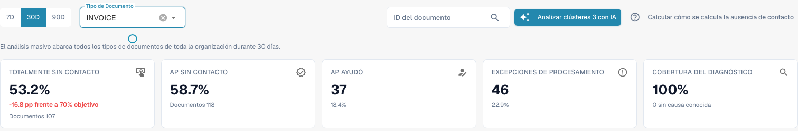
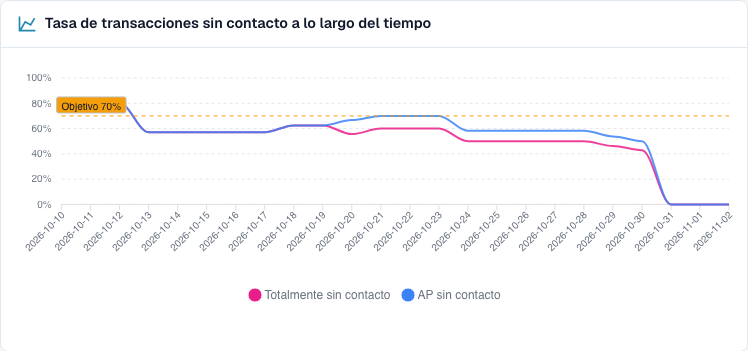
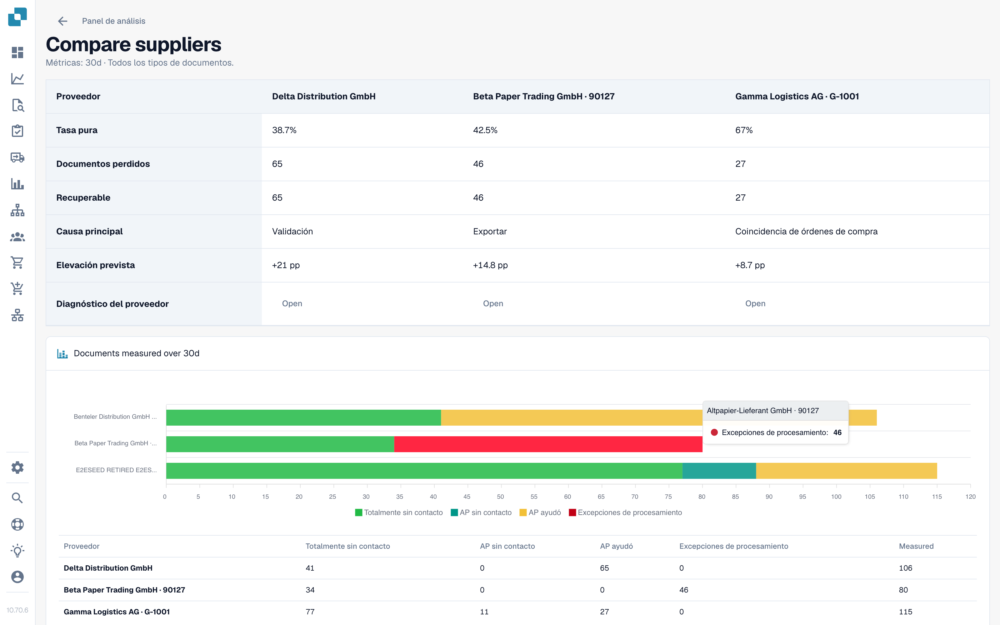

# Usar el panel

<!-- touchless-admin-video-v2-20261104:start -->
**Capítulo del vídeo (versión de revisión):** [Selección y fecha de los datos](https://docbits-videos.fra1.cdn.digitaloceanspaces.com/settings-assistant/touchless-intelligence-preview-admin/v2/es.html#chapter=01).
<!-- touchless-admin-video-v2-20261104:end -->

### Filtros

| Filtro                            | Qué hace                                                                                                                                                                                                                   |
| --------------------------------- | ------------------------------------------------------------------------------------------------------------------------------------------------------------------------------------------------------------------------------ |
| **7D / 30D / 90D**                | El período de las cifras clave y de la cola. El valor predeterminado es 30 días                                                                                                                                                           |
| **Document Type**                 | Filtra las métricas Touchless y el análisis relacionado a un solo tipo, por ejemplo INVOICE. Las propuestas de reglas aprendidas tienen actualmente su propia selección; véase más abajo                                                                                                                                                                        |
| **Segment field / Segment value** | Solo si su organización ejecuta varios procesos con un mismo tipo de documento (por ejemplo, pedidos directos, indirectos y EAM en el campo `order_type`). Elija un campo para ver el desglose y elija un valor para limitarlo todo a él |
| **Document ID**                   | Abre el **Document Trace** de un documento                                                                                                                                                                                  |

La **suborganización** que seleccionó en la parte superior de DocBits limita las cifras clave y la cola de proveedores. Los clústeres de problemas y el análisis con IA siempre abarcan toda la organización.

### Tipo de documento superior frente a propuestas de reglas aprendidas

El selector superior y el tipo de documento de **Learned rule proposals** son independientes en la implementación comprobada actualmente. Ese apartado carga sus propios tipos disponibles y elige inicialmente la primera entrada. Por tanto, seleccionar **ORDER_CONFIRMATION** arriba puede dejar **INVOICE** seleccionado abajo. Esas propuestas se refieren a facturas, no a las confirmaciones de pedido elegidas para las métricas.

Antes de aplicar una regla, compruebe el tipo que se muestra dentro de ese apartado. Si allí no hay disponible un tipo coincidente, no se han establecido propuestas para él. El apartado también usa su propia base de datos, como documentos corregidos de los últimos 60 días, en lugar de adoptar automáticamente el período principal. Esto describe los controles separados actuales; no afirma que la sincronización esté implementada.

### Las cinco cifras clave

<figure><figcaption>
Informe actual de facturas a 30 días: 107 facturas totalmente automáticas más 11 con solo aprobación dan 118 de 201, es decir, 58,7 % AP Touchless. Pure por separado es 53,2 %. La tarjeta AP ya muestra el recuento combinado de 118. Historial de formación ficticio; no se acredita ninguna exportación ERP ejecutada.
</figcaption></figure>

| Tarjeta                   | Muestra                                             | Ejemplo (ilustrativo)                                                      |
| ---------------------- | ------------------------------------------------- | --------------------------------------------------------------------------- |
| **Pure touchless**     | El porcentaje y la diferencia con el objetivo   | **63,2 %** · "120 documents" · "−6.8 pp vs 70 % target" (rojo, por debajo del objetivo) |
| **AP touchless** | Porcentaje y recuento combinados: Pure más solo aprobación | **78,9 %** · "150 documents" en el ejemplo con 120 Pure y 30 de solo aprobación |
| **AP assisted**        | El número de documentos y su proporción           | **30** · 15,8 %                                                             |
| **Process exceptions** | El número de documentos y su proporción           | **10** · 5,3 %                                                              |
| **Diagnosis coverage** | Cuántos documentos bloqueados tienen una causa **conocida** | **80 %** · "10 without a known cause"                                       |

* En la captura actual, 107 facturas totalmente automáticas más 11 con solo aprobación dan **118 ÷ 201 = 58,7 % AP Touchless**. Pure por separado es **107 ÷ 201 = 53,2 %**. Los dos porcentajes se solapan y no deben sumarse.
* Una tarjeta muestra un guion (—) en lugar de **0 %** cuando no hay nada que medir. Un guion significa "sin datos", no "cero".
* **Diagnosis coverage** = documentos con un motivo de bloqueo conocido ÷ todos los documentos bloqueados. Ejemplo: 50 documentos bloqueados, 10 con una causa desconocida → 40 ÷ 50 = **80 %**. Un valor bajo significa "todavía no entendemos por qué se detienen los documentos". Mejórelo antes de intentar corregir causas individuales.
* **Haga clic en una tarjeta** para abrir en una pestaña nueva la lista de documentos que hay detrás de la cifra ("View the documents behind this number"). Las tarjetas con 0 documentos no se pueden pulsar.

### Tasa touchless a lo largo del tiempo

<figure><figcaption>
Tendencia actual del informe: el rosa muestra Pure Touchless y el azul la tasa combinada, que incluye los documentos de solo aprobación. La línea discontinua marca el objetivo del 70 %. Estas curvas usan casos de formación ficticios y no acreditan una mejora real del proceso.
</figcaption></figure>

El gráfico actual muestra **Pure Touchless**, la **tasa AP Touchless combinada** y la **línea objetivo**. El azul incluye Pure y solo aprobación, por lo que está al mismo nivel o por encima del rosa; no sume los dos valores. Cada punto tiene su propio número de documentos finalizados elegibles, así que una tasa diaria no es automáticamente la tasa de todo el período. Los períodos cortos muestran puntos diarios y los largos, puntos semanales. La categoría separada de solo aprobación es distinta de esta línea combinada.

**Ejemplo.** Tras activar la coincidencia automática con la OC el 1 de octubre, la tasa pure sube del 55 % al 68 % en dos semanas. El gráfico muestra el día en que la curva cambia, de modo que puede investigar el momento. Una asociación antes/después no demuestra por sí sola que este ajuste causara la mejora. Compare el tipo de documento, la mezcla de proveedores y otros cambios.

### Dónde se pierde primero el touchless

<figure><figcaption>
Documentos bloqueados según la etapa y el motivo en los que se detuvieron primero. Aquí <strong>Field validation: Required field missing</strong> cuesta más documentos (58), seguido de <strong>Export mapping failed</strong> (46) y <strong>PO item mismatch</strong> (27). Organización de ejemplo con datos de demostración; los nombres de proveedores son ficticios.
</figcaption></figure>

Un gráfico de barras de **Blocked documents** por etapa del pipeline: la **primera** etapa que detuvo un documento.

**Ejemplo.** Barras: Supplier Identification 12, Field Validation 41, PO Line Match 7. La barra más grande indica que debe mirar primero **Field Validation**. Un valor extraído ausente es una causa posible; compare la factura original, las reglas de campo y los datos de origen disponibles antes de confirmarla.

### Oportunidades por proveedor

<figure><figcaption>
La cola de proveedores (reducida a las cuatro primeras filas). El primer proveedor tiene 106 documentos, una tasa pure del 38,7 % y 65 documentos recuperables, así que corregirlo vale <strong>+21 pp</strong>. Organización de ejemplo con datos de demostración; los nombres de proveedores son ficticios.
</figcaption></figure>

La cola responde a **"¿Qué proveedor deberíamos corregir primero?"** Está ordenada por documentos **Recoverable**, de mayor a menor, 25 filas por página.

| Columna                         | Significado                                                                                                                                                   |
| ------------------------------ | --------------------------------------------------------------------------------------------------------------------------------------------------------- |
| **Supplier Number / Supplier** | El proveedor. Los documentos sin un proveedor reconocido aparecen como **No supplier identified (n documents)**                                                  |
| **Volume**                     | Documentos elegibles del proveedor en el período                                                                                                          |
| **Pure Rate**                  | Proporción de documentos pure touchless. Verde si está en el objetivo o por encima, rojo si está por debajo                                                                          |
| **Lost Documents**             | Documentos que terminaron como AP assisted o como process exception. No siempre interviene una persona: un rechazo del ERP o un documento estancado durante siete días también cuentan |
| **Root Cause**                 | Quién es responsable de la corrección: Configuration, ERP integration, Export, Extraction, Master data, Measurement, PO matching, User process, Validation o Unknown          |
| **Recoverable**                | Documentos perdidos cuya causa DocBits puede corregir: configuración, datos maestros o plantilla del proveedor                                                               |
| **Expected Lift**              | Cuántos **puntos porcentuales** ganaría la tasa de su organización si cada documento recuperable de este proveedor se procesara touchless (**+x pp**)               |
| **Confidence**                 | **High**, **Medium** o **Low**: cuán seguro es el diagnóstico                                                                                                |
| **Status**                     | New, Open, Investigating, In progress, Confirmed, Resolved, Dismissed. Un proveedor con muy pocos documentos muestra **NEEDS\_DIAGNOSIS**                       |

**Ejemplo.** Su organización tiene 1.000 documentos elegibles en el período. El proveedor A tiene 40 documentos recuperables; el proveedor B tiene 90 documentos perdidos, pero solo 10 recuperables (su problema está de su lado).

* Proveedor A: 40 ÷ 1.000 = **+4,0 pp de mejora esperada**
* Proveedor B: 10 ÷ 1.000 = **+1,0 pp**, aunque B tiene más documentos perdidos

La cola clasifica a A por encima de B porque la **mejora esperada** se mide con respecto a toda su organización, no con respecto al proveedor. Un proveedor con cuatro documentos malos no puede superar a uno con cuatrocientos.

Utilice el cuadro de búsqueda ("Search supplier number or name") para encontrar un proveedor. Haga clic en una fila para abrir el **Supplier Diagnosis**.

### Comparar proveedores

<figure><figcaption>
Tres proveedores lado a lado: tasa pure, documentos perdidos y recuperables, causa raíz, mejora esperada y un gráfico de barras de los resultados. Cada <strong>Open</strong> lleva al Supplier Diagnosis. Organización de ejemplo con datos de demostración; los nombres de proveedores son ficticios.
</figcaption></figure>

Haga clic en **Compare suppliers**, marque **de dos a cinco** proveedores (cada uno aparece con su número de documentos bloqueados) y haga clic en **Compare**.

La comparación muestra los proveedores lado a lado: **Pure rate**, **Lost documents**, **Recoverable**, **Root cause**, **Expected lift**, un gráfico de barras de los resultados y un enlace al **Supplier Diagnosis** de cada uno.

**Ejemplo.** Los proveedores A y B envían el mismo diseño de factura. B tiene una tasa pure del 80 % y A solo del 35 %. El diagnóstico de A sugiere "Master data". Compare las facturas originales, los valores extraídos y los registros de proveedor importados antes de confirmar esa causa. La diferencia de tasas por sí sola no demuestra que el diseño sea correcto ni que los datos maestros de A estén incompletos.

### Analizar con IA

El botón **Analyse n clusters with AI** analiza los clústeres de problemas con mayor potencial touchless (como mínimo un número mínimo de documentos cada uno). Tarda unos 13 segundos por clúster y abarca **toda la organización**. Solo los administradores pueden iniciarlo.

Mientras se ejecuta, verá **Queued**, **Running**, **Done**, **Already analysed** o **Error** para cada clúster, con un enlace **Open cluster**. Si la IA está desactivada o no está configurada en el entorno, el botón aparece desactivado con el motivo, y **todo lo demás de la página sigue funcionando**.

## Trabajar con Touchless Intelligence: una rutina

1. **Cada semana**: abra la pestaña y compare la **tasa** y la **tendencia** con el objetivo.
2. Revise **Diagnosis coverage**. Si está por debajo de aproximadamente el 80 %, averigüe primero por qué se detienen los documentos.
3. Lea **Where touchless is lost first** y elija la etapa más grande.
4. Abra **Supplier opportunities**. Ordene por **Expected lift** y tome el primer proveedor con el estado **RECOVERABLE**.
5. Lea los **issue clusters**, revise **Missing evidence** y siga después **What to change**.
6. Corrija una causa confirmada. Para una propuesta compatible de DocBits use la vista previa y el historial de cambios. Para una corrección en Infor, documente la fuente e importe por separado; no crea automáticamente una entrada de cambio de ajuste en DocBits.
7. Transcurridas dos semanas, revise el resultado de **antes/después**.

## Quién puede verla

* La pestaña forma parte del Panel de Análisis. Su administrador la habilita para la organización. Si falta la pestaña, consulte a su administrador.
* Los **administradores de la organización** siempre la ven.
* Los demás usuarios la ven cuando un administrador ha concedido a su rol la pestaña **Analytics dashboard** (**Settings → Roles**). Sin esa concesión, solo los administradores tienen acceso.
* Algunas acciones son solo para administradores: **AI analysis**, **aplicar y deshacer un cambio**, **learned rule proposals** y el **Consulting report**.

Si no tiene permiso, la página muestra _Action not allowed, please contact the administrator_.

## Páginas relacionadas

* [Touchless Intelligence](./)
* [Métricas y cálculo](touchless-metrics.md)
* [Ejemplos: precio y cantidad](touchless-examples.md)
* [Touchless Intelligence: Diagnóstico de proveedores y clústeres de problemas](touchless-supplier-diagnosis.md)
* [Touchless Intelligence: Diagnóstico de la coincidencia con la OC](touchless-po-matching-diagnosis.md)
* [Touchless Intelligence: Seguimiento del documento](touchless-document-trace.md)
* [Touchless Intelligence: Propuestas de cambio e informes](touchless-change-proposals.md)
* [Explicar y mejorar Touchless con MCP](touchless-mcp.md)

<!-- Documentation review 2026-11-04: extraction quality vs process outcomes; KPI and terminal-outcome definitions checked against DocBits_API c51f350c728acb8ac964098d15f7b006bce273f4, module/automation_intelligence/kpi.py and bucket.py. Existing native screenshots retained and checked separately from illustrative examples. -->
<!-- Completion review 2026-11-04: owned synthetic PO examples, MCP schema/read evidence, human-action classification, KPI labels and screenshot proof limits. -->
