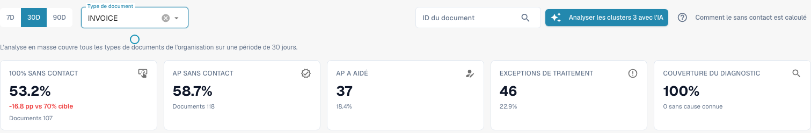
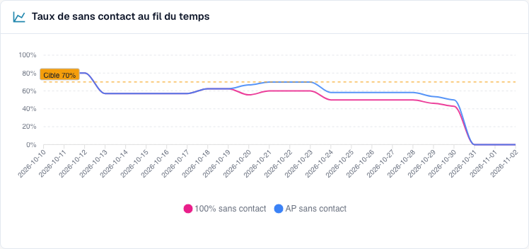
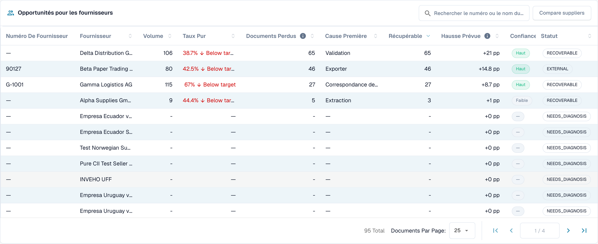
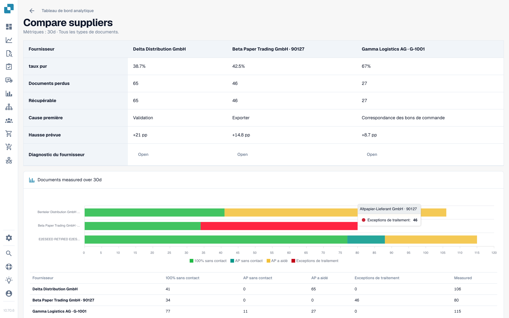

# Utiliser le tableau de bord

<!-- touchless-admin-video-v2-20261104:start -->
**Chapitre vidéo (version de contrôle):** [Sélection et date des données](https://docbits-videos.fra1.cdn.digitaloceanspaces.com/settings-assistant/touchless-intelligence-preview-admin/v2/fr.html#chapter=01).
<!-- touchless-admin-video-v2-20261104:end -->

### Filtres

| Filtre                            | Ce qu'il fait                                                                                                                                                                                                                   |
| --------------------------------- | ------------------------------------------------------------------------------------------------------------------------------------------------------------------------------------------------------------------------------ |
| **7D / 30D / 90D**                | La période des chiffres clés et de la file d'attente. La valeur par défaut est de 30 jours                                                                                                                                                           |
| **Document Type**                 | Limite les métriques Touchless et l'analyse associée à un seul type, par exemple INVOICE. Les propositions de règles apprises ont actuellement leur propre sélection ; voir ci-dessous                                                                                                                                                                        |
| **Segment field / Segment value** | Uniquement si votre organisation fait passer plusieurs processus par un même type de document (par exemple des commandes directes, indirectes et EAM dans le champ `order_type`). Choisissez un champ pour voir la répartition, choisissez une valeur pour tout y ramener |
| **Document ID**                   | Ouvre la **Document Trace** pour un document                                                                                                                                                                                  |

La **sous-organisation** que vous avez sélectionnée en haut de DocBits limite les chiffres clés et la file d'attente des fournisseurs. Les clusters de problèmes et l'analyse IA couvrent toujours l'ensemble de l'organisation.

### Type de document principal et propositions de règles apprises

Le sélecteur principal et le type de document de **Learned rule proposals** sont indépendants dans l'implémentation actuellement vérifiée. Cette section charge ses propres types disponibles et choisit d'abord la première entrée. Sélectionner **ORDER_CONFIRMATION** en haut peut donc laisser **INVOICE** sélectionné en bas. Ces propositions concernent les factures, pas les confirmations de commande choisies pour les métriques.

Avant d'appliquer une règle, vérifiez le type affiché dans cette section. Si aucun type correspondant n'y est disponible, aucune proposition n'a été établie pour lui. La section utilise également sa propre base de données, par exemple les documents corrigés des 60 derniers jours, et ne reprend pas automatiquement la période principale. Cette description porte sur les commandes actuellement séparées ; elle n'affirme pas qu'une synchronisation a été mise en œuvre.

### Les cinq chiffres clés

<figure><figcaption>
Rapport actuel sur 30 jours pour les factures : 107 factures entièrement automatiques plus 11 factures avec approbation seule donnent 118 sur 201, soit 58,7 % AP Touchless. Pure seul représente 53,2 %. La carte AP affiche déjà le total combiné de 118. Historique de formation fictif ; aucun export ERP exécuté n'est établi.
</figcaption></figure>

| Carte                   | Affiche                                             | Exemple (illustratif)                                                      |
| ---------------------- | ------------------------------------------------- | --------------------------------------------------------------------------- |
| **Pure touchless**     | Le pourcentage et l'écart à l'objectif   | **63.2 %** · « 120 documents » · « −6.8 pp vs 70 % target » (rouge, sous l'objectif) |
| **AP touchless** | Pourcentage et nombre combinés : Pure plus approbation seule | **78.9%** · « 150 documents » dans l'exemple avec 120 Pure et 30 avec approbation seule |
| **AP assisted**        | Le nombre de documents et leur part           | **30** · 15.8 %                                                             |
| **Process exceptions** | Le nombre de documents et leur part           | **10** · 5.3 %                                                              |
| **Diagnosis coverage** | Combien de documents bloqués ont une cause **connue** | **80 %** · « 10 sans cause connue »                                       |

* Dans la capture actuelle, 107 factures entièrement automatiques plus 11 factures avec approbation seule donnent **118 ÷ 201 = 58,7 % AP Touchless**. Pure seul représente **107 ÷ 201 = 53,2 %**. Les deux pourcentages se recouvrent et ne doivent pas être additionnés.
* Une carte affiche un tiret (—) au lieu de **0 %** lorsqu'il n'y a rien à mesurer. Un tiret signifie « pas de données », pas « zéro ».
* **Diagnosis coverage** = documents avec un motif de blocage connu ÷ tous les documents bloqués. Exemple : 50 documents bloqués, 10 avec une cause inconnue → 40 ÷ 50 = **80 %**. Une valeur faible signifie « nous ne comprenons pas encore pourquoi les documents s'arrêtent ». Améliorez-la avant de vouloir corriger des causes individuelles.
* **Cliquez sur une carte** pour ouvrir dans un nouvel onglet la liste des documents derrière le chiffre (« View the documents behind this number »). Les cartes avec 0 document ne sont pas cliquables.

### Taux touchless dans le temps

<figure><figcaption>
Tendance actuelle du rapport : le rose représente Pure Touchless et le bleu le taux combiné, approbation seule comprise. La ligne pointillée marque l'objectif de 70 %. Ces courbes utilisent des cas de formation fictifs et n'établissent pas une amélioration réelle du processus.
</figcaption></figure>

Le graphique actuel montre **Pure Touchless**, le **taux AP Touchless combiné** et la **ligne d'objectif**. Le bleu inclut Pure et l'approbation seule : il est donc au niveau ou au-dessus du rose ; n'additionnez pas les deux valeurs. Chaque point a son propre nombre de documents terminés éligibles : un taux journalier n'est pas automatiquement le taux de toute la période. Les périodes courtes affichent des points quotidiens, les longues des points hebdomadaires. La catégorie distincte de l'approbation seule diffère de cette ligne combinée.

**Exemple.** Après avoir activé le rapprochement automatique des PO le 1er octobre, le taux pur passe de 55 % à 68 % en deux semaines. Le graphique montre le jour où la courbe s'inverse, ce qui vous permet d'examiner le moment. Une association avant/après ne prouve pas à elle seule que ce paramètre est à l'origine de l'amélioration. Comparez le type de document, la composition des fournisseurs et les autres changements.

### Où le touchless est perdu en premier

<figure><figcaption>
Documents bloqués par étape et par motif où ils se sont arrêtés en premier. Ici, <strong>Field validation: Required field missing</strong> coûte le plus de documents (58), puis <strong>Export mapping failed</strong> (46) et <strong>PO item mismatch</strong> (27). Organisation d'exemple avec des données de démonstration ; les noms de fournisseurs sont fictifs.
</figcaption></figure>

Un graphique en barres des **Blocked documents** par étape du pipeline : la **première** étape qui a arrêté un document.

**Exemple.** Barres : Supplier Identification 12, Field Validation 41, PO Line Match 7. La barre la plus élevée vous indique de regarder **Field Validation** en premier. Une valeur extraite manquante est une cause possible ; comparez la facture d'origine, les règles de champ et les données source disponibles avant de la confirmer.

### Opportunités fournisseurs

<figure><figcaption>
La file d'attente des fournisseurs (réduite aux quatre premières lignes). Le premier fournisseur a 106 documents, un taux pur de 38,7 % et 65 documents récupérables : le corriger vaut donc <strong>+21 pp</strong>. Organisation d'exemple avec des données de démonstration ; les noms de fournisseurs sont fictifs.
</figcaption></figure>

La file d'attente répond à la question **« quel fournisseur devons-nous corriger en premier ? »**. Elle est triée par documents **Recoverable**, du plus élevé au plus faible, 25 lignes par page.

| Colonne                         | Signification                                                                                                                                                   |
| ------------------------------ | --------------------------------------------------------------------------------------------------------------------------------------------------------- |
| **Supplier Number / Supplier** | Le fournisseur. Les documents sans fournisseur reconnu apparaissent comme **No supplier identified (n documents)**                                                  |
| **Volume**                     | Documents éligibles du fournisseur sur la période                                                                                                          |
| **Pure Rate**                  | Part des documents purement touchless. Vert si la valeur atteint ou dépasse l'objectif, rouge si elle est en dessous                                                                          |
| **Lost Documents**             | Documents qui se sont terminés en AP assisted ou en exception de processus. Ce n'est pas toujours une personne : un rejet de l'ERP ou un document bloqué sept jours compte aussi | 
| **Root Cause**                 | Qui doit corriger : Configuration, ERP integration, Export, Extraction, Master data, Measurement, PO matching, User process, Validation ou Unknown          |
| **Recoverable**                | Documents perdus dont DocBits peut corriger la cause : configuration, données de référence ou modèle fournisseur                                                               |
| **Expected Lift**              | Combien de **points de pourcentage** le taux de votre organisation gagnerait si chaque document récupérable de ce fournisseur passait en touchless (**+x pp**)               |
| **Confidence**                 | **High**, **Medium** ou **Low** : la certitude du diagnostic                                                                                                |
| **Status**                     | New, Open, Investigating, In progress, Confirmed, Resolved, Dismissed. Un fournisseur avec trop peu de documents affiche **NEEDS\_DIAGNOSIS**                       |

**Exemple.** Votre organisation a 1 000 documents éligibles sur la période. Le fournisseur A a 40 documents récupérables, le fournisseur B a 90 documents perdus mais seulement 10 récupérables (son problème est de son côté).

* Fournisseur A : 40 ÷ 1 000 = **+4,0 pp de gain attendu**
* Fournisseur B : 10 ÷ 1 000 = **+1,0 pp**, alors que B a plus de documents perdus

La file d'attente classe A devant B parce que le **gain attendu** est mesuré par rapport à toute votre organisation, pas par rapport au fournisseur. Un fournisseur avec quatre mauvais documents ne peut pas dépasser un fournisseur qui en a quatre cents.

Utilisez le champ de recherche (« Search supplier number or name ») pour trouver un fournisseur. Cliquez sur une ligne pour ouvrir le **Supplier Diagnosis**.

### Comparer les fournisseurs

<figure><figcaption>
Trois fournisseurs côte à côte : taux pur, documents perdus et récupérables, cause racine, gain attendu et un graphique en barres des résultats. Chaque <strong>Open</strong> mène au Supplier Diagnosis. Organisation d'exemple avec des données de démonstration ; les noms de fournisseurs sont fictifs.
</figcaption></figure>

Cliquez sur **Compare suppliers**, cochez **deux à cinq** fournisseurs (chacun est listé avec son nombre de documents bloqués) et cliquez sur **Compare**.

La comparaison affiche les fournisseurs côte à côte : **Pure rate**, **Lost documents**, **Recoverable**, **Root cause**, **Expected lift**, un graphique en barres des résultats et un lien vers chaque **Supplier Diagnosis**.

**Exemple.** Les fournisseurs A et B envoient la même mise en page de facture. B a un taux pur de 80 %, A seulement 35 %. Le diagnostic de A suggère « Master data ». Comparez les factures d'origine, les valeurs extraites et les enregistrements fournisseur importés avant de confirmer cette cause. L'écart de taux seul ne prouve ni que la mise en page est correcte ni que les données de référence de A sont incomplètes.

### Analyser avec l'IA

Le bouton **Analyse n clusters with AI** analyse les clusters de problèmes au plus fort potentiel touchless (au moins un nombre minimal de documents chacun). Il faut environ 13 secondes par cluster et cela couvre **toute l'organisation**. Seuls les administrateurs peuvent le lancer.

Pendant l'exécution, vous voyez **Queued**, **Running**, **Done**, **Already analysed** ou **Error** pour chaque cluster, avec un lien **Open cluster**. Si l'IA est désactivée ou non configurée dans l'environnement, le bouton est désactivé avec la raison, et **tout le reste de la page continue de fonctionner**.

## Travailler avec Touchless Intelligence : une routine

1. **Chaque semaine** : ouvrez l'onglet et comparez le **taux** et la **tendance** à l'objectif.
2. Regardez la **Diagnosis coverage**. En dessous d'environ 80 %, cherchez d'abord pourquoi les documents s'arrêtent.
3. Lisez **Où le touchless est perdu en premier** et choisissez l'étape la plus importante.
4. Ouvrez les **Opportunités fournisseurs**. Triez par **Expected lift** et prenez le premier fournisseur avec le statut **RECOVERABLE**.
5. Lisez les **clusters de problèmes**, vérifiez **Missing evidence**, puis suivez **What to change**.
6. Corrigez une cause confirmée. Pour une proposition DocBits prise en charge, utilisez l'aperçu et l'historique des modifications. Pour une correction Infor, documentez la source et l'import séparément ; cela ne crée pas automatiquement une entrée de modification de paramètre dans DocBits.
7. Après deux semaines, vérifiez le résultat **avant/après**.

## Qui peut le voir

* L'onglet fait partie du Dashboard Analytics. Votre administrateur l'active pour l'organisation. Si l'onglet manque, demandez à votre administrateur.
* Les **administrateurs de l'organisation** le voient toujours.
* **Settings → Roles** — un administrateur y accorde l'onglet **Analytics dashboard** au rôle des autres utilisateurs, qui le voient alors. Sans cette autorisation, seuls les administrateurs y ont accès.
* Certaines actions sont réservées aux administrateurs : l'**AI analysis**, l'**application et l'annulation d'une modification**, les **learned rule proposals** et le **Consulting report**.

Si vous n'y êtes pas autorisé, la page affiche _Action not allowed, please contact the administrator_.

## Pages associées

* [Touchless Intelligence](./)
* [Indicateurs et calcul](../../touchless-metrics.md)
* [Exemples pratiques : prix et quantité](touchless-examples.md)
* [Diagnostic fournisseur et clusters de problèmes](../../touchless-supplier-diagnosis.md)
* [Diagnostic du rapprochement avec le BC](../../touchless-po-matching-diagnosis.md)
* [Trace du document](touchless-document-trace.md)
* [Propositions de modification et rapports](touchless-change-proposals.md)
* [Expliquer et améliorer Touchless avec MCP](touchless-mcp.md)

<!-- Documentation review 2026-11-04: extraction quality vs process outcomes; KPI and terminal-outcome definitions checked against DocBits_API c51f350c728acb8ac964098d15f7b006bce273f4, module/automation_intelligence/kpi.py and bucket.py. Existing native screenshots retained and checked separately from illustrative examples. -->
<!-- Completion review 2026-11-04: owned synthetic PO examples, MCP schema/read evidence, human-action classification, KPI labels and screenshot proof limits. -->
