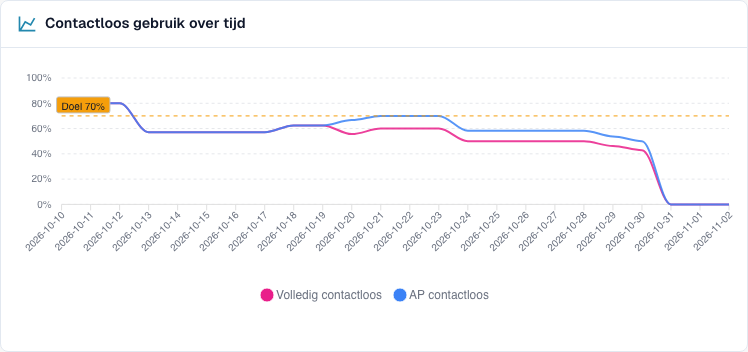
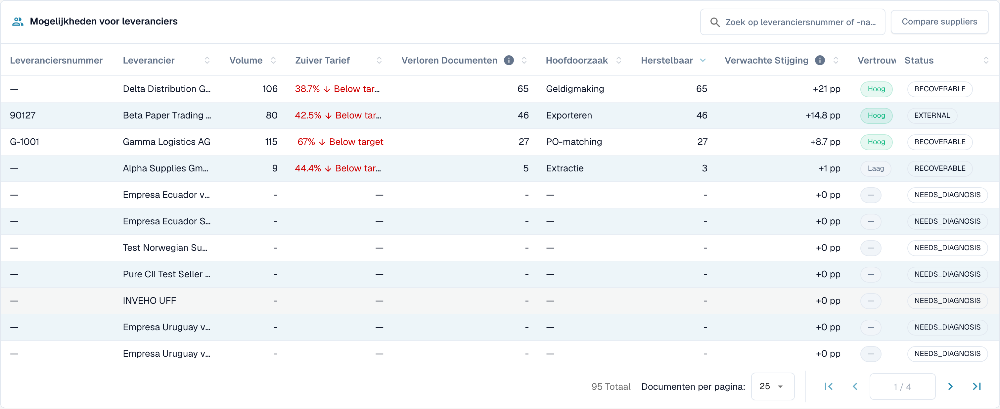
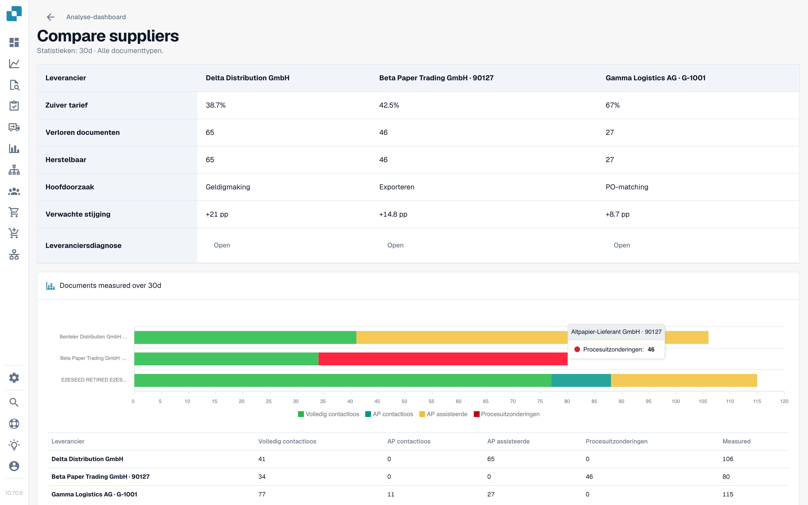

# Het dashboard gebruiken

<!-- touchless-admin-video-v2-20261104:start -->
**Videohoofdstuk (controleversie):** [Selectie en gegevenstijdstip](https://docbits-videos.fra1.cdn.digitaloceanspaces.com/settings-assistant/touchless-intelligence-preview-admin/v2/nl.html#chapter=01).
<!-- touchless-admin-video-v2-20261104:end -->

### Filters

| Filter                            | Wat het doet                                                                                                                                                                                                                   |
| --------------------------------- | ------------------------------------------------------------------------------------------------------------------------------------------------------------------------------------------------------------------------------ |
| **7D / 30D / 90D**                | De periode voor de kerncijfers en de wachtrij. De standaardwaarde is 30 dagen                                                                                                                                                           |
| **Document Type**                 | Filtert de Touchless-metrieken en de bijbehorende analyse tot één type, bijvoorbeeld INVOICE. Voorstellen voor geleerde regels hebben momenteel een eigen selectie; zie hieronder                                                                                                                                                                        |
| **Segment field / Segment value** | Alleen als uw organisatie meerdere processen via één documenttype laat lopen (bijvoorbeeld directe, indirecte en EAM-orders in het veld `order_type`). Kies een veld om de verdeling te zien, kies een waarde om alles daartoe te beperken |
| **Document ID**                   | Opent de **Document Trace** voor één document                                                                                                                                                                                  |

De **suborganisatie** die u bovenaan in DocBits hebt gekozen, beperkt de kerncijfers en de leverancierswachtrij. Probleemclusters en de AI-analyse beslaan altijd de hele organisatie.

### Documenttype bovenaan versus voorstellen voor geleerde regels

De bovenste keuze en het documenttype in **Learned rule proposals** staan in de momenteel gecontroleerde implementatie los van elkaar. De sectie laadt zijn eigen beschikbare typen en kiest aanvankelijk de eerste vermelding. **ORDER_CONFIRMATION** bovenaan kiezen kan daardoor **INVOICE** onderaan geselecteerd laten. Die voorstellen gaan over facturen, niet over de orderbevestigingen die voor de metrieken zijn gekozen.

Controleer het type dat in die sectie wordt getoond voordat u een regel toepast. Is daar geen passend type beschikbaar, dan zijn voorstellen daarvoor niet vastgesteld. De sectie gebruikt ook een eigen databasis, zoals gecorrigeerde documenten van de laatste 60 dagen, en neemt de periode bovenaan niet automatisch over. Dit beschrijft de huidige afzonderlijke bediening; het beweert niet dat synchronisatie is geïmplementeerd.

### De vijf kerncijfers

<figure><figcaption>
Huidig factuurrapport over 30 dagen: 107 volledig automatische facturen plus 11 facturen met alleen goedkeuring geven 118 van 201, oftewel 58,7% AP Touchless. Pure alleen is 53,2%. De AP-kaart toont al het gecombineerde aantal van 118. Fictieve trainingshistorie; een uitgevoerde ERP-export is niet vastgesteld.
</figcaption></figure>

| Kaart                   | Toont                                             | Voorbeeld (illustratief)                                                      |
| ---------------------- | ------------------------------------------------- | --------------------------------------------------------------------------- |
| **Pure touchless**     | Het percentage en het verschil met het doel   | **63.2 %** · "120 documents" · "−6.8 pp vs 70 % target" (rood, onder het doel) |
| **AP touchless** | Percentage en aantal gecombineerd: Pure plus alleen goedkeuring | **78.9%** · "150 documents" in het voorbeeld met 120 Pure en 30 alleen goedkeuring |
| **AP assisted**        | Het aantal documenten en hun aandeel           | **30** · 15.8 %                                                             |
| **Process exceptions** | Het aantal documenten en hun aandeel           | **10** · 5.3 %                                                              |
| **Diagnosis coverage** | Hoeveel geblokkeerde documenten een **bekende** oorzaak hebben | **80 %** · "10 without a known cause"                                       |

* In de huidige schermopname geven 107 volledig automatische plus 11 facturen met alleen goedkeuring **118 ÷ 201 = 58.7% AP Touchless**. Pure alleen is **107 ÷ 201 = 53.2%**. De twee percentages overlappen elkaar en mogen niet worden opgeteld.
* Een kaart toont een streepje (—) in plaats van **0 %** wanneer er niets te meten is. Een streepje betekent "geen gegevens", niet "nul".
* **Diagnosis coverage** = documenten met een bekende blokkeringsreden ÷ alle geblokkeerde documenten. Voorbeeld: 50 geblokkeerde documenten, 10 met een onbekende oorzaak → 40 ÷ 50 = **80 %**. Een lage waarde betekent "we begrijpen nog niet waarom documenten stoppen". Verbeter die eerst voordat u afzonderlijke oorzaken probeert op te lossen.
* **Klik op een kaart** om de documentenlijst achter het cijfer in een nieuw tabblad te openen ("View the documents behind this number"). Kaarten met 0 documenten zijn niet klikbaar.

### Touchless-percentage in de tijd

<figure><figcaption>
Huidige trend van het rapport: roze toont Pure Touchless en blauw het gecombineerde percentage inclusief documenten met alleen goedkeuring. De stippellijn markeert het doel van 70%. Deze curven gebruiken fictieve leervoorbeelden en stellen geen werkelijke procesverbetering vast.
</figcaption></figure>

De huidige grafiek toont **Pure Touchless**, het **gecombineerde AP Touchless-percentage** en de **doellijn**. Blauw omvat Pure en alleen goedkeuring en ligt dus op of boven roze; tel de twee waarden niet op. Elk punt heeft zijn eigen aantal meetellende afgeronde documenten, dus een dagpercentage is niet automatisch het percentage over de hele periode. Korte perioden tonen dagpunten, lange perioden weekpunten. De afzonderlijke uitkomstcategorie alleen goedkeuring verschilt van deze gecombineerde lijn.

**Voorbeeld.** Nadat u op 1 oktober automatische PO-matching hebt ingeschakeld, stijgt het pure percentage binnen twee weken van 55 % naar 68 %. De grafiek toont de dag waarop de curve omslaat, zodat u de timing kunt onderzoeken. Een verband voor/na bewijst op zichzelf niet dat deze instelling de verbetering heeft veroorzaakt. Vergelijk documenttype, leveranciersmix en andere wijzigingen.

### Waar touchless het eerst verloren gaat

<figure><figcaption>
Geblokkeerde documenten naar de fase en reden waar ze het eerst stopten. Hier kost <strong>Field validation: Required field missing</strong> de meeste documenten (58), gevolgd door <strong>Export mapping failed</strong> (46) en <strong>PO item mismatch</strong> (27). Voorbeeldorganisatie met demogegevens; de namen van leveranciers zijn fictief.
</figcaption></figure>

Een staafdiagram van **geblokkeerde documenten** per pipelinefase: de **eerste** fase die een document stopte.

**Voorbeeld.** Staven: Supplier Identification 12, Field Validation 41, PO Line Match 7. De grootste staaf zegt dat u eerst naar **Field Validation** moet kijken. Een ontbrekende geëxtraheerde waarde is één mogelijke oorzaak; vergelijk de originele factuur, veldregels en beschikbare brongegevens voordat u die bevestigt.

### Leverancierskansen

<figure><figcaption>
De leverancierswachtrij (verkort tot de eerste vier rijen). De eerste leverancier heeft 106 documenten, een puur percentage van 38,7 % en 65 herstelbare documenten, dus het aanpakken ervan is <strong>+21 pp</strong> waard. Voorbeeldorganisatie met demogegevens; de namen van leveranciers zijn fictief.
</figcaption></figure>

De wachtrij beantwoordt de vraag **"Welke leverancier moeten we eerst aanpakken?"** Ze is gesorteerd op **Recoverable** documenten, het hoogste eerst, 25 rijen per pagina.

| Kolom                         | Betekenis                                                                                                                                                   |
| ------------------------------ | --------------------------------------------------------------------------------------------------------------------------------------------------------- |
| **Supplier Number / Supplier** | De leverancier. Documenten zonder herkende leverancier verschijnen als **No supplier identified (n documents)**                                                  |
| **Volume**                     | Meetellende documenten van de leverancier in de periode                                                                                                          |
| **Pure Rate**                  | Aandeel puur touchless documenten. Groen bij of boven het doel, rood eronder                                                                          |
| **Lost Documents**             | Documenten die eindigden als AP assisted of als procesuitzondering. Niet altijd een persoon: een ERP-afwijzing of een document dat zeven dagen bleef steken telt ook mee |
| **Root Cause**                 | Wie de oplossing in handen heeft: Configuration, ERP integration, Export, Extraction, Master data, Measurement, PO matching, User process, Validation of Unknown          |
| **Recoverable**                | Verloren documenten waarvan DocBits de oorzaak kan oplossen: configuratie, stamgegevens of leverancierssjabloon                                                               |
| **Expected Lift**              | Hoeveel **procentpunten** het percentage van uw organisatie zou stijgen als elk herstelbaar document van deze leverancier touchless zou lopen (**+x pp**)               |
| **Confidence**                 | **High**, **Medium** of **Low**: hoe zeker de diagnose is                                                                                                |
| **Status**                     | New, Open, Investigating, In progress, Confirmed, Resolved, Dismissed. Een leverancier met te weinig documenten toont **NEEDS\_DIAGNOSIS**                       |

**Voorbeeld.** Uw organisatie heeft 1.000 meetellende documenten in de periode. Leverancier A heeft 40 herstelbare documenten, leverancier B heeft 90 verloren documenten maar slechts 10 herstelbare (hun probleem ligt aan hun kant).

* Leverancier A: 40 ÷ 1.000 = **+4,0 pp verwachte stijging**
* Leverancier B: 10 ÷ 1.000 = **+1,0 pp**, hoewel B meer verloren documenten heeft

De wachtrij plaatst A boven B omdat de **verwachte stijging** wordt afgemeten aan uw hele organisatie, niet aan de leverancier. Een leverancier met vier slechte documenten kan niet boven een leverancier met vierhonderd uitkomen.

Gebruik het zoekvak ("Search supplier number or name") om een leverancier te vinden. Klik op een rij om de **Supplier Diagnosis** te openen.

### Leveranciers vergelijken

<figure><figcaption>
Drie leveranciers naast elkaar: puur percentage, verloren en herstelbare documenten, hoofdoorzaak, verwachte stijging en een staafdiagram van de uitkomsten. Elke <strong>Open</strong> leidt naar de Supplier Diagnosis. Voorbeeldorganisatie met demogegevens; de namen van leveranciers zijn fictief.
</figcaption></figure>

Klik op **Compare suppliers**, vink **twee tot vijf** leveranciers aan (elk wordt vermeld met zijn aantal geblokkeerde documenten) en klik op **Compare**.

De vergelijking toont de leveranciers naast elkaar: **Pure rate**, **Lost documents**, **Recoverable**, **Root cause**, **Expected lift**, een staafdiagram van de uitkomsten en een link naar elke **Supplier Diagnosis**.

**Voorbeeld.** Leverancier A en B sturen dezelfde factuurindeling. B heeft een puur percentage van 80 %, A slechts 35 %. De diagnose van A suggereert "Master data". Vergelijk originele facturen, geëxtraheerde waarden en geïmporteerde leveranciersrecords voordat u die oorzaak bevestigt. Het percentageverschil alleen bewijst niet dat de indeling correct is of dat de stamgegevens van A onvolledig zijn.

### Analyseren met AI

De knop **Analyse n clusters with AI** analyseert de probleemclusters met het hoogste touchless-potentieel (elk met ten minste een minimumaantal documenten). Het duurt ongeveer 13 seconden per cluster en omvat de **hele organisatie**. Alleen beheerders kunnen de analyse starten.

Terwijl de analyse loopt, ziet u per cluster **Queued**, **Running**, **Done**, **Already analysed** of **Error**, met een link **Open cluster**. Als AI is uitgeschakeld of in de omgeving niet is geconfigureerd, is de knop uitgeschakeld met de reden, en **blijft al het andere op de pagina werken**.

## Werken met Touchless Intelligence: een routine

1. **Wekelijks**: open het tabblad en controleer het **percentage** en de **trend** ten opzichte van het doel.
2. Kijk naar **Diagnosis coverage**. Onder ongeveer 80 % zoekt u eerst uit waarom documenten stoppen.
3. Lees **Waar touchless het eerst verloren gaat** en kies de grootste fase.
4. Open **Leverancierskansen**. Sorteer op **Expected lift** en neem de bovenste leverancier met de status **RECOVERABLE**.
5. Lees de **probleemclusters**, controleer **Missing evidence** en volg daarna **What to change**.
6. Herstel één bevestigde oorzaak. Gebruik voor een ondersteund DocBits-voorstel de voorvertoning en de wijzigingshistorie. Leg voor een Infor-correctie de bron vast en importeer apart; dat maakt niet automatisch een registratie van een instellingswijziging in DocBits aan.
7. Controleer na twee weken het resultaat **voor/na**.

## Wie het kan zien

* Het tabblad maakt deel uit van het Analytics Dashboard. Uw beheerder schakelt het in voor de organisatie. Ontbreekt het tabblad, vraag het dan aan uw beheerder.
* **Organisatiebeheerders** zien het altijd.
* Andere gebruikers zien het wanneer een beheerder hun rol het tabblad **Analytics dashboard** heeft toegekend (**Settings → Roles**). Zonder toekenning hebben alleen beheerders toegang.
* Sommige acties zijn alleen voor beheerders: **AI analysis**, **het toepassen en ongedaan maken van een wijziging**, **learned rule proposals** en het **Consulting report**.

Hebt u geen toestemming, dan toont de pagina *Action not allowed, please contact the administrator*.

## Gerelateerde pagina's

* [Touchless Intelligence](./)
* [Metrieken en berekening](../../touchless-metrics.md)
* [Uitgewerkte voorbeelden: prijs en aantal](touchless-examples.md)
* [Leveranciersdiagnose en probleemclusters](../../touchless-supplier-diagnosis.md)
* [PO-matchingdiagnose](../../touchless-po-matching-diagnosis.md)
* [Document Trace](touchless-document-trace.md)
* [Wijzigingsvoorstellen en rapporten](touchless-change-proposals.md)
* [Touchless uitleggen en verbeteren met MCP](touchless-mcp.md)

<!-- Documentation review 2026-11-04: extraction quality vs process outcomes; KPI and terminal-outcome definitions checked against DocBits_API c51f350c728acb8ac964098d15f7b006bce273f4, module/automation_intelligence/kpi.py and bucket.py. Existing native screenshots retained and checked separately from illustrative examples. -->
<!-- Completion review 2026-11-04: owned synthetic PO examples, MCP schema/read evidence, human-action classification, KPI labels and screenshot proof limits. -->
