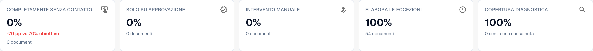
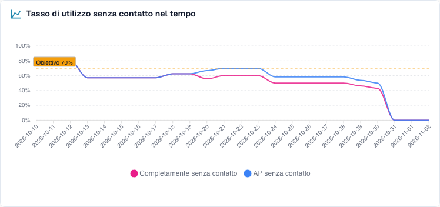
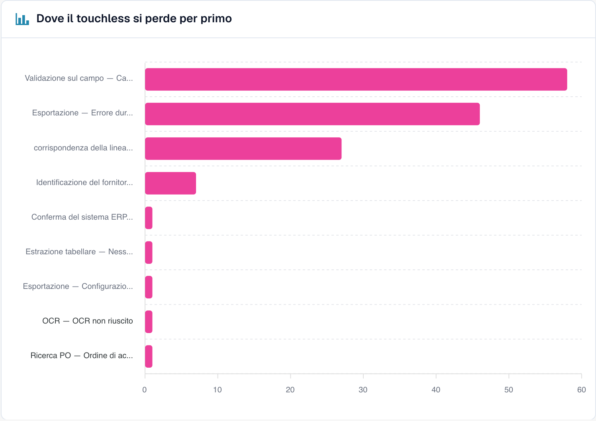
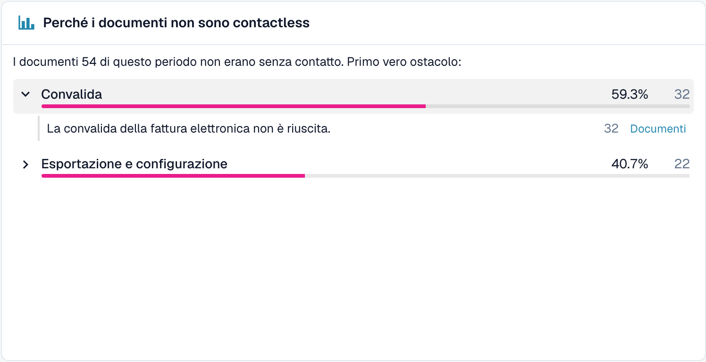
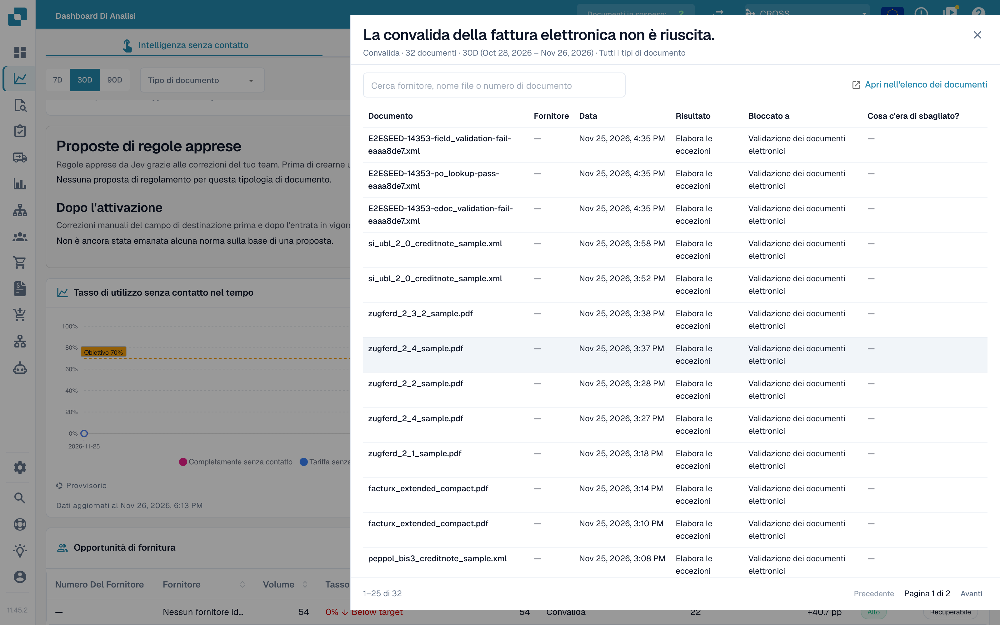
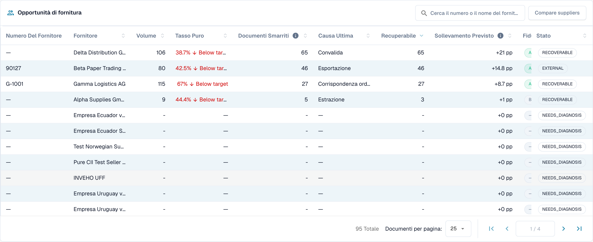
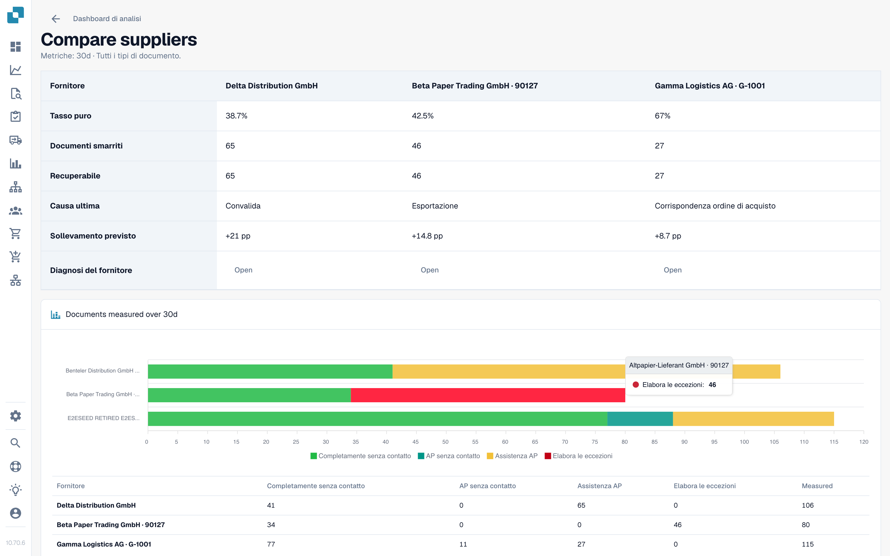

# Usare il pannello

<!-- touchless-admin-video-v2-20261104:start -->
**Capitolo video (versione di verifica):** [Selezione e data dei dati](https://docbits-videos.fra1.cdn.digitaloceanspaces.com/settings-assistant/touchless-intelligence-preview-admin/v2/it.html#chapter=01).
<!-- touchless-admin-video-v2-20261104:end -->

### Filtri

| Filtro                            | Che cosa fa                                                                                                                                                                                                                   |
| --------------------------------- | ------------------------------------------------------------------------------------------------------------------------------------------------------------------------------------------------------------------------------ |
| **7D / 30D / 90D**                | Il periodo per gli indicatori chiave e la coda. Il valore predefinito è 30 giorni                                                                                                                                                           |
| **Document Type**                 | Filtra le metriche Touchless e l'analisi correlata su un solo tipo, ad esempio INVOICE. Le proposte di regole apprese hanno attualmente una propria selezione; vedi sotto                                                                                                                                                                        |
| **Segment field / Segment value** | Solo se la tua organizzazione gestisce più processi con un unico tipo di documento (ad esempio ordini diretti, indiretti ed EAM nel campo `order_type`). Scegli un campo per vedere la suddivisione, scegli un valore per restringere tutto a quel valore |
| **Document ID**                   | Apre il **Tracciamento del documento** per un documento                                                                                                                                                                                  |

La **sotto-organizzazione** selezionata in alto in DocBits restringe gli indicatori chiave e la coda dei fornitori. I cluster di problemi e l'analisi IA coprono sempre l'intera organizzazione.

### Tipo di documento principale e proposte di regole apprese

Il selettore principale e il tipo di documento in **Learned rule proposals** sono indipendenti nell'implementazione attualmente verificata. La sezione carica i propri tipi disponibili e all'inizio sceglie la prima voce. Selezionare **ORDER_CONFIRMATION** in alto può quindi lasciare **INVOICE** selezionato in basso. Tali proposte riguardano le fatture, non le conferme d'ordine scelte per le metriche.

Prima di applicare una regola, controlla il tipo mostrato all'interno di quella sezione. Se lì non è disponibile alcun tipo corrispondente, per esso non sono state stabilite proposte. La sezione usa inoltre una propria base dati, ad esempio i documenti corretti degli ultimi 60 giorni, invece di adottare automaticamente il periodo principale. Questo descrive i controlli separati attuali; non afferma che sia stata implementata una sincronizzazione.

### I cinque indicatori chiave

<figure><figcaption>
Le quattro schede dei risultati e la Copertura diagnostica. Questo report di test di 30 giorni contiene 54 eccezioni di elaborazione e nessun documento nelle altre categorie.
</figcaption></figure>

Le prime quattro schede sono **categorie di risultati separate**. Su ogni scheda, il valore grande è la quota di quella categoria sul totale dei documenti conteggiati e la riga più piccola è il numero di documenti. Le quattro quote sommano il 100%; non aggiungere un tasso combinato separato.

| Scheda | Cosa conta | Informazioni aggiuntive |
| --- | --- | --- |
| **Completamente senza contatto** | Documenti completati senza intervento manuale o approvazione separata | Differenza in punti percentuali rispetto all'obiettivo touchless |
| **Solo su approvazione** | Documenti che hanno richiesto l'approvazione, ma nessun'altra correzione manuale | Solo quota e numero di questa categoria |
| **Intervento manuale** | Documenti che hanno richiesto una correzione manuale o un'altra interazione dell'utente | Propria quota e proprio numero |
| **Elabora le eccezioni** | Documenti non completati a causa di un'eccezione di elaborazione o integrazione | Propria quota e proprio numero |
| **Copertura diagnostica** | In quanti documenti bloccati è nota la **prima causa** del blocco | Numero di documenti senza una causa nota |

Il riquadro separato **Tasso touchless · Completamente senza contatto + Solo su approvazione** sotto le schede combina le prime due categorie. Ad esempio, 60 documenti completamente senza contatto più 15 documenti solo su approvazione su 100 producono un **tasso touchless del 75%**. La scheda Solo su approvazione mostra comunque **15%**, non 75%.

* Una scheda mostra un trattino (—) invece di **0%** quando non c'è nulla da misurare. Un trattino significa «nessun dato», non «zero».
* **Copertura diagnostica** = documenti con una causa di blocco nota ÷ tutti i documenti bloccati. Esempio: 50 documenti bloccati, 10 con causa sconosciuta → 40 ÷ 50 = **80%**. Un valore basso significa che non comprendiamo ancora perché i documenti si fermano. Miglioralo prima di correggere le singole cause.
* **Fai clic su una scheda** per aprire in una nuova scheda l'elenco dei documenti dietro al numero. Le schede con 0 documenti non sono cliccabili. Copertura diagnostica apre i documenti senza una causa nota.

### Tasso di utilizzo senza contatto nel tempo

<figure><figcaption>
Completamente senza contatto e Tasso touchless combinato nel tempo. La linea tratteggiata indica l'obiettivo.
</figcaption></figure>

Il grafico mostra **Completamente senza contatto**, il **Tasso touchless** combinato e la **linea dell'obiettivo**. Il tasso combinato include Completamente senza contatto e Solo su approvazione, quindi è uguale o superiore al tasso completamente senza contatto; non sommare i due valori. Ogni punto ha un proprio numero di documenti completati idonei, quindi un tasso giornaliero non è automaticamente il tasso dell'intero periodo. I periodi brevi mostrano punti giornalieri, quelli lunghi punti settimanali. I punti basati su dati recenti incompleti sono contrassegnati come **Provvisorio**.

**Esempio.** Dopo aver attivato l'abbinamento automatico degli ordini il 1° ottobre, il tasso completamente senza contatto passa dal 55% al 68% in due settimane. Il grafico mostra il giorno in cui cambia la curva, così puoi analizzare il momento. Un'associazione prima/dopo non dimostra da sola che questa impostazione abbia causato il miglioramento. Confronta tipo di documento, composizione dei fornitori e altre modifiche.

### Dove si perde prima il touchless

<figure><figcaption>
Documenti bloccati in base alla fase e al motivo in cui si sono fermati per primi. Qui <strong>Field validation: Required field missing</strong> interessa il maggior numero di documenti (58), seguito da <strong>Export mapping failed</strong> (46) e <strong>PO item mismatch</strong> (27). Organizzazione di esempio con dati dimostrativi; i nomi dei fornitori sono fittizi.
</figcaption></figure>

Un grafico a barre dei **Documenti bloccati** per fase del processo: la **prima** fase che ha fermato un documento.

**Esempio.** Barre: Supplier Identification 12, Field Validation 41, PO Line Match 7. La barra più grande indica di esaminare prima **Field Validation**. Un valore estratto mancante è una causa possibile; confronta la fattura originale, le regole dei campi e i dati di origine disponibili prima di confermarla.

#### Perché i documenti non sono contactless (canale di rilascio Nova)

Le organizzazioni sul canale di rilascio **Nova** vedono la risposta alla stessa domanda in un elenco espandibile invece del grafico a barre. Il pannello si intitola **Perché i documenti non sono contactless** ed è accanto a **Tasso di utilizzo senza contatto nel tempo**.

<figure><figcaption>
Espandi un'area per vedere i suoi motivi e aprire i documenti associati a un motivo. Il report di test contiene anche un'area Esportazione e configurazione con 22 documenti.
</figcaption></figure>

* L'intestazione indica quanti documenti copre l'elenco. Ogni riga è un'area del primo blocco con la sua percentuale, il numero di documenti e una barra. Le righe sono ordinate dalla più grande alla più piccola.
* Fai clic su una riga per aprire i suoi motivi. È aperta una sola area alla volta; fai di nuovo clic per chiuderla. Vengono mostrati i primi **cinque** motivi; seleziona **+N altri** per vedere i restanti. Chiudendo l'area, l'elenco torna a cinque.
* **Corretto senza un blocco** è un'area separata per i documenti corretti da un utente anche se il report non ha rilevato un primo blocco tecnico. Usala per individuare opportunità di miglioramento dei processi utente e della formazione, invece di cercare una fase del flusso non riuscita.
* L'elenco deriva dagli stessi dati del report degli indicatori chiave. Il browser non ricalcola i numeri, quindi il totale nell'intestazione e le righe corrispondono.
* Se l'installazione non invia ancora questi dati, il pannello lo segnala invece di mostrare **0**. Un elenco vuoto con il messaggio «nulla registrato» significa che nessun documento è stato perso nel periodo; sono stati diversi e non devi interpretare il primo come una buona notizia.

##### Documenti associati a un motivo

Seleziona **Documenti** su un motivo per aprire un pannello laterale senza lasciare il report. L'intestazione mantiene visibili motivo, area, periodo e tipo di documento.

<figure><figcaption>
Il pannello dei documenti del motivo mostra 25 documenti per pagina. In questo esempio di test, La convalida della fattura elettronica non è riuscita ha 32 documenti corrispondenti.
</figcaption></figure>

* **Cerca** per fornitore, nome file o numero documento. Cancella la ricerca per tornare a tutti i documenti del motivo; un messaggio di nessuna corrispondenza non significa che il motivo non abbia documenti.
* La tabella mostra **documento, fornitore, data di ricezione, risultato, prima fase bloccata e un breve dettaglio**. Seleziona una riga o il nome del documento per aprire la **Tracciabilità del documento**. **Indietro** dalla tracciabilità torna allo stesso motivo, ricerca e pagina.
* Usa **Precedente** e **Avanti** per spostarti tra pagine di **25 documenti**. Il piè di pagina mostra l'intervallo visibile, il totale e la pagina corrente.
* **Apri nell'elenco dei documenti** apre l'elenco completo in una nuova scheda con i filtri di motivo, periodo del report e tipo di documento applicati. Report e pannello laterale restano aperti nella scheda originale.
* Se il caricamento non riesce, usa **Riprova**. Un risultato vuoto e un errore di caricamento sono stati diversi.

Il canale di rilascio **Vesta** mantiene il grafico a barre descritto sopra. Se la pagina mostra barre, stai usando Vesta; se mostra l'elenco espandibile, stai usando Nova. Entrambi rispondono alla stessa domanda, quindi il resto della pagina si applica in entrambi i casi.

### Opportunità fornitori

<figure><figcaption>
La coda dei fornitori (ridotta alle prime quattro righe). Il primo fornitore ha 106 documenti, un tasso puro del 38,7 % e 65 documenti recuperabili, quindi correggerlo vale <strong>+21 pp</strong>. Organizzazione di esempio con dati dimostrativi; i nomi dei fornitori sono fittizi.
</figcaption></figure>

La coda risponde a **"Quale fornitore dovremmo correggere per primo?"** È ordinata per documenti **Recoverable**, dal più alto, 25 righe per pagina.

| Colonna                         | Significato                                                                                                                                                   |
| ------------------------------ | --------------------------------------------------------------------------------------------------------------------------------------------------------- |
| **Supplier Number / Supplier** | Il fornitore. I documenti senza un fornitore riconosciuto compaiono come **No supplier identified (n documents)**                                                  |
| **Volume**                     | Documenti idonei del fornitore nel periodo                                                                                                          |
| **Pure Rate**                  | Quota di documenti pure touchless. Verde se pari o sopra l'obiettivo, rossa se sotto                                                                          |
| **Lost Documents**             | Documenti terminati come AP assisted o come eccezione di processo. Non sempre una persona: contano anche un rifiuto dell'ERP o un documento rimasto fermo per sette giorni |
| **Root Cause**                 | Chi è responsabile della correzione: Configuration, ERP integration, Export, Extraction, Master data, Measurement, PO matching, User process, Validation o Unknown          |
| **Recoverable**                | Documenti persi la cui causa può essere corretta da DocBits: configurazione, dati anagrafici o modello del fornitore                                                               |
| **Expected Lift**              | Di quanti **punti percentuali** salirebbe il tasso della tua organizzazione se ogni documento recuperabile di questo fornitore fosse elaborato in modalità touchless (**+x pp**)               |
| **Confidence**                 | **High**, **Medium** o **Low**: quanto è sicura la diagnosi                                                                                                |
| **Status**                     | New, Open, Investigating, In progress, Confirmed, Resolved, Dismissed. Un fornitore con troppi pochi documenti mostra **NEEDS\_DIAGNOSIS**                       |

**Esempio.** La tua organizzazione ha 1.000 documenti idonei nel periodo. Il fornitore A ha 40 documenti recuperabili, il fornitore B ha 90 documenti persi ma solo 10 recuperabili (il problema è dalla loro parte).

* Fornitore A: 40 ÷ 1.000 = **+4,0 pp di incremento atteso**
* Fornitore B: 10 ÷ 1.000 = **+1,0 pp**, anche se B ha più documenti persi

La coda mette A sopra B perché l'**incremento atteso** è misurato rispetto a tutta la tua organizzazione, non rispetto al fornitore. Un fornitore con quattro documenti problematici non può superare uno con quattrocento.

Usa la casella di ricerca ("Search supplier number or name") per trovare un fornitore. Fai clic su una riga per aprire la **Supplier Diagnosis**.

### Confrontare i fornitori

<figure><figcaption>
Tre fornitori affiancati: tasso puro, documenti persi e recuperabili, causa radice, incremento atteso e un grafico a barre degli esiti. Ogni <strong>Open</strong> porta alla Supplier Diagnosis. Organizzazione di esempio con dati dimostrativi; i nomi dei fornitori sono fittizi.
</figcaption></figure>

Fai clic su **Compare suppliers**, seleziona **da due a cinque** fornitori (ognuno è elencato con il numero dei suoi documenti bloccati) e fai clic su **Compare**.

Il confronto mostra i fornitori affiancati: **Pure rate**, **Lost documents**, **Recoverable**, **Root cause**, **Expected lift**, un grafico a barre degli esiti e un link alla **Supplier Diagnosis** di ciascuno.

**Esempio.** I fornitori A e B inviano lo stesso layout di fattura. B ha un tasso puro dell'80 %, A solo del 35 %. La diagnosi di A suggerisce "Master data". Confronta le fatture originali, i valori estratti e i record fornitore importati prima di confermare quella causa. La sola differenza di tasso non dimostra che il layout sia corretto né che i dati anagrafici di A siano incompleti.

### Analizzare con l'IA

Il pulsante **Analyse n clusters with AI** analizza i cluster di problemi con il maggior potenziale touchless (ciascuno con almeno un numero minimo di documenti). Richiede circa 13 secondi per cluster e copre l'**intera organizzazione**. Solo gli amministratori possono avviarlo.

Mentre è in esecuzione vedi **Queued**, **Running**, **Done**, **Already analysed** o **Error** per ogni cluster, con un link **Open cluster**. Se l'IA è disattivata o non configurata nell'ambiente, il pulsante è disabilitato con il motivo, e **tutto il resto della pagina continua a funzionare**.

## Lavorare con Touchless Intelligence: una routine

1. **Ogni settimana**: apri la scheda e controlla il **tasso** e l'**andamento** rispetto all'obiettivo.
2. Guarda la **Diagnosis coverage**. Sotto circa l'80 %, scopri prima perché i documenti si fermano.
3. Leggi **Where touchless is lost first** (Vesta) o **Why documents are not touchless** (Nova) e scegli la fase o l’area più grande.
4. Apri **Opportunità fornitori**. Ordina per **Expected lift** e prendi il primo fornitore con lo stato **RECOVERABLE**.
5. Leggi i **cluster di problemi**, controlla **Missing evidence**, poi segui **What to change**.
6. Correggi una causa confermata. Per una proposta DocBits supportata usa anteprima e cronologia delle modifiche. Per una correzione Infor, documenta la fonte e importa separatamente; non crea automaticamente una voce di modifica di impostazione in DocBits.
7. Dopo due settimane controlla il risultato **prima/dopo**.

## Chi può vederla

* La scheda fa parte della Dashboard di analisi. Il tuo amministratore la abilita per l'organizzazione. Se la scheda manca, chiedi al tuo amministratore.
* Gli **amministratori dell'organizzazione** la vedono sempre.
* **Settings → Roles**: gli altri utenti la vedono quando un amministratore ha concesso al loro ruolo la scheda **Analytics dashboard**. Senza questa concessione, solo gli amministratori hanno accesso.
* Alcune azioni sono riservate agli amministratori: **AI analysis**, **applicare e annullare una modifica**, **learned rule proposals** e il **Consulting report**.

Se non hai l'autorizzazione, la pagina mostra _Action not allowed, please contact the administrator_.

## Pagine correlate

* [Touchless Intelligence](./)
* [Metriche e calcolo](touchless-metrics.md)
* [Esempi pratici: prezzo e quantità](touchless-examples.md)
* [Diagnosi del fornitore e cluster di problemi](touchless-supplier-diagnosis.md)
* [Diagnosi dell'abbinamento ordini](touchless-po-matching-diagnosis.md)
* [Tracciamento del documento](touchless-document-trace.md)
* [Proposte di modifica e report](touchless-change-proposals.md)
* [Spiegare e migliorare Touchless con MCP](touchless-mcp.md)

<!-- Documentation review 2026-11-04: extraction quality vs process outcomes; KPI and terminal-outcome definitions checked against DocBits_API c51f350c728acb8ac964098d15f7b006bce273f4, module/automation_intelligence/kpi.py and bucket.py. Existing native screenshots retained and checked separately from illustrative examples. -->
<!-- Completion review 2026-11-04: owned synthetic PO examples, MCP schema/read evidence, human-action classification, KPI labels and screenshot proof limits. -->
