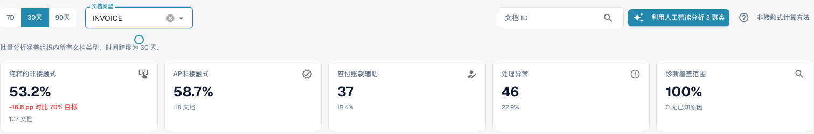
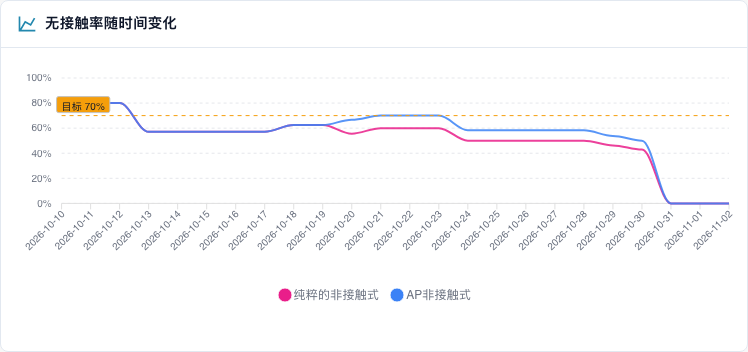

# 使用仪表板

### 筛选条件

| 筛选条件 | 作用 |
| -------------------------------- | ------------------------------------------------------------------------------------------------------------------------------------------------------------------------------------------------------------------------ |
| **7D / 30D / 90D** | 关键指标和队列所用的统计期间。默认值为 30 天 |
| **文档类型** | 按类型筛选 KPI 和分析。已学习规则提案目前有独立类型选择，见下文。 |
| **细分字段 / 细分值** | 仅当您的组织通过一种文档类型运行多个流程时使用（例如 `order_type` 字段中的直接订单、间接订单和 EAM 订单）。选择字段可查看细分情况，选择值可将所有内容限定为该值 |
| **文档 ID** | 打开某份文档的 **文档追踪** |

您在 DocBits 顶部选择的 **子组织** 会限定关键指标和供应商队列。问题簇和 AI 分析始终涵盖整个组织。

### 文档类型与已学习规则提案

已验证的实现中，顶部选择与规则区域的选择相互独立。规则区域自行加载类型并默认选择第一个。因此顶部 **ORDER_CONFIRMATION** 可与下方 **INVOICE** 同时出现：下方仍是发票规则。应用前务必核对局部类型。缺少某类型不代表已证明有它的提案。更正样本（例如 60 天）不会自动采用顶部期间。这是当前限制说明，不代表已经实现同步。

### 五项关键指标

<figure><figcaption>
当前30天发票报表：107份完全自动处理，加上11份仅需审批，共118份，占201份的58.7%。Pure单独为53.2%。AP卡片已显示合计118份。这是虚构的培训历史，不能证明实际执行过ERP导出。
</figcaption></figure>

| 卡片 | 统计内容 | 当前截图 |
| --- | --- | --- |
| Pure Touchless | 成功完成，无人工干预，也不需要审批 | 107份 · 53.2% |
| AP Touchless | Pure加仅审批；百分比和数量均为合计 | 118份 · 58.7% |
| AP Assisted | 有人工干预并成功完成 | 37份 · 18.4% |
| 流程异常 | 结果被归类为异常 | 46份 · 22.9% |
| 诊断覆盖率 | 已知阻塞原因的案例 | 100% · 0份原因未知 |

* 无数据可计量时，卡片会显示破折号（—），而非 **0 %** 。破折号表示“无数据”，并不表示“为零”。
* **诊断覆盖率** = 原因已知的文档数 ÷ 所有受阻文档数。示例：50 份文档受阻，其中 10 份原因未知 → 40 ÷ 50 = **80 %** 。数值较低意味着“我们还不清楚文档为何停下来”。在尝试修复具体原因之前，应先提高此数值。
* **点击卡片** 可在新标签页中打开该数字对应的文档列表（“查看此数字对应的文档”）。文档数为 0 的卡片不可点击。

### 无接触率随时间变化

<figure><figcaption>
当前趋势：粉色为Pure Touchless，蓝色为包含仅审批案例的AP综合率。虚线为70%的目标。这些虚构培训案例不能证明实际的流程改善。
</figcaption></figure>

当前图表显示Pure、AP综合率和目标。蓝色包含Pure及仅审批，因此位于粉色线上或其上方，不能将两条线的百分比相加。每个点使用各自已完成且符合条件的文档总体；每日比率不自动等于整个期间的比率。较短期间显示每日点，较长期间显示每周点。独立的“仅审批”结果类别与这条综合曲线不同。

 **示例。**  变更后 Pure 从 55 % 到 68 % 是时间上的关联。需比较类型、供应商及其他变更；前后结果本身不证明单一原因。

### 无接触首次流失位置

柱状图按处理流水线阶段显示 **受阻文档** 数量，每份文档只显示最先阻止其继续处理的阶段。

 **示例。**  供应商识别 12、字段验证 41、PO 行匹配 7：先检查字段验证。提取缺失只是一种可能原因，必须比较原件、规则和源数据后再确认。

### 供应商改进机会

此队列回答 **“我们应该先修复哪个供应商？”** 队列按 **可挽回文档** 数量从高到低排序，每页 25 行。

| 列 | 含义 |
| ------------------------------ | ------------------------------------------------------------------------------------------------------------------------------------------------------ |
| **供应商编号 / 供应商** | 供应商。无法识别供应商的文档会显示为 **未识别供应商（n 份文档）** |
| **文档量** | 统计期间内该供应商的符合条件文档数 |
| **纯无接触率** | 纯无接触文档所占比例。达到或超过目标值时显示绿色，低于目标值时显示红色 |
| **流失文档** | 以 AP 辅助处理或流程异常结束的文档。并非总是由人员导致：ERP 拒收或在流水线中停滞七天的文档也会计入 |
| **根本原因** | 修复责任方：配置、ERP 集成、导出、提取、主数据、计量、PO 匹配、用户流程、验证或未知 |
| **可挽回** | 流失文档中 DocBits 可以通过修复配置、主数据或供应商模板解决的数量 |
| **预期提升** | 如果该供应商所有可挽回文档都能无接触处理，贵组织的无接触率预计提升的 **百分点** 数（ **+x 个百分点** ） |
| **置信度** | **高** 、 **中** 或 **低** ：诊断的可信程度 |
| **状态** | 新建、已打开、调查中、处理中、已确认、已解决、已忽略。文档数量过少的供应商会显示 **NEEDS\_DIAGNOSIS** |

 **示例。** 贵组织在该统计期间有 1,000 份符合条件的文档。供应商 A 有 40 份可挽回文档；供应商 B 有 90 份流失文档，但只有 10 份可挽回（问题在供应商一方）。

* 供应商 A：40 ÷ 1,000 = **预期提升 +4.0 个百分点**
* 供应商 B：10 ÷ 1,000 = **+1.0 个百分点** ，尽管 B 的流失文档更多

队列将 A 排在 B 前面，因为 **预期提升** 是根据整个组织的文档量计算的，而不是根据该供应商的文档量。只有四份异常文档的供应商，不可能排在有四百份异常文档的供应商前面。

使用搜索框（“搜索供应商编号或名称”）查找供应商。点击一行可打开 **供应商诊断** 。

### 比较供应商

点击 **比较供应商** ，勾选 **两到五家** 供应商（每家旁边都列有受阻文档数），然后点击 **比较** 。

比较结果会并排显示供应商的 **纯无接触率** 、 **流失文档** 、 **可挽回文档** 、 **根本原因** 和 **预期提升** ，并显示处理结果柱状图，以及每家供应商对应的 **供应商诊断** 链接。

 **示例。**  A 与 B 使用同一版式，但 Pure 分别为 35 % 和 80 %。若诊断指向主数据，应核对原件、提取和导入。仅凭比例差异不能证明版式正确或 A 的数据不完整。

### 使用 AI 分析

 **使用 AI 分析 n 个问题簇** 按钮会分析无接触潜力最高的问题簇（每个问题簇至少达到规定的文档数量）。每个问题簇约需 13 秒，分析范围涵盖 **整个组织** 。只有管理员可以启动分析。

分析运行期间，每个问题簇会显示 **排队中** 、 **运行中** 、 **已完成** 、 **已分析** 或 **错误** ，并提供 **打开问题簇** 链接。如果环境中已关闭或未配置 AI，按钮会显示为禁用状态并说明原因，此时页面上的 **其他所有功能仍可使用** 。

## 使用无接触智能：日常流程

1. **每周** ：打开此标签页，对照目标值查看 **无接触率** 和 **趋势** 。
2. 查看 **诊断覆盖率** 。如果低于约 80 %，先找出文档停止处理的原因。
3. 查看 **无接触首次流失位置** ，选择数量最多的阶段。
4. 打开 **供应商改进机会** 。按 **预期提升** 排序，选择状态为 **RECOVERABLE** 的首位供应商。
5. 阅读 **问题簇** ，检查 **缺失证据** ，然后按照 **更改建议** 操作。
6. 修复确认原因。支持的 DocBits 提案使用预览和历史；Infor 更正与导入单独记录，不会自动形成设置变更历史。
7. 两周后检查更改 **前后** 的结果。

## 谁可以查看

* 此标签页属于分析仪表板。管理员可以为组织启用它。如果您看不到此标签页，请联系管理员。
* **组织管理员** 始终可以查看。
* 管理员在 **设置 → 角色** 中为其他用户的角色授予 **分析仪表板** 标签页权限后，这些用户才能查看。未获授权时，只有管理员可以访问。
* 某些操作仅限管理员使用： **AI 分析** 、 **应用和撤销更改** 、 **已学习规则提案** 和 **咨询报告** 。

如果您没有权限，页面会显示 _不允许执行此操作，请联系管理员_ 。

## 相关页面

* [Touchless Intelligence](./)
* [指标与计算](touchless-metrics.md)
* [示例：价格与数量](touchless-examples.md)
* [供应商诊断与问题集群](touchless-supplier-diagnosis.md)
* [采购订单匹配诊断](touchless-po-matching-diagnosis.md)
* [文档追踪](touchless-document-trace.md)
* [变更提案和报告](touchless-change-proposals.md)
* [通过 MCP 解释和改善 Touchless](touchless-mcp.md)

<!-- Alignment 2026-11-04: correct extraction is distinct from process Touchless; KPI numerator and denominator verified. -->
<!-- Completion 2026-11-04: localized MCP examples, AP actions, original-value evidence and owned synthetic PO cards. -->
