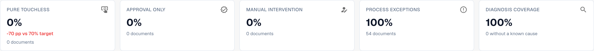
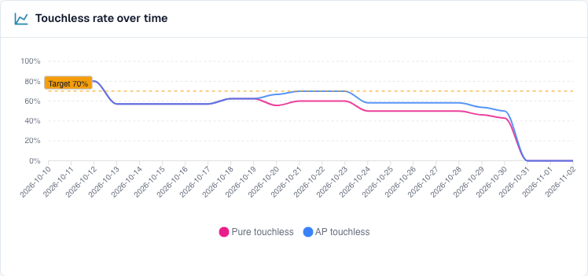
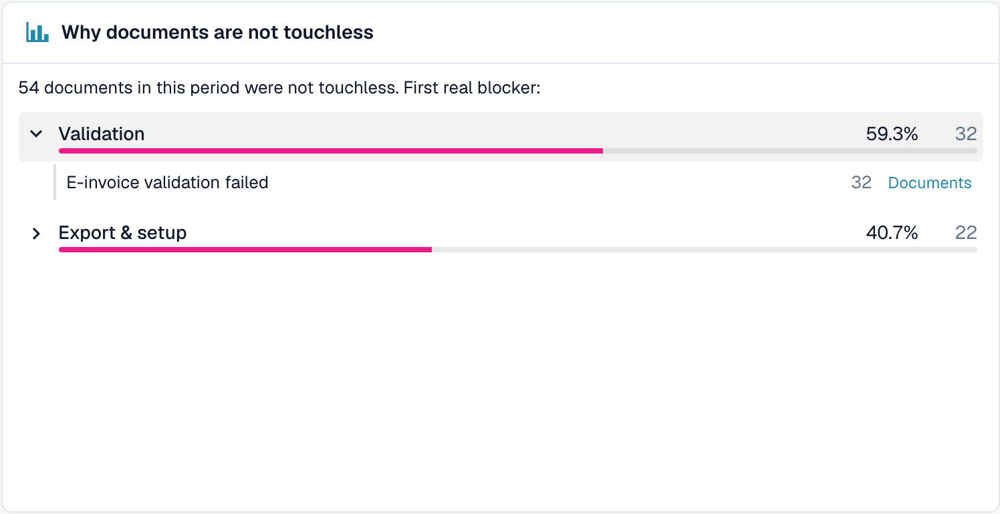
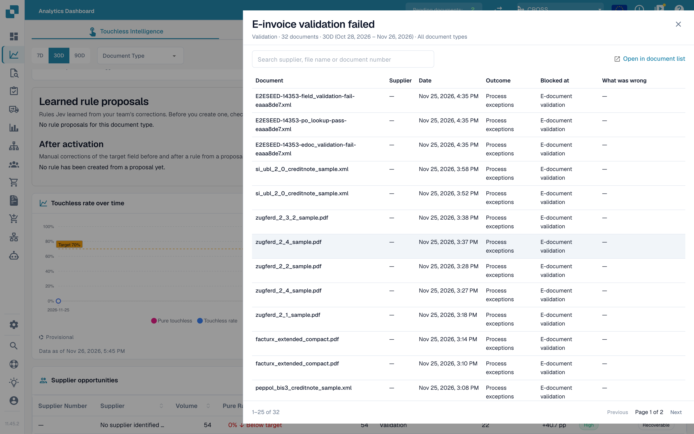
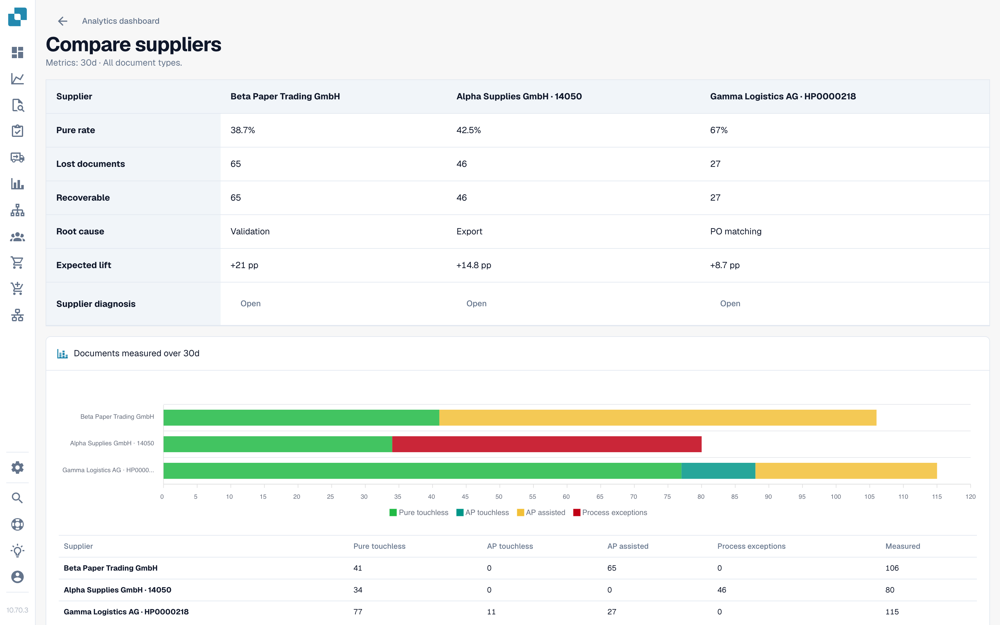

# Use the dashboard

<!-- touchless-admin-video-v2-20261104:start -->
**Video chapter (review version):** [Selection and data timestamp](https://docbits-videos.fra1.cdn.digitaloceanspaces.com/settings-assistant/touchless-intelligence-preview-admin/v2/en.html#chapter=01).
<!-- touchless-admin-video-v2-20261104:end -->

### Filters

| Filter                            | What it does                                                                                                                                                                                                                   |
| --------------------------------- | ------------------------------------------------------------------------------------------------------------------------------------------------------------------------------------------------------------------------------ |
| **7D / 30D / 90D**                | The period for the key figures and the queue. The default is 30 days                                                                                                                                                           |
| **Document Type**                 | Filters the Touchless metrics and related analysis to one type, for example INVOICE. Learned rule proposals currently have their own selection; see below                                                                                                                                                                        |
| **Segment field / Segment value** | Only if your organisation runs several processes through one document type (for example direct, indirect and EAM orders in the field `order_type`). Pick a field to see the breakdown, pick a value to narrow everything to it |
| **Document ID**                   | Opens the **Document Trace** for one document                                                                                                                                                                                  |

The **sub-organisation** you selected at the top of DocBits narrows the key figures and the supplier queue. Issue clusters and the AI analysis always cover the whole organisation.

### Top-level document type versus learned rule proposals

The top selector and the document type in **Learned rule proposals** are independent in the currently checked implementation. The section loads its own available types and initially picks the first entry. Selecting **ORDER_CONFIRMATION** above can therefore leave **INVOICE** selected below. Those proposals concern invoices, not the order confirmations chosen for the metrics.

Before applying a rule, check the type shown inside that section. If no matching type is available there, proposals for it have not been established. The section also uses its own data basis, such as corrected documents from the last 60 days, rather than automatically adopting the headline period. This describes the current separate controls; it does not claim synchronisation has been implemented.

### The five key figures

<figure><figcaption>
The four outcome cards and Diagnosis coverage. This 30-day test report contains 54 process exceptions and no documents in the other outcome categories.
</figcaption></figure>

The first four cards are **separate outcome categories**. On every card, the large value is that category's share of all counted documents and the smaller line is its document count. The four shares add up to 100%; do not add a separate combined rate to them.

| Card | What it counts | Additional information |
| --- | --- | --- |
| **Pure touchless** | Documents completed without manual intervention or a separate approval | Difference in percentage points from the touchless target |
| **Approval only** | Documents that required approval but no other manual correction | Only this category's own share and count |
| **Manual intervention** | Documents that required a manual correction or other user interaction | Its own share and count |
| **Process exceptions** | Documents that could not complete because of a processing or integration exception | Its own share and count |
| **Diagnosis coverage** | How many blocked documents have a **known** first blocking cause | The number without a known cause |

The separate **Touchless rate · Pure touchless + Approval only** box below the cards combines the first two categories. For example, 60 pure documents plus 15 approval-only documents out of 100 produce a **75% touchless rate**. The Approval only card still shows **15%**, not 75%.

* A card shows a dash (—) instead of **0 %** when there is nothing to measure. A dash means "no data", not "zero".
* **Diagnosis coverage** = documents with a known blocking reason ÷ all blocked documents. Example: 50 blocked documents, 10 with an unknown cause → 40 ÷ 50 = **80 %**. A low value means "we do not yet understand why documents stop". Improve it before you try to fix individual causes.
* **Click a card** to open the document list behind the number in a new tab ("View the documents behind this number"). Cards with 0 documents are not clickable. Diagnosis coverage opens the documents without a known cause.

### Touchless rate over time

<figure><figcaption>
Pure touchless and the combined Touchless rate over time. The dashed line marks the target.
</figcaption></figure>

The chart shows **Pure touchless**, the combined **Touchless rate**, and the **target line**. The combined rate includes Pure touchless and Approval only, so it is on or above the pure rate; do not add the two values. Each point has its own number of eligible completed documents, so a daily rate is not automatically the whole-period rate. Short periods show daily points, long periods weekly points. Points based on incomplete recent data are marked **Provisional**.

**Example.** After you switched on automatic PO matching on 1 October, the pure rate climbs from 55 % to 68 % within two weeks. The chart shows the day the curve turns, so you can investigate the timing. A before/after association does not by itself prove that this setting caused the improvement. Compare document type, supplier mix and other changes.

### Where touchless is lost first

<figure><figcaption>
Blocked documents by the stage and reason where they stopped first. Here <strong>Field validation: Required field missing</strong> costs the most documents (58), then <strong>Export mapping failed</strong> (46) and <strong>PO item mismatch</strong> (27). Example organisation with demo data; supplier names are fictional.
</figcaption></figure>

A bar chart of **Blocked documents** per pipeline stage: the **first** stage that stopped a document.

**Example.** Bars: Supplier Identification 12, Field Validation 41, PO Line Match 7. The biggest bar tells you to look at **Field Validation** first. A missing extracted value is one possible cause; compare the original invoice, field rules and available source data before confirming it.

#### Why documents are not touchless (Nova release channel)

Organisations on the **Nova** release channel see the same question answered by an expandable list instead of the bar chart. The panel is titled **Why documents are not touchless** and sits beside **Touchless rate over time**.

<figure><figcaption>
Expand an area to see its reasons and open the documents behind a reason. The test report also contains an Export &amp; setup area with 22 documents.
</figcaption></figure>

* The header names how many documents the list covers. Each row is one first-blocker area with its share in percent, the number of documents and a bar. Rows are sorted largest first.
* Click a row to open its reasons in place. Only one area is open at a time; click it again to close it. The first **five** reasons are shown; select **+N more** to reveal the rest. Closing the area folds it back to five.
* **Corrected without a blocker** is a separate area for documents that a user corrected even though the report found no technical first blocker. Use it to investigate user-process and training opportunities rather than looking for a failed pipeline stage.
* The list comes from the same report data as the key figures. Numbers are not recalculated in the browser, so the total in the header and the rows match.
* If your installation does not send this data yet, the panel says so instead of showing **0**. An empty list with the wording for "nothing recorded" means documents were not lost in the period; the two states are different and you should not read the first one as good news.

##### Documents behind a reason

Select **Documents** on a reason to open a side panel without leaving the report. The header keeps the reason, area, period and document type in view.

<figure><figcaption>
The reason-document panel lists 25 documents per page. In this test example, E-invoice validation failed has 32 matching documents.
</figcaption></figure>

* **Search** by supplier, file name or document number. Clear the search to return to all documents for the reason; a no-match message does not mean that the reason has no documents.
* The table shows the **document, supplier, received date, outcome, first blocked stage and a short detail**. Select a row or its document name to open the **Document Trace**. **Back** from the trace returns to the same reason, search and page.
* Use **Previous** and **Next** to move through pages of **25 documents**. The footer shows the visible range, total and current page.
* **Open in document list** opens the full document list in a new tab with the reason, report period and document-type filters applied. Your report and side panel remain open in the original tab.
* If loading fails, use **Retry**. An empty result and a loading error are different states.

The **Vesta** release channel keeps the bar chart described above. If your page shows bars, you are on Vesta; if it shows the expandable list, you are on Nova. Both answer the same question, so the rest of this page applies either way.

### Supplier opportunities

<figure><figcaption>
The supplier queue (shortened to the first four rows). The first supplier has 106 documents, a pure rate of 38.7 % and 65 recoverable documents, so fixing it is worth <strong>+21 pp</strong>. Example organisation with demo data; supplier names are fictional.
</figcaption></figure>

The queue answers **"Which supplier should we fix first?"** It is sorted by **Recoverable** documents, highest first, 25 rows per page.

| Column                         | Meaning                                                                                                                                                   |
| ------------------------------ | --------------------------------------------------------------------------------------------------------------------------------------------------------- |
| **Supplier Number / Supplier** | The supplier. Documents without a recognised supplier appear as **No supplier identified (n documents)**                                                  |
| **Volume**                     | Eligible documents of the supplier in the period                                                                                                          |
| **Pure Rate**                  | Share of pure touchless documents. Green if at or above the target, red if below                                                                          |
| **Lost Documents**             | Documents that ended as AP assisted or as a process exception. Not always a person: an ERP rejection or a document that stalled for seven days counts too |
| **Root Cause**                 | Who owns the fix: Configuration, ERP integration, Export, Extraction, Master data, Measurement, PO matching, User process, Validation or Unknown          |
| **Recoverable**                | Lost documents whose cause DocBits can fix: configuration, master data or supplier template                                                               |
| **Expected Lift**              | How many **percentage points** your organisation's rate would gain if every recoverable document of this supplier ran touchless (**+x pp**)               |
| **Confidence**                 | **High**, **Medium** or **Low**: how sure the diagnosis is                                                                                                |
| **Status**                     | New, Open, Investigating, In progress, Confirmed, Resolved, Dismissed. A supplier with too few documents shows **NEEDS\_DIAGNOSIS**                       |

**Example.** Your organisation has 1,000 eligible documents in the period. Supplier A has 40 recoverable documents, Supplier B has 90 lost documents but only 10 recoverable (their problem is on their side).

* Supplier A: 40 ÷ 1,000 = **+4.0 pp expected lift**
* Supplier B: 10 ÷ 1,000 = **+1.0 pp**, although B has more lost documents

The queue ranks A above B because **expected lift** is measured against your whole organisation, not against the supplier. A supplier with four bad documents cannot outrank one with four hundred.

Use the search box ("Search supplier number or name") to find a supplier. Click a row to open the **Supplier Diagnosis**.

### Compare suppliers

<figure><figcaption>
Three suppliers side by side: pure rate, lost and recoverable documents, root cause, expected lift and a bar chart of the outcomes. Each <strong>Open</strong> leads to the Supplier Diagnosis. Example organisation with demo data; supplier names are fictional.
</figcaption></figure>

Click **Compare suppliers**, tick **two to five** suppliers (each is listed with its number of blocked documents) and click **Compare**.

The comparison shows the suppliers side by side: **Pure rate**, **Lost documents**, **Recoverable**, **Root cause**, **Expected lift**, a bar chart of the outcomes, and a link to each **Supplier Diagnosis**.

**Example.** Supplier A and B send the same invoice layout. B has a pure rate of 80 %, A only 35 %. A's diagnosis suggests "Master data". Compare original invoices, extracted values and imported supplier records before confirming that cause. The rate difference alone does not prove that the layout is correct or that A's master data is incomplete.

### Analyse with AI

The button **Analyse n clusters with AI** analyses the issue clusters with the highest touchless potential (at least a minimum number of documents each). It takes about 13 seconds per cluster and covers the **whole organisation**. Only administrators can start it.

While it runs you see **Queued**, **Running**, **Done**, **Already analysed** or **Error** for each cluster, with a link **Open cluster**. If AI is switched off or not configured in the environment, the button is disabled with the reason, and **everything else on the page keeps working**.

## Work with Touchless Intelligence: a routine

1. **Weekly**: open the tab and check the **rate** and the **trend** against the target.
2. Look at **Diagnosis coverage**. Below about 80 %, first find out why documents stop.
3. Read **Where touchless is lost first** (Vesta) or **Why documents are not touchless** (Nova) and pick the biggest stage or area.
4. Open **Supplier opportunities**. Sort by **Expected lift** and take the top supplier with the status **RECOVERABLE**.
5. Read the **issue clusters**, check **Missing evidence**, then follow **What to change**.
6. Fix one confirmed cause. For a supported DocBits proposal use preview and change history. For an Infor correction, document the source and import separately; it does not automatically create a DocBits setting-change entry.
7. After two weeks check the **before/after** result.

## Who can see it

* The tab is part of the Analytics Dashboard. Your administrator enables it for the organisation. If the tab is missing, ask your administrator.
* **Organisation administrators** always see it.
* Other users see it when an administrator granted their role the **Analytics dashboard** tab (**Settings → Roles**). Without a grant, only administrators have access.
* Some actions are for administrators only: **AI analysis**, **applying and undoing a change**, **learned rule proposals** and the **Consulting report**.

If you are not allowed, the page shows _Action not allowed, please contact the administrator_.

## Related pages

* [Touchless Intelligence](./)
* [Metrics and calculation](touchless-metrics.md)
* [Worked examples: price and quantity](touchless-examples.md)
* [Supplier Diagnosis and Issue Clusters](touchless-supplier-diagnosis.md)
* [PO Matching Diagnosis](touchless-po-matching-diagnosis.md)
* [Document Trace](touchless-document-trace.md)
* [Change Proposals and Reports](touchless-change-proposals.md)
* [Explain and improve Touchless with MCP](touchless-mcp.md)

<!-- Documentation review 2026-11-04: extraction quality vs process outcomes; KPI and terminal-outcome definitions checked against DocBits_API c51f350c728acb8ac964098d15f7b006bce273f4, module/automation_intelligence/kpi.py and bucket.py. Existing native screenshots retained and checked separately from illustrative examples. -->
<!-- Completion review 2026-11-04: owned synthetic PO examples, MCP schema/read evidence, human-action classification, KPI labels and screenshot proof limits. -->
