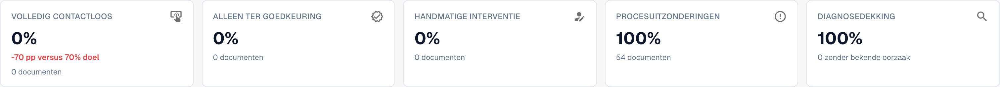
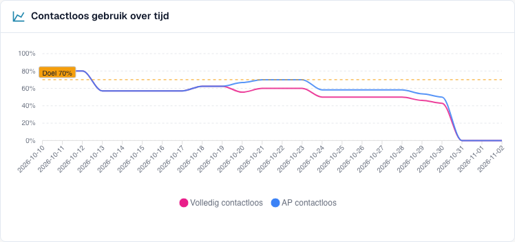
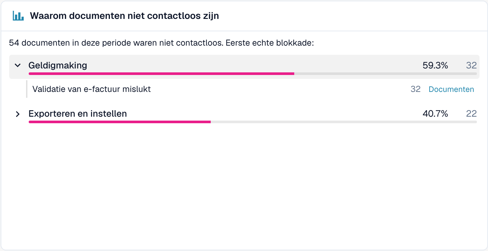
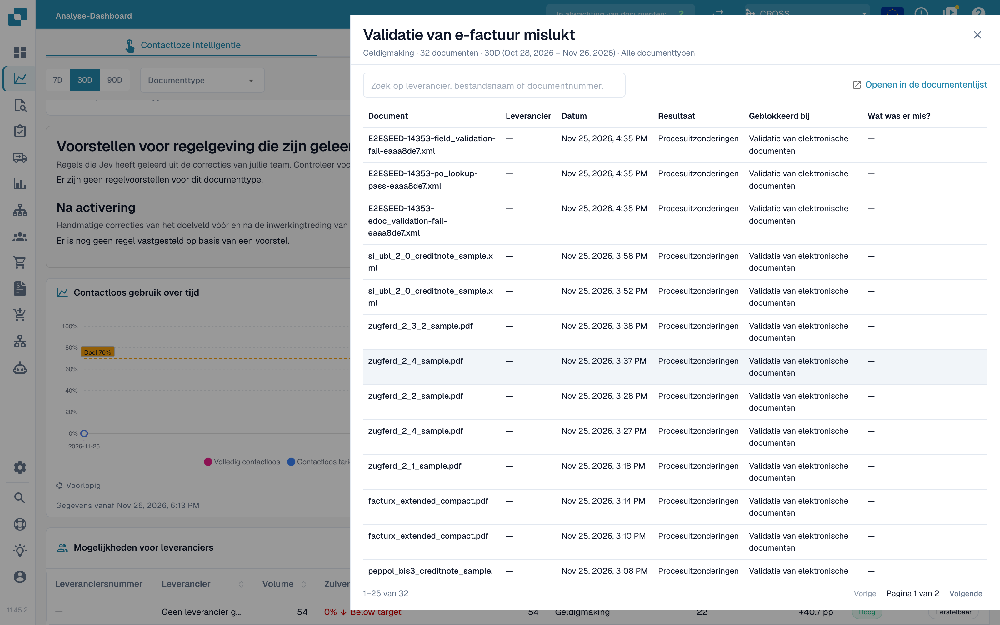
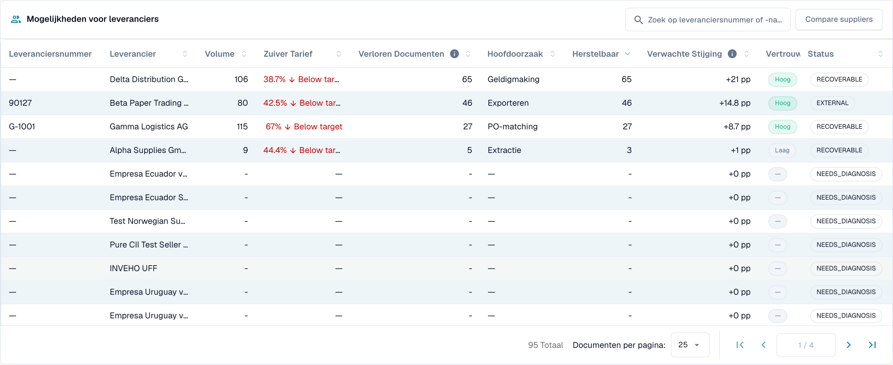
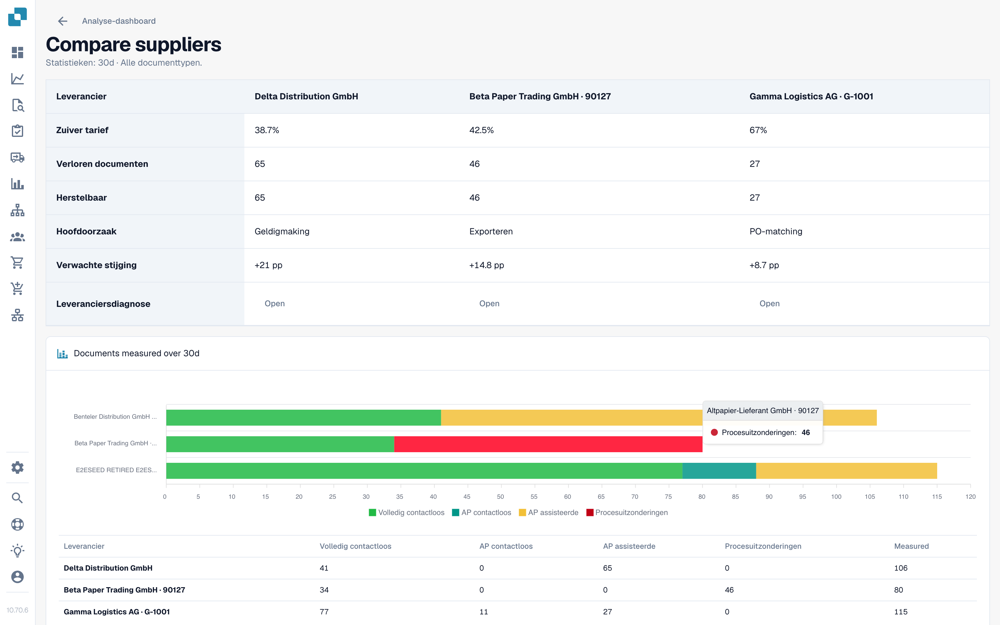

# Het dashboard gebruiken

<!-- touchless-admin-video-v2-20261104:start -->
**Videohoofdstuk (controleversie):** [Selectie en gegevenstijdstip](https://docbits-videos.fra1.cdn.digitaloceanspaces.com/settings-assistant/touchless-intelligence-preview-admin/v2/nl.html#chapter=01).
<!-- touchless-admin-video-v2-20261104:end -->

### Filters

| Filter                            | Wat het doet                                                                                                                                                                                                                   |
| --------------------------------- | ------------------------------------------------------------------------------------------------------------------------------------------------------------------------------------------------------------------------------ |
| **7D / 30D / 90D**                | De periode voor de kerncijfers en de wachtrij. De standaardwaarde is 30 dagen                                                                                                                                                           |
| **Document Type**                 | Filtert de Touchless-metrieken en de bijbehorende analyse tot één type, bijvoorbeeld INVOICE. Voorstellen voor geleerde regels hebben momenteel een eigen selectie; zie hieronder                                                                                                                                                                        |
| **Segment field / Segment value** | Alleen als uw organisatie meerdere processen via één documenttype laat lopen (bijvoorbeeld directe, indirecte en EAM-orders in het veld `order_type`). Kies een veld om de verdeling te zien, kies een waarde om alles daartoe te beperken |
| **Document ID**                   | Opent de **Document Trace** voor één document                                                                                                                                                                                  |

De **suborganisatie** die u bovenaan in DocBits hebt gekozen, beperkt de kerncijfers en de leverancierswachtrij. Probleemclusters en de AI-analyse beslaan altijd de hele organisatie.

### Documenttype bovenaan versus voorstellen voor geleerde regels

De bovenste keuze en het documenttype in **Learned rule proposals** staan in de momenteel gecontroleerde implementatie los van elkaar. De sectie laadt zijn eigen beschikbare typen en kiest aanvankelijk de eerste vermelding. **ORDER_CONFIRMATION** bovenaan kiezen kan daardoor **INVOICE** onderaan geselecteerd laten. Die voorstellen gaan over facturen, niet over de orderbevestigingen die voor de metrieken zijn gekozen.

Controleer het type dat in die sectie wordt getoond voordat u een regel toepast. Is daar geen passend type beschikbaar, dan zijn voorstellen daarvoor niet vastgesteld. De sectie gebruikt ook een eigen databasis, zoals gecorrigeerde documenten van de laatste 60 dagen, en neemt de periode bovenaan niet automatisch over. Dit beschrijft de huidige afzonderlijke bediening; het beweert niet dat synchronisatie is geïmplementeerd.

### De vijf kerncijfers

<figure><figcaption>
De vier resultaatkaarten en Diagnosedekking. Dit testrapport over 30 dagen bevat 54 procesuitzonderingen en geen documenten in de andere resultaatcategorieën.
</figcaption></figure>

De eerste vier kaarten zijn **afzonderlijke resultaatcategorieën**. Op elke kaart is de grote waarde het aandeel van die categorie in alle getelde documenten en geeft de kleinere regel het aantal documenten weer. De vier aandelen zijn samen 100%; voeg daar geen apart gecombineerd percentage aan toe.

| Kaart | Wat wordt geteld | Aanvullende informatie |
| --- | --- | --- |
| **Volledig contactloos** | Documenten die zonder handmatige interventie of afzonderlijke goedkeuring zijn afgerond | Verschil in procentpunten met de touchless-doelstelling |
| **Alleen ter goedkeuring** | Documenten die goedkeuring maar geen andere handmatige correctie vereisten | Alleen het eigen aandeel en aantal van deze categorie |
| **Handmatige interventie** | Documenten die een handmatige correctie of andere gebruikersinteractie vereisten | Eigen aandeel en aantal |
| **Procesuitzonderingen** | Documenten die door een verwerkings- of integratie-uitzondering niet konden worden afgerond | Eigen aandeel en aantal |
| **Diagnosedekking** | Bij hoeveel geblokkeerde documenten de **eerste oorzaak** van de blokkade bekend is | Aantal zonder bekende oorzaak |

Het afzonderlijke vak **Contactloos percentage · Volledig contactloos + Alleen ter goedkeuring** onder de kaarten combineert de eerste twee categorieën. Bijvoorbeeld: 60 volledig contactloze documenten plus 15 documenten alleen ter goedkeuring van 100 geven een **contactloos percentage van 75%**. De kaart Alleen ter goedkeuring toont nog steeds **15%**, niet 75%.

* Een kaart toont een streepje (—) in plaats van **0%** wanneer er niets te meten is. Een streepje betekent 'geen gegevens', niet 'nul'.
* **Diagnosedekking** = documenten met een bekende blokkeringsreden ÷ alle geblokkeerde documenten. Voorbeeld: 50 geblokkeerde documenten, 10 met een onbekende oorzaak → 40 ÷ 50 = **80%**. Een lage waarde betekent dat we nog niet begrijpen waarom documenten stoppen. Verbeter dit voordat u afzonderlijke oorzaken oplost.
* **Klik op een kaart** om de documentenlijst achter het cijfer in een nieuw tabblad te openen. Kaarten met 0 documenten zijn niet klikbaar. Diagnosedekking opent de documenten zonder bekende oorzaak.

### Contactloos gebruik over tijd

<figure><figcaption>
Volledig contactloos en het gecombineerde Contactloze percentage in de loop van de tijd. De gestippelde lijn markeert de doelstelling.
</figcaption></figure>

De grafiek toont **Volledig contactloos**, het gecombineerde **Contactloze percentage** en de **doellijn**. Het gecombineerde percentage omvat Volledig contactloos en Alleen ter goedkeuring en is daarom gelijk aan of hoger dan het volledig contactloze percentage; tel de twee waarden niet op. Elk punt heeft een eigen aantal in aanmerking komende afgeronde documenten, dus een dagpercentage is niet automatisch het percentage voor de hele periode. Korte periodes tonen dagelijkse punten, lange periodes wekelijkse punten. Punten op basis van onvolledige recente gegevens zijn gemarkeerd als **Voorlopig**.

**Voorbeeld.** Nadat u op 1 oktober automatische ordermatching hebt ingeschakeld, stijgt het volledig contactloze percentage binnen twee weken van 55% naar 68%. De grafiek toont de dag waarop de curve verandert, zodat u het tijdstip kunt onderzoeken. Een voor/na-verband bewijst op zichzelf niet dat deze instelling de verbetering heeft veroorzaakt. Vergelijk documenttype, leveranciersmix en andere wijzigingen.

### Waar touchless eerst verloren gaat

<figure><figcaption>
Geblokkeerde documenten naar de fase en reden waar ze eerst stopten. Hier kost <strong>Field validation: Required field missing</strong> de meeste documenten (58), gevolgd door <strong>Export mapping failed</strong> (46) en <strong>PO item mismatch</strong> (27). Voorbeeldorganisatie met demogegevens; leveranciersnamen zijn fictief.
</figcaption></figure>

Een staafdiagram van **Geblokkeerde documenten** per procesfase: de **eerste** fase die een document heeft gestopt.

**Voorbeeld.** Balken: Supplier Identification 12, Field Validation 41, PO Line Match 7. De grootste balk geeft aan dat u eerst **Field Validation** moet onderzoeken. Een ontbrekende geëxtraheerde waarde is een mogelijke oorzaak; vergelijk de originele factuur, veldregels en beschikbare brongegevens voordat u deze bevestigt.

#### Waarom documenten niet contactloos zijn (Nova-releasekanaal)

Organisaties op het **Nova**-releasekanaal zien het antwoord op dezelfde vraag in een uitvouwbare lijst in plaats van het staafdiagram. Het paneel heet **Waarom documenten niet contactloos zijn** en staat naast **Contactloos gebruik over tijd**.

<figure><figcaption>
Vouw een gebied uit om de redenen te zien en de documenten achter een reden te openen. Het testrapport bevat ook een gebied Exporteren en instellen met 22 documenten.
</figcaption></figure>

* De kop vermeldt hoeveel documenten de lijst bestrijkt. Elke rij is een gebied van de eerste blokkade met het aandeel in procenten, het aantal documenten en een balk. De rijen zijn van groot naar klein gesorteerd.
* Klik op een rij om de redenen te openen. Er is slechts één gebied tegelijk geopend; klik er nogmaals op om het te sluiten. De eerste **vijf** redenen worden getoond; selecteer **+N meer** om de rest te zien. Bij het sluiten wordt de lijst weer teruggebracht tot vijf.
* **Gecorrigeerd zonder blokkade** is een afzonderlijk gebied voor documenten die een gebruiker heeft gecorrigeerd terwijl het rapport geen technische eerste blokkade heeft gevonden. Gebruik dit om mogelijkheden voor gebruikersprocessen en training te onderzoeken in plaats van een mislukte pipelinefase te zoeken.
* De lijst komt uit dezelfde rapportgegevens als de kerncijfers. De browser berekent de aantallen niet opnieuw, zodat het totaal in de kop en de rijen overeenkomen.
* Als uw installatie deze gegevens nog niet verzendt, vermeldt het paneel dit in plaats van **0** te tonen. Een lege lijst met de tekst 'niets geregistreerd' betekent dat er in de periode geen documenten verloren gingen; dit zijn verschillende toestanden en u moet de eerste niet als goed nieuws lezen.

##### Documenten achter een reden

Selecteer **Documenten** bij een reden om een zijpaneel te openen zonder het rapport te verlaten. De kop houdt reden, gebied, periode en documenttype zichtbaar.

<figure><figcaption>
Het paneel met documenten van een reden toont 25 documenten per pagina. In dit testvoorbeeld heeft Validatie van e-factuur mislukt 32 overeenkomende documenten.
</figcaption></figure>

* **Zoek** op leverancier, bestandsnaam of documentnummer. Wis de zoekopdracht om alle documenten van de reden terug te zien; een melding zonder overeenkomsten betekent niet dat de reden geen documenten heeft.
* De tabel toont **document, leverancier, ontvangstdatum, resultaat, eerste geblokkeerde fase en een korte toelichting**. Selecteer een rij of de documentnaam om de **Documenttrace** te openen. **Terug** vanuit de trace keert terug naar dezelfde reden, zoekopdracht en pagina.
* Gebruik **Vorige** en **Volgende** om door pagina's van **25 documenten** te bladeren. De voettekst toont het zichtbare bereik, het totaal en de huidige pagina.
* **Openen in de documentenlijst** opent de volledige documentenlijst in een nieuw tabblad met de filters voor reden, rapportperiode en documenttype toegepast. Het rapport en zijpaneel blijven geopend in het oorspronkelijke tabblad.
* Gebruik bij een laadfout **Opnieuw proberen**. Een leeg resultaat en een laadfout zijn verschillende toestanden.

Het **Vesta**-releasekanaal behoudt het hierboven beschreven staafdiagram. Toont uw pagina balken, dan gebruikt u Vesta; toont ze de uitvouwbare lijst, dan gebruikt u Nova. Beide beantwoorden dezelfde vraag, dus de rest van deze pagina geldt in beide gevallen.

### Leverancierskansen

<figure><figcaption>
De leverancierswachtrij (verkort tot de eerste vier rijen). De eerste leverancier heeft 106 documenten, een puur percentage van 38,7 % en 65 herstelbare documenten, dus het aanpakken ervan is <strong>+21 pp</strong> waard. Voorbeeldorganisatie met demogegevens; de namen van leveranciers zijn fictief.
</figcaption></figure>

De wachtrij beantwoordt de vraag **"Welke leverancier moeten we eerst aanpakken?"** Ze is gesorteerd op **Recoverable** documenten, het hoogste eerst, 25 rijen per pagina.

| Kolom                         | Betekenis                                                                                                                                                   |
| ------------------------------ | --------------------------------------------------------------------------------------------------------------------------------------------------------- |
| **Supplier Number / Supplier** | De leverancier. Documenten zonder herkende leverancier verschijnen als **No supplier identified (n documents)**                                                  |
| **Volume**                     | Meetellende documenten van de leverancier in de periode                                                                                                          |
| **Pure Rate**                  | Aandeel puur touchless documenten. Groen bij of boven het doel, rood eronder                                                                          |
| **Lost Documents**             | Documenten die eindigden als AP assisted of als procesuitzondering. Niet altijd een persoon: een ERP-afwijzing of een document dat zeven dagen bleef steken telt ook mee |
| **Root Cause**                 | Wie de oplossing in handen heeft: Configuration, ERP integration, Export, Extraction, Master data, Measurement, PO matching, User process, Validation of Unknown          |
| **Recoverable**                | Verloren documenten waarvan DocBits de oorzaak kan oplossen: configuratie, stamgegevens of leverancierssjabloon                                                               |
| **Expected Lift**              | Hoeveel **procentpunten** het percentage van uw organisatie zou stijgen als elk herstelbaar document van deze leverancier touchless zou lopen (**+x pp**)               |
| **Confidence**                 | **High**, **Medium** of **Low**: hoe zeker de diagnose is                                                                                                |
| **Status**                     | New, Open, Investigating, In progress, Confirmed, Resolved, Dismissed. Een leverancier met te weinig documenten toont **NEEDS\_DIAGNOSIS**                       |

**Voorbeeld.** Uw organisatie heeft 1.000 meetellende documenten in de periode. Leverancier A heeft 40 herstelbare documenten, leverancier B heeft 90 verloren documenten maar slechts 10 herstelbare (hun probleem ligt aan hun kant).

* Leverancier A: 40 ÷ 1.000 = **+4,0 pp verwachte stijging**
* Leverancier B: 10 ÷ 1.000 = **+1,0 pp**, hoewel B meer verloren documenten heeft

De wachtrij plaatst A boven B omdat de **verwachte stijging** wordt afgemeten aan uw hele organisatie, niet aan de leverancier. Een leverancier met vier slechte documenten kan niet boven een leverancier met vierhonderd uitkomen.

Gebruik het zoekvak ("Search supplier number or name") om een leverancier te vinden. Klik op een rij om de **Supplier Diagnosis** te openen.

### Leveranciers vergelijken

<figure><figcaption>
Drie leveranciers naast elkaar: puur percentage, verloren en herstelbare documenten, hoofdoorzaak, verwachte stijging en een staafdiagram van de uitkomsten. Elke <strong>Open</strong> leidt naar de Supplier Diagnosis. Voorbeeldorganisatie met demogegevens; de namen van leveranciers zijn fictief.
</figcaption></figure>

Klik op **Compare suppliers**, vink **twee tot vijf** leveranciers aan (elk wordt vermeld met zijn aantal geblokkeerde documenten) en klik op **Compare**.

De vergelijking toont de leveranciers naast elkaar: **Pure rate**, **Lost documents**, **Recoverable**, **Root cause**, **Expected lift**, een staafdiagram van de uitkomsten en een link naar elke **Supplier Diagnosis**.

**Voorbeeld.** Leverancier A en B sturen dezelfde factuurindeling. B heeft een puur percentage van 80 %, A slechts 35 %. De diagnose van A suggereert "Master data". Vergelijk originele facturen, geëxtraheerde waarden en geïmporteerde leveranciersrecords voordat u die oorzaak bevestigt. Het percentageverschil alleen bewijst niet dat de indeling correct is of dat de stamgegevens van A onvolledig zijn.

### Analyseren met AI

De knop **Analyse n clusters with AI** analyseert de probleemclusters met het hoogste touchless-potentieel (elk met ten minste een minimumaantal documenten). Het duurt ongeveer 13 seconden per cluster en omvat de **hele organisatie**. Alleen beheerders kunnen de analyse starten.

Terwijl de analyse loopt, ziet u per cluster **Queued**, **Running**, **Done**, **Already analysed** of **Error**, met een link **Open cluster**. Als AI is uitgeschakeld of in de omgeving niet is geconfigureerd, is de knop uitgeschakeld met de reden, en **blijft al het andere op de pagina werken**.

## Werken met Touchless Intelligence: een routine

1. **Wekelijks**: open het tabblad en controleer het **percentage** en de **trend** ten opzichte van het doel.
2. Kijk naar **Diagnosis coverage**. Onder ongeveer 80 % zoekt u eerst uit waarom documenten stoppen.
3. Lees **Where touchless is lost first** (Vesta) of **Why documents are not touchless** (Nova) en kies de grootste fase of het grootste gebied.
4. Open **Leverancierskansen**. Sorteer op **Expected lift** en neem de bovenste leverancier met de status **RECOVERABLE**.
5. Lees de **probleemclusters**, controleer **Missing evidence** en volg daarna **What to change**.
6. Herstel één bevestigde oorzaak. Gebruik voor een ondersteund DocBits-voorstel de voorvertoning en de wijzigingshistorie. Leg voor een Infor-correctie de bron vast en importeer apart; dat maakt niet automatisch een registratie van een instellingswijziging in DocBits aan.
7. Controleer na twee weken het resultaat **voor/na**.

## Wie het kan zien

* Het tabblad maakt deel uit van het Analytics Dashboard. Uw beheerder schakelt het in voor de organisatie. Ontbreekt het tabblad, vraag het dan aan uw beheerder.
* **Organisatiebeheerders** zien het altijd.
* Andere gebruikers zien het wanneer een beheerder hun rol het tabblad **Analytics dashboard** heeft toegekend (**Settings → Roles**). Zonder toekenning hebben alleen beheerders toegang.
* Sommige acties zijn alleen voor beheerders: **AI analysis**, **het toepassen en ongedaan maken van een wijziging**, **learned rule proposals** en het **Consulting report**.

Hebt u geen toestemming, dan toont de pagina *Action not allowed, please contact the administrator*.

## Gerelateerde pagina's

* [Touchless Intelligence](./)
* [Metrieken en berekening](touchless-metrics.md)
* [Uitgewerkte voorbeelden: prijs en aantal](touchless-examples.md)
* [Leveranciersdiagnose en probleemclusters](touchless-supplier-diagnosis.md)
* [PO-matchingdiagnose](touchless-po-matching-diagnosis.md)
* [Document Trace](touchless-document-trace.md)
* [Wijzigingsvoorstellen en rapporten](touchless-change-proposals.md)
* [Touchless uitleggen en verbeteren met MCP](touchless-mcp.md)

<!-- Documentation review 2026-11-04: extraction quality vs process outcomes; KPI and terminal-outcome definitions checked against DocBits_API c51f350c728acb8ac964098d15f7b006bce273f4, module/automation_intelligence/kpi.py and bucket.py. Existing native screenshots retained and checked separately from illustrative examples. -->
<!-- Completion review 2026-11-04: owned synthetic PO examples, MCP schema/read evidence, human-action classification, KPI labels and screenshot proof limits. -->
