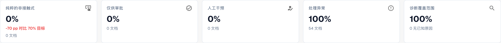
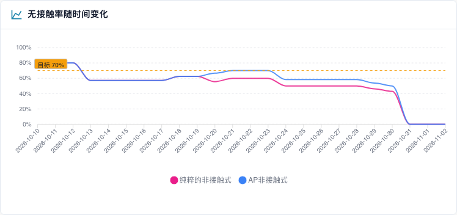
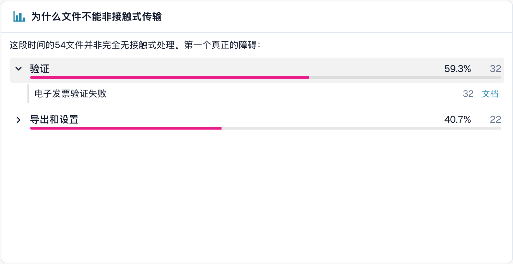
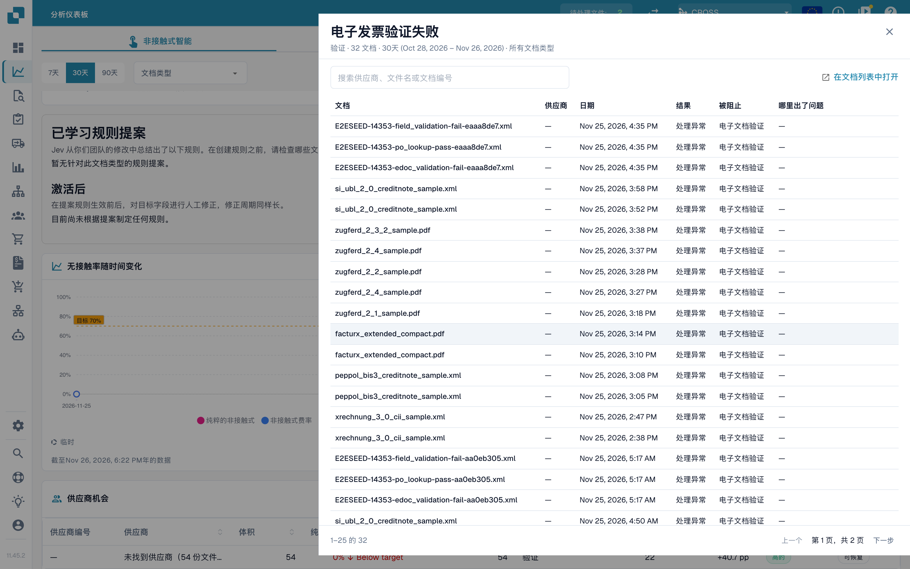
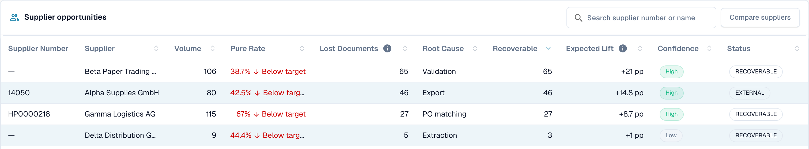

# 使用仪表板

<!-- touchless-admin-video-v2-20261104:start -->
**视频章节（审核版）：** [选择与数据时间戳](https://docbits-videos.fra1.cdn.digitaloceanspaces.com/settings-assistant/touchless-intelligence-preview-admin/v2/zh.html#chapter=01)。
<!-- touchless-admin-video-v2-20261104:end -->

### 筛选

| 筛选 | 作用 |
| --------------------------------- | ------------------------------------------------------------------------------------------------------------------------------------------------------------------------------------------------------------------------------ |
| **7D / 30D / 90D** | 关键指标和队列所用的期间。默认为 30 天 |
| **Document Type** | 将 Touchless 指标及相关分析限定为某一类型，例如 INVOICE。已学习规则提案目前有独立的选择，见下文 |
| **Segment field / Segment value** | 仅当您的组织通过同一文档类型运行多个流程时使用（例如 `order_type` 字段中的直接、间接和 EAM 订单）。选择字段可查看细分，选择值可将全部内容收窄到该值 |
| **Document ID** | 为某一份文档打开 **Document Trace** |

您在 DocBits 顶部选择的**子组织**会收窄关键指标和供应商队列。问题集群和 AI 分析则始终覆盖整个组织。

### 顶层文档类型与已学习规则提案

在当前核对的实现中，顶部的选择器与**已学习规则提案**中的文档类型相互独立。该区域会自行加载可用类型，初始选择第一项。因此，上方选择 **ORDER_CONFIRMATION** 时，下方仍可能保留 **INVOICE**。这些提案针对的是发票，而不是为指标所选的订单确认。

应用规则之前，请核对该区域中显示的类型。如果那里没有可用的匹配类型，说明尚未建立针对该类型的提案。该区域还使用自己的数据基础，例如最近 60 天已更正的文档，而不会自动采用上方的期间。这里描述的是当前彼此独立的控件；并不表示同步已经实现。

### 五个关键指标

<figure><figcaption>
四张结果卡片和“诊断覆盖范围”。此 30 天测试报告包含 54 个处理异常，其他结果类别中没有文档。
</figcaption></figure>

前四张卡片是**相互独立的结果类别**。每张卡片上的大数值是该类别占所有已计数文档的比例，下方较小的文字是文档数量。四项比例合计为 100%；不要再额外加上一个合并比率。

| 卡片 | 计数内容 | 其他信息 |
| --- | --- | --- |
| **纯粹的非接触式** | 无需人工干预或单独审批即可完成的文档 | 与 touchless 目标相差的百分点 |
| **仅供审批** | 需要审批但不需要其他人工更正的文档 | 仅显示该类别自身的比例和数量 |
| **人工干预** | 需要人工更正或其他用户交互的文档 | 自身的比例和数量 |
| **处理异常** | 因处理或集成异常而无法完成的文档 | 自身的比例和数量 |
| **诊断覆盖范围** | 在受阻文档中，**首个受阻原因**已知的文档比例 | 原因未知的文档数量 |

卡片下方独立的 **Touchless 比率 · 纯粹的非接触式 + 仅供审批** 框合并前两个类别。例如，100 个文档中有 60 个纯粹的非接触式文档和 15 个仅供审批文档，则 **touchless 比率为 75%**。“仅供审批”卡片仍显示 **15%**，而不是 75%。

* 没有可测量的数据时，卡片显示破折号（—）而不是 **0%**。破折号表示“无数据”，而不是“零”。
* **诊断覆盖范围** = 受阻原因已知的文档 ÷ 所有受阻文档。例如：50 个受阻文档中有 10 个原因未知 → 40 ÷ 50 = **80%**。数值较低表示我们尚不了解文档停止处理的原因。请先改善此指标，再处理各个原因。
* **点击卡片**可在新标签页中打开该数字对应的文档列表。包含 0 个文档的卡片不可点击。“诊断覆盖范围”会打开原因未知的文档。

### 无接触率随时间变化

<figure><figcaption>
纯粹的非接触式和合并 Touchless 比率随时间的变化。虚线表示目标。
</figcaption></figure>

图表显示**纯粹的非接触式**、合并的 **Touchless 比率**和**目标线**。合并比率包括纯粹的非接触式和仅供审批，因此等于或高于纯粹非接触式比率；不要将两个数值相加。每个点都有各自符合条件的已完成文档数量，因此每日比率不一定等于整个期间的比率。较短期间显示每日点，较长期间显示每周点。基于不完整近期数据的点标记为**临时**。

**示例。** 在 10 月 1 日启用自动订单匹配后，纯粹非接触式比率在两周内从 55% 上升到 68%。图表显示曲线发生变化的那一天，便于调查具体时间。前后关联本身不能证明此设置导致了改善。请比较文档类型、供应商组合和其他变更。

### Touchless 首先在哪里流失

<figure><figcaption>
按文档首次停止处理的阶段和原因显示受阻文档。这里 <strong>Field validation: Required field missing</strong> 影响的文档最多（58），其次是 <strong>Export mapping failed</strong>（46）和 <strong>PO item mismatch</strong>（27）。使用演示数据的示例组织；供应商名称为虚构。
</figcaption></figure>

按流程阶段显示**受阻文档**的条形图：即阻止文档的**第一个**阶段。

**示例。** 条形：Supplier Identification 12、Field Validation 41、PO Line Match 7。最大的条形表示应首先检查 **Field Validation**。缺少提取值是可能的原因之一；确认前请比较原始发票、字段规则和可用的源数据。

#### 为什么文件不能非接触式传输（Nova 发布渠道）

**Nova** 发布渠道中的组织通过可展开列表而不是条形图查看同一问题的答案。面板标题为**为什么文件不能非接触式传输**，位于**无接触率随时间变化**旁边。

<figure><figcaption>
展开区域可查看其原因，并打开某个原因对应的文档。测试报告还包含一个有 22 个文档的“导出和设置”区域。
</figcaption></figure>

* 标题说明列表涵盖的文档数量。每一行代表一个首次受阻区域，显示百分比、文档数量和条形。各行按数量从大到小排序。
* 点击一行可展开其原因。一次只能展开一个区域；再次点击即可关闭。首先显示前**五个**原因；选择 **+N 更多**可显示其余原因。关闭区域后，列表恢复为五项。
* **无阻塞但已更正**是一个独立区域，用于收录用户已更正、但报告未发现技术性首次阻塞的文档。使用它调查用户流程和培训方面的改进机会，而不是寻找失败的处理阶段。
* 列表与关键指标来自相同的报告数据。浏览器不会重新计算数字，因此标题中的总数与各行一致。
* 如果安装尚未发送这些数据，面板会明确说明，而不是显示 **0**。带有“未记录任何内容”文字的空列表表示该期间没有流失文档；这两种状态不同，不应将第一种状态理解为好消息。

##### 某个原因对应的文档

在某个原因上选择**文档**，无需离开报告即可打开侧栏。标题始终显示原因、区域、期间和文档类型。

<figure><figcaption>
原因文档面板每页显示 25 个文档。在此测试示例中，“电子发票验证失败”有 32 个匹配文档。
</figcaption></figure>

* 按供应商、文件名或文档编号**搜索**。清除搜索可返回该原因的全部文档；无匹配消息并不表示该原因没有文档。
* 表格显示**文档、供应商、接收日期、结果、首个受阻阶段和简短详情**。选择一行或文档名称可打开**文档跟踪**。从跟踪页面选择**返回**，可回到相同的原因、搜索条件和页码。
* 使用**上一个**和**下一个**浏览每页 **25 个文档**的页面。页脚显示可见范围、总数和当前页。
* **在文档列表中打开**会在新标签页中打开完整文档列表，并应用原因、报告期间和文档类型筛选条件。报告和侧栏在原标签页中保持打开。
* 加载失败时，请使用**重试**。空结果和加载错误是不同的状态。

**Vesta** 发布渠道保留上述条形图。如果页面显示条形，则使用 Vesta；如果显示可展开列表，则使用 Nova。两者回答同一问题，因此本页其余内容均适用。

### 供应商机会

<figure><figcaption>
供应商队列（缩短为首四行）。第一家供应商有 106 份文档、38.7 % 的 pure 比率和 65 份可挽回文档，因此修复它价值 <strong>+21 pp</strong>。示例组织，使用演示数据；供应商名称为虚构。
</figcaption></figure>

该队列回答**“我们应该先修复哪家供应商？”**。它按**可挽回**文档数排序，从高到低，每页 25 行。

| 列                         | 含义                                                                                                                                                   |
| ------------------------------ | --------------------------------------------------------------------------------------------------------------------------------------------------------- |
| **Supplier Number / Supplier** | 供应商。无法识别供应商的文档显示为 **No supplier identified (n documents)**                                                  |
| **Volume**                     | 该期间内该供应商符合条件的文档数                                                                                                          |
| **Pure Rate**                  | pure touchless 文档的占比。达到或超过目标为绿色，低于目标为红色                                                                          |
| **Lost Documents**             | 最终成为 AP assisted 或流程异常的文档。并不总意味着有人参与：ERP 拒收或停滞七天的文档也计入 |
| **Root Cause**                 | 修复责任的归属：Configuration、ERP integration、Export、Extraction、Master data、Measurement、PO matching、User process、Validation 或 Unknown          |
| **Recoverable**                | 原因可由 DocBits 修复的流失文档：配置、主数据或供应商模板                                                               |
| **Expected Lift**              | 如果该供应商所有可挽回文档都能 touchless 运行，贵组织的比率将提升多少**百分点**（**+x pp**）               |
| **Confidence**                 | **High**、**Medium** 或 **Low**：诊断的确定程度                                                                                                |
| **Status**                     | New、Open、Investigating、In progress、Confirmed、Resolved、Dismissed。文档数过少的供应商显示 **NEEDS\_DIAGNOSIS**                       |

**示例。**贵组织在该期间有 1,000 份符合条件的文档。供应商 A 有 40 份可挽回文档，供应商 B 有 90 份流失文档但只有 10 份可挽回（其问题在供应商一侧）。

* 供应商 A：40 ÷ 1,000 = **预期提升 +4.0 pp**
* 供应商 B：10 ÷ 1,000 = **+1.0 pp**，尽管 B 的流失文档更多

队列将 A 排在 B 之前，因为**预期提升**是相对整个组织来衡量的，而不是相对该供应商。只有四份问题文档的供应商无法排在有四百份问题文档的供应商之前。

使用搜索框（“Search supplier number or name”）查找供应商。点击某一行可打开 **Supplier Diagnosis**。

### 比较供应商

<figure><figcaption>
三家供应商并排比较：pure 比率、流失与可挽回文档、根本原因、预期提升，以及各结果的柱状图。每个 <strong>Open</strong> 都指向 Supplier Diagnosis。示例组织，使用演示数据；供应商名称为虚构。
</figcaption></figure>

点击 **Compare suppliers**，勾选**两到五家**供应商（每家都会列出其受阻文档数），然后点击 **Compare**。

比较结果会并排显示各供应商的 **Pure rate**、**Lost documents**、**Recoverable**、**Root cause**、**Expected lift**，各结果的柱状图，以及指向每个 **Supplier Diagnosis** 的链接。

**示例。**供应商 A 和 B 发送相同的发票版式。B 的 pure 比率为 80 %，A 只有 35 %。A 的诊断提示“Master data”。在确认该原因之前，请比较原始发票、提取值和导入的供应商记录。仅凭比率差异不能证明版式正确，也不能证明 A 的主数据不完整。

### 使用 AI 分析

按钮 **Analyse n clusters with AI** 会分析 touchless 潜力最高的问题集群（每个集群至少达到最低文档数）。每个集群约需 13 秒，覆盖**整个组织**。只有管理员可以启动。

运行时，您会看到每个集群显示 **Queued**、**Running**、**Done**、**Already analysed** 或 **Error**，并带有 **Open cluster** 链接。如果环境中 AI 已关闭或未配置，该按钮会被禁用并说明原因，此时**页面上的其他所有内容仍可正常使用**。

## 使用 Touchless Intelligence：日常工作流程

1. **每周**：打开该选项卡，对照目标检查**比率**和**趋势**。
2. 查看**诊断覆盖率**。低于约 80 % 时，先查明文档为何停下。
3. 阅读 **Where touchless is lost first**（Vesta）或 **Why documents are not touchless**（Nova），并选择最大的阶段或区域。
4. 打开 **Supplier opportunities**。按 **Expected lift** 排序，选取状态为 **RECOVERABLE** 的首家供应商。
5. 阅读**问题集群**，检查 **Missing evidence**，然后按照 **What to change** 操作。
6. 修复一个已确认的原因。对于受支持的 DocBits 提案，使用预览和变更历史。对于 Infor 更正，另行记录来源并导入；它不会自动生成 DocBits 设置变更条目。
7. 两周后检查**前后**结果。

## 谁可以查看

* 该选项卡属于 Analytics Dashboard。管理员为组织启用它。如果选项卡缺失，请联系管理员。
* **组织管理员**始终可以查看。
* 当管理员为其角色授予 **Analytics dashboard** 选项卡权限后（**Settings → Roles**），其他用户才能查看。没有授权时，只有管理员可以访问。
* 部分操作仅限管理员：**AI analysis**、**应用和撤销变更**、**已学习规则提案**以及 **Consulting report**。

如果没有权限，页面会显示 _Action not allowed, please contact the administrator_。

## 相关页面

* [Touchless Intelligence](./)
* [指标与计算](touchless-metrics.md)
* [完整示例：价格与数量](touchless-examples.md)
* [供应商诊断与问题集群](touchless-supplier-diagnosis.md)
* [PO 匹配诊断](touchless-po-matching-diagnosis.md)
* [文档追踪](touchless-document-trace.md)
* [变更提案与报告](touchless-change-proposals.md)
* [通过 MCP 解释和改进 Touchless](touchless-mcp.md)

<!-- Documentation review 2026-11-04: extraction quality vs process outcomes; KPI and terminal-outcome definitions checked against DocBits_API c51f350c728acb8ac964098d15f7b006bce273f4, module/automation_intelligence/kpi.py and bucket.py. Existing native screenshots retained and checked separately from illustrative examples. -->
<!-- Completion review 2026-11-04: owned synthetic PO examples, MCP schema/read evidence, human-action classification, KPI labels and screenshot proof limits. -->
