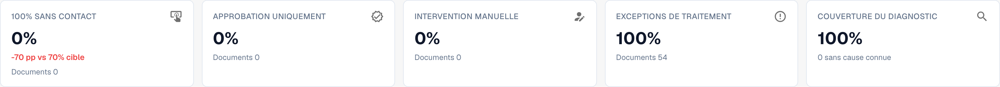
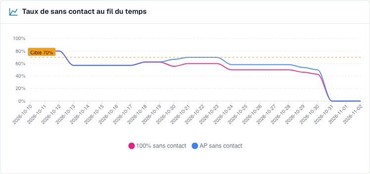
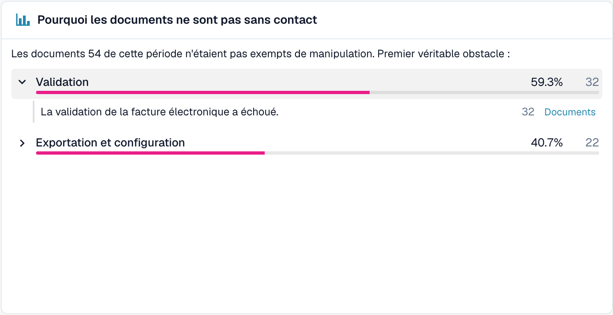
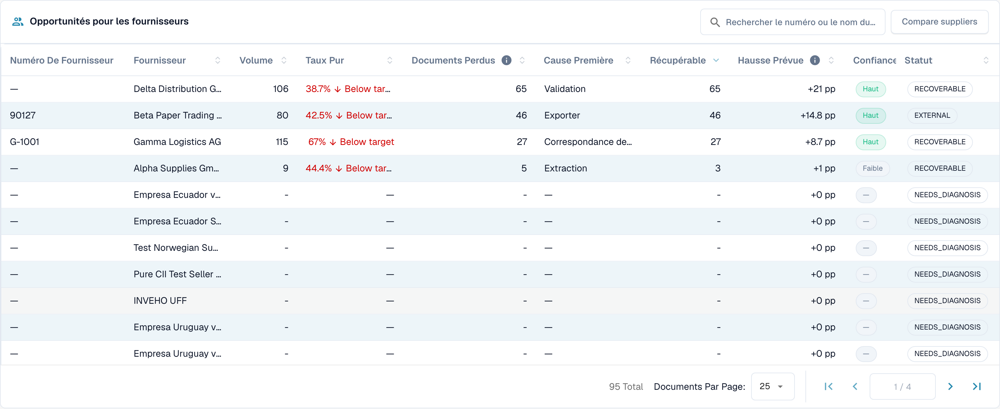
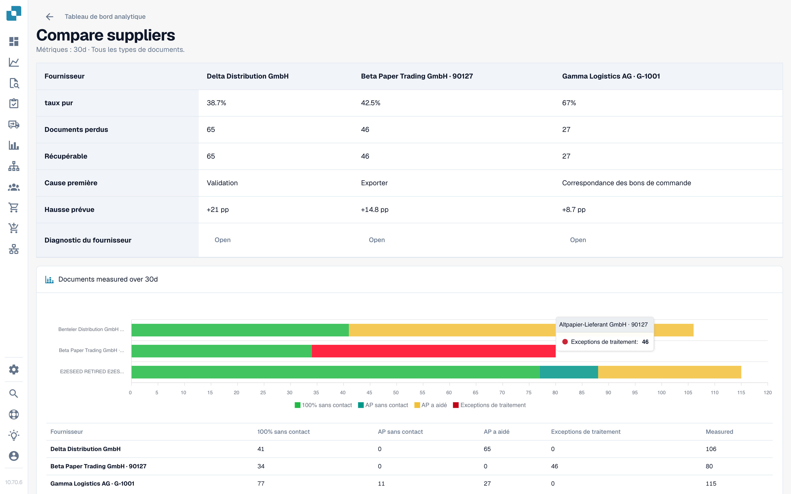

# Utiliser le tableau de bord

<!-- touchless-admin-video-v2-20261104:start -->
**Chapitre vidéo (version de contrôle):** [Sélection et date des données](https://docbits-videos.fra1.cdn.digitaloceanspaces.com/settings-assistant/touchless-intelligence-preview-admin/v2/fr.html#chapter=01).
<!-- touchless-admin-video-v2-20261104:end -->

### Filtres

| Filtre                            | Ce qu'il fait                                                                                                                                                                                                                   |
| --------------------------------- | ------------------------------------------------------------------------------------------------------------------------------------------------------------------------------------------------------------------------------ |
| **7D / 30D / 90D**                | La période des chiffres clés et de la file d'attente. La valeur par défaut est de 30 jours                                                                                                                                                           |
| **Document Type**                 | Limite les métriques Touchless et l'analyse associée à un seul type, par exemple INVOICE. Les propositions de règles apprises ont actuellement leur propre sélection ; voir ci-dessous                                                                                                                                                                        |
| **Segment field / Segment value** | Uniquement si votre organisation fait passer plusieurs processus par un même type de document (par exemple des commandes directes, indirectes et EAM dans le champ `order_type`). Choisissez un champ pour voir la répartition, choisissez une valeur pour tout y ramener |
| **Document ID**                   | Ouvre la **Document Trace** pour un document                                                                                                                                                                                  |

La **sous-organisation** que vous avez sélectionnée en haut de DocBits limite les chiffres clés et la file d'attente des fournisseurs. Les clusters de problèmes et l'analyse IA couvrent toujours l'ensemble de l'organisation.

### Type de document principal et propositions de règles apprises

Le sélecteur principal et le type de document de **Learned rule proposals** sont indépendants dans l'implémentation actuellement vérifiée. Cette section charge ses propres types disponibles et choisit d'abord la première entrée. Sélectionner **ORDER_CONFIRMATION** en haut peut donc laisser **INVOICE** sélectionné en bas. Ces propositions concernent les factures, pas les confirmations de commande choisies pour les métriques.

Avant d'appliquer une règle, vérifiez le type affiché dans cette section. Si aucun type correspondant n'y est disponible, aucune proposition n'a été établie pour lui. La section utilise également sa propre base de données, par exemple les documents corrigés des 60 derniers jours, et ne reprend pas automatiquement la période principale. Cette description porte sur les commandes actuellement séparées ; elle n'affirme pas qu'une synchronisation a été mise en œuvre.

### Les cinq indicateurs clés

<figure><figcaption>
Les quatre cartes de résultats et la Couverture du diagnostic. Ce rapport de test sur 30 jours contient 54 exceptions de traitement et aucun document dans les autres catégories.
</figcaption></figure>

Les quatre premières cartes sont **des catégories de résultats distinctes**. Sur chaque carte, la grande valeur représente la part de cette catégorie dans l'ensemble des documents comptabilisés et la petite ligne indique son nombre de documents. Les quatre parts totalisent 100 % ; n'y ajoutez pas un taux combiné distinct.

| Carte | Ce qu'elle compte | Information supplémentaire |
| --- | --- | --- |
| **100 % sans contact** | Documents terminés sans intervention manuelle ni approbation distincte | Écart en points de pourcentage par rapport à l'objectif sans contact |
| **Approbation uniquement** | Documents ayant nécessité une approbation, mais aucune autre correction manuelle | Uniquement la part et le nombre de cette catégorie |
| **Intervention manuelle** | Documents ayant nécessité une correction manuelle ou une autre interaction utilisateur | Sa propre part et son propre nombre |
| **Exceptions de traitement** | Documents n'ayant pas pu aboutir en raison d'une exception de traitement ou d'intégration | Sa propre part et son propre nombre |
| **Couverture du diagnostic** | Nombre de documents bloqués dont la **première cause** de blocage est connue | Nombre de documents sans cause connue |

La zone distincte **Taux sans contact · 100 % sans contact + Approbation uniquement**, située sous les cartes, combine les deux premières catégories. Par exemple, 60 documents 100 % sans contact plus 15 documents avec approbation uniquement sur 100 donnent un **taux sans contact de 75 %**. La carte Approbation uniquement affiche toujours **15 %**, et non 75 %.

* Une carte affiche un tiret (—) au lieu de **0 %** lorsqu'il n'y a rien à mesurer. Un tiret signifie « aucune donnée », et non « zéro ».
* **Couverture du diagnostic** = documents avec une cause de blocage connue ÷ tous les documents bloqués. Exemple : 50 documents bloqués, dont 10 sans cause connue → 40 ÷ 50 = **80 %**. Une valeur faible signifie que nous ne comprenons pas encore pourquoi les documents s'arrêtent. Améliorez-la avant de corriger les causes individuelles.
* **Cliquez sur une carte** pour ouvrir dans un nouvel onglet la liste des documents correspondant au chiffre. Les cartes contenant 0 document ne sont pas cliquables. Couverture du diagnostic ouvre les documents sans cause connue.

### Taux de sans contact au fil du temps

<figure><figcaption>
100 % sans contact et le Taux sans contact combiné au fil du temps. La ligne en pointillés marque l'objectif.
</figcaption></figure>

Le graphique montre **100 % sans contact**, le **Taux sans contact** combiné et la **ligne d'objectif**. Le taux combiné inclut 100 % sans contact et Approbation uniquement ; il est donc supérieur ou égal au taux 100 % sans contact. N'additionnez pas les deux valeurs. Chaque point possède son propre nombre de documents terminés éligibles : un taux quotidien n'est donc pas automatiquement celui de toute la période. Les périodes courtes affichent des points quotidiens, les longues des points hebdomadaires. Les points fondés sur des données récentes incomplètes sont marqués **Provisoire**.

**Exemple.** Après l'activation du rapprochement automatique des commandes le 1er octobre, le taux 100 % sans contact passe de 55 % à 68 % en deux semaines. Le graphique montre le jour où la courbe évolue afin d'examiner ce moment. Une association avant/après ne prouve pas à elle seule que ce paramètre a provoqué l'amélioration. Comparez le type de document, la répartition des fournisseurs et les autres changements.

### Où le sans contact est perdu en premier

<figure><figcaption>
Documents bloqués selon l'étape et le motif de leur premier arrêt. Ici, <strong>Field validation: Required field missing</strong> concerne le plus de documents (58), suivi de <strong>Export mapping failed</strong> (46) et <strong>PO item mismatch</strong> (27). Organisation d'exemple avec des données de démonstration ; les noms de fournisseurs sont fictifs.
</figcaption></figure>

Un graphique à barres des **Documents bloqués** par étape du processus : la **première** étape qui a arrêté un document.

**Exemple.** Barres : Supplier Identification 12, Field Validation 41, PO Line Match 7. La plus grande barre indique qu'il faut examiner **Field Validation** en premier. Une valeur extraite manquante est une cause possible ; comparez la facture d'origine, les règles de champs et les données sources disponibles avant de la confirmer.

#### Pourquoi les documents ne sont pas sans contact (canal de publication Nova)

Les organisations du canal de publication **Nova** voient la réponse à cette question dans une liste extensible au lieu du graphique à barres. Le panneau s'intitule **Pourquoi les documents ne sont pas sans contact** et se trouve à côté de **Taux de sans contact au fil du temps**.

<figure><figcaption>
Développez une zone pour voir ses motifs et ouvrir les documents associés à un motif. Le rapport de test contient également une zone Exportation et configuration avec 22 documents.
</figcaption></figure>

* L'en-tête indique combien de documents la liste couvre. Chaque ligne correspond à une zone de premier blocage avec sa part en pourcentage, son nombre de documents et une barre. Les lignes sont triées par ordre décroissant.
* Cliquez sur une ligne pour afficher ses motifs. Une seule zone est ouverte à la fois ; cliquez de nouveau pour la fermer. Les **cinq** premiers motifs sont affichés ; sélectionnez **+N supplémentaires** pour voir les autres. La fermeture de la zone ramène la liste à cinq.
* **Corrigé sans blocage** est une zone distincte pour les documents corrigés par un utilisateur alors que le rapport n'a trouvé aucun premier blocage technique. Utilisez-la pour examiner les possibilités d'amélioration des processus utilisateur et de la formation, plutôt que pour rechercher une étape de traitement en échec.
* La liste provient des mêmes données de rapport que les indicateurs clés. Le navigateur ne recalcule pas les nombres : le total de l'en-tête et les lignes correspondent donc.
* Si votre installation n'envoie pas encore ces données, le panneau l'indique au lieu d'afficher **0**. Une liste vide avec le message « rien enregistré » signifie qu'aucun document n'a été perdu pendant la période ; ces deux états sont différents et le premier ne doit pas être interprété comme une bonne nouvelle.

##### Documents associés à un motif

Sélectionnez **Documents** sur un motif pour ouvrir un panneau latéral sans quitter le rapport. L'en-tête conserve le motif, la zone, la période et le type de document.

<figure><figcaption>
Le panneau des documents du motif affiche 25 documents par page. Dans cet exemple de test, La validation de la facture électronique a échoué compte 32 documents correspondants.
</figcaption></figure>

* **Recherchez** par fournisseur, nom de fichier ou numéro de document. Effacez la recherche pour retrouver tous les documents du motif ; un message d'absence de correspondance ne signifie pas que le motif n'a aucun document.
* Le tableau affiche le **document, le fournisseur, la date de réception, le résultat, la première étape bloquée et un détail court**. Sélectionnez une ligne ou son nom de document pour ouvrir la **Traçabilité du document**. **Retour** depuis la traçabilité ramène au même motif, à la même recherche et à la même page.
* Utilisez **Précédent** et **Suivant** pour parcourir des pages de **25 documents**. Le pied de page indique la plage visible, le total et la page actuelle.
* **Ouvrir dans la liste des documents** ouvre la liste complète dans un nouvel onglet avec les filtres de motif, de période du rapport et de type de document appliqués. Le rapport et le panneau latéral restent ouverts dans l'onglet d'origine.
* Si le chargement échoue, utilisez **Réessayer**. Un résultat vide et une erreur de chargement sont des états différents.

Le canal de publication **Vesta** conserve le graphique à barres décrit ci-dessus. Si votre page affiche des barres, vous utilisez Vesta ; si elle affiche la liste extensible, vous utilisez Nova. Les deux répondent à la même question et le reste de cette page s'applique dans les deux cas.

### Opportunités fournisseurs

<figure><figcaption>
La file d'attente des fournisseurs (réduite aux quatre premières lignes). Le premier fournisseur a 106 documents, un taux pur de 38,7 % et 65 documents récupérables : le corriger vaut donc <strong>+21 pp</strong>. Organisation d'exemple avec des données de démonstration ; les noms de fournisseurs sont fictifs.
</figcaption></figure>

La file d'attente répond à la question **« quel fournisseur devons-nous corriger en premier ? »**. Elle est triée par documents **Recoverable**, du plus élevé au plus faible, 25 lignes par page.

| Colonne                         | Signification                                                                                                                                                   |
| ------------------------------ | --------------------------------------------------------------------------------------------------------------------------------------------------------- |
| **Supplier Number / Supplier** | Le fournisseur. Les documents sans fournisseur reconnu apparaissent comme **No supplier identified (n documents)**                                                  |
| **Volume**                     | Documents éligibles du fournisseur sur la période                                                                                                          |
| **Pure Rate**                  | Part des documents purement touchless. Vert si la valeur atteint ou dépasse l'objectif, rouge si elle est en dessous                                                                          |
| **Lost Documents**             | Documents qui se sont terminés en AP assisted ou en exception de processus. Ce n'est pas toujours une personne : un rejet de l'ERP ou un document bloqué sept jours compte aussi | 
| **Root Cause**                 | Qui doit corriger : Configuration, ERP integration, Export, Extraction, Master data, Measurement, PO matching, User process, Validation ou Unknown          |
| **Recoverable**                | Documents perdus dont DocBits peut corriger la cause : configuration, données de référence ou modèle fournisseur                                                               |
| **Expected Lift**              | Combien de **points de pourcentage** le taux de votre organisation gagnerait si chaque document récupérable de ce fournisseur passait en touchless (**+x pp**)               |
| **Confidence**                 | **High**, **Medium** ou **Low** : la certitude du diagnostic                                                                                                |
| **Status**                     | New, Open, Investigating, In progress, Confirmed, Resolved, Dismissed. Un fournisseur avec trop peu de documents affiche **NEEDS\_DIAGNOSIS**                       |

**Exemple.** Votre organisation a 1 000 documents éligibles sur la période. Le fournisseur A a 40 documents récupérables, le fournisseur B a 90 documents perdus mais seulement 10 récupérables (son problème est de son côté).

* Fournisseur A : 40 ÷ 1 000 = **+4,0 pp de gain attendu**
* Fournisseur B : 10 ÷ 1 000 = **+1,0 pp**, alors que B a plus de documents perdus

La file d'attente classe A devant B parce que le **gain attendu** est mesuré par rapport à toute votre organisation, pas par rapport au fournisseur. Un fournisseur avec quatre mauvais documents ne peut pas dépasser un fournisseur qui en a quatre cents.

Utilisez le champ de recherche (« Search supplier number or name ») pour trouver un fournisseur. Cliquez sur une ligne pour ouvrir le **Supplier Diagnosis**.

### Comparer les fournisseurs

<figure><figcaption>
Trois fournisseurs côte à côte : taux pur, documents perdus et récupérables, cause racine, gain attendu et un graphique en barres des résultats. Chaque <strong>Open</strong> mène au Supplier Diagnosis. Organisation d'exemple avec des données de démonstration ; les noms de fournisseurs sont fictifs.
</figcaption></figure>

Cliquez sur **Compare suppliers**, cochez **deux à cinq** fournisseurs (chacun est listé avec son nombre de documents bloqués) et cliquez sur **Compare**.

La comparaison affiche les fournisseurs côte à côte : **Pure rate**, **Lost documents**, **Recoverable**, **Root cause**, **Expected lift**, un graphique en barres des résultats et un lien vers chaque **Supplier Diagnosis**.

**Exemple.** Les fournisseurs A et B envoient la même mise en page de facture. B a un taux pur de 80 %, A seulement 35 %. Le diagnostic de A suggère « Master data ». Comparez les factures d'origine, les valeurs extraites et les enregistrements fournisseur importés avant de confirmer cette cause. L'écart de taux seul ne prouve ni que la mise en page est correcte ni que les données de référence de A sont incomplètes.

### Analyser avec l'IA

Le bouton **Analyse n clusters with AI** analyse les clusters de problèmes au plus fort potentiel touchless (au moins un nombre minimal de documents chacun). Il faut environ 13 secondes par cluster et cela couvre **toute l'organisation**. Seuls les administrateurs peuvent le lancer.

Pendant l'exécution, vous voyez **Queued**, **Running**, **Done**, **Already analysed** ou **Error** pour chaque cluster, avec un lien **Open cluster**. Si l'IA est désactivée ou non configurée dans l'environnement, le bouton est désactivé avec la raison, et **tout le reste de la page continue de fonctionner**.

## Travailler avec Touchless Intelligence : une routine

1. **Chaque semaine** : ouvrez l'onglet et comparez le **taux** et la **tendance** à l'objectif.
2. Regardez la **Diagnosis coverage**. En dessous d'environ 80 %, cherchez d'abord pourquoi les documents s'arrêtent.
3. Lisez **Where touchless is lost first** (Vesta) ou **Why documents are not touchless** (Nova) et choisissez l’étape ou la zone la plus importante.
4. Ouvrez les **Opportunités fournisseurs**. Triez par **Expected lift** et prenez le premier fournisseur avec le statut **RECOVERABLE**.
5. Lisez les **clusters de problèmes**, vérifiez **Missing evidence**, puis suivez **What to change**.
6. Corrigez une cause confirmée. Pour une proposition DocBits prise en charge, utilisez l'aperçu et l'historique des modifications. Pour une correction Infor, documentez la source et l'import séparément ; cela ne crée pas automatiquement une entrée de modification de paramètre dans DocBits.
7. Après deux semaines, vérifiez le résultat **avant/après**.

## Qui peut le voir

* L'onglet fait partie du Dashboard Analytics. Votre administrateur l'active pour l'organisation. Si l'onglet manque, demandez à votre administrateur.
* Les **administrateurs de l'organisation** le voient toujours.
* **Settings → Roles** — un administrateur y accorde l'onglet **Analytics dashboard** au rôle des autres utilisateurs, qui le voient alors. Sans cette autorisation, seuls les administrateurs y ont accès.
* Certaines actions sont réservées aux administrateurs : l'**AI analysis**, l'**application et l'annulation d'une modification**, les **learned rule proposals** et le **Consulting report**.

Si vous n'y êtes pas autorisé, la page affiche _Action not allowed, please contact the administrator_.

## Pages associées

* [Touchless Intelligence](./)
* [Indicateurs et calcul](touchless-metrics.md)
* [Exemples pratiques : prix et quantité](touchless-examples.md)
* [Diagnostic fournisseur et clusters de problèmes](touchless-supplier-diagnosis.md)
* [Diagnostic du rapprochement avec le BC](touchless-po-matching-diagnosis.md)
* [Trace du document](touchless-document-trace.md)
* [Propositions de modification et rapports](touchless-change-proposals.md)
* [Expliquer et améliorer Touchless avec MCP](touchless-mcp.md)

<!-- Documentation review 2026-11-04: extraction quality vs process outcomes; KPI and terminal-outcome definitions checked against DocBits_API c51f350c728acb8ac964098d15f7b006bce273f4, module/automation_intelligence/kpi.py and bucket.py. Existing native screenshots retained and checked separately from illustrative examples. -->
<!-- Completion review 2026-11-04: owned synthetic PO examples, MCP schema/read evidence, human-action classification, KPI labels and screenshot proof limits. -->
