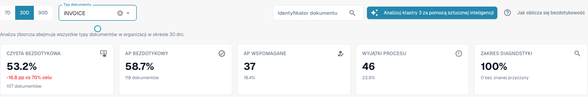
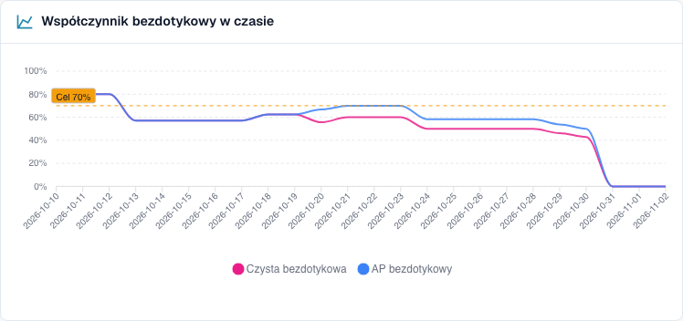
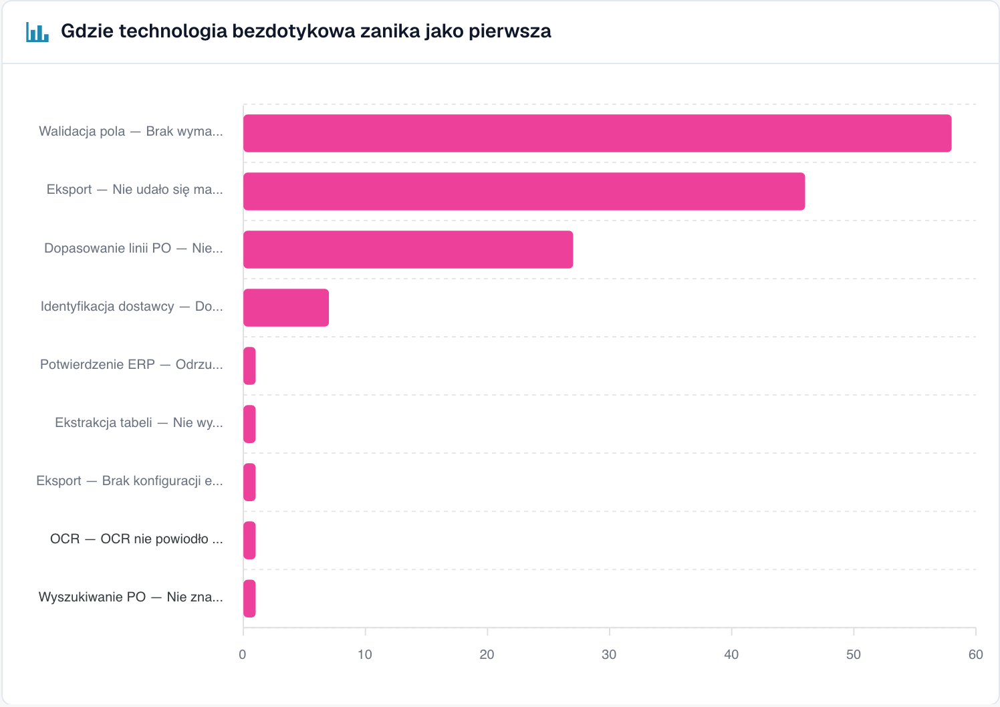
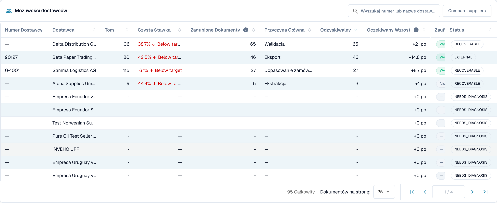
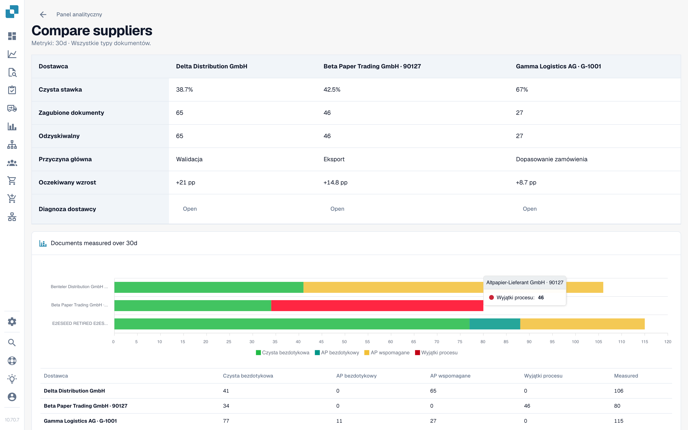

# Korzystanie z panelu

<!-- touchless-admin-video-v2-20261104:start -->
**Rozdział filmu (wersja do oceny):** [Wybór i znacznik czasu danych](https://docbits-videos.fra1.cdn.digitaloceanspaces.com/settings-assistant/touchless-intelligence-preview-admin/v2/pl.html#chapter=01).
<!-- touchless-admin-video-v2-20261104:end -->

### Filtry

| Filtr                             | Co robi                                                                                                                                                                                                                        |
| --------------------------------- | ------------------------------------------------------------------------------------------------------------------------------------------------------------------------------------------------------------------------------ |
| **7D / 30D / 90D**                | Okres dla kluczowych wskaźników i kolejki. Domyślnie 30 dni                                                                                                                                                                    |
| **Document Type**                 | Zawęża wskaźniki Touchless i powiązaną analizę do jednego typu, na przykład INVOICE. Wyuczone propozycje reguł mają obecnie własny wybór; patrz poniżej                                                                        |
| **Segment field / Segment value** | Tylko jeśli Twoja organizacja prowadzi kilka procesów przez jeden typ dokumentu (na przykład zamówienia bezpośrednie, pośrednie i EAM w polu `order_type`). Wybierz pole, aby zobaczyć podział, wybierz wartość, aby zawęzić wszystko do niej |
| **Document ID**                   | Otwiera **Document Trace** dla jednego dokumentu                                                                                                                                                                               |

Wybrana u góry w DocBits **podorganizacja** zawęża kluczowe wskaźniki i kolejkę dostawców. Klastry problemów i analiza AI zawsze obejmują całą organizację.

### Typ dokumentu u góry a wyuczone propozycje reguł

Górny selektor i typ dokumentu w **Learned rule proposals** są w obecnie sprawdzanej implementacji niezależne. Sekcja ładuje własne dostępne typy i początkowo wybiera pierwszy wpis. Wybranie **ORDER_CONFIRMATION** u góry może więc pozostawić **INVOICE** wybrany poniżej. Te propozycje dotyczą faktur, a nie wybranych do wskaźników potwierdzeń zamówień.

Przed zastosowaniem reguły sprawdź typ pokazany wewnątrz tej sekcji. Jeśli nie ma tam pasującego typu, propozycje dla niego nie zostały ustalone. Sekcja używa też własnej podstawy danych, na przykład poprawionych dokumentów z ostatnich 60 dni, a nie automatycznie przejmuje okresu z nagłówka. Opisuje to obecne, rozdzielne elementy sterowania; nie twierdzi, że synchronizacja została wdrożona.

### Pięć kluczowych wskaźników

<figure><figcaption>
Aktualny raport faktur za 30 dni: 107 w pełni automatycznych faktur plus 11 faktur wymagających tylko zatwierdzenia daje 118 z 201, czyli 58.7% AP Touchless. Samo Pure to 53.2%. Karta AP pokazuje już łączną liczbę 118. Fikcyjna historia szkoleniowa; nie potwierdzono wykonanego eksportu do ERP.
</figcaption></figure>

| Karta                  | Co pokazuje                                       | Przykład (ilustracyjny)                                                     |
| ---------------------- | ------------------------------------------------- | --------------------------------------------------------------------------- |
| **Pure touchless**     | Procent i różnicę do celu                         | **63.2 %** · "120 documents" · "−6.8 pp vs 70 % target" (czerwony, poniżej celu) |
| **AP touchless**       | Łączny procent i liczbę: Pure plus tylko zatwierdzenie | **78.9%** · "150 documents" w przykładzie ze 120 Pure i 30 tylko zatwierdzenie |
| **AP assisted**        | Liczbę dokumentów i ich udział                    | **30** · 15.8 %                                                             |
| **Process exceptions** | Liczbę dokumentów i ich udział                    | **10** · 5.3 %                                                              |
| **Diagnosis coverage** | Ile zablokowanych dokumentów ma **znaną** przyczynę | **80 %** · "10 without a known cause"                                        |

* W aktualnym zrzucie 107 w pełni automatycznych plus 11 faktur wymagających tylko zatwierdzenia daje **118 ÷ 201 = 58.7% AP Touchless**. Samo Pure to **107 ÷ 201 = 53.2%**. Te dwa procenty się pokrywają i nie wolno ich dodawać.
* Karta pokazuje kreskę (—) zamiast **0 %**, gdy nie ma czego mierzyć. Kreska oznacza "brak danych", a nie "zero".
* **Diagnosis coverage** = dokumenty ze znanym powodem blokady ÷ wszystkie zablokowane dokumenty. Przykład: 50 zablokowanych dokumentów, 10 z nieznaną przyczyną daje 40 ÷ 50 = **80 %**. Niska wartość oznacza "jeszcze nie rozumiemy, dlaczego dokumenty się zatrzymują". Popraw ją, zanim spróbujesz usuwać pojedyncze przyczyny.
* **Kliknij kartę**, aby otworzyć w nowej karcie listę dokumentów stojących za liczbą ("View the documents behind this number"). Karty z 0 dokumentów nie są klikalne.

### Wskaźnik touchless w czasie

<figure><figcaption>
Aktualny trend raportu: różowy pokazuje Pure Touchless, a niebieski wskaźnik łączny obejmujący dokumenty wymagające tylko zatwierdzenia. Linia przerywana oznacza cel 70%. Te krzywe używają fikcyjnych przypadków szkoleniowych i nie potwierdzają rzeczywistej poprawy procesu.
</figcaption></figure>

Aktualny wykres pokazuje **Pure Touchless**, **łączny wskaźnik AP Touchless** oraz **linię celu**. Niebieski obejmuje Pure i dokumenty wymagające tylko zatwierdzenia, więc leży na różowym lub powyżej niego; nie dodawaj tych dwóch wartości. Każdy punkt ma własną liczbę kwalifikujących się zakończonych dokumentów, więc wskaźnik dzienny nie jest automatycznie wskaźnikiem całego okresu. Krótkie okresy pokazują punkty dzienne, długie tygodniowe. Odrębna kategoria wyniku "tylko zatwierdzenie" różni się od tej łącznej linii.

**Przykład.** Po włączeniu automatycznego dopasowania PO 1 października czysty wskaźnik rośnie z 55 % do 68 % w ciągu dwóch tygodni. Wykres pokazuje dzień, w którym krzywa się zmienia, więc możesz zbadać moment. Związek przed/po sam w sobie nie dowodzi, że poprawę spowodowało to ustawienie. Porównaj typ dokumentu, strukturę dostawców i inne zmiany.

### Gdzie touchless jest tracony najpierw

<figure><figcaption>
Zablokowane dokumenty według etapu i powodu, na którym zatrzymały się najpierw. Tutaj <strong>Field validation: Required field missing</strong> kosztuje najwięcej dokumentów (58), następnie <strong>Export mapping failed</strong> (46) i <strong>PO item mismatch</strong> (27). Przykładowa organizacja z danymi demonstracyjnymi; nazwy dostawców są fikcyjne.
</figcaption></figure>

Wykres słupkowy **Blocked documents** według etapu potoku: **pierwszego** etapu, który zatrzymał dokument.

**Przykład.** Słupki: Supplier Identification 12, Field Validation 41, PO Line Match 7. Najwyższy słupek mówi, żeby najpierw przyjrzeć się **Field Validation**. Brakująca odczytana wartość to jedna z możliwych przyczyn; przed potwierdzeniem porównaj oryginalną fakturę, reguły pól i dostępne dane źródłowe.

### Możliwości u dostawców

<figure><figcaption>
Kolejka dostawców (skrócona do pierwszych czterech wierszy). Pierwszy dostawca ma 106 dokumentów, Pure Rate 38.7 % i 65 dokumentów możliwych do odzyskania, więc jego naprawa jest warta <strong>+21 pp</strong>. Przykładowa organizacja z danymi demonstracyjnymi; nazwy dostawców są fikcyjne.
</figcaption></figure>

Kolejka odpowiada na pytanie **"Którego dostawcę naprawić najpierw?"**. Jest posortowana według dokumentów **Recoverable**, od największej liczby, po 25 wierszy na stronę.

| Kolumna                        | Znaczenie                                                                                                                                                 |
| ------------------------------ | --------------------------------------------------------------------------------------------------------------------------------------------------------- |
| **Supplier Number / Supplier** | Dostawca. Dokumenty bez rozpoznanego dostawcy pojawiają się jako **No supplier identified (n documents)**                                                |
| **Volume**                     | Kwalifikujące się dokumenty dostawcy w okresie                                                                                                            |
| **Pure Rate**                  | Udział dokumentów czystego touchless. Zielony, jeśli na poziomie celu lub powyżej, czerwony, jeśli poniżej                                                |
| **Lost Documents**             | Dokumenty, które zakończyły się jako AP Assisted albo jako wyjątek procesu. Nie zawsze chodzi o człowieka: odrzucenie przez ERP lub dokument, który utknął na siedem dni, też się liczy |
| **Root Cause**                 | Kto odpowiada za naprawę: Configuration, ERP integration, Export, Extraction, Master data, Measurement, PO matching, User process, Validation lub Unknown  |
| **Recoverable**                | Utracone dokumenty, których przyczynę DocBits może naprawić: konfiguracja, dane podstawowe lub szablon dostawcy                                            |
| **Expected Lift**              | O ile **punktów procentowych** wzrósłby wskaźnik Twojej organizacji, gdyby każdy dokument tego dostawcy możliwy do odzyskania przeszedł touchless (**+x pp**) |
| **Confidence**                 | **High**, **Medium** lub **Low**: jak pewna jest diagnoza                                                                                                 |
| **Status**                     | New, Open, Investigating, In progress, Confirmed, Resolved, Dismissed. Dostawca ze zbyt małą liczbą dokumentów pokazuje **NEEDS\_DIAGNOSIS**              |

**Przykład.** Twoja organizacja ma w okresie 1,000 kwalifikujących się dokumentów. Dostawca A ma 40 dokumentów możliwych do odzyskania, dostawca B ma 90 utraconych dokumentów, ale tylko 10 możliwych do odzyskania (jego problem leży po jego stronie).

* Dostawca A: 40 ÷ 1,000 = **+4.0 pp oczekiwanego wzrostu**
* Dostawca B: 10 ÷ 1,000 = **+1.0 pp**, chociaż B ma więcej utraconych dokumentów

Kolejka stawia A przed B, ponieważ **oczekiwany wzrost** jest mierzony względem całej Twojej organizacji, a nie względem dostawcy. Dostawca z czterema złymi dokumentami nie może wyprzedzić dostawcy z czterystoma.

Użyj pola wyszukiwania ("Search supplier number or name"), aby znaleźć dostawcę. Kliknij wiersz, aby otworzyć **Supplier Diagnosis**.

### Porównaj dostawców

<figure><figcaption>
Trzej dostawcy obok siebie: Pure Rate, Lost Documents i Recoverable, Root Cause, Expected Lift oraz wykres słupkowy wyników. Każde <strong>Open</strong> prowadzi do Supplier Diagnosis. Przykładowa organizacja z danymi demonstracyjnymi; nazwy dostawców są fikcyjne.
</figcaption></figure>

Kliknij **Compare suppliers**, zaznacz **od dwóch do pięciu** dostawców (każdy jest wymieniony z liczbą zablokowanych dokumentów) i kliknij **Compare**.

Porównanie pokazuje dostawców obok siebie: **Pure rate**, **Lost documents**, **Recoverable**, **Root cause**, **Expected lift**, wykres słupkowy wyników oraz link do **Supplier Diagnosis** każdego z nich.

**Przykład.** Dostawcy A i B wysyłają ten sam układ faktury. B ma Pure Rate 80 %, A tylko 35 %. Diagnoza A sugeruje "Master data". Przed potwierdzeniem tej przyczyny porównaj oryginalne faktury, odczytane wartości i zaimportowane rekordy dostawców. Sama różnica wskaźników nie dowodzi, że układ jest poprawny ani że dane podstawowe A są niekompletne.

### Analiza z AI

Przycisk **Analyse n clusters with AI** analizuje klastry problemów o największym potencjale touchless (każdy z co najmniej minimalną liczbą dokumentów). Trwa to około 13 sekund na klaster i obejmuje **całą organizację**. Uruchomić go mogą tylko administratorzy.

W trakcie działania przy każdym klastrze widzisz **Queued**, **Running**, **Done**, **Already analysed** lub **Error**, z linkiem **Open cluster**. Jeśli AI jest wyłączone lub nieskonfigurowane w środowisku, przycisk jest nieaktywny wraz z powodem, a **wszystko inne na stronie nadal działa**.

## Praca z Touchless Intelligence: rutyna

1. **Co tydzień**: otwórz kartę i sprawdź **wskaźnik** oraz **trend** względem celu.
2. Spójrz na **Diagnosis coverage**. Poniżej około 80 % najpierw dowiedz się, dlaczego dokumenty się zatrzymują.
3. Przeczytaj **Gdzie touchless jest tracony najpierw** i wybierz największy etap.
4. Otwórz **Możliwości u dostawców**. Posortuj według **Expected lift** i weź pierwszego dostawcę ze statusem **RECOVERABLE**.
5. Przeczytaj **klastry problemów**, sprawdź **Missing evidence**, a następnie wykonaj **What to change**.
6. Usuń jedną potwierdzoną przyczynę. Dla obsługiwanej propozycji DocBits użyj podglądu i historii zmian. Korektę w Infor udokumentuj i zaimportuj osobno; nie tworzy ona automatycznie wpisu o zmianie ustawień DocBits.
7. Po dwóch tygodniach sprawdź wynik **przed/po**.

## Kto może to zobaczyć

* Karta jest częścią Analytics Dashboard. Twój administrator włącza ją dla organizacji. Jeśli karty brakuje, zapytaj administratora.
* **Administratorzy organizacji** widzą ją zawsze.
* Inni użytkownicy widzą ją, gdy administrator przyznał ich roli kartę **Analytics dashboard** (**Settings &#8594; Roles**). Bez nadania dostęp mają tylko administratorzy.
* Niektóre działania są tylko dla administratorów: **AI analysis**, **applying and undoing a change**, **learned rule proposals** oraz **Consulting report**.

Jeśli nie masz uprawnień, strona pokazuje _Action not allowed, please contact the administrator_.

## Powiązane strony

* [Touchless Intelligence](./)
* [Wskaźniki i obliczenia](../../touchless-metrics.md)
* [Przykłady: cena i ilość](touchless-examples.md)
* [Diagnoza dostawcy i klastry problemów](../../touchless-supplier-diagnosis.md)
* [Diagnoza dopasowania PO](../../touchless-po-matching-diagnosis.md)
* [Ślad dokumentu](touchless-document-trace.md)
* [Propozycje zmian i raporty](touchless-change-proposals.md)
* [Wyjaśnianie i poprawa Touchless przez MCP](touchless-mcp.md)

<!-- Documentation review 2026-11-04: extraction quality vs process outcomes; KPI and terminal-outcome definitions checked against DocBits_API c51f350c728acb8ac964098d15f7b006bce273f4, module/automation_intelligence/kpi.py and bucket.py. Existing native screenshots retained and checked separately from illustrative examples. -->
<!-- Completion review 2026-11-04: owned synthetic PO examples, MCP schema/read evidence, human-action classification, KPI labels and screenshot proof limits. -->
