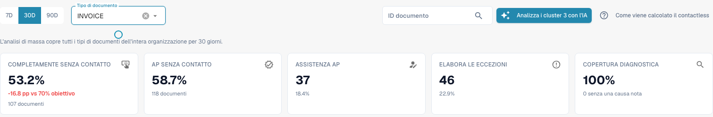
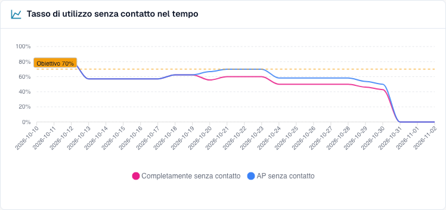
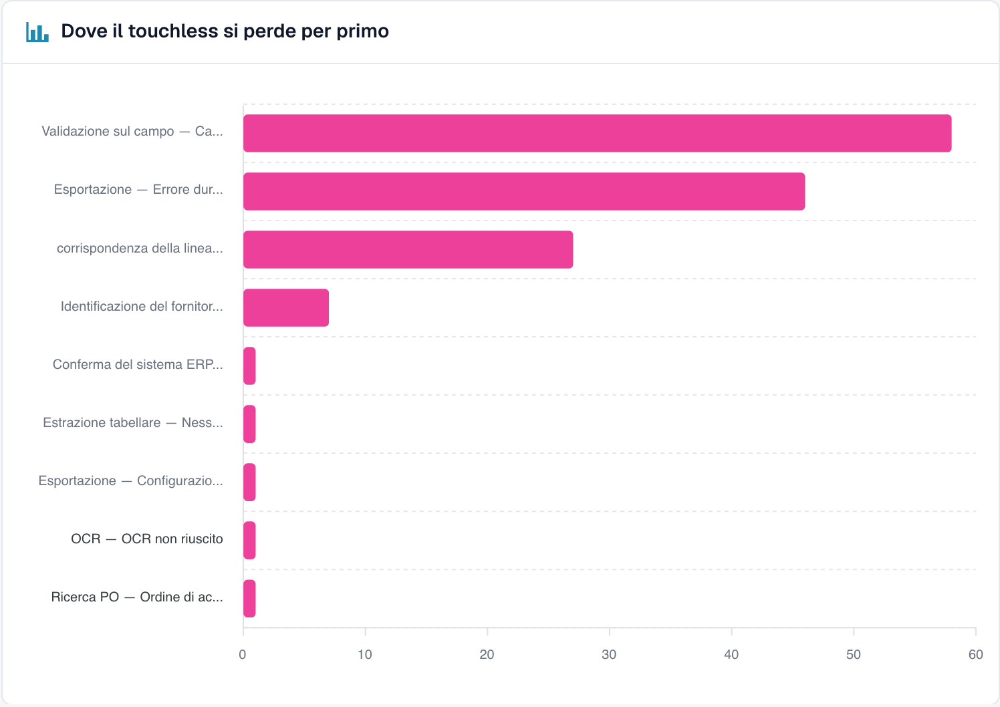
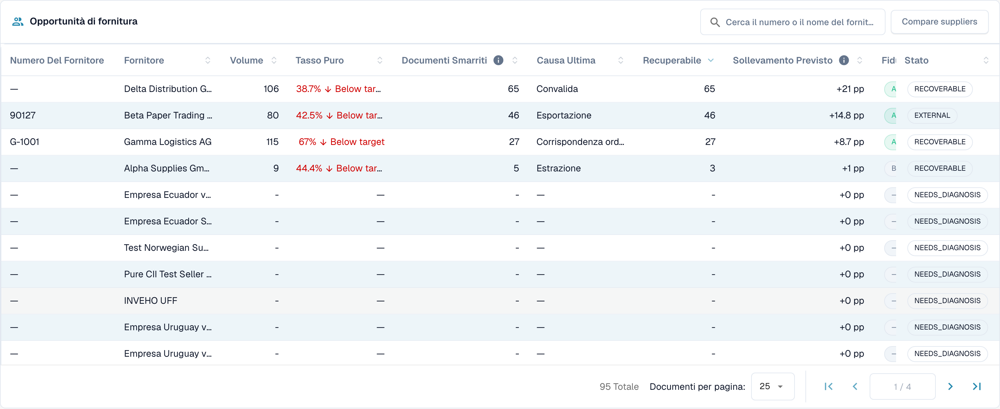

# Usare il pannello

<!-- touchless-admin-video-v2-20261104:start -->
**Capitolo video (versione di verifica):** [Selezione e data dei dati](https://docbits-videos.fra1.cdn.digitaloceanspaces.com/settings-assistant/touchless-intelligence-preview-admin/v2/it.html#chapter=01).
<!-- touchless-admin-video-v2-20261104:end -->

### Filtri

| Filtro                            | Che cosa fa                                                                                                                                                                                                                   |
| --------------------------------- | ------------------------------------------------------------------------------------------------------------------------------------------------------------------------------------------------------------------------------ |
| **7D / 30D / 90D**                | Il periodo per gli indicatori chiave e la coda. Il valore predefinito è 30 giorni                                                                                                                                                           |
| **Document Type**                 | Filtra le metriche Touchless e l'analisi correlata su un solo tipo, ad esempio INVOICE. Le proposte di regole apprese hanno attualmente una propria selezione; vedi sotto                                                                                                                                                                        |
| **Segment field / Segment value** | Solo se la tua organizzazione gestisce più processi con un unico tipo di documento (ad esempio ordini diretti, indiretti ed EAM nel campo `order_type`). Scegli un campo per vedere la suddivisione, scegli un valore per restringere tutto a quel valore |
| **Document ID**                   | Apre il **Tracciamento del documento** per un documento                                                                                                                                                                                  |

La **sotto-organizzazione** selezionata in alto in DocBits restringe gli indicatori chiave e la coda dei fornitori. I cluster di problemi e l'analisi IA coprono sempre l'intera organizzazione.

### Tipo di documento principale e proposte di regole apprese

Il selettore principale e il tipo di documento in **Learned rule proposals** sono indipendenti nell'implementazione attualmente verificata. La sezione carica i propri tipi disponibili e all'inizio sceglie la prima voce. Selezionare **ORDER_CONFIRMATION** in alto può quindi lasciare **INVOICE** selezionato in basso. Tali proposte riguardano le fatture, non le conferme d'ordine scelte per le metriche.

Prima di applicare una regola, controlla il tipo mostrato all'interno di quella sezione. Se lì non è disponibile alcun tipo corrispondente, per esso non sono state stabilite proposte. La sezione usa inoltre una propria base dati, ad esempio i documenti corretti degli ultimi 60 giorni, invece di adottare automaticamente il periodo principale. Questo descrive i controlli separati attuali; non afferma che sia stata implementata una sincronizzazione.

### I cinque indicatori chiave

<figure><figcaption>
Report attuale delle fatture su 30 giorni: 107 fatture completamente automatiche più 11 fatture con sola approvazione danno 118 su 201, ovvero 58,7% AP Touchless. Il solo Pure è 53,2%. La scheda AP mostra già il conteggio combinato di 118. Storico didattico fittizio; non è stabilita alcuna esportazione ERP eseguita.
</figcaption></figure>

| Scheda                   | Che cosa mostra                                             | Esempio (illustrativo)                                                      |
| ---------------------- | ------------------------------------------------- | --------------------------------------------------------------------------- |
| **Pure touchless**     | La percentuale e la differenza rispetto all'obiettivo   | **63,2 %** · "120 documenti" · "−6,8 pp rispetto all'obiettivo del 70 %" (rosso, sotto l'obiettivo) |
| **AP touchless** | Percentuale e conteggio combinati: Pure più sola approvazione | **78,9%** · "150 documenti" nell'esempio con 120 Pure e 30 con sola approvazione |
| **AP assisted**        | Il numero di documenti e la loro quota           | **30** · 15,8 %                                                             |
| **Process exceptions** | Il numero di documenti e la loro quota           | **10** · 5,3 %                                                              |
| **Diagnosis coverage** | Quanti documenti bloccati hanno una causa **nota** | **80 %** · "10 senza causa nota"                                       |

* Nella schermata attuale, 107 fatture completamente automatiche più 11 con sola approvazione danno **118 ÷ 201 = 58,7% AP Touchless**. Il solo Pure è **107 ÷ 201 = 53,2%**. Le due percentuali si sovrappongono e non vanno sommate.
* Una scheda mostra un trattino (—) invece di **0 %** quando non c'è nulla da misurare. Un trattino significa "nessun dato", non "zero".
* **Diagnosis coverage** = documenti con un motivo di blocco noto ÷ tutti i documenti bloccati. Esempio: 50 documenti bloccati, 10 con causa sconosciuta → 40 ÷ 50 = **80 %**. Un valore basso significa "non capiamo ancora perché i documenti si fermano". Miglioralo prima di provare a correggere le singole cause.
* **Fai clic su una scheda** per aprire in una nuova scheda del browser l'elenco dei documenti dietro al numero ("View the documents behind this number"). Le schede con 0 documenti non sono cliccabili.

### Tasso touchless nel tempo

<figure><figcaption>
Andamento attuale del report: il rosa mostra Pure Touchless e il blu il tasso combinato, compresi i documenti con sola approvazione. La linea tratteggiata indica l'obiettivo del 70%. Queste curve usano casi didattici fittizi e non stabiliscono un miglioramento reale del processo.
</figcaption></figure>

Il grafico attuale mostra **Pure Touchless**, il **tasso AP Touchless combinato** e la **linea dell'obiettivo**. Il blu comprende Pure e sola approvazione, quindi è allo stesso livello o sopra il rosa; non sommare i due valori. Ogni punto ha il proprio numero di documenti conclusi idonei, quindi un tasso giornaliero non è automaticamente il tasso dell'intero periodo. I periodi brevi mostrano punti giornalieri, quelli lunghi punti settimanali. La categoria distinta sola approvazione è diversa da questa linea combinata.

**Esempio.** Dopo aver attivato l'abbinamento automatico degli ordini il 1° ottobre, il tasso puro sale dal 55 % al 68 % in due settimane. Il grafico mostra il giorno in cui la curva cambia, così puoi indagare sulla tempistica. Un'associazione prima/dopo non dimostra di per sé che questa impostazione abbia causato il miglioramento. Confronta tipo di documento, mix di fornitori e altre modifiche.

### Dove si perde per primo il touchless

<figure><figcaption>
Documenti bloccati per fase e motivo in cui si sono fermati per primi. Qui <strong>Field validation: Required field missing</strong> costa più documenti (58), poi <strong>Export mapping failed</strong> (46) e <strong>PO item mismatch</strong> (27). Organizzazione di esempio con dati dimostrativi; i nomi dei fornitori sono fittizi.
</figcaption></figure>

Un grafico a barre dei **Documenti bloccati** per fase della pipeline: la **prima** fase che ha fermato un documento.

**Esempio.** Barre: Supplier Identification 12, Field Validation 41, PO Line Match 7. La barra più grande indica di guardare prima a **Field Validation**. Un valore estratto mancante è una possibile causa; confronta la fattura originale, le regole dei campi e i dati di origine disponibili prima di confermarla.

### Opportunità fornitori

<figure><figcaption>
La coda dei fornitori (ridotta alle prime quattro righe). Il primo fornitore ha 106 documenti, un tasso puro del 38,7 % e 65 documenti recuperabili, quindi correggerlo vale <strong>+21 pp</strong>. Organizzazione di esempio con dati dimostrativi; i nomi dei fornitori sono fittizi.
</figcaption></figure>

La coda risponde a **"Quale fornitore dovremmo correggere per primo?"** È ordinata per documenti **Recoverable**, dal più alto, 25 righe per pagina.

| Colonna                         | Significato                                                                                                                                                   |
| ------------------------------ | --------------------------------------------------------------------------------------------------------------------------------------------------------- |
| **Supplier Number / Supplier** | Il fornitore. I documenti senza un fornitore riconosciuto compaiono come **No supplier identified (n documents)**                                                  |
| **Volume**                     | Documenti idonei del fornitore nel periodo                                                                                                          |
| **Pure Rate**                  | Quota di documenti pure touchless. Verde se pari o sopra l'obiettivo, rossa se sotto                                                                          |
| **Lost Documents**             | Documenti terminati come AP assisted o come eccezione di processo. Non sempre una persona: contano anche un rifiuto dell'ERP o un documento rimasto fermo per sette giorni |
| **Root Cause**                 | Chi è responsabile della correzione: Configuration, ERP integration, Export, Extraction, Master data, Measurement, PO matching, User process, Validation o Unknown          |
| **Recoverable**                | Documenti persi la cui causa può essere corretta da DocBits: configurazione, dati anagrafici o modello del fornitore                                                               |
| **Expected Lift**              | Di quanti **punti percentuali** salirebbe il tasso della tua organizzazione se ogni documento recuperabile di questo fornitore fosse elaborato in modalità touchless (**+x pp**)               |
| **Confidence**                 | **High**, **Medium** o **Low**: quanto è sicura la diagnosi                                                                                                |
| **Status**                     | New, Open, Investigating, In progress, Confirmed, Resolved, Dismissed. Un fornitore con troppi pochi documenti mostra **NEEDS\_DIAGNOSIS**                       |

**Esempio.** La tua organizzazione ha 1.000 documenti idonei nel periodo. Il fornitore A ha 40 documenti recuperabili, il fornitore B ha 90 documenti persi ma solo 10 recuperabili (il problema è dalla loro parte).

* Fornitore A: 40 ÷ 1.000 = **+4,0 pp di incremento atteso**
* Fornitore B: 10 ÷ 1.000 = **+1,0 pp**, anche se B ha più documenti persi

La coda mette A sopra B perché l'**incremento atteso** è misurato rispetto a tutta la tua organizzazione, non rispetto al fornitore. Un fornitore con quattro documenti problematici non può superare uno con quattrocento.

Usa la casella di ricerca ("Search supplier number or name") per trovare un fornitore. Fai clic su una riga per aprire la **Supplier Diagnosis**.

### Confrontare i fornitori

<figure><figcaption>
Tre fornitori affiancati: tasso puro, documenti persi e recuperabili, causa radice, incremento atteso e un grafico a barre degli esiti. Ogni <strong>Open</strong> porta alla Supplier Diagnosis. Organizzazione di esempio con dati dimostrativi; i nomi dei fornitori sono fittizi.
</figcaption></figure>

Fai clic su **Compare suppliers**, seleziona **da due a cinque** fornitori (ognuno è elencato con il numero dei suoi documenti bloccati) e fai clic su **Compare**.

Il confronto mostra i fornitori affiancati: **Pure rate**, **Lost documents**, **Recoverable**, **Root cause**, **Expected lift**, un grafico a barre degli esiti e un link alla **Supplier Diagnosis** di ciascuno.

**Esempio.** I fornitori A e B inviano lo stesso layout di fattura. B ha un tasso puro dell'80 %, A solo del 35 %. La diagnosi di A suggerisce "Master data". Confronta le fatture originali, i valori estratti e i record fornitore importati prima di confermare quella causa. La sola differenza di tasso non dimostra che il layout sia corretto né che i dati anagrafici di A siano incompleti.

### Analizzare con l'IA

Il pulsante **Analyse n clusters with AI** analizza i cluster di problemi con il maggior potenziale touchless (ciascuno con almeno un numero minimo di documenti). Richiede circa 13 secondi per cluster e copre l'**intera organizzazione**. Solo gli amministratori possono avviarlo.

Mentre è in esecuzione vedi **Queued**, **Running**, **Done**, **Already analysed** o **Error** per ogni cluster, con un link **Open cluster**. Se l'IA è disattivata o non configurata nell'ambiente, il pulsante è disabilitato con il motivo, e **tutto il resto della pagina continua a funzionare**.

## Lavorare con Touchless Intelligence: una routine

1. **Ogni settimana**: apri la scheda e controlla il **tasso** e l'**andamento** rispetto all'obiettivo.
2. Guarda la **Diagnosis coverage**. Sotto circa l'80 %, scopri prima perché i documenti si fermano.
3. Leggi **Dove si perde per primo il touchless** e scegli la fase più grande.
4. Apri **Opportunità fornitori**. Ordina per **Expected lift** e prendi il primo fornitore con lo stato **RECOVERABLE**.
5. Leggi i **cluster di problemi**, controlla **Missing evidence**, poi segui **What to change**.
6. Correggi una causa confermata. Per una proposta DocBits supportata usa anteprima e cronologia delle modifiche. Per una correzione Infor, documenta la fonte e importa separatamente; non crea automaticamente una voce di modifica di impostazione in DocBits.
7. Dopo due settimane controlla il risultato **prima/dopo**.

## Chi può vederla

* La scheda fa parte della Dashboard di analisi. Il tuo amministratore la abilita per l'organizzazione. Se la scheda manca, chiedi al tuo amministratore.
* Gli **amministratori dell'organizzazione** la vedono sempre.
* **Settings → Roles**: gli altri utenti la vedono quando un amministratore ha concesso al loro ruolo la scheda **Analytics dashboard**. Senza questa concessione, solo gli amministratori hanno accesso.
* Alcune azioni sono riservate agli amministratori: **AI analysis**, **applicare e annullare una modifica**, **learned rule proposals** e il **Consulting report**.

Se non hai l'autorizzazione, la pagina mostra _Action not allowed, please contact the administrator_.

## Pagine correlate

* [Touchless Intelligence](./)
* [Metriche e calcolo](../../touchless-metrics.md)
* [Esempi pratici: prezzo e quantità](touchless-examples.md)
* [Diagnosi del fornitore e cluster di problemi](../../touchless-supplier-diagnosis.md)
* [Diagnosi dell'abbinamento ordini](../../touchless-po-matching-diagnosis.md)
* [Tracciamento del documento](touchless-document-trace.md)
* [Proposte di modifica e report](touchless-change-proposals.md)
* [Spiegare e migliorare Touchless con MCP](touchless-mcp.md)

<!-- Documentation review 2026-11-04: extraction quality vs process outcomes; KPI and terminal-outcome definitions checked against DocBits_API c51f350c728acb8ac964098d15f7b006bce273f4, module/automation_intelligence/kpi.py and bucket.py. Existing native screenshots retained and checked separately from illustrative examples. -->
<!-- Completion review 2026-11-04: owned synthetic PO examples, MCP schema/read evidence, human-action classification, KPI labels and screenshot proof limits. -->
