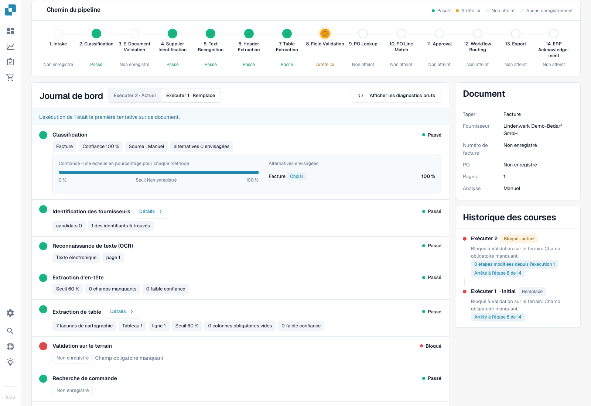
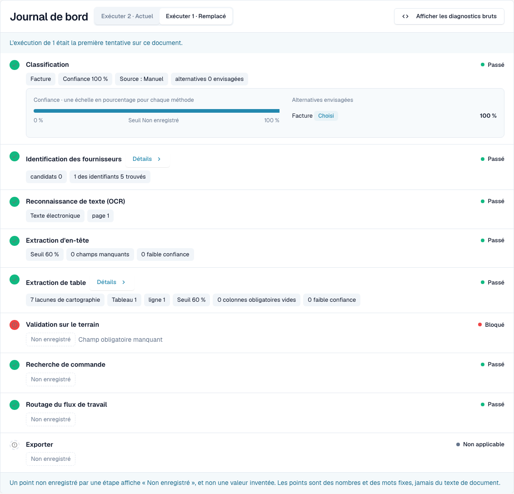
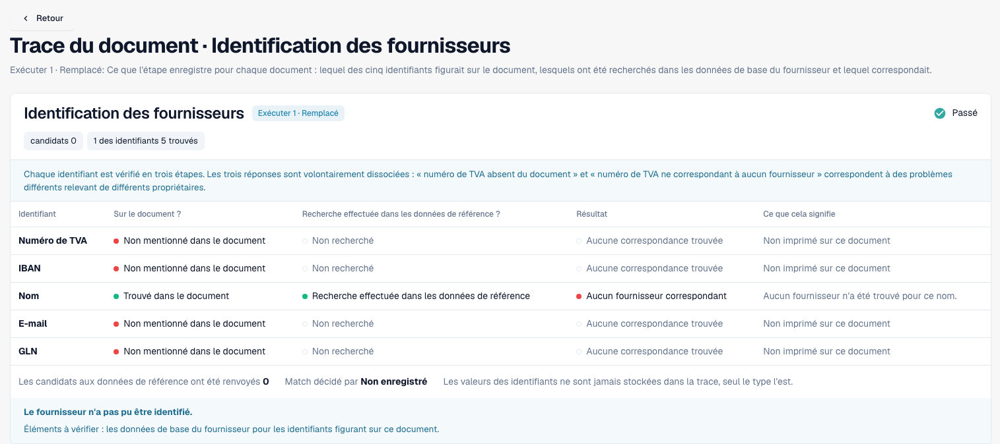
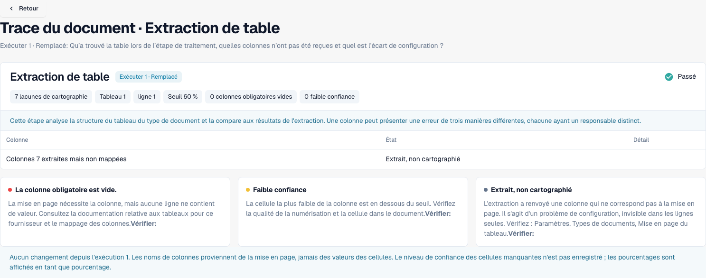
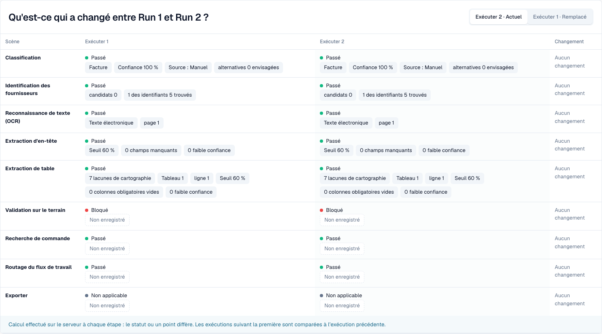

# Trace du document

<!-- touchless-admin-video-v2-20261104:start -->
**Chapitre vidéo (version de contrôle):** [Comparer les exécutions](https://docbits-videos.fra1.cdn.digitaloceanspaces.com/settings-assistant/touchless-intelligence-preview-admin/v2/fr.html#chapter=08).
<!-- touchless-admin-video-v2-20261104:end -->

Saisissez un identifiant de document dans **Document ID**, ou ouvrez un document d'exemple depuis un cluster, pour voir **ce qui est arrivé à ce document précis**.

L'en-tête affiche le fichier, son statut (par exemple **In progress**), l'exécution que vous consultez et son premier blocage, ainsi qu'un bouton **Document** avec l'identifiant du document.

<figure><figcaption>
Nouvelle capture de Dev NOVA 11.0.3, 4 novembre 2026. La facture de test fictive s'arrête à la validation des champs. Classification, recherche de fournisseur, extraction d'en-tête et extraction de tableau contiennent de véritables points enregistrés ; les cartes montrent l'historique du document et des exécutions. Il s'agit bien de l'interface du produit en fonctionnement.
</figcaption></figure>

Le **Pipeline Path** montre 14 étapes : Intake, Classification, E-Document Validation, Supplier Identification, Text Recognition, Header Extraction, Table Extraction, Field Validation, PO Lookup, PO Line Match, Approval, Workflow Routing, Export, ERP Acknowledgement. Chaque étape porte un seul état :

| État | Signification |
| --- | --- |
| **Passed** (vert) | L'étape s'est déroulée correctement |
| **Stopped Here** (orange) | L'étape a bloqué le document |
| **Not reached** | Affiché après le premier blocage du chemin ; consultez le journal des étapes pour toute exécution supplémentaire enregistrée |
| **Nothing Recorded** (pointillés) | Aucune donnée n'a été enregistrée pour cette étape |
| **Not applicable** | L'étape ne s'applique pas à ce document |

### Journal des étapes

Le **Stage Log** sous le chemin liste les mêmes étapes avec ce que chacune a enregistré. Un point d'état et le mot d'état se trouvent à gauche et à droite de chaque ligne.

* Chaque valeur est une **puce de point** : un nombre avec son unité, par exemple **Confidence 100 %**, **Threshold 60 %**, **Failed rules 0**, **8 missing fields** ou **0 mapping gaps**. Les pourcentages s'affichent sous la forme `97 %`, jamais `0.97`.
* **Details** ouvre la liste complète des points enregistrés par une étape, y compris les alternatives qu'elle a examinées.
* L'étape qui a bloqué le document indique pourquoi, par exemple **Field validation failed**.
* Un point qu'aucune étape n'a enregistré s'affiche comme **Not recorded**, jamais comme une valeur inventée. Les points sont des nombres et des mots fixes, jamais du texte du document.
* **Show Raw Diagnostics** active les données brutes lorsque le support le demande.

<figure><figcaption>
Première exécution réelle : confiance de classification de 100 %, 0 candidat fournisseur, 1 ligne de tableau et 7 écarts de mappage. Passed signifie qu'une étape s'est exécutée ; cela ne prouve ni une correspondance de fournisseur ni que chaque valeur de la facture est correcte. La validation des champs signale un champ obligatoire manquant.
</figcaption></figure>

### Exécutions et changements

Utilisez le sélecteur d'exécution pour choisir une tentative. Run History liste son résultat et son premier blocage. Les différences enregistrées comparent l'exécution sélectionnée avec la précédente, pas automatiquement avec l'exécution actuelle. Un badge de différence inclut son unité ; les points inchangés restent inchangés.

La carte Document liste le type de document, le fournisseur, le numéro de facture, le bon de commande, les pages et la méthode d'analyse enregistrée. Ici, Manual reflète le type de document fourni lors de l'import de test. La valeur de classification de 100 % n'est donc pas une preuve indépendante de la précision d'une classification automatique.

### Lire les détails du fournisseur et du tableau

<figure><figcaption>
Cette exécution trouve le nom du fournisseur sur la facture et interroge les données de référence, mais n'attribue aucun fournisseur. Le numéro de TVA, l'IBAN, l'e-mail et le GLN sont absents de cette facture de test. Une correspondance de données de référence manquante est un diagnostic différent d'une valeur de facture manquante.
</figcaption></figure>

Vérifiez trois questions distinctes : un identifiant a-t-il été trouvé sur le document, a-t-il été recherché, et un fournisseur a-t-il été mis en correspondance ? Une étape verte seule ne répond pas à ces questions.

<figure><figcaption>
Les détails du tableau signalent 7 écarts de mappage pour 1 tableau et 1 ligne. Vérifiez le mappage des colonnes avant de conclure que l'extraction a échoué. Le pied de comparaison n'est pas une base valable pour l'exécution initiale sélectionnée, qui n'a pas de prédécesseur.
</figcaption></figure>

### Reconnaître une véritable relance

<figure><figcaption>
La même facture de test après une véritable relance manuelle, sans correction des champs de facture. Une nouvelle exécution prouve une nouvelle tentative, pas une amélioration. Les points inchangés affichent No change ; aucun badge de différence n'a été inventé.
</figcaption></figure>

Une relance manuelle est une intervention humaine. Seule une fin réussie ultérieure classerait ce cas en AP assisted. Tant qu'il reste en cours, il est exclu du dénominateur des documents terminés.

Limites des preuves. Ce cas ne démontre ni approbation métier, ni export réussi, ni accusé de réception ERP. L'ancien matcher PO ne fournit ici aucun chemin de décision enregistré ; ce n'est pas une preuve de comparaison Infor. Dans NOVA 11.0.3, le journal des étapes peut enregistrer une recherche de PO réussie après une validation des champs bloquée, alors que le chemin l'indique comme Not reached. Vérifiez les deux vues. Le résumé affiche aussi le numéro de facture comme Not recorded alors que l'extraction le contient ; utilisez les champs d'origine et extraits pour une comparaison de valeurs.

## Distinguer extraction et données du système source

1. Ouvrez la **facture d'origine** et comparez ses champs d'en-tête et ses lignes avec ce que DocBits a extrait. Lors de l'analyse d'une exécution antérieure, utilisez les valeurs d'avant la correction d'une personne. Une valeur actuelle corrigée n'établit pas ce qui a été extrait à l'origine.
2. Lisez le premier blocage de la trace. Une étape d'extraction réussie signifie que l'étape s'est terminée ; elle ne certifie pas que chaque valeur correspond à la facture.
3. Pour un écart de PO, comparez les valeurs de la facture avec les **données de commande réellement disponibles pour DocBits** et avec l'enregistrement Infor correspondant. Incluez les unités, les unités de prix, les quantités et l'heure d'import.
4. Consignez la différence confirmée : **facture vs extraction**, **extraction correcte vs données source importées**, ou **Infor vs sa copie importée**. Laissez la cause ouverte si les preuves nécessaires ne sont pas enregistrées.
5. Consultez l'historique des exécutions pour une correction manuelle, une approbation ou une relance, ainsi que le résultat final. Le résultat et la cause répondent à des questions différentes.

**Exemple.** La facture et la valeur extraite indiquent toutes deux 10,00 €, alors que la commande importée indique 9,00 €. Cela établit un écart avec les données de commande, pas une erreur d'extraction. Confirmez quel prix a été convenu et si c'est Infor lui-même ou sa copie importée qui doit être corrigé. Si AP relance manuellement la facture et qu'elle se termine ensuite correctement, elle est AP assisted malgré l'extraction correcte. Voir les [exemples pratiques et le calcul](./#example-100-correct-extraction-80-ap-touchless).

**Champs manquants répétés.** Plusieurs documents qui s'arrêtent à Field Validation établissent un blocage répété. Les causes possibles incluent l'extraction, une valeur de facture réellement absente, une règle de validation ou une valeur par défaut configurée manquante. Comparez les preuves avant de choisir une correction ; la répétition seule ne prouve aucune cause en particulier.

## Prouver l'extraction d'origine avant de conclure

1. Ouvrez **Document** depuis cette trace et vérifiez l'identifiant du document et l'exécution sélectionnée. Comparez le numéro de PO, la devise, les quantités, les unités, les unités de prix, les prix unitaires, les montants de ligne et les totaux pertinents d'origine avec les champs et tableaux de validation.
2. Distinguez les valeurs actuelles de l'extraction d'avant une correction. Pour une facture déjà modifiée, utilisez un enregistrement historique de champ correspondant ou les preuves d'extraction de cette exécution. Changer d'exécution ne garantit pas la reconstruction de chaque ancien champ et de chaque ancienne cellule.
3. Si la valeur extraite d'origine est indisponible, consignez-la comme **not assessable**, et non comme correcte. Définissez les champs, la couverture des lignes, la sélection de l'échantillon et sa taille avant de rapporter un résultat indépendant de qualité d'extraction.
4. Comparez les valeurs de PO importées et l'horodatage d'import avec les valeurs Infor actuelles. Cela distingue des données source incorrectes d'une copie obsolète.

Des blocages successifs sont possibles : l'exécution 1 peut s'arrêter parce qu'un PO n'est pas encore arrivé ; après l'import, l'exécution 2 peut révéler un écart de prix. Ni l'une ni l'autre ne prouve que la première exécution a atteint le contrôle ultérieur. Une relance manuelle subsiste après la réussite en tant qu'AP assisted ; un rejet final de l'ERP prime en revanche comme exception de processus. **Not recorded** signifie une preuve manquante, pas un contrôle réussi.

Voir [Touchless avec MCP](touchless-mcp.md) pour les appels d'outils correspondants et la classification des actions humaines.

## Pages associées

* [Touchless Intelligence](./)
* [Diagnostic fournisseur et clusters de problèmes](../../touchless-supplier-diagnosis.md)
* [Diagnostic du rapprochement avec le BC](../../touchless-po-matching-diagnosis.md)

<!-- Documentation review 2026-11-04: extraction quality vs process outcomes; KPI and terminal-outcome definitions checked against DocBits_API c51f350c728acb8ac964098d15f7b006bce273f4, module/automation_intelligence/kpi.py and bucket.py. Existing native screenshots retained and checked separately from illustrative examples. -->

<!-- Completion review 2026-11-04: owned synthetic PO examples, MCP schema/read evidence, human-action classification, KPI labels and screenshot proof limits. -->

Les cinq nouvelles captures de trace montrent l'interface localisée de Dev NOVA 11.0.3 et la même facture de test créée pour nous. Toute image séparée comparant original et champ reste une illustration limitée de cette comparaison.
