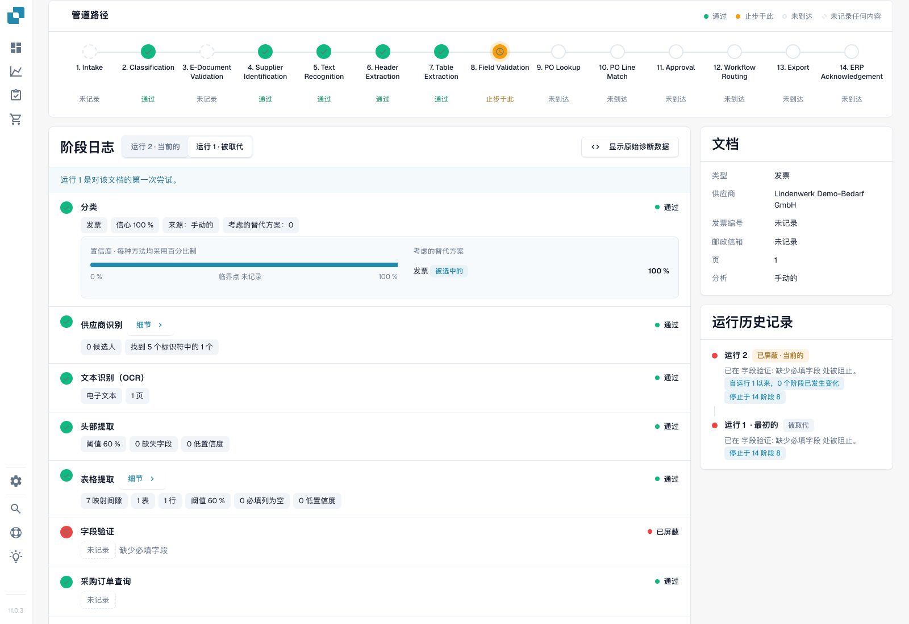
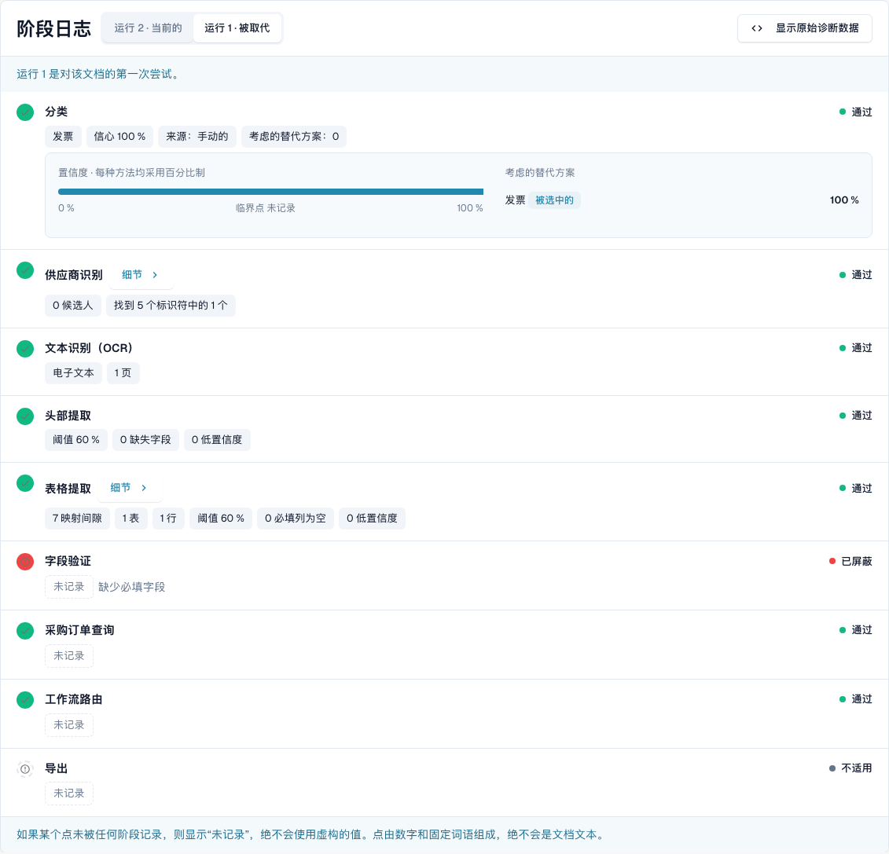
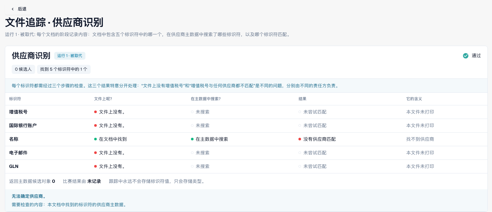
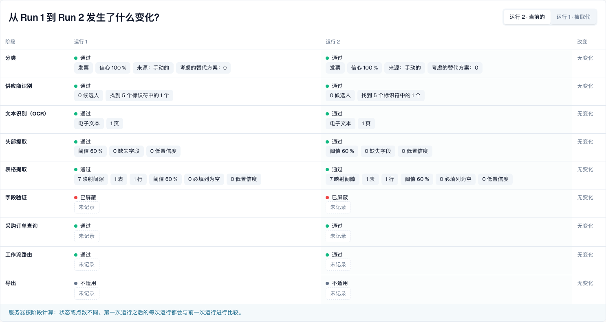

# 文档追踪

<!-- touchless-admin-video-v2-20261104:start -->
**视频章节（审核版）：** [比较运行](https://docbits-videos.fra1.cdn.digitaloceanspaces.com/settings-assistant/touchless-intelligence-preview-admin/v2/zh.html#chapter=08)。
<!-- touchless-admin-video-v2-20261104:end -->

在 **Document ID** 中输入文档 ID，或从某个问题集群中打开示例文档，即可查看**这一份文档发生了什么**。

页眉显示文件、其状态（例如 **In progress**）、您正在查看的运行及其首个阻塞点，以及一个带文档 ID 的 **Document** 按钮。

<figure><figcaption>
2026 年十一月 4 日从 Dev NOVA 11.0.3 的新采集。虚构的测试发票停在字段校验。分类、供应商查找、表头提取和表格提取包含真实记录的数据点；卡片显示文档和运行历史。这是正在运行的产品界面。
</figcaption></figure>

**Pipeline Path** 显示 14 个阶段：Intake、Classification、E-Document Validation、Supplier Identification、Text Recognition、Header Extraction、Table Extraction、Field Validation、PO Lookup、PO Line Match、Approval、Workflow Routing、Export、ERP Acknowledgement。每个阶段带有一种状态：

| 状态 | 含义 |
| --- | --- |
| **Passed**（绿色） | 该阶段已正常执行 |
| **Stopped Here**（橙色） | 该阶段阻塞了文档 |
| **Not reached** | 显示在路径中首个阻塞点之后；请查看阶段日志，了解是否还有额外记录的执行 |
| **Nothing Recorded**（虚线） | 该阶段没有记录任何数据 |
| **Not applicable** | 该阶段不适用于此文档 |

在追踪提供该视图的位置，选择 **PO Match** 步骤即可打开 PO Match 明细视图，其中包含该步骤背后的订单行。

### 阶段日志

路径下方的 **Stage Log** 列出相同的阶段以及各阶段记录的内容。每一行的左右两侧分别是状态圆点和状态词。

* 每个值都是一个**数据点标签**：带单位的数字，例如 **Confidence 100 %**、**Threshold 60 %**、**Failed rules 0**、**8 missing fields** 或 **0 mapping gaps**。百分比显示为 `97 %`，绝不显示为 `0.97`。
* **Details** 会展开某个阶段记录的完整数据点列表，包括它考虑过的备选值。
* 阻塞该文档的阶段会说明原因，例如 **Field validation failed**。
* **Intake** 条目说明文档如何进入 DocBits，例如在某一天通过电子邮件到达。当运行记录了自己的 Intake 阶段时，该句出现在该行，而不是单独的条目。
* 没有任何阶段记录的数据点显示为 **Not recorded**，绝不显示为编造的值。数据点是数字和固定词汇，绝不是文档正文。
* **Show Raw Diagnostics** 在支持人员需要时打开原始数据。

<figure><figcaption>
实际的首次运行：分类置信度 100%、0 个供应商候选、1 个表格行和 7 个映射缺口。Passed 表示某阶段已执行；它并不证明供应商匹配成功，也不证明每个发票值都正确。字段校验报告缺少必填字段。
</figcaption></figure>

### Pre-processing

对于最新一次运行，追踪会在路径下方增加 **Pre-processing** 区块。它按执行顺序列出在文档进入 Pipeline 之前运行的各项决策，并显示每项决策的状态：

| 状态 | 含义 |
| --- | --- |
| **Recorded** | 该模块在此文档的记录中。有记录只证明曾经尝试，并不证明成功。 |
| **Skipped** | 该决策不适用于此文档 |
| **Not recorded** | 该决策没有存储任何内容 |

如果某项决策取决于配置，该条目还会显示当前的组织设置及其值。该区块描述的是文档当前的状态，因此仅针对最新一次运行显示。

### 运行与变更

使用运行选择器选择一次尝试。Run History 列出其结果和首个阻塞点。已记录的差异会将所选运行与其前一次运行比较，而不是自动与当前运行比较。差异标记会带上单位；未变化的数据点保持不变。

Document 卡片列出文档类型、供应商、发票号、采购订单、页数以及记录的分析方法。此处的 Manual 反映测试导入时提供的文档类型。因此 100% 的分类值并不是自动分类准确率的独立证据。

### 查看供应商和表格详情

<figure><figcaption>
本次运行在发票上找到了供应商名称并查询主数据，但没有分配供应商。此测试发票中没有 VAT ID、IBAN、电子邮件地址和 GLN。主数据无匹配与发票值缺失属于不同的诊断结果。
</figcaption></figure>

请分别检查三个问题：文档上是否找到了标识、是否进行了查询，以及是否匹配到了供应商？仅有一个绿色阶段无法回答这些问题。

<figure><figcaption>
表格详情显示 1 个表格、1 行对应 7 个映射缺口。在断定提取失败之前，请先检查列映射。比较页脚不适用于所选的首次运行，因为它没有前一次运行。
</figcaption></figure>

### 识别真正的重启

<figure><figcaption>
同一张测试发票经过一次真实的人工重启，期间没有更正任何发票字段。新的运行只证明又尝试了一次，并不证明有所改善。未变化的数据点显示 No change；没有编造差异标记。
</figcaption></figure>

人工重启属于人工干预。只有后续成功完成，才会将此案例归为 AP Assisted。只要它仍在进行中，就不计入已完成文档的分母。

证据局限。此案例没有展示业务审批、成功导出或 ERP 确认。旧版 PO 匹配器在此没有记录决策路径；这不能作为 Infor 比较的证据。在 NOVA 11.0.3 中，阶段日志可以在字段校验受阻后仍记录 PO 查找通过，而路径却将其标为 Not reached。请两种视图都查看。摘要还会把发票号显示为 Not recorded，尽管提取结果中已有该值；进行值比较时请使用原始值和提取字段。

## 区分提取问题与源系统数据问题

1. 打开**原始发票**，将其表头字段和行项目与 DocBits 提取的内容比较。调查较早的运行时应使用人工更正前的值。当前已更正的值无法说明最初提取的是什么。
2. 阅读追踪中的首个阻塞点。提取阶段通过只表示该阶段已完成；它并不证明每个值都与发票一致。
3. 对于 PO 差异，请将发票值与 **DocBits 实际可用的订单数据**以及对应的 Infor 记录比较。包括单位、价格单位、数量和导入时间。
4. 记录已确认的差异：**invoice vs extraction**、**correct extraction vs imported source data**，或 **Infor vs its imported copy**。如果所需证据未被记录，请让原因保持未定。
5. 检查运行历史中是否存在人工更正、审批或重启，以及最终结果。结果和原因回答的是不同问题。

**示例。**发票和提取值都显示 €10.00，而导入的订单显示 €9.00。这确立的是与订单数据之间的差异，而不是提取错误。请确认约定的是哪个价格，以及需要更正的是 Infor 本身还是其导入副本。如果 AP 手动重启该发票并随后成功完成，那么尽管提取正确，它仍属于 AP assisted。参见[完整示例与计算](./)。

**反复出现的缺失字段。**多份文档停在 Field Validation，说明存在重复的阻塞点。可能原因包括提取问题、发票值确实缺失、校验规则，或缺少已配置的默认值。选择修复方式前请比较证据；仅凭重复本身无法证明其中任何一个原因。

## 得出结论前先证明原始提取

1. 从此追踪打开 **Document**，核实文档 ID 和所选运行。将原始 PO 号、币种、数量、单位、价格单位、单价、行金额和相关合计与校验字段及表格比较。
2. 在更正之前区分当前值与提取值。对于已经编辑过的发票，请使用匹配的历史字段记录或该运行的提取证据。切换运行并不保证能重建每一个旧字段和单元格。
3. 如果原始提取值不可用，请将其记录为**无法评估**，而不是正确。在报告独立的提取质量结果之前，先界定字段、行覆盖范围、样本选择和样本量。
4. 将导入的 PO 值和导入时间戳与当前 Infor 值比较。这可以区分源数据错误与副本过时。

阻塞点可能相继出现：第 1 次运行可能因 PO 尚未到达而停下；导入之后，第 2 次运行可能暴露出价格差异。两者都不能证明第一次运行到达了后面的检查。人工重启在成功后会以 AP Assisted 的形式保留；而最终的 ERP 拒收会优先作为流程异常处理。**Not recorded** 表示缺少证据，而不是检查通过。

关于对应的工具调用和人工操作的分类，参见 [Touchless with MCP](touchless-mcp.md)。

## 相关页面

* [Touchless Intelligence](./)
* [供应商诊断与问题集群](touchless-supplier-diagnosis.md)
* [PO 匹配诊断](touchless-po-matching-diagnosis.md)

<!-- Documentation review 2026-11-04: extraction quality vs process outcomes; KPI and terminal-outcome definitions checked against DocBits_API c51f350c728acb8ac964098d15f7b006bce273f4, module/automation_intelligence/kpi.py and bucket.py. Existing native screenshots retained and checked separately from illustrative examples. -->

<!-- Completion review 2026-11-04: owned synthetic PO examples, MCP schema/read evidence, human-action classification, KPI labels and screenshot proof limits. -->

这五张新的追踪截图展示本地化的 Dev NOVA 11.0.3 界面和同一张自建测试发票。任何单独的原件与字段对比图仍只是该比较的有限示例。
