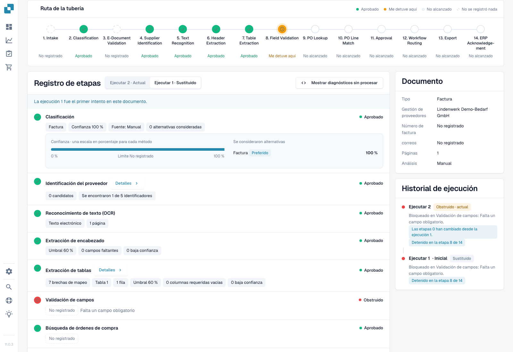
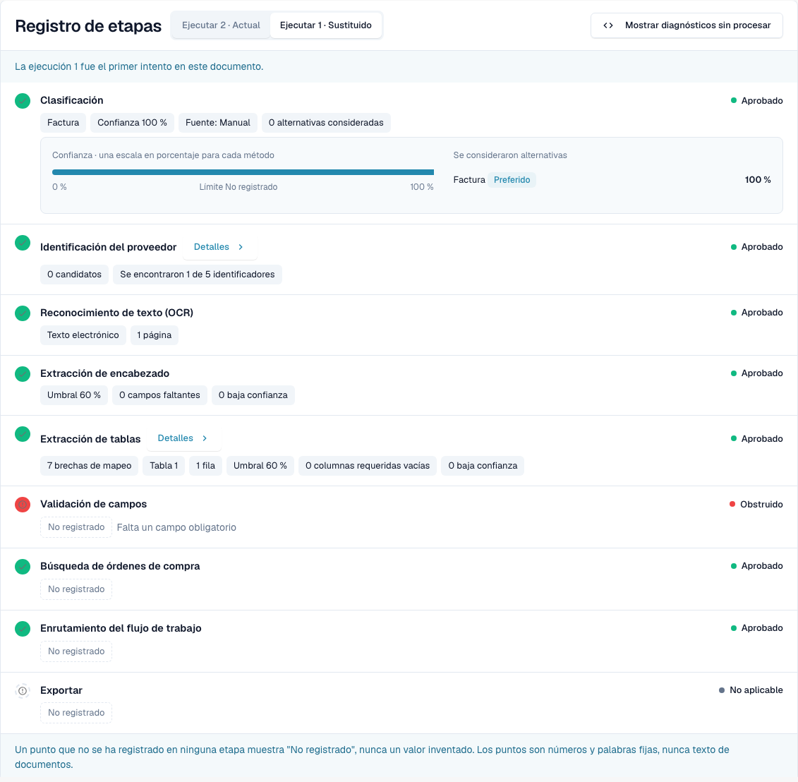
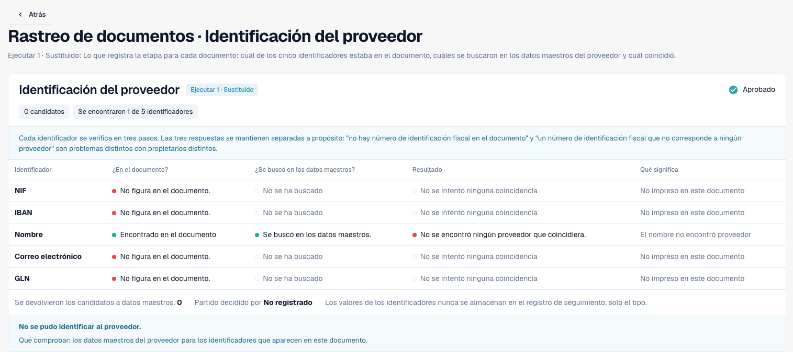
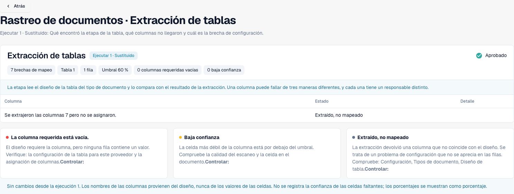
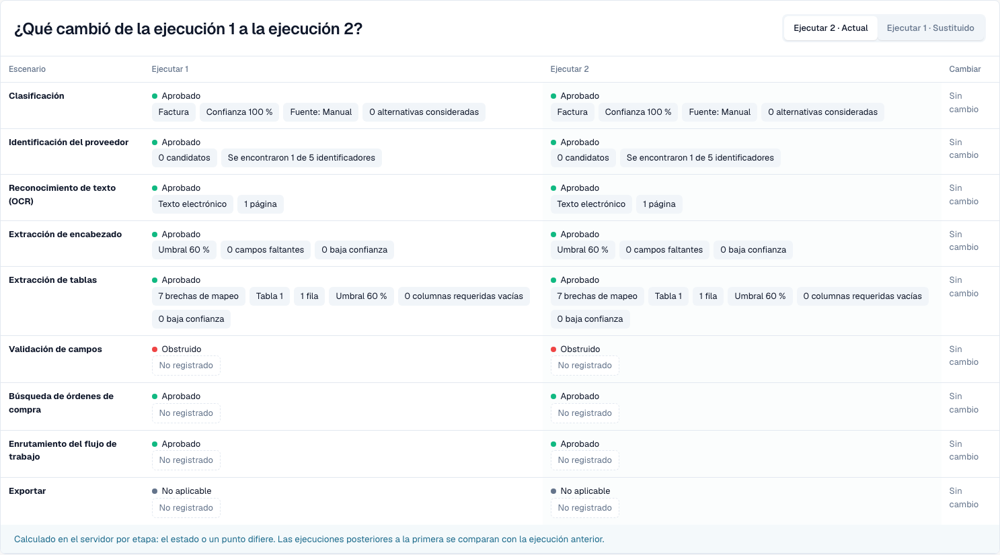

# Touchless Intelligence: Seguimiento del documento

<!-- touchless-admin-video-v2-20261104:start -->
**Capítulo del vídeo (versión de revisión):** [Comparar ejecuciones](https://docbits-videos.fra1.cdn.digitaloceanspaces.com/settings-assistant/touchless-intelligence-preview-admin/v2/es.html#chapter=08).
<!-- touchless-admin-video-v2-20261104:end -->

Introduzca un ID de documento en **Document ID**, o abra un documento de muestra desde un clúster, para ver **qué ocurrió con este documento**.

La cabecera muestra el archivo, su estado (por ejemplo **In progress**), la ejecución que está consultando y su primer bloqueo, y un botón **Document** con el ID del documento.

<figure><figcaption>
Nueva captura de Dev NOVA 11.0.3, del 4 de noviembre de 2026. La factura de prueba ficticia se detiene en la validación de campos. La clasificación, la búsqueda de proveedor, la extracción de cabecera y la extracción de tabla contienen puntos registrados reales; las tarjetas muestran el documento y el historial de ejecuciones. Es la interfaz del producto en funcionamiento.
</figcaption></figure>

El **Pipeline Path** muestra 14 etapas: Intake, Classification, E-Document Validation, Supplier Identification, Text Recognition, Header Extraction, Table Extraction, Field Validation, PO Lookup, PO Line Match, Approval, Workflow Routing, Export, ERP Acknowledgement. Cada etapa lleva un solo estado:

| Estado | Significado |
| --- | --- |
| **Passed** (verde) | La etapa se ejecutó sin problemas |
| **Stopped Here** (naranja) | La etapa bloqueó el documento |
| **Not reached** | Se muestra después del primer bloqueo de la ruta; compruebe el registro de etapas por si hay alguna ejecución adicional registrada |
| **Nothing Recorded** (discontinuo) | No se registraron datos para esta etapa |
| **Not applicable** | La etapa no se aplica a este documento |

Seleccione el paso **PO Match** para abrir el detalle de PO matching con las líneas de pedido que hay detrás de ese paso, donde el trace lo ofrece.

### Registro de etapas

El **Stage Log** situado bajo la ruta enumera las mismas etapas con lo que registró cada una. Un punto de estado y la palabra de estado aparecen a la izquierda y a la derecha de cada fila.

* Cada valor es una **point chip**: un número con su unidad, por ejemplo **Confidence 100 %**, **Threshold 60 %**, **Failed rules 0**, **8 missing fields** o **0 mapping gaps**. Los porcentajes se muestran como `97 %`, nunca como `0.97`.
* **Details** abre la lista completa de puntos que registró una etapa, incluidas las alternativas que consideró.
* La etapa que bloqueó el documento indica el motivo, por ejemplo **Field validation failed**.
* La entrada **Intake** indica cómo entró el documento en DocBits, por ejemplo que llegó por correo electrónico en una fecha determinada. Cuando la ejecución registra un estadio Intake propio, la frase aparece en esa fila en lugar de en una entrada separada.
* Un punto que ninguna etapa registró se muestra como **Not recorded**, nunca como un valor inventado. Los puntos son números y palabras fijas, nunca texto del documento.
* **Show Raw Diagnostics** activa los datos en bruto cuando el soporte lo solicita.

<figure><figcaption>
Primera ejecución real: 100 % de confianza de clasificación, 0 proveedores candidatos, 1 fila de tabla y 7 brechas de asignación. Que una etapa figure como aprobada significa que se ejecutó; no demuestra una coincidencia de proveedor ni que todos los valores de la factura sean correctos. La validación de campos informa de un campo obligatorio ausente.
</figcaption></figure>

### Pre-processing

Para la última ejecución, el seguimiento añade el bloque **Pre-processing** bajo la ruta. Enumera las decisiones que se ejecutan antes de que el documento llegue al pipeline, en el orden en que se ejecutaron, cada una con un estado:

| Estado | Significado |
| --- | --- |
| **Recorded** | El módulo figura en el registro de este documento. Un registro demuestra el intento, no el éxito. |
| **Skipped** | La decisión no se aplicaba a este documento |
| **Not recorded** | No se almacenó nada para esta decisión |

Cuando una decisión depende de una configuración, la entrada muestra también el ajuste actual de la organización y su valor. El bloque describe el documento tal como está ahora, por lo que solo se muestra para la última ejecución.

### Ejecuciones y cambios

Utilice el selector de ejecuciones para elegir un intento. El historial de ejecuciones muestra su resultado y su primer bloqueo. Las diferencias registradas comparan la ejecución seleccionada con su predecesora, no automáticamente con la ejecución actual. Cada insignia de diferencia incluye su unidad; los puntos sin cambios permanecen sin cambios.

La tarjeta Document lista el tipo de documento, el proveedor, el número de factura, el pedido de compra, las páginas y el método de análisis registrado. Aquí Manual refleja el tipo de documento indicado durante la importación de prueba. El valor de clasificación del 100 % no es, por tanto, una prueba independiente de la precisión de una clasificación automática.

### Leer los detalles de proveedor y tabla

<figure><figcaption>
Esta ejecución encuentra el nombre del proveedor en la factura y busca en los datos maestros, pero no asigna ningún proveedor. El NIF-IVA, el IBAN, el correo electrónico y el GLN no aparecen en esta factura de prueba. Una coincidencia ausente en los datos maestros es un diagnóstico distinto de un valor ausente en la factura.
</figcaption></figure>

Compruebe tres preguntas separadas: si se encontró un identificador en el documento, si se buscó y si se asignó un proveedor. Una etapa en verde por sí sola no las responde.

<figure><figcaption>
Los detalles de tabla informan de 7 brechas de asignación para 1 tabla y 1 fila. Compruebe la asignación de columnas antes de concluir que falló la extracción. El pie de comparación no es una base válida para la ejecución inicial seleccionada, que no tiene predecesora.
</figcaption></figure>

### Reconocer un reinicio real

<figure><figcaption>
La misma factura de prueba tras un reinicio manual real, sin corregir campos de la factura. Una nueva ejecución demuestra otro intento, no una mejora. Los puntos sin cambios muestran No change; no se han inventado insignias de diferencia.
</figcaption></figure>

Un reinicio manual es una intervención humana. Solo una finalización correcta posterior clasificaría este caso como AP Assisted. Mientras siga en proceso, queda excluido del denominador de documentos finalizados.

Límites de las pruebas. Este caso no demuestra aprobación de negocio, exportación correcta ni confirmación del ERP. El comparador de pedidos heredado no aporta aquí ninguna ruta de decisión registrada; esto no es prueba de una comparación con Infor. En NOVA 11.0.3, el registro de etapas puede registrar una búsqueda de pedido aprobada después de una validación de campos bloqueada, mientras la ruta la etiqueta como Not reached. Compruebe ambas vistas. El resumen también muestra el número de factura como Not recorded aunque la extracción lo contiene; utilice la factura original y los campos extraídos para comparar el valor.

## Distinguir la extracción de los datos del sistema de origen

1. Abra la **factura original** y compare sus campos de cabecera y sus líneas con lo que extrajo DocBits. Utilice los valores anteriores a la corrección de una persona cuando investigue una ejecución anterior. Un valor corregido actual no establece lo que se extrajo originalmente.
2. Lea el primer bloqueo del seguimiento. Una etapa de extracción aprobada significa que la etapa se completó; no certifica que todos los valores coincidan con la factura.
3. Para una discrepancia de pedido, compare los valores de la factura con los **datos del pedido de los que DocBits dispone realmente** y con el registro correspondiente de Infor. Incluya las unidades, las unidades de precio, las cantidades y el momento de la importación.
4. Registre la diferencia confirmada: **factura frente a extracción**, **extracción correcta frente a datos de origen importados**, o **Infor frente a su copia importada**. Deje la causa abierta si no se registran las pruebas necesarias.
5. Revise el historial de ejecuciones en busca de una corrección manual, una aprobación o un reinicio, y el resultado final. El resultado y la causa responden a preguntas distintas.

**Ejemplo.** La factura y el valor extraído indican 10,00 €, mientras que el pedido importado indica 9,00 €. Esto establece una discrepancia con los datos del pedido, no un error de extracción. Confirme qué precio se acordó y si hay que corregir Infor o su copia importada. Si AP reinicia la factura manualmente y después termina correctamente, es AP assisted pese a la extracción correcta. Véanse los [ejemplos completos y el cálculo](touchless-metrics.md#ejemplo-100-de-extracción-correcta-80-de-ap-touchless).

**Campos ausentes repetidos.** Varios documentos que se detienen en Field Validation establecen un bloqueo repetido. Entre las causas posibles están la extracción, un valor realmente ausente en la factura, una regla de validación o un valor predeterminado configurado que falta. Compare las pruebas antes de elegir una corrección; la repetición por sí sola no demuestra ninguna causa concreta.

## Acreditar la extracción original antes de sacar conclusiones

1. Abra el **Document** desde este seguimiento y verifique el ID del documento y la ejecución seleccionada. Compare el número de pedido, la moneda, las cantidades, las unidades, las unidades de precio, los precios unitarios, los importes de línea y los totales relevantes del original con los campos y las tablas de validación.
2. Distinga los valores actuales de los de la extracción anterior a una corrección. Para una factura ya editada, utilice un registro histórico de campo coincidente o pruebas de extracción de esa ejecución. Cambiar de ejecución no promete reconstruir todos los campos y celdas antiguos.
3. Si el valor extraído original no está disponible, regístrelo como **no evaluable**, no como correcto. Defina los campos, la cobertura de líneas, la selección y el tamaño de la muestra antes de informar de un resultado independiente de calidad de extracción.
4. Compare los valores del pedido importado y la marca de tiempo de la importación con los valores actuales de Infor. Esto separa unos datos de origen incorrectos de una copia desactualizada.

Los bloqueos sucesivos son posibles: la ejecución 1 puede detenerse porque un pedido aún no ha llegado; tras la importación, la ejecución 2 puede revelar una discrepancia de precio. Ninguna de las dos demuestra que la primera ejecución llegara a la comprobación posterior. Un reinicio manual persiste tras el éxito como AP Assisted; un rechazo definitivo del ERP tiene prioridad como excepción de proceso. **Not recorded** significa pruebas ausentes, no una comprobación superada.

Véase [Touchless con MCP](touchless-mcp.md) para conocer las llamadas de herramienta correspondientes y la clasificación de las acciones humanas.

## Páginas relacionadas

* [Touchless Intelligence](./)
* [Touchless Intelligence: Diagnóstico de proveedores y clústeres de problemas](touchless-supplier-diagnosis.md)
* [Touchless Intelligence: Diagnóstico de la coincidencia con la OC](touchless-po-matching-diagnosis.md)

<!-- Documentation review 2026-11-04: extraction quality vs process outcomes; KPI and terminal-outcome definitions checked against DocBits_API c51f350c728acb8ac964098d15f7b006bce273f4, module/automation_intelligence/kpi.py and bucket.py. Existing native screenshots retained and checked separately from illustrative examples. -->

<!-- Completion review 2026-11-04: owned synthetic PO examples, MCP schema/read evidence, human-action classification, KPI labels and screenshot proof limits. -->

Las cinco nuevas capturas del seguimiento muestran la interfaz localizada de Dev NOVA 11.0.3 y la misma factura de prueba propia. Cualquier imagen separada de original frente a campos sigue siendo una ilustración limitada de esa comparación.
