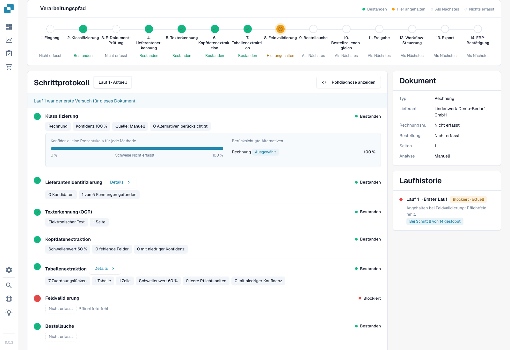
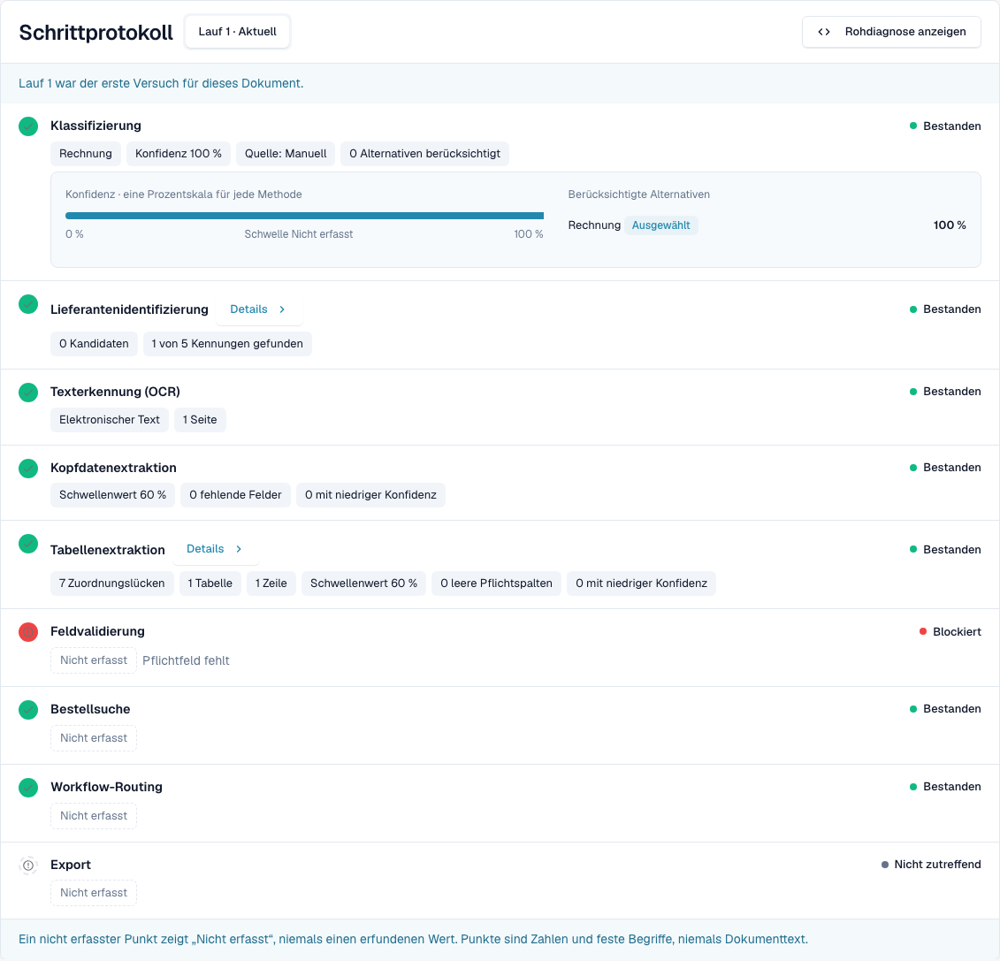
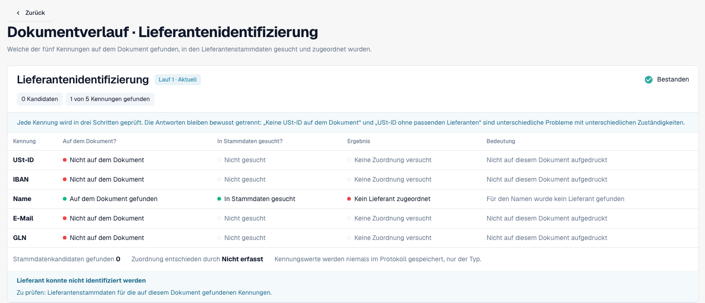
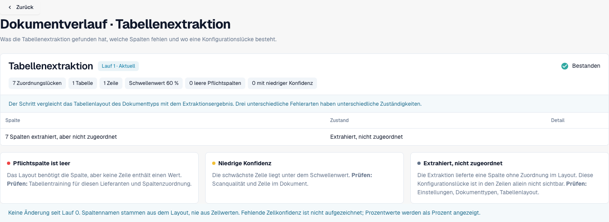
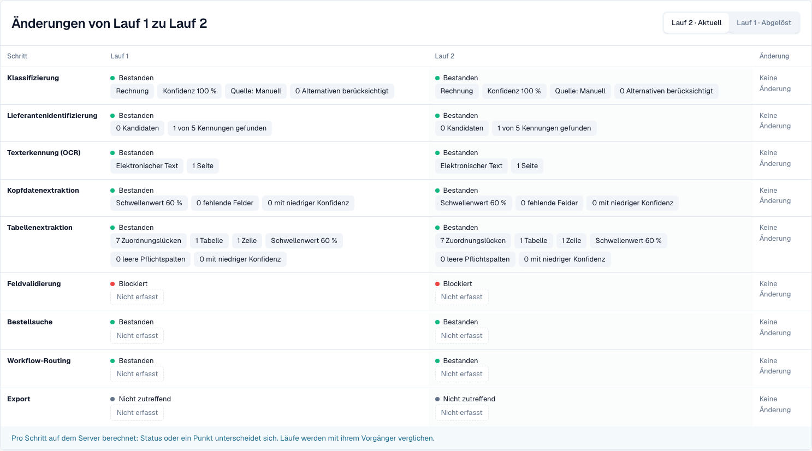

# Dokumentverlauf

<!-- touchless-admin-video-v2-20261104:start -->
**Video-Kapitel (Prüffassung):** [Läufe vergleichen](https://docbits-videos.fra1.cdn.digitaloceanspaces.com/settings-assistant/touchless-intelligence-preview-admin/v2/de.html#chapter=08).
<!-- touchless-admin-video-v2-20261104:end -->

Geben Sie eine Dokument-ID in **Document ID** ein oder öffnen Sie ein Beispieldokument aus einem Fehlermuster, um zu sehen, **was mit genau diesem Dokument passiert ist**.

Die Kopfzeile zeigt die Datei, ihren Status (zum Beispiel **In progress**), den Lauf, den Sie gerade ansehen, und dessen ersten Blocker sowie eine Schaltfläche **Document** mit der Dokument-ID.

<figure><figcaption>
Neue Aufnahme aus Dev NOVA 11.0.3 vom 4. November 2026. Die fiktive Testrechnung stoppt bei der Feldvalidierung. Klassifizierung, Lieferantensuche, Kopfdatenextraktion und Tabellenextraktion enthalten tatsächlich aufgezeichnete Werte; die Karten zeigen Dokument und Laufhistorie. Dies ist die laufende Oberfläche des Produkts.
</figcaption></figure>

Der **Pipeline Path** zeigt 14 Schritte: Intake, Classification, E-Document Validation, Supplier Identification, Text Recognition, Header Extraction, Table Extraction, Field Validation, PO Lookup, PO Line Match, Approval, Workflow Routing, Export, ERP Acknowledgement. Jeder Schritt trägt genau einen Zustand:

| Zustand | Bedeutung |
| --- | --- |
| **Passed** (grün) | Der Schritt lief fehlerfrei |
| **Stopped Here** (orange) | Der Schritt hat das Dokument blockiert |
| **Not reached** | Wird im Pfad nach dem ersten Blocker angezeigt; prüfen Sie das Stage Log auf weitere aufgezeichnete Ausführungen |
| **Nothing Recorded** (gestrichelt) | Für diesen Schritt wurden keine Daten aufgezeichnet |
| **Not applicable** | Der Schritt gilt für dieses Dokument nicht |

Wählen Sie den Schritt **PO Match**, um die PO-Match-Detailansicht mit den Auftragszeilen hinter diesem Schritt zu öffnen, wo der Verlauf sie anbietet.

### Stage Log

Das **Stage Log** unter dem Pfad listet dieselben Schritte mit dem auf, was jeder von ihnen aufgezeichnet hat. Ein Statuspunkt und das Statuswort stehen links und rechts in jeder Zeile.

* Jeder Wert ist ein **point chip**: eine Zahl mit ihrer Einheit, zum Beispiel **Confidence 100 %**, **Threshold 60 %**, **Failed rules 0**, **8 missing fields** oder **0 mapping gaps**. Prozentwerte erscheinen als `97 %`, nie als `0.97`.
* **Details** öffnet die vollständige Liste der Werte, die ein Schritt aufgezeichnet hat, einschließlich der geprüften Alternativen.
* Der Schritt, der das Dokument blockiert hat, nennt den Grund, zum Beispiel **Field validation failed**.
* Der Eintrag **Intake** sagt, wie das Dokument in DocBits gelangt ist, zum Beispiel dass es an einem bestimmten Datum per E-Mail eingegangen ist. Zeichnet der Lauf ein eigenes Intake-Stadium auf, steht der Satz in dieser Zeile statt in einem separaten Eintrag.
* Ein Wert, den kein Schritt aufgezeichnet hat, erscheint als **Not recorded**, nie als erfundener Wert. Werte sind Zahlen und feste Begriffe, nie Dokumenttext.
* **Show Raw Diagnostics** blendet die Rohdaten ein, wenn der Support danach fragt.

<figure><figcaption>
Echter erster Lauf: 100 % Klassifizierungskonfidenz, 0 Lieferantenkandidaten, 1 Tabellenzeile und 7 Mapping-Lücken. Passed bedeutet, dass ein Schritt ausgeführt wurde; es belegt weder eine Lieferantenzuordnung noch die Richtigkeit jedes Rechnungswertes. Die Feldvalidierung meldet ein fehlendes Pflichtfeld.
</figcaption></figure>

### Läufe und Änderungen

Mit der Laufauswahl wählen Sie einen Versuch. **Run History** listet dessen Ergebnis und ersten Blocker. Aufgezeichnete Unterschiede vergleichen den gewählten Lauf mit seinem Vorgänger, nicht automatisch mit dem aktuellen Lauf. Ein Differenz-Abzeichen enthält seine Einheit; unveränderte Werte bleiben unverändert.

Die Karte **Document** listet Dokumenttyp, Lieferant, Rechnungsnummer, Bestellung, Seiten und die aufgezeichnete Analysemethode. Hier gibt **Manual** den beim Testimport vorgegebenen Dokumenttyp wieder. Der Klassifizierungswert von 100 % ist daher kein unabhängiger Nachweis einer automatischen Klassifizierungsgenauigkeit.

### Lieferanten- und Tabellendetails lesen

<figure><figcaption>
Dieser Lauf findet den Lieferantennamen auf der Rechnung und durchsucht die Stammdaten, ordnet aber keinen Lieferanten zu. USt-ID, IBAN, E-Mail und GLN fehlen auf dieser Testrechnung. Ein fehlender Stammdatentreffer ist eine andere Diagnose als ein fehlender Rechnungswert.
</figcaption></figure>

Prüfen Sie drei getrennte Fragen: Wurde eine Kennung auf dem Dokument gefunden, wurde sie nachgeschlagen, und wurde ein Lieferant zugeordnet? Ein grüner Schritt allein beantwortet sie nicht.

<figure><figcaption>
Die Tabellendetails melden 7 Mapping-Lücken für 1 Tabelle und 1 Zeile. Prüfen Sie die Spaltenzuordnung, bevor Sie auf einen fehlgeschlagenen Auslesevorgang schließen. Die Vergleichsfußzeile ist für den gewählten ersten Lauf keine gültige Vergleichsbasis, weil er keinen Vorgänger hat.
</figcaption></figure>

### Einen echten Neustart erkennen

<figure><figcaption>
Dieselbe Testrechnung nach einem echten manuellen Neustart, ohne korrigierte Rechnungsfelder. Ein neuer Lauf belegt einen weiteren Versuch, keine Verbesserung. Unveränderte Werte zeigen No change; es wurden keine Differenz-Abzeichen erfunden.
</figcaption></figure>

Ein manueller Neustart ist ein menschlicher Eingriff. Erst ein späterer erfolgreicher Abschluss würde diesen Fall als AP Assisted einordnen. Solange er in Bearbeitung bleibt, ist er vom Nenner der abgeschlossenen Dokumente ausgeschlossen.

Grenzen der Nachweise. Dieser Fall belegt keine fachliche Freigabe, keinen erfolgreichen Export und keine ERP-Bestätigung. Der Legacy-PO-Matcher liefert hier keinen aufgezeichneten Entscheidungsweg; das ist kein Nachweis eines Infor-Abgleichs. In NOVA 11.0.3 kann das Stage Log nach einer blockierten Feldvalidierung einen bestandenen PO-Lookup aufzeichnen, während der Pfad ihn als Not reached kennzeichnet. Prüfen Sie beide Ansichten. Die Zusammenfassung zeigt die Rechnungsnummer außerdem als Not recorded, obwohl die Auslesung sie enthält; nutzen Sie für einen Wertevergleich Original und ausgelesene Felder.

## Auslesung und Daten des Quellsystems unterscheiden

1. Öffnen Sie die **Originalrechnung** und vergleichen Sie ihre Kopffelder und Positionen mit dem, was DocBits ausgelesen hat. Verwenden Sie bei der Untersuchung eines früheren Laufs die Werte vor einer manuellen Korrektur. Ein heute korrigierter Wert belegt nicht, was ursprünglich ausgelesen wurde.
2. Lesen Sie den ersten Blocker im Verlauf. Ein bestandener Extraktionsschritt bedeutet, dass der Schritt abgeschlossen wurde; er bestätigt nicht, dass jeder Wert mit der Rechnung übereinstimmt.
3. Vergleichen Sie bei einer Bestellabweichung die Rechnungswerte mit den **tatsächlich in DocBits verfügbaren Bestelldaten** und dem zugehörigen Infor-Datensatz. Berücksichtigen Sie Einheiten, Preiseinheiten, Mengen und den Importzeitpunkt.
4. Halten Sie den bestätigten Unterschied fest: **invoice vs extraction**, **correct extraction vs imported source data** oder **Infor vs its imported copy**. Fehlen die erforderlichen Nachweise, bleibt die Ursache offen.
5. Prüfen Sie die Laufhistorie auf eine manuelle Korrektur, eine Freigabe oder einen Neustart sowie auf das Endergebnis. Endergebnis und Ursache beantworten unterschiedliche Fragen.

**Beispiel.** Rechnung und ausgelesener Wert nennen beide 10,00 €, die importierte Bestellung nennt 9,00 €. Das belegt eine Abweichung zu den Bestelldaten, keinen Auslesefehler. Klären Sie, welcher Preis vereinbart war und ob Infor selbst oder die importierte Kopie korrigiert werden muss. Startet AP die Rechnung manuell neu und schließt sie anschließend erfolgreich ab, ist sie trotz korrekter Auslesung AP assisted. Siehe die [Praxisbeispiele und Berechnung](touchless-examples.md).

**Wiederholt fehlende Felder.** Mehrere Dokumente, die bei Field Validation stehen bleiben, belegen einen wiederkehrenden Blocker. Mögliche Ursachen sind die Extraktion, ein tatsächlich fehlender Rechnungswert, eine Validierungsregel oder ein fehlender konfigurierter Standardwert. Vergleichen Sie die Nachweise, bevor Sie eine Behebung wählen; die Wiederholung allein beweist keine dieser Ursachen.

## Die ursprüngliche Auslesung belegen, bevor Sie Schlüsse ziehen

1. Öffnen Sie **Document** aus diesem Verlauf und prüfen Sie Dokument-ID und gewählten Lauf. Vergleichen Sie Original-Bestellnummer, Währung, Mengen, Einheiten, Preiseinheiten, Stückpreise, Positionsbeträge und relevante Summen mit den Feldern und Tabellen der Validierung.
2. Unterscheiden Sie aktuelle Werte von der Auslesung vor einer Korrektur. Nutzen Sie bei einer bereits bearbeiteten Rechnung einen passenden historischen Felddatensatz oder einen Auslesenachweis für diesen Lauf. Der Wechsel zwischen Läufen verspricht keine Rekonstruktion jedes alten Feldes und jeder Zelle.
3. Ist der ursprünglich ausgelesene Wert nicht verfügbar, halten Sie ihn als **not assessable** fest, nicht als korrekt. Legen Sie Felder, Positionsabdeckung, Stichprobenauswahl und Stichprobengröße fest, bevor Sie ein unabhängiges Ergebnis zur Auslesequalität berichten.
4. Vergleichen Sie importierte Bestellwerte und Importzeitstempel mit den aktuellen Infor-Werten. Das trennt falsche Quelldaten von einer veralteten Kopie.

Aufeinanderfolgende Blocker sind möglich: Lauf 1 kann stoppen, weil eine Bestellung noch nicht eingetroffen ist; nach dem Import kann Lauf 2 eine Preisabweichung zeigen. Keines von beiden belegt, dass der erste Lauf die spätere Prüfung erreicht hat. Ein manueller Neustart bleibt nach dem Erfolg als AP Assisted bestehen; eine endgültige ERP-Ablehnung hat stattdessen als Prozessausnahme Vorrang. **Not recorded** bedeutet fehlender Nachweis, nicht eine bestandene Prüfung.

Die zugehörigen Werkzeugaufrufe und die Einordnung menschlicher Aktionen sind unter [Touchless mit MCP](touchless-mcp.md) beschrieben.

## Weiterführende Seiten

* [Touchless Intelligence](./)
* [Lieferantendiagnose und Fehlermuster](touchless-supplier-diagnosis.md)
* [Bestellabgleich-Diagnose](touchless-po-matching-diagnosis.md)

<!-- Documentation review 2026-11-04: extraction quality vs process outcomes; KPI and terminal-outcome definitions checked against DocBits_API c51f350c728acb8ac964098d15f7b006bce273f4, module/automation_intelligence/kpi.py and bucket.py. Existing native screenshots retained and checked separately from illustrative examples. -->

<!-- Completion review 2026-11-04: owned synthetic PO examples, MCP schema/read evidence, human-action classification, KPI labels and screenshot proof limits. -->

Die fünf neuen Verlaufsscreenshots zeigen die lokalisierte Oberfläche von Dev NOVA 11.0.3 und denselben eigens angelegten Testbeleg. Ein separates Bild zu Original und angezeigtem Feld bleibt eine begrenzte Veranschaulichung dieses Vergleichs.
