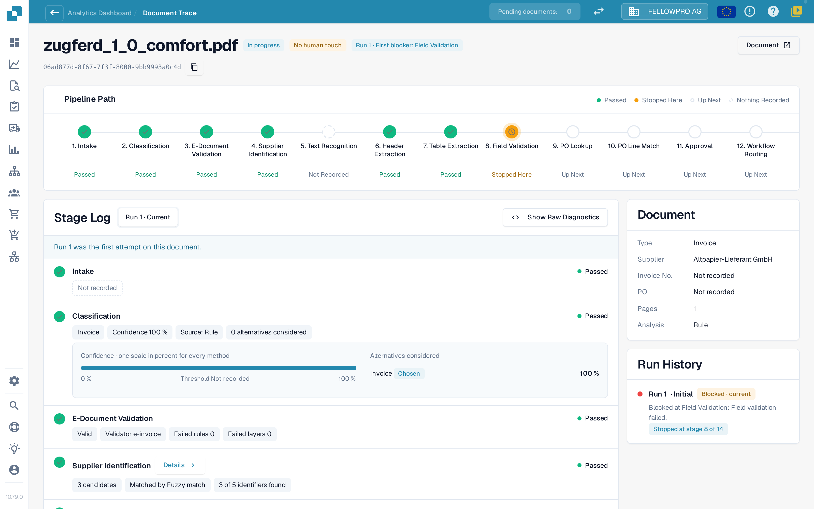
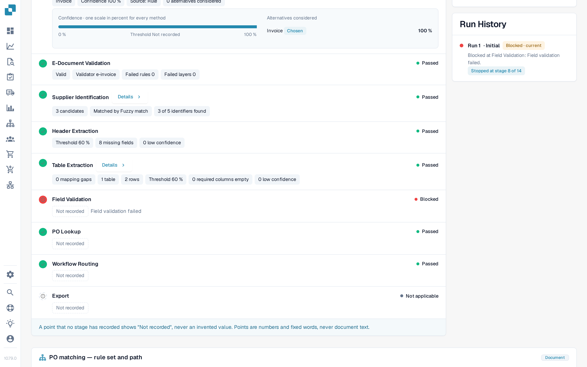

# Document Trace

Enter a document ID in **Document ID**, or open a sample document from a cluster, to see **what happened to this one document**.

The header shows the file, its status (for example **In progress**), the run you are looking at and its first blocker, and a **Document** button with the document ID.

<figure><figcaption>
The Document Trace: the Pipeline Path with every stage, and the Stage Log with the details each stage recorded.
</figcaption></figure>

The **Pipeline Path** shows 14 stages: Intake, Classification, E-Document Validation, Supplier Identification, Text Recognition, Header Extraction, Table Extraction, Field Validation, PO Lookup, PO Line Match, Approval, Workflow Routing, Export, ERP Acknowledgement. Each stage carries one state:

| State | Meaning |
| --- | --- |
| **Passed** (green) | The stage ran fine |
| **Stopped Here** (orange) | The stage blocked the document |
| **Up Next** | The document never got this far |
| **Nothing Recorded** (dashed) | No data was recorded for this stage |
| **Not applicable** | The stage does not apply to this document |

### Stage Log

The **Stage Log** below the path lists the same stages with what each one recorded. A status dot and the status word sit on the left and right of every row.

* Each value is a **point chip**: a number with its unit, for example **Confidence 100 %**, **Threshold 60 %**, **Failed rules 0**, **8 missing fields** or **0 mapping gaps**. Percentages are shown as `97 %`, never as `0.97`.
* **Details** opens the full list of points a stage recorded, including the alternatives it considered.
* The stage that blocked the document says why, for example **Field validation failed**.
* A point that no stage recorded is shown as **Not recorded**, never as an invented value. Points are numbers and fixed words, never document text.
* **Show Raw Diagnostics** switches the raw data on when support asks for it.

<figure><figcaption>
This example stops at Field Validation. Header Extraction records eight missing fields; Field Validation is blocked and has no detailed points recorded. These observations identify checks to investigate, but do not establish whether extraction, the invoice or source-system data caused the problem.
</figcaption></figure>

### Runs and changes

The run selector at the top of the Stage Log (**Run 1 · Current**) switches between the runs of the document. **Run History** on the right lists every run with its outcome and where it stopped. When a document ran more than once, choose a run in the selector to compare it with the current one: the changed points carry a badge with the difference and its unit, for example **−2 fields** or **+3 %**.

The **Document** card next to the Stage Log lists the document type, supplier, invoice number, purchase order, number of pages and whether the analysis is **Rule**-based or AI-written.

## Distinguish extraction from source-system data

1. Open the **original invoice** and compare its header fields and lines with what DocBits extracted. Use the values before a person's correction when investigating an earlier run. A current corrected value does not establish what was originally extracted.
2. Read the first blocker in the trace. A passed extraction stage means the stage completed; it does not certify that every value matches the invoice.
3. For a PO discrepancy, compare the invoice values with the **order data actually available to DocBits** and the corresponding Infor record. Include units, price units, quantities and the import time.
4. Record the confirmed difference: **invoice vs extraction**, **correct extraction vs imported source data**, or **Infor vs its imported copy**. Leave the cause open if the required evidence is not recorded.
5. Check the run history for a manual correction, approval or restart, and the final outcome. The outcome and the cause answer different questions.

**Example.** The invoice and extracted value both say €10.00, while the imported order says €9.00. This establishes a discrepancy with the order data, not an extraction error. Confirm which price was agreed and whether Infor itself or its imported copy needs correction. If AP manually restarts the invoice and it then finishes successfully, it is AP assisted despite the correct extraction. See the [worked examples and calculation](./#example-100-correct-extraction-80-ap-touchless).

**Repeated missing fields.** Several documents stopping at Field Validation establish a repeated blocker. Possible causes include extraction, a genuinely absent invoice value, a validation rule or a missing configured default. Compare the evidence before choosing a fix; repetition alone does not prove any one cause.

## Prove the original extraction before drawing conclusions

1. Open **Document** from this trace and verify the document ID and selected run. Compare the original PO number, currency, quantities, units, price units, unit prices, line amounts and relevant totals with the validation fields and tables.
2. Distinguish current values from extraction before a correction. For an already edited invoice, use a matching historical field record or extraction evidence for that run. Switching runs does not promise reconstruction of every old field and cell.
3. If the original extracted value is unavailable, record it as **not assessable**, not correct. Define the fields, line coverage, sample selection and sample size before reporting an independent extraction-quality result.
4. Compare imported PO values and import timestamp with current Infor values. This separates incorrect source data from an outdated copy.

Successive blockers are possible: run 1 may stop because a PO has not arrived; after import, run 2 may reveal a price discrepancy. Neither proves that the first run reached the later check. A manual restart persists after success as AP Assisted; a final ERP rejection instead takes precedence as a process exception. **Not recorded** means missing evidence, not a passed check.

### Read the evidence through MCP

> Inspect this invoice without changing it. Compare the original, current fields and tables. Explain the recorded stages and runs, and identify missing historical extraction evidence.

| Tool, using the same `doc_id` | Evidence and limit |
| --- | --- |
| `get_extracted_fields` | Current header values and confidence; not a historical snapshot |
| `get_extracted_tables` | Actual tables and rows; not proof they agree with the original |
| `touchless_get_document_trace` | Recorded outcomes, interventions, stages and runs |
| `touchless_explain_pipeline` | Explanation of the evidenced processing path; does not fill missing evidence |

**Observed negative check:** Our fresh test invoice had a `passed` header-extraction stage but `extracted_field_count: 0`, eight empty required fields and no table. Field validation blocked with `REQUIRED_FIELD_MISSING`. The assistant must investigate missing extraction/configuration, rather than claim correct extraction from a green stage or a proven PO-price blocker from differing source values.

### Does an MCP action count as a human touch?

Read-only inspection does not change an invoice. Other MCP tools may write fields, validate or restart. Classification depends on the recorded event and whether its actor is a human or system account. An API key can act as a system account; “performed through MCP” alone proves neither a human touch nor Pure Touchless. Never use system credentials to hide human rework.

After a document action inspect `human_touched`, `human_touch_source`, `human_restart_count`, `business_approval_touched`, final status and runs. Business approval only is different from a saved correction, manual validation or human restart.

## Related pages

* [Touchless Intelligence](./)
* [Supplier Diagnosis and Issue Clusters](touchless-supplier-diagnosis.md)
* [PO Matching Diagnosis](touchless-po-matching-diagnosis.md)

<!-- Documentation review 2026-11-04: extraction quality vs process outcomes; KPI and terminal-outcome definitions checked against DocBits_API c51f350c728acb8ac964098d15f7b006bce273f4, module/automation_intelligence/kpi.py and bucket.py. Existing native screenshots retained and checked separately from illustrative examples. -->

<!-- Completion review 2026-11-04: owned synthetic PO examples, MCP schema/read evidence, human-action classification, KPI labels and screenshot proof limits. -->
