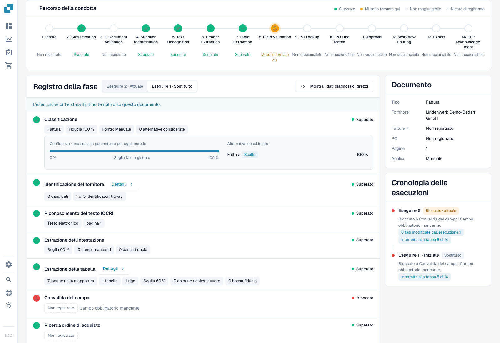
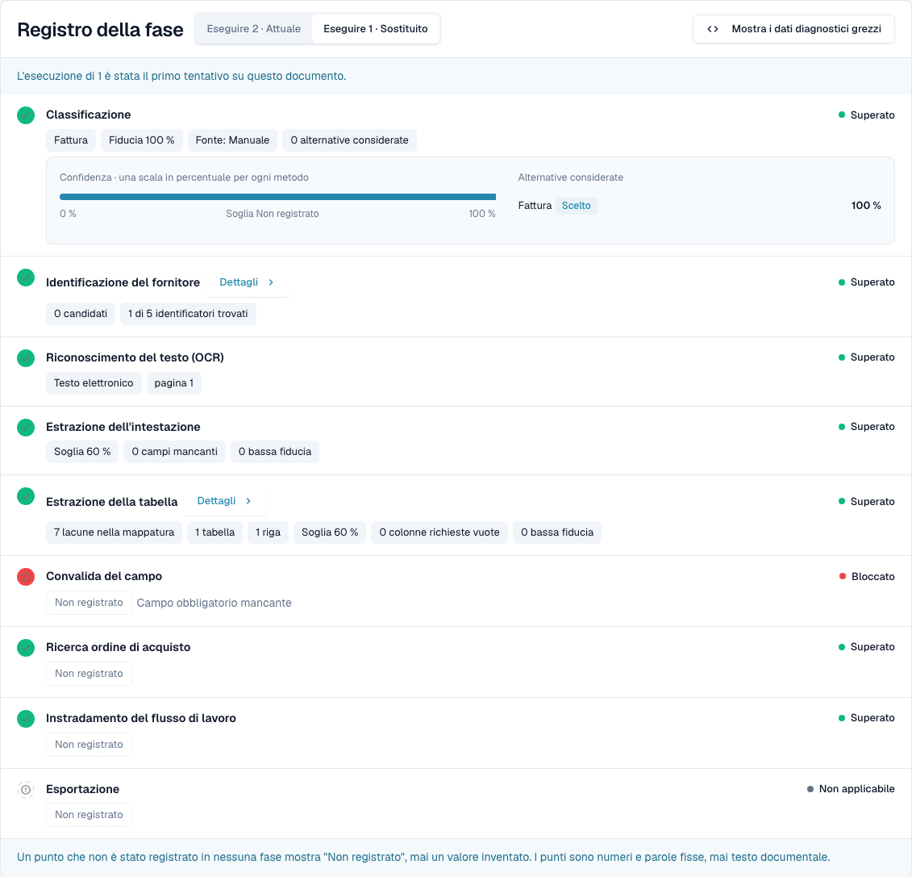
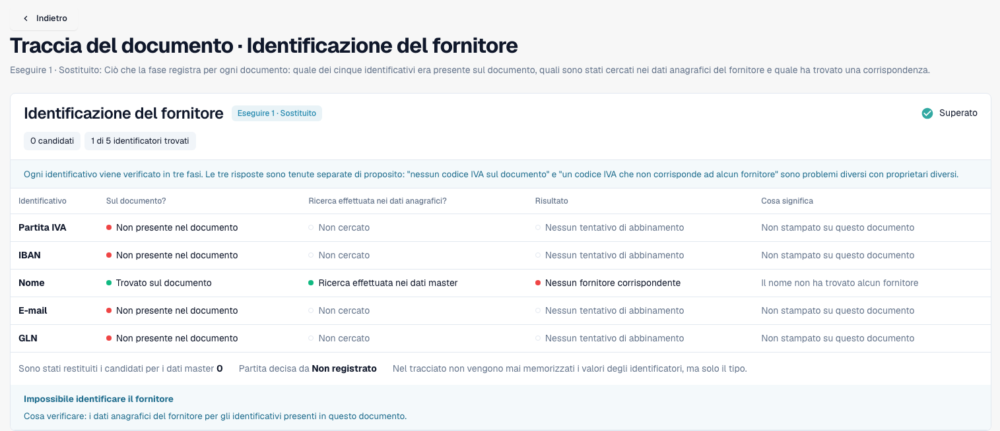
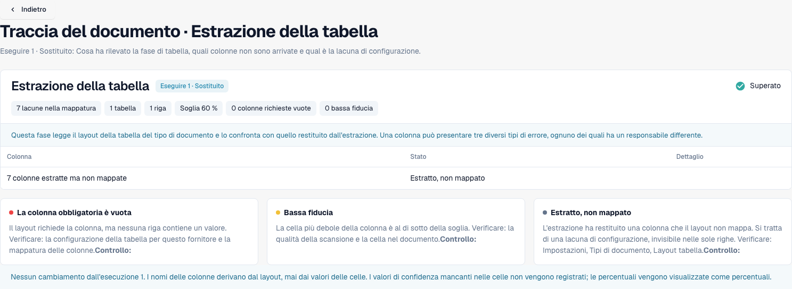
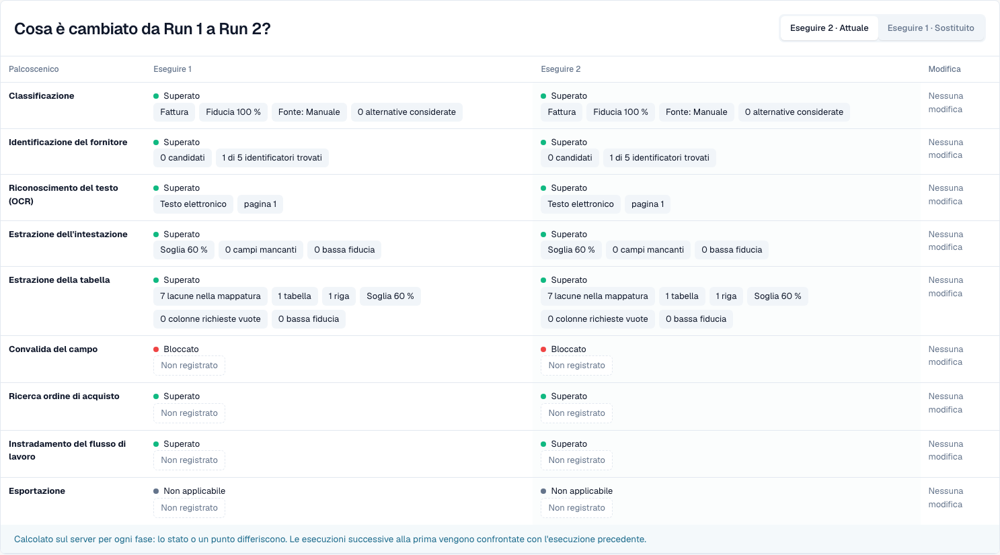

# Tracciamento del documento

<!-- touchless-admin-video-v2-20261104:start -->
**Capitolo video (versione di verifica):** [Confrontare le esecuzioni](https://docbits-videos.fra1.cdn.digitaloceanspaces.com/settings-assistant/touchless-intelligence-preview-admin/v2/it.html#chapter=08).
<!-- touchless-admin-video-v2-20261104:end -->

Inserisci un ID documento in **Document ID**, oppure apri un documento di esempio da un cluster, per vedere **che cosa è successo a questo singolo documento**.

L'intestazione mostra il file, il suo stato (ad esempio **In progress**), l'esecuzione che stai guardando e il suo primo bloccante, oltre a un pulsante **Document** con l'ID del documento.

<figure><figcaption>
Nuova acquisizione da Dev NOVA 11.0.3, 4 novembre 2026. La fattura di test fittizia si ferma alla convalida dei campi. Classificazione, ricerca del fornitore, estrazione dell'intestazione ed estrazione della tabella contengono punti realmente registrati; le schede mostrano il documento e la cronologia delle esecuzioni. È l'interfaccia del prodotto in esecuzione.
</figcaption></figure>

Il **Pipeline Path** mostra 14 fasi: Intake, Classification, E-Document Validation, Supplier Identification, Text Recognition, Header Extraction, Table Extraction, Field Validation, PO Lookup, PO Line Match, Approval, Workflow Routing, Export, ERP Acknowledgement. Ogni fase porta un solo stato:

| Stato | Significato |
| --- | --- |
| **Passed** (verde) | La fase è stata eseguita correttamente |
| **Stopped Here** (arancione) | La fase ha bloccato il documento |
| **Not reached** | Mostrato dopo il primo bloccante nel percorso; controlla il registro della fase per eventuali ulteriori esecuzioni registrate |
| **Nothing Recorded** (tratteggiato) | Per questa fase non è stato registrato alcun dato |
| **Not applicable** | La fase non si applica a questo documento |

### Stage Log

Il **Stage Log** sotto il percorso elenca le stesse fasi con ciò che ciascuna ha registrato. Un punto di stato e la parola di stato si trovano a sinistra e a destra di ogni riga.

* Ogni valore è un **punto**: un numero con la sua unità, ad esempio **Confidence 100 %**, **Threshold 60 %**, **Failed rules 0**, **8 missing fields** o **0 mapping gaps**. Le percentuali sono mostrate come `97 %`, mai come `0.97`.
* **Details** apre l'elenco completo dei punti registrati da una fase, comprese le alternative che ha considerato.
* La fase che ha bloccato il documento ne indica il motivo, ad esempio **Field validation failed**.
* Un punto che nessuna fase ha registrato è mostrato come **Not recorded**, mai come un valore inventato. I punti sono numeri e parole fisse, mai testo del documento.
* **Show Raw Diagnostics** attiva i dati grezzi quando l'assistenza lo richiede.

<figure><figcaption>
Prima esecuzione reale: affidabilità di classificazione del 100%, 0 fornitori candidati, 1 riga di tabella e 7 lacune di mappatura. Passed significa che una fase è stata eseguita; non dimostra un abbinamento del fornitore né che ogni valore della fattura sia corretto. La convalida dei campi segnala un campo obbligatorio mancante.
</figcaption></figure>

### Esecuzioni e modifiche

Usa il selettore delle esecuzioni per scegliere un tentativo. La Run History ne elenca il risultato e il primo bloccante. Le differenze registrate confrontano l'esecuzione selezionata con quella precedente, non automaticamente con quella attuale. Ogni indicatore di differenza include la sua unità; i punti invariati restano invariati.

La scheda Document elenca tipo di documento, fornitore, numero di fattura, ordine di acquisto, pagine e metodo di analisi registrato. Qui Manual riflette il tipo di documento fornito durante l'importazione di test. Il valore di classificazione del 100% non è quindi una prova indipendente della precisione della classificazione automatica.

### Leggere i dettagli del fornitore e della tabella

<figure><figcaption>
Questa esecuzione trova il nome del fornitore nella fattura e cerca nei dati anagrafici, ma non assegna alcun fornitore. Partita IVA, IBAN, e-mail e GLN sono assenti da questa fattura di test. Un abbinamento anagrafico mancante è una diagnosi diversa da un valore mancante nella fattura.
</figcaption></figure>

Controlla tre domande distinte: un identificativo è stato trovato nel documento, è stato cercato e è stato abbinato un fornitore? Una fase verde da sola non risponde.

<figure><figcaption>
I dettagli della tabella indicano 7 lacune di mappatura per 1 tabella e 1 riga. Controlla la mappatura delle colonne prima di concludere che l'estrazione sia fallita. Il piè di pagina del confronto non è una base valida per l'esecuzione iniziale selezionata, che non ha una precedente.
</figcaption></figure>

### Riconoscere un vero riavvio

<figure><figcaption>
La stessa fattura di test dopo un vero riavvio manuale, senza campi della fattura corretti. Una nuova esecuzione dimostra un altro tentativo, non un miglioramento. I punti invariati mostrano No change; non sono stati inventati indicatori di differenza.
</figcaption></figure>

Un riavvio manuale è un intervento umano. Solo un successivo completamento riuscito classificherebbe questo caso come AP Assisted. Finché resta in corso, è escluso dal denominatore dei documenti conclusi.

Limiti delle prove. Questo caso non dimostra alcuna approvazione aziendale, esportazione riuscita o conferma ERP. Il motore di abbinamento ordini precedente non fornisce qui alcun percorso decisionale registrato; non è una prova di un confronto con Infor. In NOVA 11.0.3 il registro delle fasi può registrare una ricerca dell'ordine superata dopo una convalida dei campi bloccata, mentre il percorso la indica come Not reached. Controlla entrambe le viste. Il riepilogo mostra inoltre il numero di fattura come Not recorded anche se l'estrazione lo contiene; usa l'originale e i campi estratti per un confronto dei valori.

## Distinguere l'estrazione dai dati del sistema di origine

1. Apri la **fattura originale** e confronta i suoi campi di intestazione e le righe con ciò che DocBits ha estratto. Quando indaghi su un'esecuzione precedente, usa i valori antecedenti alla correzione di una persona. Un valore corretto attuale non stabilisce che cosa sia stato estratto in origine.
2. Leggi il primo bloccante nella traccia. Una fase di estrazione superata significa che la fase è stata completata; non certifica che ogni valore corrisponda alla fattura.
3. Per una discrepanza sull'ordine, confronta i valori della fattura con i **dati dell'ordine effettivamente disponibili a DocBits** e con il record Infor corrispondente. Includi unità, unità di prezzo, quantità e il momento dell'importazione.
4. Registra la differenza confermata: **fattura rispetto a estrazione**, **estrazione corretta rispetto a dati di origine importati** oppure **Infor rispetto alla sua copia importata**. Lascia aperta la causa se le prove necessarie non sono registrate.
5. Controlla la cronologia delle esecuzioni per una correzione manuale, un'approvazione o un riavvio, e per l'esito finale. L'esito e la causa rispondono a domande diverse.

**Esempio.** La fattura e il valore estratto indicano entrambi €10,00, mentre l'ordine importato indica €9,00. Questo stabilisce una discrepanza con i dati dell'ordine, non un errore di estrazione. Conferma quale prezzo è stato concordato e se vada corretto Infor stesso o la sua copia importata. Se AP riavvia manualmente la fattura e questa si completa poi con successo, è AP assisted nonostante l'estrazione corretta. Vedi gli [esempi pratici e il calcolo](./#example-100-correct-extraction-80-ap-touchless).

**Campi mancanti ricorrenti.** Diversi documenti che si fermano alla Field Validation stabiliscono un bloccante ripetuto. Le cause possibili includono l'estrazione, un valore realmente assente nella fattura, una regola di convalida o un valore predefinito configurato mancante. Confronta le prove prima di scegliere una correzione; la ripetizione da sola non dimostra una singola causa.

## Provare l'estrazione originale prima di trarre conclusioni

1. Apri **Document** da questa traccia e verifica l'ID del documento e l'esecuzione selezionata. Confronta numero dell'ordine, valuta, quantità, unità, unità di prezzo, prezzi unitari, importi di riga e totali pertinenti originali con i campi e le tabelle di convalida.
2. Distingui i valori attuali dall'estrazione precedente a una correzione. Per una fattura già modificata, usa un record storico del campo corrispondente o una prova di estrazione di quell'esecuzione. Cambiare esecuzione non promette la ricostruzione di ogni vecchio campo e cella.
3. Se il valore estratto originale non è disponibile, registralo come **non valutabile**, non come corretto. Definisci campi, copertura delle righe, selezione e dimensione del campione prima di riportare un risultato indipendente sulla qualità dell'estrazione.
4. Confronta i valori del PO importato e la marca temporale dell'importazione con i valori Infor attuali. Questo separa dati di origine errati da una copia obsoleta.

I bloccanti successivi sono possibili: l'esecuzione 1 può fermarsi perché un PO non è ancora arrivato; dopo l'importazione, l'esecuzione 2 può rivelare una discrepanza di prezzo. Nessuna delle due dimostra che la prima esecuzione abbia raggiunto il controllo successivo. Un riavvio manuale persiste dopo il successo come AP Assisted; un rifiuto ERP finale prevale invece come eccezione di processo. **Not recorded** significa prova mancante, non controllo superato.

Vedi [Touchless con MCP](touchless-mcp.md) per le chiamate agli strumenti corrispondenti e la classificazione delle azioni umane.

## Pagine correlate

* [Touchless Intelligence](./)
* [Diagnosi del fornitore e cluster di problemi](../../touchless-supplier-diagnosis.md)
* [Diagnosi dell'abbinamento ordini](../../touchless-po-matching-diagnosis.md)

<!-- Documentation review 2026-11-04: extraction quality vs process outcomes; KPI and terminal-outcome definitions checked against DocBits_API c51f350c728acb8ac964098d15f7b006bce273f4, module/automation_intelligence/kpi.py and bucket.py. Existing native screenshots retained and checked separately from illustrative examples. -->

<!-- Completion review 2026-11-04: owned synthetic PO examples, MCP schema/read evidence, human-action classification, KPI labels and screenshot proof limits. -->

Le cinque nuove schermate della traccia mostrano l'interfaccia localizzata di Dev NOVA 11.0.3 e la stessa fattura di test propria. Qualsiasi immagine separata originale-campo resta un'illustrazione limitata di quel confronto.
