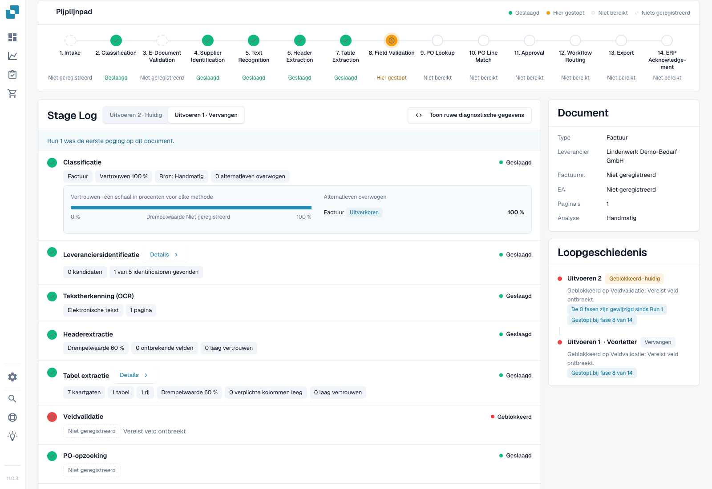
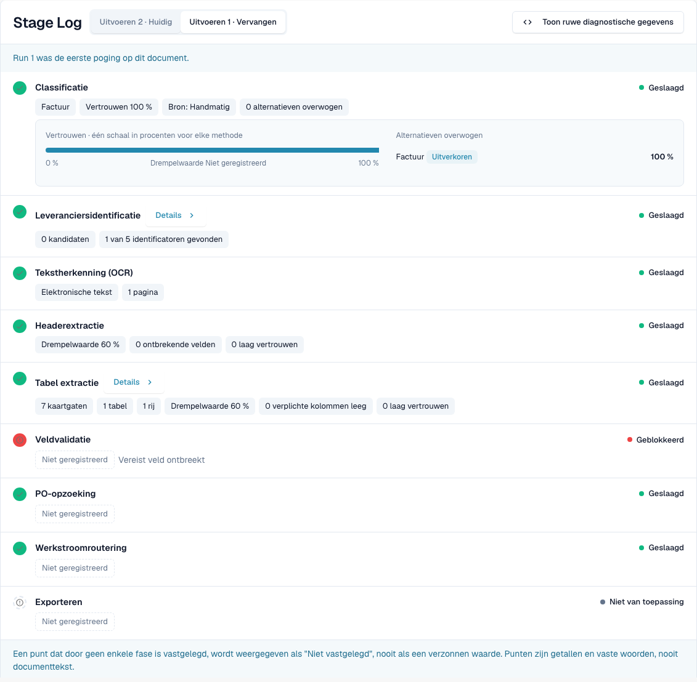
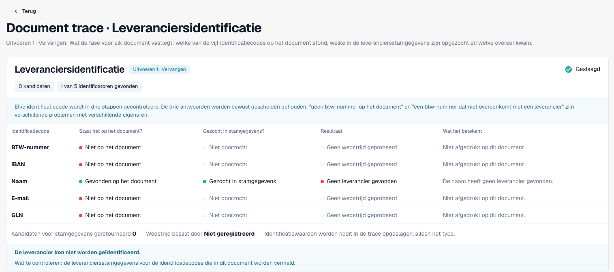
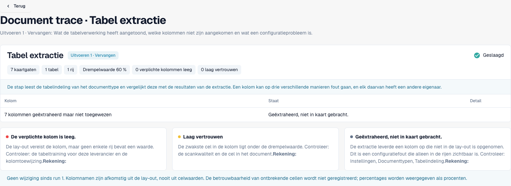
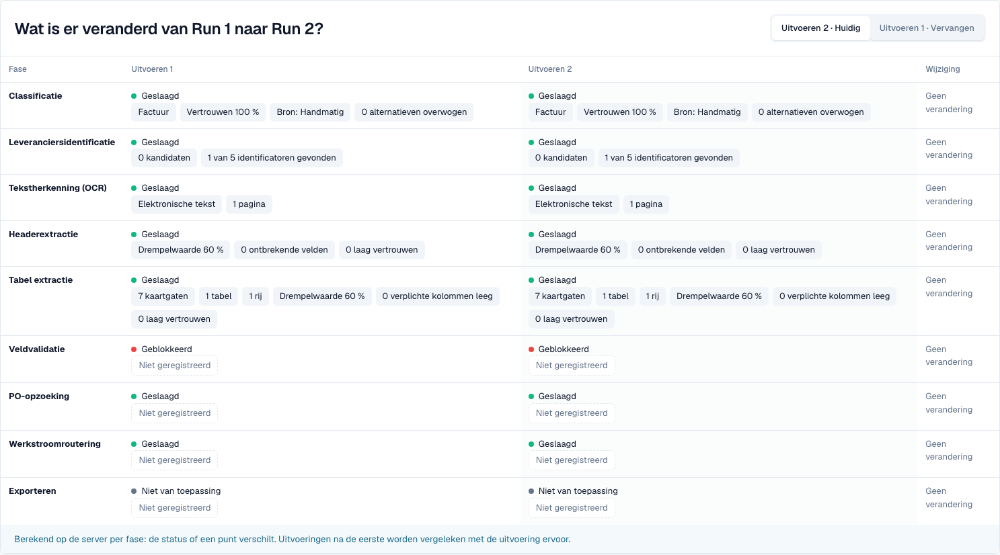

# Document Trace

<!-- touchless-admin-video-v2-20261104:start -->
**Videohoofdstuk (controleversie):** [Uitvoeringen vergelijken](https://docbits-videos.fra1.cdn.digitaloceanspaces.com/settings-assistant/touchless-intelligence-preview-admin/v2/nl.html#chapter=08).
<!-- touchless-admin-video-v2-20261104:end -->

Voer een document-ID in bij **Document ID**, of open een voorbeelddocument uit een cluster, om te zien **wat er met dit ene document is gebeurd**.

De kop toont het bestand, de status ervan (bijvoorbeeld **In progress**), de uitvoering die u bekijkt met de eerste blokkade, en een knop **Document** met het document-ID.

<figure><figcaption>
Nieuwe opname uit Dev NOVA 11.0.3, 4 november 2026. De fictieve testfactuur stopt bij veldvalidatie. Classificatie, leverancierszoekopdracht, headextractie en tabelextractie bevatten werkelijk vastgelegde punten; de kaarten tonen het document en de uitvoeringshistorie. Dit is de werkende productinterface.
</figcaption></figure>

Het **Pipeline Path** toont 14 fasen: Intake, Classification, E-Document Validation, Supplier Identification, Text Recognition, Header Extraction, Table Extraction, Field Validation, PO Lookup, PO Line Match, Approval, Workflow Routing, Export, ERP Acknowledgement. Elke fase heeft één toestand:

| Toestand | Betekenis |
| --- | --- |
| **Passed** (groen) | De fase is goed verlopen |
| **Stopped Here** (oranje) | De fase heeft het document geblokkeerd |
| **Not reached** | Getoond na de eerste blokkade in het pad; controleer het faselogboek op eventuele extra vastgelegde uitvoering |
| **Nothing Recorded** (gestreept) | Voor deze fase zijn geen gegevens vastgelegd |
| **Not applicable** | De fase geldt niet voor dit document |

### Stage Log

Het **Stage Log** onder het pad toont dezelfde fasen met wat elke fase heeft vastgelegd. Per rij staan links en rechts een statusstip en het statuswoord.

* Elke waarde is een **puntchip**: een getal met zijn eenheid, bijvoorbeeld **Confidence 100 %**, **Threshold 60 %**, **Failed rules 0**, **8 missing fields** of **0 mapping gaps**. Percentages worden als `97 %` weergegeven, nooit als `0.97`.
* **Details** opent de volledige lijst met punten die een fase heeft vastgelegd, inclusief de alternatieven die zijn overwogen.
* De fase die het document blokkeerde, vermeldt waarom, bijvoorbeeld **Field validation failed**.
* Een punt dat geen enkele fase heeft vastgelegd, verschijnt als **Not recorded**, nooit als een verzonnen waarde. Punten zijn getallen en vaste woorden, nooit documenttekst.
* **Show Raw Diagnostics** schakelt de ruwe gegevens in wanneer support daarom vraagt.

<figure><figcaption>
Werkelijke eerste uitvoering: 100% classificatiebetrouwbaarheid, 0 leverancierskandidaten, 1 tabelrij en 7 mappinghiaten. Passed betekent dat een fase liep; het bewijst geen leveranciersmatch en niet dat elke factuurwaarde correct is. Veldvalidatie meldt een ontbrekend verplicht veld.
</figcaption></figure>

### Uitvoeringen en wijzigingen

Gebruik de uitvoeringskeuze om een poging te kiezen. Run History vermeldt het resultaat en de eerste blokkade. Vastgelegde verschillen vergelijken de gekozen uitvoering met de voorafgaande, niet automatisch met de huidige uitvoering. Een verschilmarkering bevat de bijbehorende eenheid; ongewijzigde punten blijven ongewijzigd.

De kaart Document vermeldt het documenttype, de leverancier, het factuurnummer, de inkooporder, het aantal pagina's en de vastgelegde analysemethode. Hier weerspiegelt Manual het documenttype dat bij de testimport is opgegeven. De classificatiewaarde van 100% is daardoor geen onafhankelijk bewijs van automatische classificatienauwkeurigheid.

### Leveranciers- en tabeldetails lezen

<figure><figcaption>
Deze uitvoering vindt de leveranciersnaam op de factuur en doorzoekt de stamgegevens, maar kent geen leverancier toe. Btw-ID, IBAN, e-mail en GLN ontbreken op deze testfactuur. Een ontbrekende match in de stamgegevens is een andere diagnose dan een ontbrekende factuurwaarde.
</figcaption></figure>

Controleer drie afzonderlijke vragen: is er een identificator op het document gevonden, is die opgezocht, en is er een leverancier gematcht? Een groene fase beantwoordt die vragen niet.

<figure><figcaption>
Tabeldetails melden 7 mappinghiaten voor 1 tabel en 1 rij. Controleer de kolomtoewijzing voordat u concludeert dat de extractie mislukte. De vergelijkingsvoet is geen geldige basis voor de geselecteerde eerste uitvoering, die geen voorganger heeft.
</figcaption></figure>

### Een echte herstart herkennen

<figure><figcaption>
Dezelfde testfactuur na een echte handmatige herstart, zonder gecorrigeerde factuurvelden. Een nieuwe uitvoering bewijst een nieuwe poging, geen verbetering. Ongewijzigde punten tonen No change; er zijn geen verschilmarkeringen verzonnen.
</figcaption></figure>

Een handmatige herstart is een menselijke ingreep. Alleen een latere geslaagde afronding zou dit geval als AP assisted classificeren. Zolang het in behandeling blijft, valt het buiten de noemer van afgeronde documenten.

Beperkingen van het bewijs. Dit geval toont geen zakelijke goedkeuring, geslaagde export of ERP-bevestiging. De legacy PO-matcher levert hier geen vastgelegd beslissingspad; dit is geen bewijs van een Infor-vergelijking. In NOVA 11.0.3 kan het faselogboek een geslaagde PO-lookup vastleggen na een geblokkeerde veldvalidatie, terwijl het pad die als Not reached aanmerkt. Controleer beide weergaven. De samenvatting toont het factuurnummer ook als Not recorded, hoewel de extractie het bevat; gebruik het origineel en de geëxtraheerde velden voor een waardevergelijking.

## Extractie onderscheiden van bronsysteemgegevens

1. Open de **originele factuur** en vergelijk de kopvelden en regels met wat DocBits heeft geëxtraheerd. Gebruik bij het onderzoeken van een eerdere uitvoering de waarden van vóór een correctie door een persoon. Een huidige gecorrigeerde waarde stelt niet vast wat oorspronkelijk is geëxtraheerd.
2. Lees de eerste blokkade in de trace. Een geslaagde extractiefase betekent dat de fase is afgerond; ze certificeert niet dat elke waarde met de factuur overeenkomt.
3. Vergelijk bij een PO-afwijking de factuurwaarden met de **ordergegevens die DocBits werkelijk ter beschikking heeft** en met het bijbehorende Infor-record. Neem eenheden, prijseenheden, hoeveelheden en het importtijdstip mee.
4. Leg het bevestigde verschil vast: **factuur versus extractie**, **correcte extractie versus geïmporteerde brongegevens**, of **Infor versus de geïmporteerde kopie**. Laat de oorzaak open als het vereiste bewijs niet is vastgelegd.
5. Controleer de uitvoeringshistorie op een handmatige correctie, goedkeuring of herstart, en op de definitieve uitkomst. De uitkomst en de oorzaak beantwoorden verschillende vragen.

**Voorbeeld.** De factuur en de geëxtraheerde waarde zeggen beide €10,00, terwijl de geïmporteerde order €9,00 zegt. Dat stelt een afwijking met de ordergegevens vast, geen extractiefout. Bevestig welke prijs is afgesproken en of Infor zelf of de geïmporteerde kopie correctie nodig heeft. Herstart AP de factuur handmatig en wordt die daarna succesvol afgerond, dan is ze AP assisted ondanks de correcte extractie. Zie de [uitgewerkte voorbeelden en berekening](.#example-100-correct-extraction-80-ap-touchless).

**Herhaald ontbrekende velden.** Meerdere documenten die bij Field Validation stoppen, stellen een terugkerende blokkade vast. Mogelijke oorzaken zijn extractie, een werkelijk ontbrekende factuurwaarde, een validatieregel of een ontbrekende geconfigureerde standaardwaarde. Vergelijk het bewijs voordat u een oplossing kiest; herhaling alleen bewijst geen enkele oorzaak.

## De oorspronkelijke extractie bewijzen voordat u conclusies trekt

1. Open **Document** vanuit deze trace en controleer het document-ID en de gekozen uitvoering. Vergelijk het originele PO-nummer, de valuta, hoeveelheden, eenheden, prijseenheden, eenheidsprijzen, regelbedragen en relevante totalen met de validatievelden en -tabellen.
2. Onderscheid huidige waarden van de extractie vóór een correctie. Gebruik voor een al bewerkte factuur een passend historisch veldrecord of extractiebewijs voor die uitvoering. Van uitvoering wisselen belooft geen reconstructie van elk oud veld en elke cel.
3. Is de oorspronkelijk geëxtraheerde waarde niet beschikbaar, leg die dan vast als **niet beoordeelbaar**, niet als correct. Bepaal de velden, de dekking van de regels, de steekproefkeuze en de steekproefomvang voordat u een onafhankelijk resultaat over extractiekwaliteit rapporteert.
4. Vergelijk geïmporteerde PO-waarden en het importtijdstip met de actuele Infor-waarden. Zo scheidt u onjuiste brongegevens van een verouderde kopie.

Opeenvolgende blokkades zijn mogelijk: uitvoering 1 kan stoppen omdat een PO nog niet is aangekomen; na de import kan uitvoering 2 een prijsafwijking aan het licht brengen. Geen van beide bewijst dat de eerste uitvoering de latere controle heeft bereikt. Een handmatige herstart blijft na succes bestaan als AP assisted; een definitieve ERP-afwijzing heeft daarentegen voorrang als procesuitzondering. **Not recorded** betekent ontbrekend bewijs, geen geslaagde controle.

Zie [Touchless met MCP](touchless-mcp.md) voor de bijbehorende toolaanroepen en de classificatie van menselijke acties.

## Gerelateerde pagina's

* [Touchless Intelligence](./)
* [Leveranciersdiagnose en probleemclusters](touchless-supplier-diagnosis.md)
* [PO-matchingdiagnose](touchless-po-matching-diagnosis.md)

<!-- Documentation review 2026-11-04: extraction quality vs process outcomes; KPI and terminal-outcome definitions checked against DocBits_API c51f350c728acb8ac964098d15f7b006bce273f4, module/automation_intelligence/kpi.py and bucket.py. Existing native screenshots retained and checked separately from illustrative examples. -->

<!-- Completion review 2026-11-04: owned synthetic PO examples, MCP schema/read evidence, human-action classification, KPI labels and screenshot proof limits. -->

De vijf nieuwe trace-schermopnamen tonen de gelokaliseerde Dev NOVA 11.0.3-interface en dezelfde eigen testfactuur. Een afzonderlijke afbeelding van origineel tegenover veld blijft een beperkte illustratie van die vergelijking.
