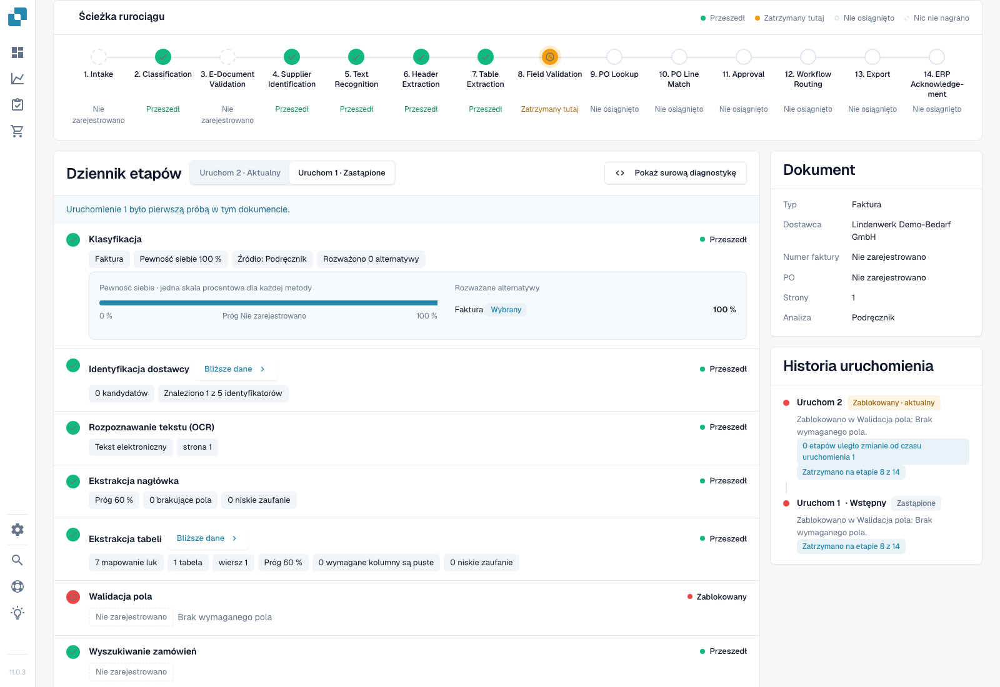
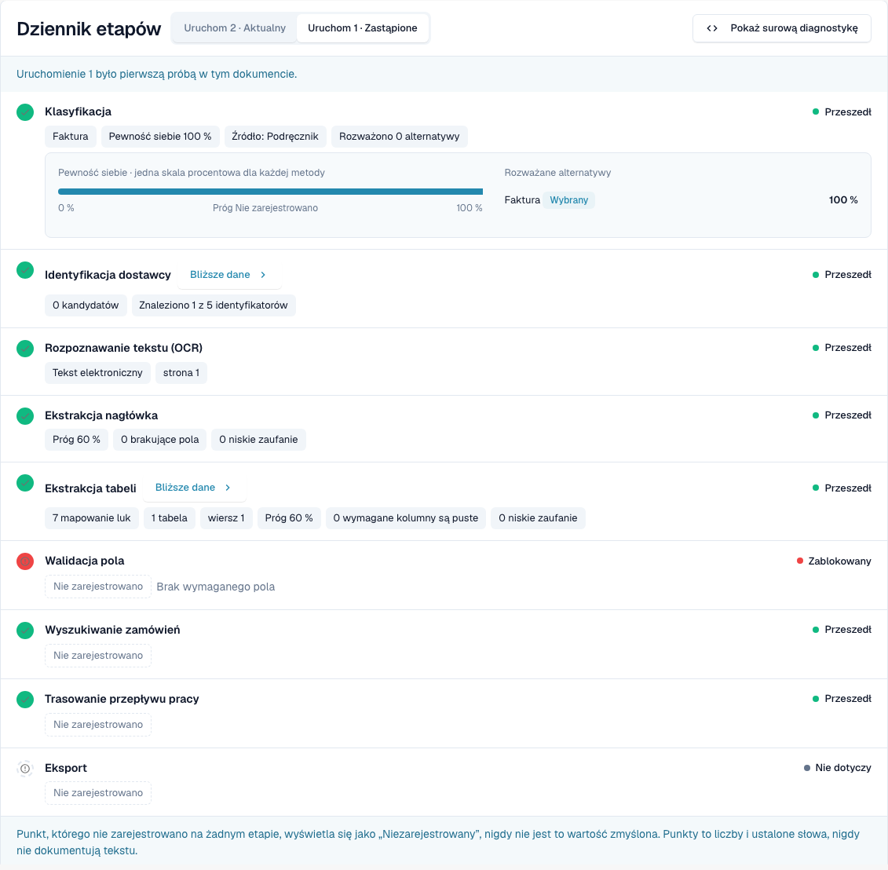
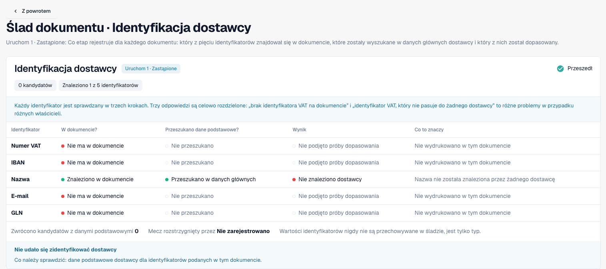
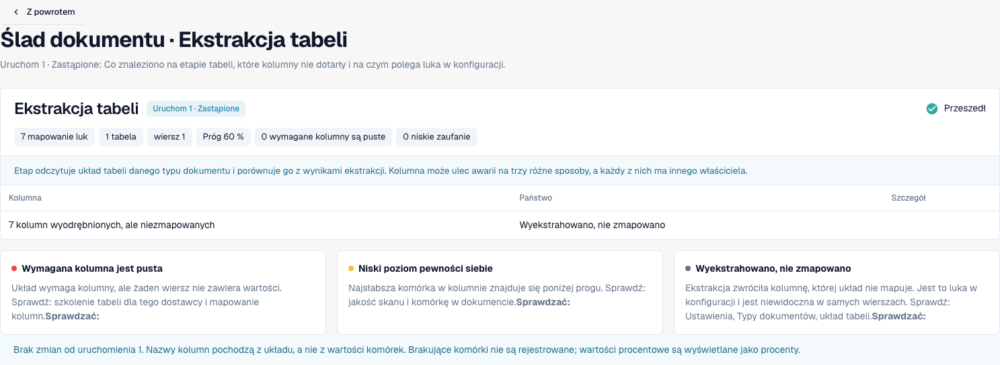
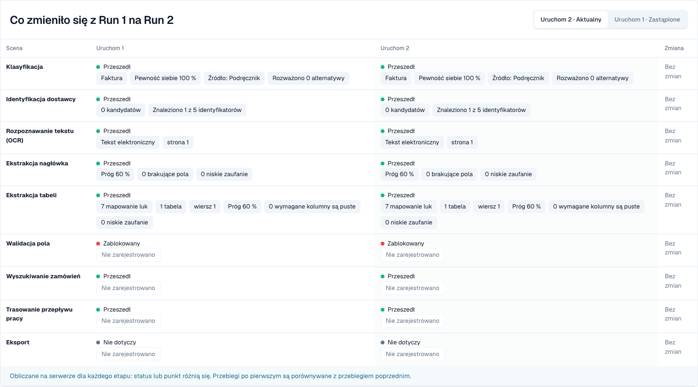

# Ślad dokumentu

<!-- touchless-admin-video-v2-20261104:start -->
**Rozdział filmu (wersja do oceny):** [Porównanie uruchomień](https://docbits-videos.fra1.cdn.digitaloceanspaces.com/settings-assistant/touchless-intelligence-preview-admin/v2/pl.html#chapter=08).
<!-- touchless-admin-video-v2-20261104:end -->

Wpisz identyfikator dokumentu w **Document ID** lub otwórz przykładowy dokument z klastra, aby zobaczyć, **co się stało z tym jednym dokumentem**.

Nagłówek pokazuje plik, jego status (na przykład **In progress**), oglądane uruchomienie i jego pierwszą blokadę oraz przycisk **Document** z identyfikatorem dokumentu.

<figure><figcaption>
Nowe przechwycenie z Dev NOVA 11.0.3, 4 listopada 2026. Fikcyjna faktura testowa zatrzymuje się na walidacji pól. Klasyfikacja, wyszukiwanie dostawcy, odczyt nagłówka i odczyt tabeli zawierają rzeczywiste zarejestrowane punkty; karty pokazują dokument i historię uruchomień. To działający interfejs produktu.
</figcaption></figure>

**Pipeline Path** pokazuje 14 etapów: Intake, Classification, E-Document Validation, Supplier Identification, Text Recognition, Header Extraction, Table Extraction, Field Validation, PO Lookup, PO Line Match, Approval, Workflow Routing, Export, ERP Acknowledgement. Każdy etap ma jeden stan:

| Stan | Znaczenie |
| --- | --- |
| **Passed** (zielony) | Etap przebiegł prawidłowo |
| **Stopped Here** (pomarańczowy) | Etap zablokował dokument |
| **Not reached** | Pokazywany po pierwszej blokadzie na ścieżce; sprawdź dziennik etapu, czy nie ma dodatkowego zarejestrowanego wykonania |
| **Nothing Recorded** (przerywany) | Dla tego etapu nie zarejestrowano żadnych danych |
| **Not applicable** | Etap nie dotyczy tego dokumentu |

### Stage Log

**Stage Log** pod ścieżką wymienia te same etapy wraz z tym, co każdy z nich zarejestrował. Kropka statusu i słowo statusu znajdują się po lewej i prawej stronie każdego wiersza.

* Każda wartość to **point chip**: liczba z jednostką, na przykład **Confidence 100 %**, **Threshold 60 %**, **Failed rules 0**, **8 missing fields** lub **0 mapping gaps**. Procenty są pokazywane jako `97 %`, nigdy jako `0.97`.
* **Details** otwiera pełną listę punktów zarejestrowanych przez etap, wraz z rozważanymi alternatywami.
* Etap, który zablokował dokument, podaje przyczynę, na przykład **Field validation failed**.
* Punkt, którego żaden etap nie zarejestrował, jest pokazywany jako **Not recorded**, nigdy jako wymyślona wartość. Punkty to liczby i stałe słowa, nigdy tekst dokumentu.
* **Show Raw Diagnostics** włącza surowe dane, gdy poprosi o to wsparcie.

<figure><figcaption>
Rzeczywiste pierwsze uruchomienie: pewność klasyfikacji 100%, 0 kandydatów dostawcy, 1 wiersz tabeli i 7 luk w mapowaniu. Passed oznacza, że etap przebiegł; nie dowodzi dopasowania dostawcy ani tego, że każda wartość faktury jest poprawna. Walidacja pól zgłasza brak wymaganego pola.
</figcaption></figure>

### Uruchomienia i zmiany

Użyj selektora uruchomień, aby wybrać próbę. Run History wymienia jej wynik i pierwszą blokadę. Zarejestrowane różnice porównują wybrane uruchomienie z poprzednim, a nie automatycznie z bieżącym. Znacznik różnicy zawiera jednostkę; niezmienione punkty pozostają niezmienione.

Karta Document wymienia typ dokumentu, dostawcę, numer faktury, zamówienie zakupu, strony i zarejestrowaną metodę analizy. Tutaj Manual odzwierciedla typ dokumentu podany podczas importu testowego. Wartość klasyfikacji 100% nie jest więc niezależnym dowodem dokładności automatycznej klasyfikacji.

### Odczyt szczegółów dostawcy i tabeli

<figure><figcaption>
To uruchomienie znajduje nazwę dostawcy na fakturze i przeszukuje dane podstawowe, ale nie przypisuje dostawcy. Numer VAT, IBAN, e-mail i GLN nie występują na tej fakturze testowej. Brak dopasowania w danych podstawowych to inna diagnoza niż brakująca wartość na fakturze.
</figcaption></figure>

Sprawdź trzy odrębne pytania: czy na dokumencie znaleziono identyfikator, czy wykonano jego wyszukanie i czy dopasowano dostawcę? Zielony etap sam na nie nie odpowiada.

<figure><figcaption>
Szczegóły tabeli pokazują 7 luk w mapowaniu dla 1 tabeli i 1 wiersza. Zanim uznasz, że odczyt się nie powiódł, sprawdź mapowanie kolumn. Stopka porównania nie jest prawidłową podstawą dla wybranego początkowego uruchomienia, które nie ma poprzednika.
</figcaption></figure>

### Rozpoznanie rzeczywistego restartu

<figure><figcaption>
Ta sama faktura testowa po rzeczywistym ręcznym restarcie, bez poprawionych pól faktury. Nowe uruchomienie dowodzi kolejnej próby, a nie poprawy. Niezmienione punkty pokazują No change; nie wymyślono żadnych znaczników różnic.
</figcaption></figure>

Ręczny restart to ingerencja człowieka. Dopiero późniejsze pomyślne zakończenie zaklasyfikowałoby ten przypadek jako AP Assisted. Dopóki dokument jest w toku, jest wyłączony z mianownika zakończonych dokumentów.

Ograniczenia dowodów. Ten przypadek nie wykazuje zatwierdzenia biznesowego, pomyślnego eksportu ani potwierdzenia z ERP. Starszy mechanizm dopasowania PO nie daje tu zarejestrowanej ścieżki decyzji; to nie jest dowód porównania z Infor. W NOVA 11.0.3 dziennik etapów może zarejestrować udane wyszukanie PO po zablokowanej walidacji pól, podczas gdy ścieżka oznacza je jako Not reached. Sprawdź oba widoki. Podsumowanie pokazuje też numer faktury jako Not recorded, chociaż odczyt go zawiera; do porównania wartości użyj oryginału i odczytanych pól.

## Rozróżnianie odczytu od danych systemu źródłowego

1. Otwórz **oryginalną fakturę** i porównaj jej pola nagłówka oraz pozycje z tym, co odczytał DocBits. Podczas badania wcześniejszego uruchomienia używaj wartości sprzed poprawki człowieka. Bieżąca poprawiona wartość nie ustala, co odczytano pierwotnie.
2. Odczytaj pierwszą blokadę w śladzie. Etap odczytu ze stanem Passed oznacza, że etap się zakończył; nie potwierdza, że każda wartość odpowiada fakturze.
3. W przypadku rozbieżności PO porównaj wartości faktury z **danymi zamówienia rzeczywiście dostępnymi dla DocBits** i z odpowiednim rekordem w Infor. Uwzględnij jednostki, jednostki ceny, ilości i czas importu.
4. Zapisz potwierdzoną różnicę: **faktura a odczyt**, **poprawny odczyt a zaimportowane dane źródłowe** albo **Infor a jego zaimportowana kopia**. Jeśli wymagane dowody nie są zarejestrowane, pozostaw przyczynę otwartą.
5. Sprawdź historię uruchomień pod kątem ręcznej poprawki, zatwierdzenia lub restartu oraz wyniku końcowego. Wynik i przyczyna odpowiadają na różne pytania.

**Przykład.** Faktura i odczytana wartość mówią €10.00, a zaimportowane zamówienie €9.00. Ustala to rozbieżność z danymi zamówienia, a nie błąd odczytu. Potwierdź, która cena została uzgodniona i czy poprawy wymaga sam Infor, czy jego zaimportowana kopia. Jeśli AP ręcznie uruchomi fakturę ponownie i zakończy się ona pomyślnie, jest AP assisted mimo poprawnego odczytu. Zobacz [przykłady i obliczenie](./#example-100-correct-extraction-80-ap-touchless).

**Powtarzające się brakujące pola.** Kilka dokumentów zatrzymujących się na Field Validation ustala powtarzającą się blokadę. Możliwe przyczyny to odczyt, rzeczywiście nieobecna wartość na fakturze, reguła walidacji lub brakująca skonfigurowana wartość domyślna. Przed wyborem poprawki porównaj dowody; samo powtórzenie nie dowodzi żadnej z tych przyczyn.

## Udowodnij pierwotny odczyt, zanim wyciągniesz wnioski

1. Otwórz **Document** z tego śladu i sprawdź identyfikator dokumentu oraz wybrane uruchomienie. Porównaj oryginalny numer PO, walutę, ilości, jednostki, jednostki ceny, ceny jednostkowe, kwoty pozycji i odpowiednie sumy z polami i tabelami walidacji.
2. Przed poprawką rozróżnij wartości bieżące od odczytu. Dla już edytowanej faktury użyj pasującego historycznego zapisu pola lub dowodu odczytu z tego uruchomienia. Przełączanie uruchomień nie obiecuje odtworzenia każdego starego pola i komórki.
3. Jeśli pierwotna odczytana wartość jest niedostępna, zapisz ją jako **not assessable**, a nie jako poprawną. Zdefiniuj pola, pokrycie pozycji, dobór próby i jej liczebność, zanim podasz niezależny wynik jakości odczytu.
4. Porównaj zaimportowane wartości PO i znacznik czasu importu z bieżącymi wartościami w Infor. Oddziela to nieprawidłowe dane źródłowe od nieaktualnej kopii.

Kolejne blokady są możliwe: uruchomienie 1 może się zatrzymać, bo zamówienie jeszcze nie dotarło; po jego imporcie uruchomienie 2 może ujawnić rozbieżność ceny. Żadne z nich nie dowodzi, że pierwsze uruchomienie dotarło do późniejszej kontroli. Ręczny restart pozostaje po powodzeniu jako AP Assisted; końcowe odrzucenie przez ERP ma natomiast pierwszeństwo jako wyjątek procesu. **Not recorded** oznacza brakujący dowód, a nie zaliczoną kontrolę.

Dopasowane wywołania narzędzi i klasyfikację działań człowieka znajdziesz w [Touchless z MCP](touchless-mcp.md).

## Powiązane strony

* [Touchless Intelligence](./)
* [Diagnoza dostawcy i klastry problemów](../../touchless-supplier-diagnosis.md)
* [Diagnoza dopasowania PO](../../touchless-po-matching-diagnosis.md)

<!-- Documentation review 2026-11-04: extraction quality vs process outcomes; KPI and terminal-outcome definitions checked against DocBits_API c51f350c728acb8ac964098d15f7b006bce273f4, module/automation_intelligence/kpi.py and bucket.py. Existing native screenshots retained and checked separately from illustrative examples. -->

<!-- Completion review 2026-11-04: owned synthetic PO examples, MCP schema/read evidence, human-action classification, KPI labels and screenshot proof limits. -->

Pięć nowych zrzutów śladu pokazuje zlokalizowany interfejs Dev NOVA 11.0.3 i tę samą własną fakturę testową. Każdy odrębny obraz oryginał-versus-pole pozostaje ograniczoną ilustracją tego porównania.
