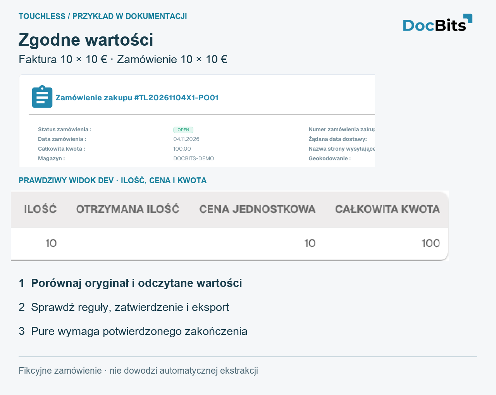
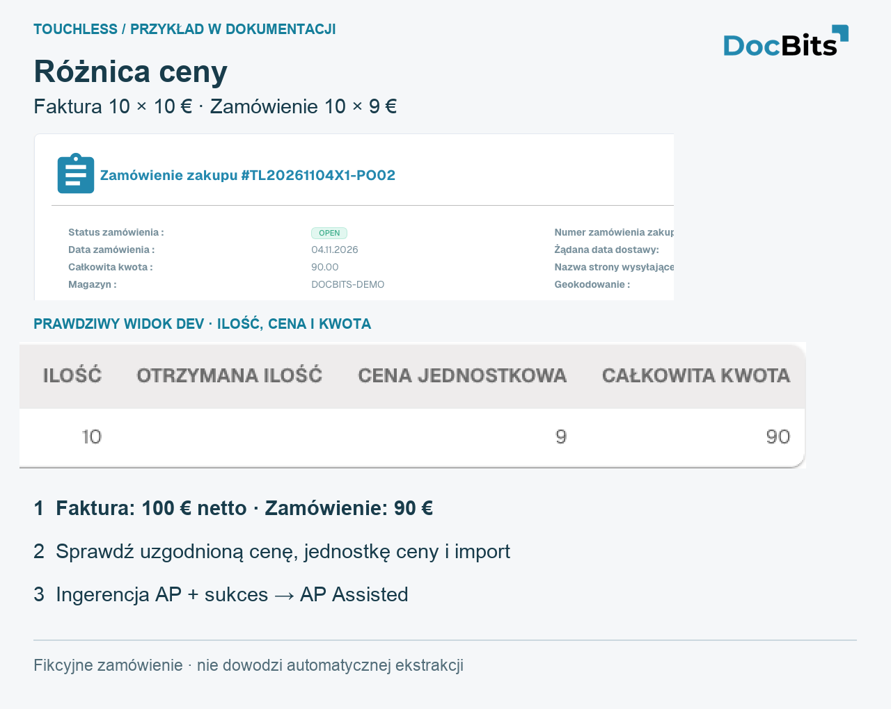
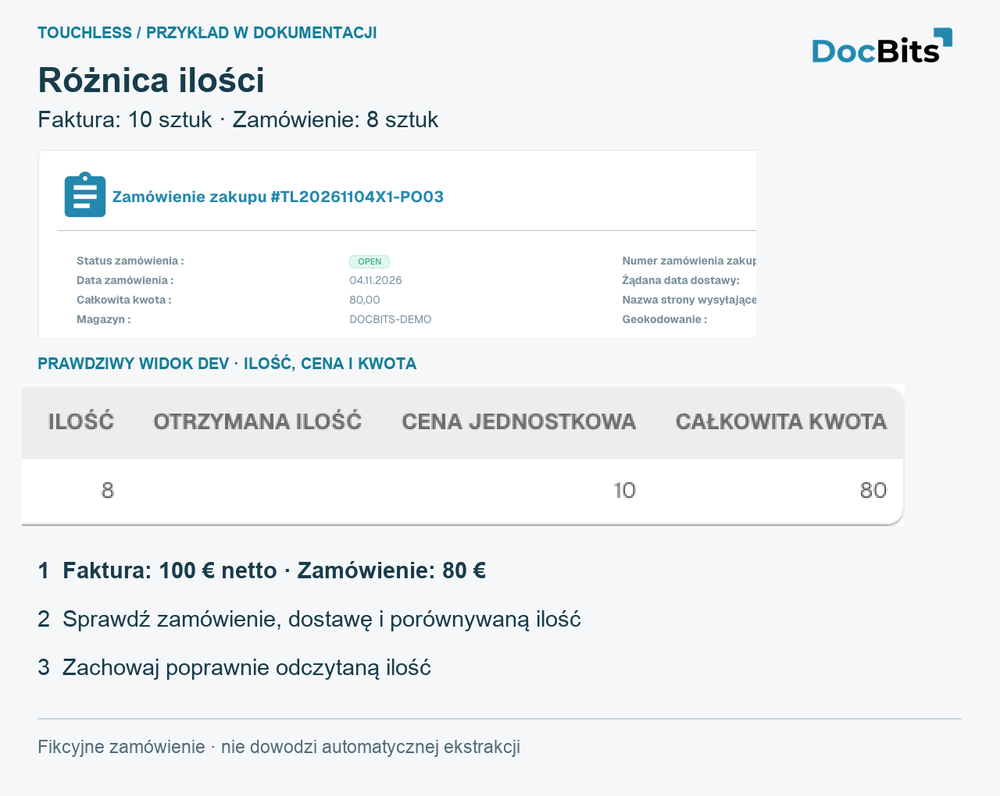

# Przykłady: cena i ilość

<!-- touchless-admin-video-v2-20261104:start -->
**Rozdział filmu (wersja do oceny):** [Śledzenie dokumentu](https://docbits-videos.fra1.cdn.digitaloceanspaces.com/settings-assistant/touchless-intelligence-preview-admin/v2/pl.html#chapter=07).
<!-- touchless-admin-video-v2-20261104:end -->

## Przykład: poprawny odczyt, inne dane w Infor

To przypadek ilustracyjny, odrębny od zrzutów ekranu. Faktura pokazuje **10 jednostek po €10.00**, razem **€100.00**. DocBits odczytuje wszystkie trzy wartości poprawnie. Zaimportowane zamówienie z Infor pokazuje **10 jednostek po €9.00**, razem **€90.00**. Załóż, że skonfigurowane kontrole dopasowania blokują tę różnicę ceny.

1. **Sprawdź odczyt:** porównaj oryginalną fakturę z odczytaną ilością, ceną jednostkową i kwotą pozycji. Są zgodne, więc dla tych wartości nie ma wykazanego błędu odczytu.
2. **Sprawdź źródło:** porównaj zaimportowane zamówienie z bieżącym zamówieniem w Infor, w tym jednostką ceny i czasem importu. Nieaktualny import i nieprawidłowe zamówienie w Infor wymagają różnych poprawek.
3. **Wyjaśnij wartość biznesową:** w tym przykładzie dział zakupów potwierdza, że uzgodniono €10.00, i poprawia zamówienie w Infor. Gdyby uzgodnioną ceną było €9.00, zamiast tego wyjaśnienia wymagałaby faktura dostawcy.
4. **Sprawdź poprawiony import:** przed ponowną próbą sprawdź, czy prawidłowe wartości zamówienia rzeczywiście dotarły do DocBits.
5. **Zapisz działanie AP:** AP ręcznie uruchamia tę fakturę ponownie w DocBits; po pomyślnym zakończeniu jest **AP assisted**. Poprawny odczyt i proces inny niż touchless mogą występować jednocześnie.
6. **Sprawdź późniejsze faktury:** sprawdź, czy dopasowanie i eksport kończą się teraz bez kolejnej poprawki lub restartu. Wcześniej dotknięta faktura pozostaje dotknięta; dowodem poprawy są późniejsze faktury.


Nie zmieniaj poprawnie odczytanych €10.00 na €9.00 tylko po to, aby dopasować nieprawidłowe zamówienie, i nie poszerzaj tolerancji wyłącznie po to, aby ukryć rozbieżność. Potwierdź uzgodnioną wartość i popraw odpowiedzialne dane lub konfigurację. Blokada dopasowania wskazuje, gdzie zatrzymał się proces, a nie kto go spowodował.


Odrębny przykład jakości odczytu i obliczenie AP touchless znajdziesz w [Touchless Intelligence](./), a dowody do porównania w [Document Trace](touchless-document-trace.md).

## Trzy własne demonstracyjne PO: wartości zgodne, cena i ilość

Te PO zostały utworzone specjalnie w **Dev**. Dostawca, pozycje i faktury są fikcyjne. Każda faktura zawiera **10 jednostek × €10 = €100 netto**. Karty zawierają autentyczne angielskie zrzuty interfejsu i powiększone szczegóły liczbowe. Nie pokazują działającego połączenia Infor u klienta, udowodnionego odczytu ani pomyślnie zakończonego automatycznego procesu faktury.

| Przypadek | Faktura | Zaimportowane PO | Co ustala porównanie |
| --- | --- | --- | --- |
| PO01 / RE01: wartości zgodne | 10 × €10 = €100 | 10 × €10 = €100 | Wartości źródłowe się zgadzają; Pure Touchless nadal wymaga poprawnego odczytu i potwierdzonego zakończenia bez ingerencji lub zatwierdzenia |
| PO02 / RE02: rozbieżność ceny | 10 × €10 = €100 | 10 × €9 = €90 | Różnica €10 w pozycji; cena jednostkowa różni się o około 11.11% względem ceny w PO. O tym, czy to blokuje, decydują rzeczywiste aktywne reguły |
| PO03 / RE03: rozbieżność ilości | 10 × €10 = €100 | 8 × €10 = €80 | 2 dodatkowe jednostki, 25% względem zamówionej ilości. Sprawdź ilość otwartą i przyjętą oraz skonfigurowaną ilość porównania |

<figure><figcaption>
Wartości zgodne w fikcyjnym PO01. Powiększony natywny wiersz pokazuje ilość, cenę jednostkową i kwotę. Sama zgodność nie dowodzi ani poprawnego odczytu, ani Pure Touchless.
</figcaption></figure>

<figure><figcaption>
Przykład ceny PO02: zaimportowane zamówienie rzeczywiście pokazuje 10 × 9 = 90 wobec 10 × 10 = 100 na fikcyjnej fakturze. Sprawdź uzgodnioną cenę, jednostkę ceny i import. Zarejestrowana interwencja człowieka zakończona powodzeniem to AP Assisted.
</figcaption></figure>

<figure><figcaption>
Przykład ilości PO03: zaimportowane PO zawiera 8 jednostek, faktura 10. Ilość przyjęta jest w tym teście pusta i nie dowodzi dostawy. Te karty wyjaśniają porównanie; nie dowodzą udanego dopasowania.
</figcaption></figure>

## Powiązane strony

* [Touchless Intelligence](./)
* [Wskaźniki i obliczenia](touchless-metrics.md)
* [Korzystanie z panelu](touchless-dashboard.md)
* [Diagnoza dostawcy i klastry problemów](touchless-supplier-diagnosis.md)
* [Diagnoza dopasowania PO](touchless-po-matching-diagnosis.md)
* [Ślad dokumentu](touchless-document-trace.md)
* [Propozycje zmian i raporty](touchless-change-proposals.md)
* [Wyjaśnianie i poprawa Touchless przez MCP](touchless-mcp.md)

<!-- Documentation review 2026-11-04: extraction quality vs process outcomes; KPI and terminal-outcome definitions checked against DocBits_API c51f350c728acb8ac964098d15f7b006bce273f4, module/automation_intelligence/kpi.py and bucket.py. Existing native screenshots retained and checked separately from illustrative examples. -->
<!-- Completion review 2026-11-04: owned synthetic PO examples, MCP schema/read evidence, human-action classification, KPI labels and screenshot proof limits. -->
